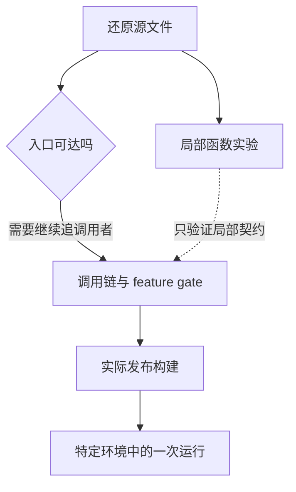

## 本章的问题

如果看到一个叫 query 的导出，你会怎样判断它是否真的执行一次 Agent 任务？这门课从这个问题开始。我们将逐章做出 coda：一个能读文件、精确修改、运行测试、使用 MCP、加载 Skill、委派探索并保存会话的教学 Agent。最后让它修复一个真实的 normalizeSlug 测试。

coda 是我们自己的实现。研究对象固定为 Claude Code 2.1.88 的 sourcemap 还原材料；产品原始分支、教学取舍与 2.1.296 录制会分别说明。课程默认用可控模型回复，文件、进程、MCP 和持久化则实际运行，因此可以在没有 API Key 的环境里反复制造同一个失败。

## 起点会怎样骗过我们

最短的错误推理是“有类型签名，所以这就是执行器”。实验会调用 SDK 类型入口，亲眼看到它抛出 not implemented。另一个错误是“引用 GitHub main，所以证据不会变”：main 的行号可以移动，固定提交和函数锚点才是这次研究的坐标。

## 沿固定源码逐段拆解

@ccsrc bootstrap

### 从 cli.tsx 的提前返回读可达性

main 先切出 argv，再检查版本查询是否是唯一参数。命中后输出编译期版本并 return，后面的动态 import 完全不会发生。随后才加载 startupProfiler；部分其他入口还受 feature 宏控制。因此一份源码里出现某项能力，只能说明存在相应实现，不能说明外部发行包启用了它。

@ccsrc sdk-stub

### 用函数体推翻文件名带来的猜测

agentSdkTypes 的 query 直接抛错。此时应找构建导出和实际 SDK 传输实现，而不是继续围绕这个函数想象主循环。后面第 12 章会在 StructuredIO 和公开 SDK 实现中重新定位执行边界。

@ccsrc query

### 给源码结论建立四级证据

| 层次 | 能证明的结论 | 本课怎样获得 |
| --- | --- | --- |
| 文本来源 | 文件来自固定 map 的 sourcesContent | Git blob 与逐字核对 |
| 可达路径 | 给定入口和 gate 会经过此分支 | 追调用者、参数与提前返回 |
| 局部行为 | 这些输入在原函数上得到这些输出 | 提取函数，明确测试端口 |
| 产品运行 | 某版本、模式、平台完成了任务 | 独立录制或实际集成 |

不要把下一层的结论写在上一层证据旁边。课程的 2.1.296 录制用于比较，不能填补 2.1.88 的运行证据。

## 机制总览



## 接入贯穿项目

@implementation 00-method

### 逐步跟踪本章实现

从读取证据开始，避免把目录名当成版本。实验先核对固定 Git 提交和 source map 的 sourcesContent，再把课程引用逐一映射回原始内容。只有这一步通过，后续执行提取函数才有明确来源；“这段代码恰好在本机能运行”不能替代版本核对。

贯穿实现从 `workspacePath` 与 `Journal` 起步。路径先解析到工作区的物理位置，再检查相对路径是否越界，因此指向外部的符号链接也会被拒绝。Journal 追加的是带序号、前一条哈希和当前哈希的事实；完整坏行会报错，末尾未写完的片段才可以在下一次追加前截掉。

这两个基础件会在后面反复出现：Read/Edit 复用同一条路径边界，Session 复用同一份追加日志。它们采用单进程课程假设；哈希链能检测损坏，不能提供多进程事务锁，也不能证明日志作者身份。先把这个边界讲清楚，再讨论持久化有什么保证。

## 运行本章实验

```bash
node --disable-warning=ExperimentalWarning labs/chapters/00-method.mjs
```

@experiment 00-method

## 逐项解释实验结果

实验先核对全部来源，再运行那个看似合理的 query 入口。最后检查工作区路径边界，为以后所有临时文件实验建立基础。源码版本不符时构建会失败；它不会自动把源码更新到最新版。

从此章起，每次记笔记都写出输入、分支条件、状态 owner、返回结果和一个反例。读完一段代码，应能说出什么输入会让自己的解释失效。

## 继续动手与验收

把 query 的类型签名与函数体分别记录下来，解释为什么它们不矛盾。再为“源码存在但此发行环境不可达”列出两种原因。验收时提供固定 URL、gate 条件和真实失败输出。

::: interview 怎样证明一个导出在发行包中真的可执行？
固定源码文本、受控执行和产品实验分别支持不同结论。先核对提交与 sourcesContent，再从引用范围说明真实分支；教学项目的通过只证明它自己的契约，2.1.296 录制也不能替 2.1.88 的行为作证。
:::

@observation 00-method
