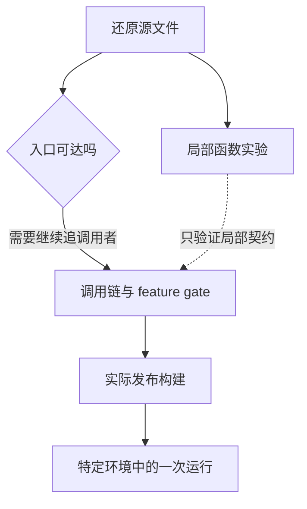

## 研究对象与版本锁

课程主线依据你指定的 ChinaSiro/claude-code-sourcemap。它从公开 npm 包的 source map 还原 TypeScript，版本为 **2.1.88**，固定提交为 `a8a678cb6244e6770e1e421767ff0987a1d95549`。这是一份非官方还原材料；目录、文件存在和某个分支的实际发布状态，需要分别判断。

原课程的 2.1.296 录制保留为各章末尾的独立实验对照。它们能说明该次运行发生了什么，不能反向证明 2.1.88 的所有分支都能执行。官方文档也可能描述更晚的版本，引用时要说明用途。

@ccsrc bootstrap

@ccsrc query

## 每个结论怎样落到源码

每章给出入口函数、状态归属、调用关系、关键分支与失败边界。证据卡链接到固定提交中的文件和行号；构建还会把这些文件与 `cli.js.map` 的 sourcesContent 逐字核对。这样可以发现“版本对了，但读取的文件被改过”一类问题。

构建读取源码用于校验和定位，不把整份还原源码复制进课程仓库。正文用自己的语言解释工程机制，保留原仓库链接、函数名、版本和内容指纹。

## 有代码，不代表功能已经启用

还原文件中存在 `feature(...)`、编译宏、动态 require、内部构建分支和声明占位。静态看到一个函数，只证明这份材料包含它。要证明它可达，需要找到入口和条件；要证明产品实际行为，需要对应版本的运行记录。

例如入口先处理版本查询，再加载其他模块。不能把所有被动态导入的模块都算作启动必经开销；也不能因为 query 支持一个恢复分支，就声称每次失败都一定进入该分支。

## 三种证据并列使用

| 标记 | 证明范围 | 典型证据 |
| --- | --- | --- |
| 源码 2.1.88 | 此提交的结构、顺序和分支 | 固定链接、sourcesContent 一致性 |
| 实验 2.1.296 | 此版本与指定模型的一次运行 | 已保存的代理记录、事件、钩子输入 |
| 开源组件对照 | 被固定组件版本的实现 | Pi、sandbox-runtime、Python SDK |

工程解读不是把所有文件串讲一遍，而是回答：谁拥有状态，什么条件触发变化，失败后谁负责恢复，哪个观察能证伪你的理解。先看工程地图，再沿具体问题深入；实验按需要进行。

## 先拿一个具体任务做切口

本课程贯穿一个例子：项目里有个 `normalizeSlug`，它把连续空格处理错了。用户要求“修复它，运行测试，并解释修改”。任务虽小，却会经过项目指令、读文件、工具权限、编辑、命令执行、事件输出和会话保存。后面每读一个模块，都回到这个任务，问它的输入是什么、改变了什么、失败后留下什么。

在 Pi 课里，你亲手实现这些部件；这里要练另一种能力：面对一个很大的已有产品，能顺着一条因果链读懂它。不要先背目录。先在 `query.ts` 找到循环，在工具执行器找到实际效果，再回到入口确认谁提供配置。理解一个分支以后，才扩大阅读范围。

## 源码、构建与运行之间有三道门

source map 保存的 `sourcesContent` 能说明打包时记录了什么源文件，但不自动证明每个文件都属于当前可执行路径。一些入口用于导出类型，一些分支受构建宏和 feature gate 控制，一些实现只适用于内部环境。



这就是为什么本课要单独指出 SDK 的占位 `query()`：函数名和类型签名都像一个真实入口，函数体却直接抛错。只读文件名便介绍“SDK 内部怎样启动 Agent”，会从第一步就讲错。第 12 章会把这件事做成实验。

## 本地建立一个能追溯的阅读环境

```bash
npm ci
npm run setup:source
npm run lab:source
npm run check
npm run build
npm run serve
```

`setup:source` 准备固定提交；构建会把引用文件与 `.map` 的内容核对。`lab:source` 只执行明确选中的函数，工具目录、feature flag 或 IO 构造器以测试端口传入。没有启动整个 CLI，也没有把端口的返回值称作真实服务结果。命令执行失败时，先排除源码版本不一致，再调查课程自身的问题。

## 做一张自己的阅读记录

| 要记录的事实 | 以工具调度为例 |
| --- | --- |
| 用户可见的症状 | 两次读取为什么可以同时执行 |
| 决策入口 | `partitionToolCalls` |
| 输入和状态 | 调用顺序、已解析参数、工具的并发声明 |
| 不变量 | 不跨过有顺序要求的调用重新分组 |
| 一个反例 | Read、Edit、Read 不能变成两个 Read 先执行 |
| 验证方法 | 第 3 章的源码函数实验 |

“看过代码”很容易停留在注释复述。能提出一个会推翻自己理解的输入，再观察实际结果，才开始接近工程判断。每章练习都围绕这个目标安排。

## 怎样安排学习

第一遍按 1—3 章追完一次请求；第二遍读 4—7 章，把历史、记忆、权限和 Hook 的关系理顺；第三遍读 MCP、Skill、子 Agent 和无界面入口。最后在第 13 章把同一个工具调用从入口一直追到退出。

不要把两个版本的结果拼成一个“Claude Code 就是这样”。本页后半部分与各章的实验对照使用 2.1.296 的录制；源码主线固定在 2.1.88。遇到差异时，保留差异，提出需要在哪个版本复测的问题。

::: interview 从 sourcemap 研究一个产品时，最容易犯什么错误？
把还原目录当作官方内部仓库，把静态存在当作已发布可达，把另一版本的实验当作当前源码的运行证明。应固定提交，核对 sourcesContent，沿入口与功能条件追调用，并清楚区分源码、推断和运行证据。
:::

@observation 00-method
