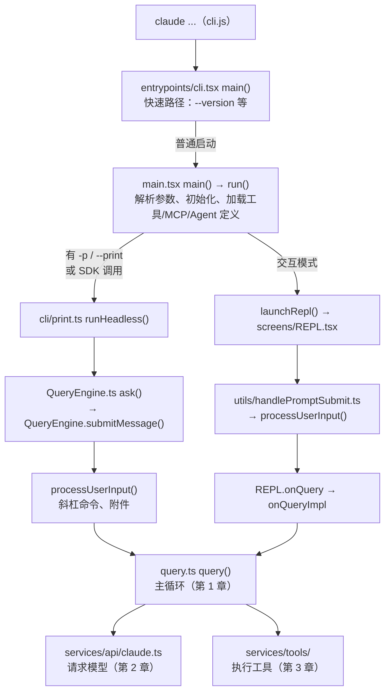

Learn Pi Agent 读的是一个刻意保持小巧的 Agent：Pi 的核心循环一百多行，每个包都可以顺着读完。Claude Code 不一样。它的 npm 包里附带的 source map 能还原出一千九百个 TypeScript 文件、五十多万行代码，包括终端界面、远程会话、语音、插件市场、内部实验功能……从 `main.tsx` 的第一行往下读，读不到一千行就会迷路。

所以这一章不讲任何一个机制，只解决“怎么读”：

1. 这份源码是什么、缺什么——决定哪些结论可以下、哪些不能；
2. 一张目录地图，和一条从 `claude` 命令到主循环的入口线；
3. 读这份源码最重要的一个技巧：**认出开关**。很多代码在你下载的 Claude Code 里根本不存在；
4. 这门课怎样验证结论：固定版本的源码摘录、真实运行的录制，和每章都能跑的实验。

@figure assets/course/ch00-reading.png 五十万行源码像一座档案馆：从入口出发，认出被封住的开关，顺着一次请求走到主循环

## 这份源码从哪来

Claude Code 以 npm 包 `@anthropic-ai/claude-code` 发布。包里的 `cli.js` 是打包、压缩后的单个文件，旁边还有一个 `cli.js.map`——source map，本来是给报错堆栈用的，把压缩后的位置映射回原始文件。source map 有一个可选字段 `sourcesContent`，直接保存了每个原始文件的全文。2.1.88 版本的包带上了这个字段，于是社区仓库 [ChinaSiro/claude-code-sourcemap](https://github.com/ChinaSiro/claude-code-sourcemap) 把它提取出来，按原来的路径写回磁盘，就是本课读的 `restored-src/`。

这件事决定了三条阅读纪律：

- **它是真的源码，但不是完整的仓库。** 没有测试、没有构建脚本、没有提交历史，目录结构也是从 source map 的路径推出来的。想知道“为什么这样写”，只能从代码和注释里找；Claude Code 的源码注释写得相当详细，这一点帮了大忙。
- **它只包含被打进包里的代码。** 构建时被删掉的分支，对应的文件根本不会出现在 source map 里（下面马上会看到）。
- **它固定在一个版本上。** 课程所有摘录都来自提交 `a8a678c`（2.1.88）。构建时 `lab/sourcemap.ts` 会检查本地源码确实在这个提交上，并且课程引用的每个文件和 `sourcesContent` 里的内容逐字一致。

版权方面：这是 Anthropic 的代码，不是开源项目。本仓库只保存文件名、函数名和行号；页面上的代码摘录是构建时从你本地的固定 checkout 读出来的。

先给它做一次体检。下面这个实验直接读 `cli.js.map`，统计还原出了什么：

@lab node labs/chapters/00-method.mjs

几个值得记住的数字：

- 4756 个源文件里，**只有 1902 个是 Claude Code 自己的代码**，其余是打进包里的第三方依赖（React、Ink、zod、MCP SDK……）。
- `src/` 一共五十多万行，**`utils/` 一个目录就占了三分之一以上**。这不是坏味道：Claude Code 的大部分“机制”（权限、Hook、记忆、会话存储、沙箱适配）都住在 `utils/` 下面，按领域分了子目录。
- `components/`、`ink/`、`screens/`、`hooks/`（React hooks，不是 Claude Code 的 Hook 功能）加起来十几万行，是终端界面。这门课几乎不读它们。

## 一张地图

按“这门课会不会读”把目录分一下。左边是 Agent 的核心机制，右边是产品外壳：

<div class="dirmap">
<section><h4>入口</h4><ul><li><code>entrypoints/cli.tsx</code> 启动快速路径</li><li><code>main.tsx</code> 参数与模式分岔</li><li><code>cli/print.ts</code> 无界面 <code>-p</code></li><li><code>screens/REPL.tsx</code> 交互界面</li></ul><p class="dirmap-ch">第 0、12 章</p></section>
<section><h4>主循环</h4><ul><li><code>QueryEngine.ts</code> 一次提交</li><li><code>query.ts</code> 循环本体</li><li><code>query/</code> 停止钩子、预算</li></ul><p class="dirmap-ch">第 1 章</p></section>
<section><h4>请求与模型</h4><ul><li><code>constants/prompts.ts</code> 系统提示</li><li><code>context.ts</code> 用户/系统上下文</li><li><code>services/api/claude.ts</code> 调用 API</li></ul><p class="dirmap-ch">第 2 章</p></section>
<section><h4>工具</h4><ul><li><code>Tool.ts</code>、<code>tools.ts</code> 接口与清单</li><li><code>tools/</code> 四十个工具</li><li><code>services/tools/</code> 编排与执行</li></ul><p class="dirmap-ch">第 3 章</p></section>
<section><h4>上下文与会话</h4><ul><li><code>utils/claudemd.ts</code> 记忆文件</li><li><code>utils/attachments.ts</code> 附件</li><li><code>utils/sessionStorage.ts</code> 会话</li><li><code>services/compact/</code> 压缩</li></ul><p class="dirmap-ch">第 4、5 章</p></section>
<section><h4>控制</h4><ul><li><code>utils/permissions/</code> 权限</li><li><code>utils/hooks.ts</code> Hook</li><li><code>utils/sandbox/</code> 沙箱</li></ul><p class="dirmap-ch">第 6、7、11 章</p></section>
<section><h4>扩展</h4><ul><li><code>services/mcp/</code> MCP</li><li><code>skills/</code>、<code>tools/SkillTool/</code></li><li><code>tools/AgentTool/</code> 子 Agent</li></ul><p class="dirmap-ch">第 8、9、10 章</p></section>
<section class="dim"><h4>产品外壳（本课不读）</h4><ul><li><code>components/</code>、<code>ink/</code>、<code>hooks/</code> 终端界面</li><li><code>bridge/</code>、<code>remote/</code> 远程会话</li><li><code>voice/</code>、<code>buddy/</code>、<code>vim/</code> ……</li></ul></section>
</div>

章节顺序就是沿这张图从上往下走：第 1 章读主循环，第 2 章读请求，第 3 章读工具，第 4、5 章读上下文和会话，第 6～9 章读权限、Hook、MCP、Skill，第 10～12 章读子 Agent、沙箱和无界面模式，第 13 章把它们放在一起，和 Pi、mox 做一次总对照。

## 入口：从 `claude` 命令到主循环

在终端里敲 `claude`，执行的是 `cli.js`，它最先跑的是 `entrypoints/cli.tsx` 里的 `main()`：

@cc entrypoints/cli.tsx#L28-L48 hl=34-42

文件顶部的注释说明了这个文件存在的理由：**在加载完整 CLI 之前，先检查几个特殊参数**。`claude --version` 是最极端的例子：参数只有一个 `--version` 时，直接打印版本号返回，连一个模块都不加载。版本号 `MACRO.VERSION` 是构建时直接写进代码的常量。

为什么要这样抠启动速度？因为 `main.tsx` 一被导入，就会连带导入几百个模块（界面、工具、服务……），光是模块求值就要几百毫秒。脚本和编辑器插件经常调用 `claude --version` 检查环境，没理由让它们为整个应用的加载买单。所以 `cli.tsx` 里**所有其他导入都是动态的** `await import(...)`：走到哪条路，才加载哪条路需要的模块。`profileCheckpoint('cli_entry')` 则是启动性能打点，后面每条快速路径都会打一个自己的点——这个细节下面会派上用场。

`cli.tsx` 里还有十来条这样的快速路径：Chrome 扩展的原生宿主、MCP 服务器模式、远程控制……都不是本课关心的。它们全部检查完，才轮到正常路径：

@cc entrypoints/cli.tsx#L286-L302 hl=287-297

`startCapturingEarlyInput()` 也是一个体验细节：`main.tsx` 加载需要时间，这段时间里用户可能已经开始打字了，先把键盘输入缓存下来，界面起来后再交给输入框。然后动态导入 `main.tsx`，调用它的 `main()`。

`main.tsx` 有四千六百多行，大部分是命令行参数的定义和各种初始化。我们只关心一个分岔：**有没有 `-p`（`--print`）**。



两条路的终点是同一个函数。无界面模式下，`print.ts` 通过 `QueryEngine` 驱动：

@cc QueryEngine.ts#L675-L686

交互模式下，`REPL.tsx` 自己组装好参数，直接调用：

@cc screens/REPL.tsx#L2793-L2803

对照两段代码：传给 `query()` 的东西几乎一样——消息、系统提示、用户上下文、系统上下文、`canUseTool`（权限判断的回调，第 6 章）、`toolUseContext`（工具运行需要的一切：工具列表、中止信号、文件读取缓存……）。区别在外面：REPL 把 `query()` 产出的事件交给 React 状态去渲染，`QueryEngine` 把它们转换成 SDK 消息、写进会话、处理 `maxTurns` 和预算。

这就是 Learn Pi Agent 第 0 章讲过的分层在 Claude Code 里的样子：**循环只有一个，界面有好几个**。Pi 的交互模式、print 模式、RPC 模式共用一个 `AgentSession`；Claude Code 的终端界面、`-p`、Agent SDK 共用一个 `query()`。所以这门课从第 1 章起就直接读 `query()`，界面那一层到第 12 章讲无界面运行时才回来看。

## 读源码的第一技巧：认出开关

回到 `cli.tsx`。下面这段是 `claude daemon` 子命令的入口：

@cc entrypoints/cli.tsx#L164-L180 hl=165

它导入了 `../daemon/main.js`。可是你在 `restored-src/src/` 下面找不到 `daemon/` 目录——上面的实验也确认了，source map 里没有 `daemon/main.ts`。

原因在第 165 行的 `feature('DAEMON')`。`feature` 来自文件第一行的 `import { feature } from 'bun:bundle'`：Claude Code 用 Bun 打包，`feature('X')` 是**构建时求值**的开关。打包对外发布的版本时，`DAEMON` 被判为假，`if (false && ...)` 整段代码被当作死代码删掉，它动态导入的 `daemon/main.js` 也就不会被打进包里——source map 里自然没有它。

源码注释里把这个叫作 DCE（dead code elimination，死代码消除）。上面的实验统计了：一百九十多个文件用到了 `feature()`，一共八十九个不同的开关。每条快速路径都会调用 `profileCheckpoint('名字')`，这个名字是一个字符串常量，只要这段代码留在包里，字符串就一定在 `cli.js` 里。所以检查名字在不在 `cli.js` 里，就能判断这条路径有没有被编译掉。实验的结果是：`DAEMON`、`BG_SESSIONS`、`TEMPLATES` 等路径被删掉了；`BRIDGE_MODE`（远程控制）、`CHICAGO_MCP`（computer use）的路径留在了 2.1.88 的发布包里。

`feature()` 只是三种开关之一。读到一段代码，先问“它在我用的 Claude Code 里会运行吗”，按下面三种情况判断：

| 开关 | 长什么样 | 什么时候决定 | 怎么判断 |
| --- | --- | --- | --- |
| 编译期开关 | `feature('KAIROS')` | 打包时 | 被关掉的代码连同它导入的模块都不在包里；用实验里的方法检查字符串是否在 `cli.js` 里 |
| 内部版本 | `process.env.USER_TYPE === 'ant'`，或已经被替换成常量的 `"external" === 'ant'` | 打包时 | 对外版本里 `USER_TYPE` 是 `external`，这些分支永远为假（“ant”指 Anthropic 员工） |
| 远程配置 | `getFeatureValue_CACHED_MAY_BE_STALE('tengu_...')` 等 GrowthBook 调用 | 运行时 | 代码在包里，是否启用由服务端下发、可能按用户灰度；只看源码判断不了 |

`tools.ts` 的开头集中体现了前两种：

@cc tools.ts#L14-L40

`REPLTool` 只给内部用户，`SleepTool` 跟着 `PROACTIVE` / `KAIROS` 走，定时任务工具跟着 `AGENT_TRIGGERS` 走。顺手验证一下：`tools/MonitorTool/` 目录不存在（编译掉了）；`tools/REPLTool/` 目录在，但里面只有 `constants.ts` 和 `primitiveTools.ts`，没有 `REPLTool.ts` 本身——别的模块用到了它的常量，所以常量文件留了下来，工具本身被删掉了。

::: warn 别被“目录存在”骗了
判断一个功能在不在发布版里，不能看目录或类型定义还在不在，要看它的**入口**有没有被开关包着。最常见的误读是：在源码里找到一个工具或命令的实现，就以为自己的 Claude Code 里有它。
:::

## 读源码的第二技巧：跟着一次请求走

五十万行代码，按目录读一定会迷路。这门课的办法是**挑一个具体的行为，从入口一路追到它发生的地方**，只读路上经过的代码。追的时候有几个好用的抓手：

- **事件和日志的名字**是最好的路标。`logEvent('tengu_...')`、`profileCheckpoint('...')`、Hook 事件名（`PreToolUse`）、错误信息里的固定字符串，在全仓库里 grep 一下，通常能直接落到你要找的分支。
- **注释里的“为什么”**。Claude Code 的注释经常写明某行代码是为了修哪个问题（“Bugfix for corepack auto-pinning”），这是没有提交历史时最接近设计文档的东西。
- **类型定义告诉你状态在哪里**。`Tool.ts` 里的 `ToolUseContext`、`query.ts` 里的 `State`，列出了一个机制读写的全部状态；先读类型，再读用法。
- **先找主干，再看分支**。`query.ts` 里有大量 `if (feature(...))`，第一遍读时把被开关包着、或者明显是边缘情况的分支折叠起来。

每一章都会先画出这样一条调用链，再一站一站地读。

## 用实验验证结论

只读源码有两个风险：读错了自己不知道；读的是 2.1.88，而你手上的 Claude Code 可能已经更新。所以每章的结论还有两种证据：

**真实运行的录制。** 这门课早期用一套实验台录制了真实 Claude Code（2.1.296）运行的全过程：`CLAUDE_CONFIG_DIR` 指向临时目录，不读也不写你自己的配置；`ANTHROPIC_BASE_URL` 指向本机的一个记录代理，截下每一个发给模型的请求；每个 Hook 事件都挂上记录器；`--output-format stream-json` 的每个事件和会话文件都保存下来。

@code lab/cc.ts#runClaude collapse=true

录制保存在 `labs/chNN/recorded/`，分析脚本离线读取它们，构建网页时真正运行。录制的版本（2.1.296）比源码（2.1.88）新：两者一致的地方，录制是源码结论的旁证；不一致的地方，正好说明这个机制后来改过，章节里会明确指出。录制里模型的选择（先读哪个文件、调用几次工具）只是一次运行的例子，驾驭层的行为（请求的结构、Hook 的输入、会话文件的格式）才是要研究的对象。想在新版本上重录，设置 `LCC_BASE_URL`、`LCC_API_KEY`、`LCC_MODEL` 后运行对应的 `labs/chNN/record.ts`。

**直接运行源码里的函数。** 有些函数足够独立（比如第 3 章的 `partitionToolCalls`），`labs/engineering/run.mjs` 会在运行时从固定提交里把这一个函数取出来，配上必要的假依赖直接执行，用真实代码回答“给这个输入，它会怎么分组”。代码不复制进本仓库。

## 贯穿全课的项目：coda

Learn Pi Agent 一边读 Pi，一边从零写 mox。这门课也有一个贯穿项目 **coda**（`coda/src/`）：一个用纯 JavaScript 写成、零依赖的小型 coding agent，每一章把这一章读懂的 Claude Code 机制，用最小的代码在 coda 里实现一遍。

| 章 | coda 模块 | 对应 Claude Code |
| --- | --- | --- |
| 1 | `engine.mjs` 主循环 | `query.ts` |
| 2 | `request.mjs` 请求构造 | `constants/prompts.ts`、`services/api/claude.ts` |
| 3 | `tools.mjs`、`files.mjs` 工具编排与文件工具 | `services/tools/`、`tools/File*Tool` |
| 4 | `memory.mjs` 项目记忆 | `utils/claudemd.ts` |
| 5 | `session.mjs`、`compact.mjs` 会话与压缩 | `utils/sessionStorage.ts`、`services/compact/` |
| 6 | `permissions.mjs` 权限 | `utils/permissions/` |
| 7 | `hooks.mjs` Hook | `utils/hooks.ts` |
| 8 | `mcp.mjs` MCP 客户端 | `services/mcp/client.ts` |
| 9 | `skills.mjs` Skill | `skills/`、`tools/SkillTool/` |
| 10 | `subagents.mjs` 子 Agent | `tools/AgentTool/` |
| 11 | `runtime/sandbox.mjs` 沙箱 | `utils/sandbox/` + sandbox-runtime |
| 12 | `io.mjs` 无界面协议 | `cli/print.ts`、`cli/structuredIO.ts` |
| 13 | `app.mjs` 总装 | `main.tsx` 的装配部分 |

coda 刻意比 mox 更“像 Claude Code”：模块的划分、函数的名字、处理失败的顺序都尽量和对应的源码一致，读完一章的源码再看 coda，能一一对上；同时它足够小，每个模块一两百行以内。所有工具访问文件都要经过 `runtime/files.mjs` 的 `workspacePath`：拒绝 `..` 越界，也拒绝借符号链接跳出工作区——这是 coda 唯一一处“先于任何一章”就存在的安全底线：

@code runtime/files.mjs#workspacePath

每章的实验都能单独运行，不需要 API Key，不读你的个人配置：

```bash
npm ci
npm run setup:source     # 准备固定版本的还原源码（../claude-code-sourcemap-source）
npm run setup:study      # 准备对照用的 Pi、learn-pi-agent 和两个开源组件
npm run lesson -- 0      # 运行本章的实验
npm run build && npm run serve
```

## 你来改

::: predict 找一个被编译掉的工具
`tools.ts` 里 `MonitorTool` 由 `feature('MONITOR_TOOL')` 控制。不看实验，你能用什么办法判断 2.1.88 的发布包里有没有这个工具？
???
最直接的两个办法：一是看 `restored-src/src/tools/MonitorTool/` 存不存在——不存在，说明它的文件没有进 source map，入口被编译掉了；二是在 `package/cli.js` 里搜这个工具独有的字符串（例如它注册的工具名）。两者都说明发布版里没有 MonitorTool。反过来，目录存在并不能证明工具可用（`REPLTool` 就是反例），还要确认入口没有被开关包着。
:::

::: predict 加一条检查
在 `labs/chapters/00-method.mjs` 里，把 `cli.tsx` 换成 `main.tsx`，统计 `main.tsx` 里 `profileCheckpoint` 的名字有多少出现在 `cli.js` 里。你预计比例会比 `cli.tsx` 高还是低？为什么？
???
会更高。`main.tsx` 的大多数打点在正常启动路径上，不被 `feature()` 包着；`cli.tsx` 是专门放“特殊模式快速路径”的地方，其中相当一部分是内部或实验功能，被编译掉的比例自然高。这也说明：越靠近主干的代码，越可能真的在运行。
:::

## 面试题

::: interview 你会怎样开始阅读一个几十万行的陌生代码库？
先确定边界：源码的来源、版本、完整程度（有没有测试和构建配置），决定哪些结论能下。然后找入口（命令行入口、主函数），沿一个具体行为的调用链读，只读路上经过的代码；用日志/事件名/错误字符串做路标在全库搜索；先读状态的类型定义再读用法；第一遍折叠边缘分支。最后用实验验证读出来的结论——跑单个函数、录制真实运行、或者写一个最小复现。
:::

::: interview Claude Code 的交互模式和 `-p` 模式是两套实现吗？
不是。`main.tsx` 在解析完参数后分岔：`-p` 走 `cli/print.ts` 的 `runHeadless`，经过 `QueryEngine` 调用 `query()`；交互模式启动 Ink 界面，`REPL.tsx` 在用户提交后也调用 `query()`。主循环只有一个，两边的区别在外层：界面把事件渲染出来，`QueryEngine` 把事件转换成 SDK 消息、负责会话记录和轮数/预算限制。这和 Pi 的多种运行模式共用 `AgentSession` 是同一种分层。
:::

::: interview 什么是 feature flag 的死代码消除？它对阅读源码有什么影响？
打包工具在构建时对 `feature('X')` 求值，值为假时整个分支连同它动态导入的模块一起删掉。好处是对外版本不包含内部和实验功能，包更小、攻击面更小。对阅读的影响：源码里看到的功能不一定存在于你用的版本；判断时要看入口是否被开关包着，可以检查模块是否出现在 source map 里、或者独有字符串是否在打包产物里。还要和运行时开关（远程配置、灰度）区分，后者代码在包里，但是否启用取决于服务端。
:::

::: interview 为什么 CLI 的入口文件要把导入全部写成动态导入？
为了启动速度。静态导入会在启动时求值整个依赖图，一个大型 CLI 可能要几百毫秒；`--version`、MCP 服务器模式这类简单路径不应该为完整应用的加载付费。入口文件先检查参数，走到哪条路才 `await import` 哪条路需要的模块；还可以在等待主模块加载时先缓存用户的键盘输入，避免丢字。
:::
