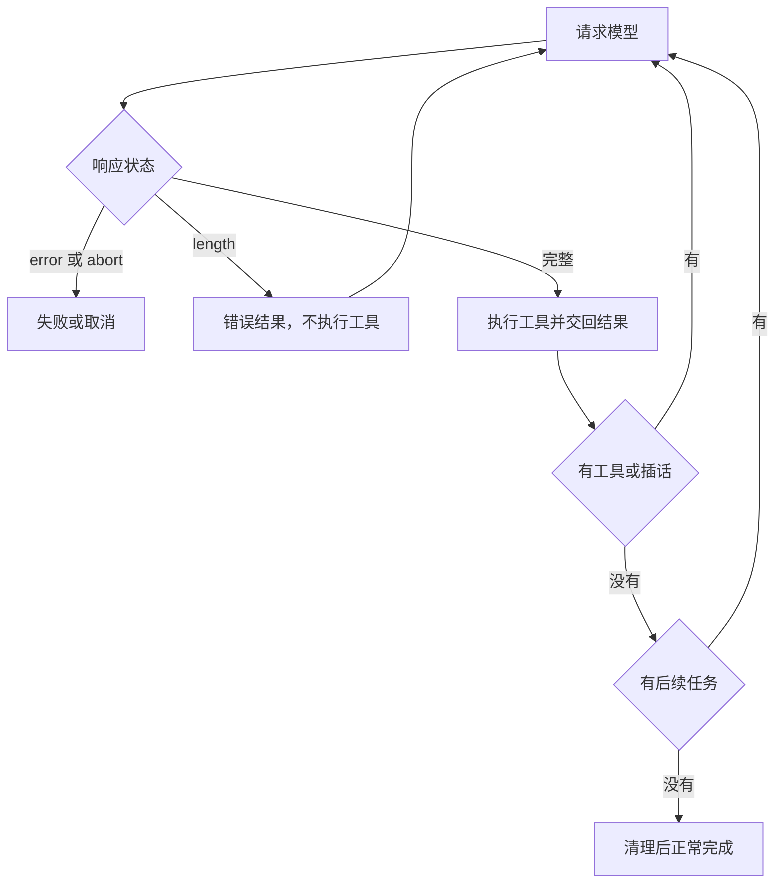

## 本章的问题

用户要求把结果写进文件。模型的输出额度耗尽，产生的 JSON 恰好仍可解析，内容却只有 HALF。只检查“有没有工具调用”的循环会把半成品写入磁盘。这不是解析器异常，而是对停止语义的误判。

我们先用一个故意忽略 stop 的基线写出 HALF，再把同一段回复交给 coda。正确实现把每个截断调用变成错误结果，请模型重新给完整计划；文件最终只能出现 COMPLETE。接着分别制造 Provider 抛错、轮数耗尽和调用者提前关闭生成器。

一次用户任务可能经历多个模型迭代。Engine.running 属于当前任务，iteration 属于模型往返，tool id 属于一次工具意图。不要用同一个 turn 词遮住这三个身份。

## 沿固定源码逐段拆解

@ccsrc query

### 外层 query：yield* 的三种完成方式

consumedCommandUuids 在外层创建并传给 queryLoop。只有 yield* 正常返回，后面的 completed 通知才执行；内部 throw 会传播，外部调用 .return() 会关闭委托链。把通知挪进 finally 会把失败与提前关闭都误记为完成。finally 适合释放资源，业务完成需要保留自己的条件。

@ccsrc query-state

### queryLoop：稳定参数与跨迭代 State

systemPrompt、canUseTool、querySource 等先从 params 取出；messages、toolUseContext、压缩追踪、输出恢复次数、turnCount 和 transition 放进 State。每次 continue 以新的 State 表达转换，阅读时应逐个检查哪些字段保留、哪些清零、哪个计数递增。

buildQueryConfig 在入口抓取一份配置；内存预取只按用户任务启动一次，而 Skill 发现可以按迭代推进。两者说明“在循环外做一次”与“每次迭代做一次”具有可测的成本和一致性差别。using 还把预取资源释放关联到生成器退出路径。

### 把五条出口画在同一张图上



coda 把这些契约缩成一个可读循环；它没有复刻产品里的全部恢复策略、Stop Hook 和内部功能开关。对应源码里每条恢复边，仍应按真实 State 更新解释。

## 接入贯穿项目

@implementation 01-one-run

### 逐步跟踪本章实现

跟踪一次 `run`：入口先拒绝已有任务占用，再复制 history 并追加本次 user。`messages` 是模型往返的工作状态，`running` 是整个用户任务的占用状态；工具调用多轮不会把占用提前释放。每次请求都拿消息副本，避免 Provider 端口修改宿主数组。

收到 reply 后，先将 assistant 及 calls 记入消息，再检查 `stop === "length"`。截断回复中的每个调用都生成对应 id 的错误结果，但不进入 Toolset；这既守住副作用边界，也让下一次请求知道哪些意图没有执行。完整回复才执行工具，把结果追加后继续。

收尾处的 `cleaned` 保护清理只运行一次。正常完成先 cleanup 再 onCompleted，调用者提前关闭则只走 finally；Provider 或 cleanup 抛错由失败路径归因。`steering.splice(0)` 在当前迭代边界交付插话，followups 则等当前模型工作完成后接续，两个队列的交付时机不同。

## 运行本章实验

```bash
node --disable-warning=ExperimentalWarning labs/chapters/01-one-run.mjs
```

@experiment 01-one-run

## 逐项解释实验结果

先比较磁盘上的 HALF 与 COMPLETE，再看事件轨迹。注意 response length 后没有 tool_start；下一次完整调用才产生副作用。正常任务有一次 completed；提前 .return() 清理了资源，却没有多出业务完成。

故意把 length 分支删除，测试应在“文件最终只能由完整计划写入”的断言处失败。把 completed 移进 finally，提前关闭测试应失败。这两种修改都能把设计理由变成可反驳的事实。

## 继续动手与验收

增加 maxTurns=1 的持续工具回复，断言得到 budget。再在工具等待期间调用 steer 和 follow，记录下一次请求中两条消息分别出现的位置，解释为什么它们需要不同队列。

::: interview 生成器三种退出应发出相同的业务完成通知吗？
正常耗尽、内部抛错和调用者提前关闭有不同语义。业务 completed 只在正常路径发生；资源清理必须覆盖三种出口，并且只执行一次。本章用提前 .return() 和清理计数，检验通知没有被错误放进 finally。
:::

@observation 01-one-run
