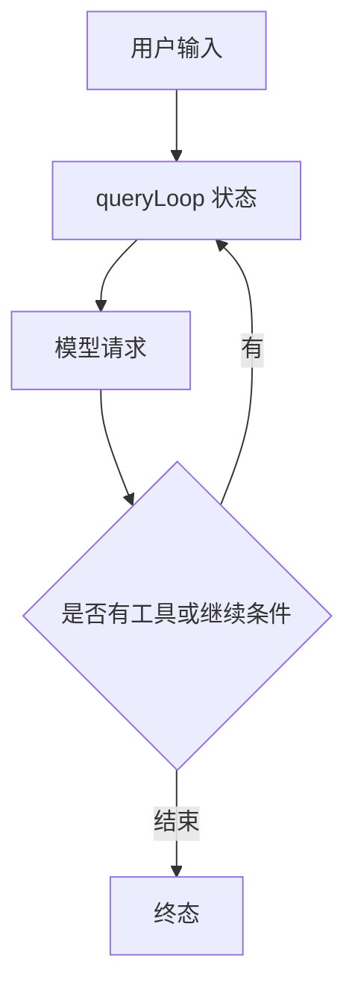

## 从启动器进入主循环

先看 `entrypoints/cli.tsx`，而不是从最大的文件开始读。它让版本查询走快速路径，其他路径再动态加载。接着到 `main.tsx` 看参数和交互/print 分流；再沿 `cli/print.ts` 或交互控制器进入查询层。

@ccsrc bootstrap

@ccsrc query

外层 `query` 是 async generator，委托 `queryLoop` 产生流事件和消息。正常返回后，才把本次消费的命令标记为 completed；异常或生成器被提前关闭，不会走这个正常完成分支。这使“已开始但没有完成”成为可以观察的状态，而不是把所有退出都包装成成功。

## 一轮模型请求不等于一个用户任务

@ccsrc query-state

`queryLoop` 把 systemPrompt、权限函数、querySource 等稳定参数与跨迭代 State 分开。State 包含 messages、toolUseContext、压缩追踪、输出上限恢复次数、turnCount 和继续原因等。一次用户任务可能经历多次模型请求与多次工具执行。

阅读 while 循环时，应标记每个 continue 与 return：工具调用之后继续、预算或压缩恢复之后继续，与没有下一步工作时结束，语义并不相同。源码中把继续原因显式记录，方便测试恢复路径，而不是从最终文字猜发生了什么。

## 输出与持久记录是两个消费者

模型事件可能在文本尚未完成时就向 UI 或 SDK 流出；正式 Message 还要被归一化并写入转录。UI 显示了一行文字、客户端收到了 event、磁盘提交了一条记录，分别属于不同边界。

跟踪一个 bug 时，选择稳定关联字段：用户请求身份、assistant message、tool_use id，以及父子会话关系。不要用“终端看起来停了”替代对生成器、工具和持久层的检查。

## 读源码时应得到的状态图

这张图是阅读主干，不枚举所有 feature 分支。每条恢复边都应回到源码确认触发条件。下方 2.1.296 的 stream-json 实验用于练习观察事件，不能据此省略旧版本源码的分支判断。

## 把修复任务拆成三次不同的“完成”

假设模型先请求读取 `slug.ts`，接着编辑，再运行测试。用户只提交了一次任务，模型却至少要在工具结果返回后再次推理。`turnCount` 是循环内部的计数，不能看到一个“turn”字段便把它等同于终端里的一条用户输入。

这里最容易混淆三个时刻：模型输出结束、`queryLoop` 返回 terminal、上层完成持久化与界面结算。模型返回了 stop reason 只说明这次采样停止；若有工具调用，循环仍有工作。反过来，UI 收到了文字也不说明转录已落盘。排查“明明回答了却没有保存”时，这三个时刻要分别打点。

## 精读 State：每个字段都对应一条恢复路径

读 `State` 时，可以把字段分成三组。`messages` 和 `toolUseContext` 承载下一轮工作的材料；`autoCompactTracking` 与 `hasAttemptedReactiveCompact` 防止压缩恢复失控；`maxOutputTokensRecoveryCount`、`turnCount` 和 `transition` 记录循环为什么继续。稳定参数和可变状态分开，使每个 continue 的更新成为一个可以检查的整体。

做一个很具体的阅读动作：搜索 `state =`，为每次赋值记下“旧 messages 是否保留”“是否递增轮数”“恢复次数是否改变”。只搜索 `while` 的位置，看不到这个状态机。一个修复若漏带某个字段，主路径可能仍然工作，只有恢复分支才会出现问题。

## 预测：取消是否也应该发 completed

正常返回、内部抛错、调用者提前关闭生成器，都会结束迭代。它们应该留下相同的业务完成记录吗？先按自己的理解填三行表，再运行：

@lab node --disable-warning=ExperimentalWarning labs/engineering/run.mjs lifecycle

这里执行的是还原源码中的外层 `query`。内部 `queryLoop` 被一个可控生成器替代，分别制造三种退出；记录器也是测试端口。结果证明正常退出才通知 completed，而生成器内部的 finally 在三种退出中都会清理。**释放资源与宣告工作成功，是两份不同的契约。**

这也解释一个常见错误：把 completed 通知挪进 finally，看似修复了“有开始没有结束”的记录，实际会把失败和取消误报成完成。需要完整生命周期时，应增加明确的 failed/cancelled 状态，而不是改变 completed 的含义。

## 跟着一个工具调用做阅读练习

在源码中标出四个位置：assistant 消息进入循环、tool_use 被交给执行器、tool_result 回到 messages、下一次模型请求开始。为同一个调用保留 tool_use id；若只根据“第几条消息”关联，插入 Hook 或附件后编号就会改变。

再做一次失败注入：让教学生成器在第一次 yield 后抛错。验收条件是错误传播、清理完成、completed 没有被发出。把这三条断言写出来，比在终端截一张“出错了”的图更有用。

::: interview 为什么 Agent 的主循环适合用 async generator 表达？
它能逐步产出事件和消息，又能在最后返回明确终态；调用者可以渲染进度、传递取消并管理背压。但生成器正常完成、抛错与提前 return 的清理语义不同，必须检查这些退出路径，而不能只关注最终 yield 的文字。
:::

@observation 01-one-run
