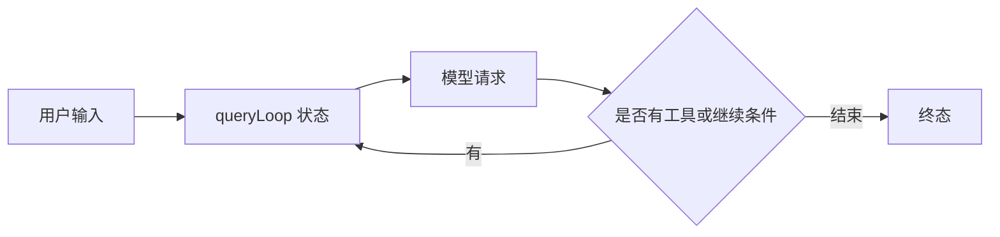

## 从启动器进入主循环

先看 `entrypoints/cli.tsx`，而不是从最大的文件开始读。它让版本查询走快速路径，其他路径再动态加载。接着到 `main.tsx` 看参数和交互/print 分流；再沿 `cli/print.ts` 或交互控制器进入查询层。

@ccsrc bootstrap

@ccsrc query

外层 `query` 是 async generator，委托 `queryLoop` 产生流事件和消息。正常返回后，才把本次消费的命令标记为 completed；异常或生成器被提前关闭，不会走这个正常完成分支。这使“已开始但没有完成”成为可以观察的状态，而不是把所有退出都包装成成功。

## 一轮模型请求不等于一个用户任务

@ccsrc query-state

`queryLoop` 把 systemPrompt、权限函数、querySource 等稳定参数与跨迭代 State 分开。State 包含 messages、toolUseContext、压缩追踪、输出上限恢复次数、turnCount 和继续原因等。一次用户任务可能经历多次模型请求与多次工具执行。

阅读 while 循环时，应标记每个 continue 与 return：工具调用之后继续、预算或压缩恢复之后继续，与没有下一步工作时结束，语义并不相同。源码中把继续原因显式记录，方便测试恢复路径，而不是从最终文字猜发生了什么。

## 输出与持久记录是两个消费者

模型事件可能在文本尚未完成时就向 UI 或 SDK 流出；正式 Message 还要被归一化并写入转录。UI 显示了一行文字、客户端收到了 event、磁盘提交了一条记录，分别属于不同边界。

跟踪一个 bug 时，选择稳定关联字段：用户请求身份、assistant message、tool_use id，以及父子会话关系。不要用“终端看起来停了”替代对生成器、工具和持久层的检查。

## 读源码时应得到的状态图

这张图是阅读主干，不枚举所有 feature 分支。每条恢复边都应回到源码确认触发条件。下方 2.1.296 的 stream-json 实验用于练习观察事件，不能据此省略旧版本源码的分支判断。

::: interview 为什么 Agent 的主循环适合用 async generator 表达？
它能逐步产出事件和消息，又能在最后返回明确终态；调用者可以渲染进度、传递取消并管理背压。但生成器正常完成、抛错与提前 return 的清理语义不同，必须检查这些退出路径，而不能只关注最终 yield 的文字。
:::

@observation 01-one-run
