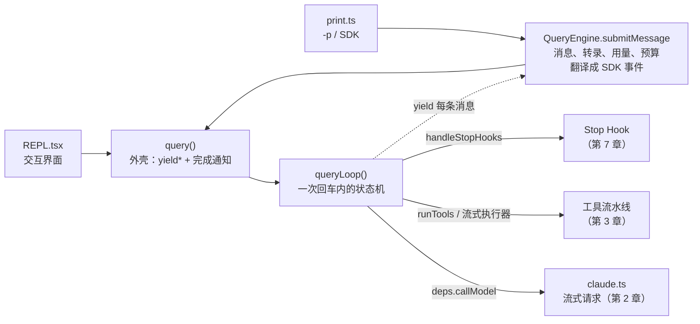
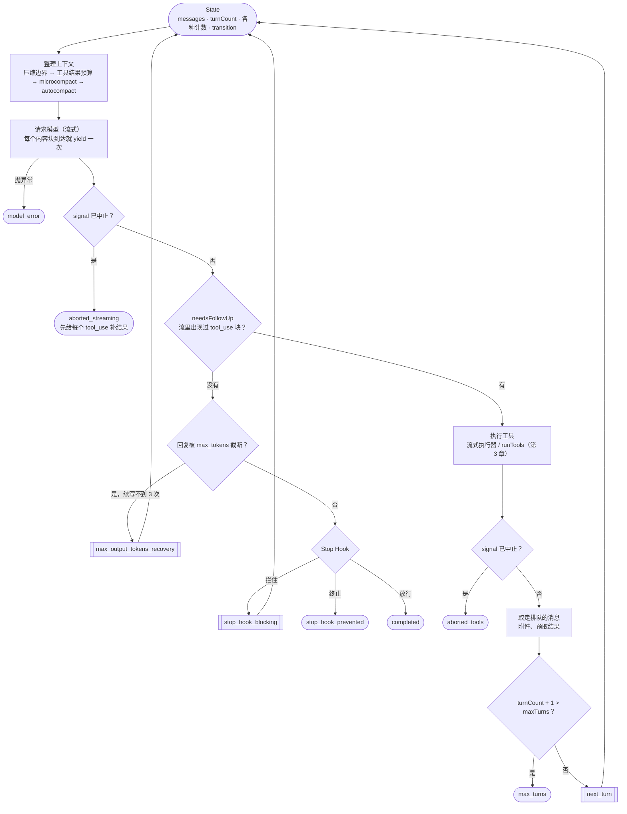

在终端里敲下回车，到屏幕上出现最后一句话，模型被请求了几次？拿一次真实的运行来数：修一个把 `a + b` 写成 `a - b` 的 bug，Claude Code 请求了 5 次模型，执行了 6 个工具调用。可同一次运行的 `result` 事件写着 `num_turns: 7`。

这个对不上的数字是读主循环的好入口。它背后有两个同名的计数器、两层生成器，和一个叫 `queryLoop` 的函数：一个带显式 `State` 的异步生成器，有 7 个位置会重新开始一圈，有 10 种方式退出。Learn Pi Agent 第 3 章里，循环的停止权交给宿主；Claude Code 把更多决定留在了循环里。这一章顺着 `query.ts` 一站一站读：状态、一圈里的步骤、输出被截断时的恢复（和 Pi 的做法正面对照）、Stop Hook、中止、运行中排队的消息，最后在 coda 里写出同样的结构。

@figure assets/course/ch01-loop.png 每一圈结束时，State 决定再来一圈、续写、交给 Stop Hook，还是驶向出口

## 先看现象：一次回车，五次请求，result 却说 7 轮

任务很小：`add.js` 里的 `add` 把加号写成了减号，请 Claude Code 修好，并运行 `node test.js` 确认。用 `claude -p --output-format stream-json --verbose` 跑一次，把每个事件录下来（录制来自 Claude Code 2.1.296，本章读的源码是 2.1.88；拿录制印证源码的地方，都是两个版本行为一致的部分）：

@lab node labs/ch01/events.ts

三个值得留意的地方：

- 第 4、5、6、8 行是**同一次**模型回复（它们的 `message.id` 相同）：一个内容块一个 `assistant` 事件，一段文字加三个工具调用就是四行。
- 第 7 行是 `Read add.js` 的结果，它排在第 8 行（同一次回复的第四个块）**前面**：模型还在输出，第一个工具已经跑完了。
- 最后一行 `result` 写着 7 轮。

把事件按回复分组，再和代理截到的请求对上：

@lab node labs/ch01/iterations.ts | md

模型请求 5 次（每次都带着此前全部历史，所以消息条数一路增加），工具结果 6 条，`num_turns` 是 `1 + 6`。它不是请求次数。看 `QueryEngine` 怎么消费 `query()` 吐出的消息：

@cc QueryEngine.ts#L716-L755 hl=716,718-726,753-755

- 第 716 行：每条 assistant / user 消息都进 `messages`，并写入会话文件。
- 718～726 行的注释解释了“一个块一个事件”：`claude.ts` 在每个内容块结束时就 yield 一条 assistant 消息，等 `message_delta` 到达，才回头把用量和 `stop_reason` 补写到最后一条上。所以写盘不能等待，否则 `message_delta` 永远排在所有块之后。会话文件也按这个粒度，一个内容块一条记录（第 5 章读它）。
- 753～755 行：`turnCount` 从 1 起，**每收到一条 `user` 类型的消息加 1**。工具结果在 Anthropic 的消息格式里就是 user 消息，6 个工具结果加 6。

所以 `result.num_turns` 数的是“出现了几条 user 消息”。`query.ts` 里另有一个同名的 `turnCount`：每次 `next_turn` 加 1，续写和 Stop Hook 重试不算，`maxTurns` 比较的是它。**一个产品里两个 turn**，读源码和 SDK 文档时先问：说的是哪一个。本章把 `queryLoop` 里 `while` 的一次迭代叫“一圈”（对应一次模型请求），把 `turnCount` 数的叫“一轮”。录制里的 `result` 还多了一个 `terminal_reason: "completed"`，它就是下面 `queryLoop` 的返回值。

## 三个函数，各管一层

第 0 章看过两条入口：交互模式的 `REPL.tsx` 直接调用 `query()`，`-p` 和 SDK 经过 `QueryEngine`。从这里往下，循环只有一个：

`QueryEngine` 是对话级对象，跨回车存活，负责把内部消息变成会话文件和 SDK 事件、累计用量、检查费用预算。`query()` 和 `queryLoop()` 只管一次回车：

@cc query.ts#L201-L239 hl=204-216,229-238 collapse=false

`State` 是 `queryLoop` 在两圈之间唯一带着走的东西，下一节细看。外壳 `query()` 做的事很少：在外面建一个 `consumedCommandUuids` 数组交给 `queryLoop` 去填（循环里每消费一条排队的命令就记一个 uuid），用 `yield*` 把所有输出原样转出，**只有 `queryLoop` 正常返回之后**才对这些命令发 `completed` 通知。注释写得直白：`queryLoop` 抛错，异常穿过 `yield*`；调用者提前 `.return()`，两层生成器一起关闭——两种情况都走不到通知，留下“开始了、没完成”的不对称信号。

下面运行的是固定提交里真正的 `query`（里面的 `queryLoop` 换成一个只 yield 一次的假生成器）：

@lab node --disable-warning=ExperimentalWarning labs/ch01/lifecycle.mjs | md

三种结束方式里，清理都执行了，业务通知只有正常返回才有。把通知挪进 `finally`，失败和提前关闭就会被误记成完成。coda 的 `run()` 保留了同样的外壳。

## State：十个字段，每圈重写一遍

| 字段 | 记什么 |
| --- | --- |
| `messages` | 下一次请求要发送的完整历史 |
| `toolUseContext` | 工具运行需要的一切：工具列表、中止信号、读文件缓存…… |
| `autoCompactTracking` | 自动压缩的追踪与熔断计数（第 5 章） |
| `maxOutputTokensRecoveryCount` | 连续因输出被截断而续写了几次 |
| `hasAttemptedReactiveCompact` | 是否已经为“prompt 太长”压缩过一次 |
| `maxOutputTokensOverride` | 这一圈是否临时把输出上限升到 64k |
| `pendingToolUseSummary` | 上一批工具的摘要，模型流式输出期间在后台生成 |
| `stopHookActive` | 这一圈是不是 Stop Hook 逼出来的 |
| `turnCount` | 轮数，`maxTurns` 比较的对象 |
| `transition` | 上一圈为什么继续 |

源码注释里还写着“9 个字段”，`transition` 是后来加的。看循环入口：

@cc query.ts#L252-L321 hl=253-262,265-279,295,301-304,311-321

- 253～262 行：八个参数在整个循环里从不重新赋值。会变的东西全进 `State`。
- 263 行的 `deps` 是四个可注入的 I/O 依赖（`callModel`、`microcompact`、`autocompact`、`uuid`，见 `query/deps.ts`），测试直接传假实现，不必逐模块打桩。
- 265～267 行的注释是整个设计的关键：每个“继续”的位置都写 `state = { ... }`，一次给出全部字段，不做九次零散赋值。配合 `const next: State = {...}` 的类型标注，漏写任何字段都是编译错误——每次继续，每个字段是保留、清零还是替换，必须有人明确决定。
- 295 行 `buildQueryConfig()` 在入口抓一份环境变量和灰度开关的快照；`query/config.ts` 开头的注释说得明白，把不变的配置和每圈变化的 State 分开，是为了将来能把循环抽成 `(state, event, config)` 的纯函数。
- 301～304 行：记忆预取只在这次提问开始时启动一次（提问内容在各圈之间不变，每圈启动就会向同一个侧查询问 N 次同样的问题），`using` 保证生成器无论怎么退出，预取资源都被释放。
- 311～321 行：每圈开头把 `State` 解构成局部常量，往后读起来就是普通变量。`transition` 的注释交代了用途：让测试能断言恢复路径触发了，而不必检查消息内容。

## 一圈里发生什么

每一圈从上到下做这些事：整理上下文（取压缩边界之后的消息 → 限制工具结果总体积 → microcompact → autocompact，见 `query.ts` 365～468 行，第 5 章细读）；请求模型；判断要不要继续；要继续就执行工具；取走排队的消息；检查轮数；带着新的 `State` 回到开头。压缩不是一个独立功能，只是每一圈开头的几个步骤。

::: steps queryLoop 走两圈：先执行工具，再放行结束
--- 第 1 圈开头：`queryLoop` 把 `State` 解构成局部常量（311～321 行），然后整理上下文：取压缩边界之后的消息、限制工具结果体积、microcompact、autocompact。压缩只是每一圈开头的几个步骤。
flowchart TD
  S["State messages · turnCount · transition"]:::on --> P["整理上下文 压缩边界 → 工具预算 → microcompact → autocompact"]:::on --> M["请求模型（流式） 每个内容块到达就 yield"]:::dim --> N["needsFollowUp？ 流里出现过 tool_use 块？"]:::dim
  N["needsFollowUp？ 流里出现过 tool_use 块？"]:::dim -->|有| T["执行工具 流式执行器 / runTools"]:::dim --> Q["取走排队的消息 附件、预取结果"]:::dim --> L["turnCount + 1 > maxTurns？"]:::dim
  L["turnCount + 1 > maxTurns？"]:::dim -->|否| C["next_turn 重写 State，turnCount + 1"]:::dim
  C["next_turn 重写 State，turnCount + 1"]:::dim -.->|回到 while 开头| S["State messages · turnCount · transition"]:::on
  N["needsFollowUp？ 流里出现过 tool_use 块？"]:::dim -->|没有| H["Stop Hook"]:::dim
  H["Stop Hook"]:::dim -->|放行| X["completed"]:::dim
--- 请求模型。每个内容块一结束就 yield 一条 assistant 消息；开着流式工具执行时，`tool_use` 块一到就交给执行器，工具在模型还在输出时已经开始跑。
flowchart TD
  S["State messages · turnCount · transition"]:::done --> P["整理上下文 压缩边界 → 工具预算 → microcompact → autocompact"]:::done --> M["请求模型（流式） 每个内容块到达就 yield"]:::on --> N["needsFollowUp？ 流里出现过 tool_use 块？"]:::dim
  N["needsFollowUp？ 流里出现过 tool_use 块？"]:::dim -->|有| T["执行工具 流式执行器 / runTools"]:::dim --> Q["取走排队的消息 附件、预取结果"]:::dim --> L["turnCount + 1 > maxTurns？"]:::dim
  L["turnCount + 1 > maxTurns？"]:::dim -->|否| C["next_turn 重写 State，turnCount + 1"]:::dim
  C["next_turn 重写 State，turnCount + 1"]:::dim -.->|回到 while 开头| S["State messages · turnCount · transition"]:::done
  N["needsFollowUp？ 流里出现过 tool_use 块？"]:::dim -->|没有| H["Stop Hook"]:::dim
  H["Stop Hook"]:::dim -->|放行| X["completed"]:::dim
--- 流结束后看 `needsFollowUp`：流里出现过 `tool_use` 块就为真（不看 `stop_reason`）。这一圈为真，进入工具路径，执行（并等待）这一批工具。
flowchart TD
  S["State messages · turnCount · transition"]:::done --> P["整理上下文 压缩边界 → 工具预算 → microcompact → autocompact"]:::done --> M["请求模型（流式） 每个内容块到达就 yield"]:::done --> N["needsFollowUp？ 流里出现过 tool_use 块？"]:::on
  N["needsFollowUp？ 流里出现过 tool_use 块？"]:::on -->|有| T["执行工具 流式执行器 / runTools"]:::on --> Q["取走排队的消息 附件、预取结果"]:::dim --> L["turnCount + 1 > maxTurns？"]:::dim
  L["turnCount + 1 > maxTurns？"]:::dim -->|否| C["next_turn 重写 State，turnCount + 1"]:::dim
  C["next_turn 重写 State，turnCount + 1"]:::dim -.->|回到 while 开头| S["State messages · turnCount · transition"]:::done
  N["needsFollowUp？ 流里出现过 tool_use 块？"]:::on -->|没有| H["Stop Hook"]:::dim
  H["Stop Hook"]:::dim -->|放行| X["completed"]:::dim
--- 工具执行完，取走排队的消息（用户中途又输入的，作为 `queued_command` 附件追加在结果后面），再比较 `turnCount + 1` 与 `maxTurns`，没超就继续。
flowchart TD
  S["State messages · turnCount · transition"]:::done --> P["整理上下文 压缩边界 → 工具预算 → microcompact → autocompact"]:::done --> M["请求模型（流式） 每个内容块到达就 yield"]:::done --> N["needsFollowUp？ 流里出现过 tool_use 块？"]:::done
  N["needsFollowUp？ 流里出现过 tool_use 块？"]:::done -->|有| T["执行工具 流式执行器 / runTools"]:::done --> Q["取走排队的消息 附件、预取结果"]:::on --> L["turnCount + 1 > maxTurns？"]:::on
  L["turnCount + 1 > maxTurns？"]:::on -->|否| C["next_turn 重写 State，turnCount + 1"]:::dim
  C["next_turn 重写 State，turnCount + 1"]:::dim -.->|回到 while 开头| S["State messages · turnCount · transition"]:::done
  N["needsFollowUp？ 流里出现过 tool_use 块？"]:::done -->|没有| H["Stop Hook"]:::dim
  H["Stop Hook"]:::dim -->|放行| X["completed"]:::dim
--- 写出 `next_turn` 的 State：消息 = 旧历史 + 回复 + 工具结果 + 排队消息，`turnCount` 加 1，续写计数清零，`transition` 记下原因，`continue` 回到 `while` 开头。
flowchart TD
  S["State messages · turnCount · transition"]:::on --> P["整理上下文 压缩边界 → 工具预算 → microcompact → autocompact"]:::done --> M["请求模型（流式） 每个内容块到达就 yield"]:::done --> N["needsFollowUp？ 流里出现过 tool_use 块？"]:::done
  N["needsFollowUp？ 流里出现过 tool_use 块？"]:::done -->|有| T["执行工具 流式执行器 / runTools"]:::done --> Q["取走排队的消息 附件、预取结果"]:::done --> L["turnCount + 1 > maxTurns？"]:::done
  L["turnCount + 1 > maxTurns？"]:::done -->|否| C["next_turn 重写 State，turnCount + 1"]:::on
  C["next_turn 重写 State，turnCount + 1"]:::on -.->|回到 while 开头| S["State messages · turnCount · transition"]:::on
  N["needsFollowUp？ 流里出现过 tool_use 块？"]:::done -->|没有| H["Stop Hook"]:::dim
  H["Stop Hook"]:::dim -->|放行| X["completed"]:::dim
--- 第 2 圈：请求模型，这次只回了一段文字，没有 `tool_use` 块，`needsFollowUp` 为假，进入 `!needsFollowUp` 分支。
flowchart TD
  S["State messages · turnCount · transition"]:::done --> P["整理上下文 压缩边界 → 工具预算 → microcompact → autocompact"]:::done --> M["请求模型（流式） 每个内容块到达就 yield"]:::on --> N["needsFollowUp？ 流里出现过 tool_use 块？"]:::on
  N["needsFollowUp？ 流里出现过 tool_use 块？"]:::on -->|有| T["执行工具 流式执行器 / runTools"]:::done --> Q["取走排队的消息 附件、预取结果"]:::done --> L["turnCount + 1 > maxTurns？"]:::done
  L["turnCount + 1 > maxTurns？"]:::done -->|否| C["next_turn 重写 State，turnCount + 1"]:::done
  C["next_turn 重写 State，turnCount + 1"]:::done -.->|回到 while 开头| S["State messages · turnCount · transition"]:::done
  N["needsFollowUp？ 流里出现过 tool_use 块？"]:::on -->|没有| H["Stop Hook"]:::dim
  H["Stop Hook"]:::dim -->|放行| X["completed"]:::dim
--- 没有被截断，也没有 API 错误，于是运行 Stop Hook（`handleStopHooks`）。放行，循环以 `completed` 退出。这就是录制里 `terminal_reason: "completed"` 的来历。
flowchart TD
  S["State messages · turnCount · transition"]:::done --> P["整理上下文 压缩边界 → 工具预算 → microcompact → autocompact"]:::done --> M["请求模型（流式） 每个内容块到达就 yield"]:::done --> N["needsFollowUp？ 流里出现过 tool_use 块？"]:::done
  N["needsFollowUp？ 流里出现过 tool_use 块？"]:::done -->|有| T["执行工具 流式执行器 / runTools"]:::done --> Q["取走排队的消息 附件、预取结果"]:::done --> L["turnCount + 1 > maxTurns？"]:::done
  L["turnCount + 1 > maxTurns？"]:::done -->|否| C["next_turn 重写 State，turnCount + 1"]:::done
  C["next_turn 重写 State，turnCount + 1"]:::done -.->|回到 while 开头| S["State messages · turnCount · transition"]:::done
  N["needsFollowUp？ 流里出现过 tool_use 块？"]:::done -->|没有| H["Stop Hook"]:::on
  H["Stop Hook"]:::on -->|放行| X["completed"]:::on
:::

双线方框是“继续”，圆角框是“退出”。先看“要不要继续”这个判断是怎么做的：

::: tabs
@@ Claude Code
@cc query.ts#L551-L558
流式接收时只要有 `tool_use` 块到达，`needsFollowUp` 就置真，它是唯一的出口信号。
@@ Pi
@pi packages/agent/src/agent-loop.ts#L268-L282
`toolCalls.length > 0` 才执行工具并设 `hasMoreToolCalls`；`length` 截断时整批拒绝（后面细讲）。
@@ mox
@mox mox/src/loop.ts#L91-L95
和 Pi 同一套：看有没有工具调用，截断时拒绝整批。
@@ coda
@code coda/src/engine.mjs#L138-L143
`needsFollowUp = assistant.calls.length > 0`，截断分支只在没有工具调用时进入。
:::

注释是这个循环最重要的一句话：`stop_reason === 'tool_use'` 不可靠，有时不会被正确设置；**流式接收过程中有没有 `tool_use` 块到达，是唯一的循环出口信号**。Pi 的 `runLoop` 同样看有没有工具调用，mox 照搬。分歧在下面：循环怎么对待另一个停止原因，`max_tokens`。先看这个信号是在流里怎么置位的：

@cc query.ts#L799-L845 hl=799-825,827-835,837-844

- 799～825 行：`withheld` 把可恢复的错误（prompt 太长、输出被截断、媒体太大）扣下，不 yield 给调用者。SDK 调用方（桌面端之类）看到任何带 `error` 的消息就会终止会话，而恢复分支还没来得及运行（`isWithheldMaxOutputTokens` 上方的注释，166～173 行）。被扣下的消息仍然进 `assistantMessages`，后面的恢复判断要找它。
- 827～835 行：每个内容块（一条 assistant 消息）进 `assistantMessages`，有 `tool_use` 就置 `needsFollowUp = true`。
- 837～844 行：开着流式工具执行时，**此刻就把这个工具交给执行器**。工具在模型还在输出时开始跑，这正是录制里第 7 行排在第 8 行前面的原因。这条路径由灰度开关 `tengu_streaming_tool_execution2` 控制（`query/config.ts`）；关掉时，工具等流结束后由 `runTools` 统一执行（第 3 章）。

## 输出被截断：续写，而不是拒绝执行

输出撞到 `max_tokens` 是主循环绕不开的一种非正常情形。Learn Pi Agent 第 3 章里，Pi 的答案是：只要 `stopReason` 是 `length`，这条回复里的**所有工具调用都不执行**。Claude Code 的答案不同，而且分两种情形。

### 停止原因变成了一条消息

Anthropic API 把 `stop_reason` 放在最后的 `message_delta` 事件里。这时 `claude.ts` 做了什么：

@cc services/api/claude.ts#L2266-L2292 hl=2266,2270-2275,2284-2291

遇到 `max_tokens`，`claude.ts` 额外 yield 一条**合成的 assistant 消息**，带 `apiError: 'max_output_tokens'`。stop reason 在循环里不是一个字段，是流里的一条消息。`model_context_window_exceeded` 复用同一条路径，注释说得好：对模型来说，两者都意味着“回复被截断，从断开处接着写”。真正的内容块早已在各自结束时 yield 出去了，用户已经看到了半截回复。上一节 `withheld` 扣下的，就是这条合成消息。

### 没有工具调用：保留半截，请它接着写

回到 `queryLoop`。`!needsFollowUp` 分支里，先处理这条被扣下的消息：

@cc query.ts#L1185-L1221 hl=1188,1195-1203,1207-1220

第一招受灰度开关 `tengu_otk_slot_v1` 控制（注释：第三方平台默认 false），并且只在用户没有用 `CLAUDE_CODE_MAX_OUTPUT_TOKENS` 指定上限、这一轮还没升级过时才触发：**同一个请求**把 `max_tokens` 升到 64k 重发，不追加消息，注意 `messages: messagesForQuery`，半截回复直接丢掉。开关打开时默认上限会被压到 8k，因为线上输出的 p99 只有约 4.9k token，预留 32k 是浪费：

@cc utils/context.ts#L18-L25 hl=18-21,24-25

录制里请求的 `max_tokens` 是 32000，说明那次运行里它没有生效。第二招所有人都走得到：

@cc query.ts#L1223-L1256 hl=1224-1229,1232-1236,1239,1244,1245-1248,1254-1255

- 1224～1229 行：构造一条 `isMeta` 的用户消息，要求模型直接接着写，不道歉、不复述，把剩下的工作拆小。
- 1232～1236 行：新的历史是 `messagesForQuery + assistantMessages + 提示`——半截回复**留在历史里**，模型从断开处续写。合成的错误消息混在 `assistantMessages` 里，但构造请求时会被过滤掉（`normalizeMessagesForAPI` 丢弃合成的 API 错误消息）。
- 1239、1244 行：`maxOutputTokensRecoveryCount + 1`，`turnCount` 不变——续写不算新的一轮，`transition` 记下第几次。
- 1254～1255 行：续写满 3 次还被截断，才把一直扣着的错误 yield 出去，显示给用户。随后 1262 行的 `isApiErrorMessage` 判断让循环以 `completed` 退出，**跳过 Stop Hook**。

::: steps 输出被截断且没有工具调用：续写直到用尽
--- 模型的输出撞上 `max_tokens`。`claude.ts` 在 `message_delta` 里看到停止原因，**额外 yield 一条合成的 assistant 消息**，带 `apiError: 'max_output_tokens'`。真正的内容块早已各自 yield 出去，用户看到了半截回复。
flowchart TD
  M["请求模型（流式）"]:::on --> SYN["claude.ts：stop_reason 是 max_tokens yield 合成消息 apiError: max_output_tokens"]:::on --> WH["queryLoop：withheld 扣下 半截回复已在 assistantMessages"]:::dim --> NF["!needsFollowUp isWithheldMaxOutputTokens"]:::dim --> ESC["tengu_otk_slot_v1 打开 且没指定上限、未升级过？"]:::dim
  ESC["tengu_otk_slot_v1 打开 且没指定上限、未升级过？"]:::dim -->|是| E1["max_output_tokens_escalate 同一请求 max_tokens 升到 64k 重发"]:::dim
  ESC["tengu_otk_slot_v1 打开 且没指定上限、未升级过？"]:::dim -->|否| REC["maxOutputTokensRecoveryCount < 3？"]:::dim
  REC["maxOutputTokensRecoveryCount < 3？"]:::dim -->|是| R1["max_output_tokens_recovery 历史 + 半截回复 + 续写提示 计数 + 1，turnCount 不变"]:::dim
  REC["maxOutputTokensRecoveryCount < 3？"]:::dim -->|"否（已续写 3 次）"| Y["yield 被扣下的错误"]:::dim --> D["completed isApiErrorMessage：跳过 Stop Hook"]:::dim
  E1["max_output_tokens_escalate 同一请求 max_tokens 升到 64k 重发"]:::dim -.-> M["请求模型（流式）"]:::on
  R1["max_output_tokens_recovery 历史 + 半截回复 + 续写提示 计数 + 1，turnCount 不变"]:::dim -.-> M["请求模型（流式）"]:::on
--- `queryLoop` 把这条可恢复的错误**扣下**（`withheld`），不 yield 给调用者，免得 SDK 调用方看到 `error` 就终止会话。半截回复仍在 `assistantMessages` 里。
flowchart TD
  M["请求模型（流式）"]:::done --> SYN["claude.ts：stop_reason 是 max_tokens yield 合成消息 apiError: max_output_tokens"]:::done --> WH["queryLoop：withheld 扣下 半截回复已在 assistantMessages"]:::on --> NF["!needsFollowUp isWithheldMaxOutputTokens"]:::dim --> ESC["tengu_otk_slot_v1 打开 且没指定上限、未升级过？"]:::dim
  ESC["tengu_otk_slot_v1 打开 且没指定上限、未升级过？"]:::dim -->|是| E1["max_output_tokens_escalate 同一请求 max_tokens 升到 64k 重发"]:::dim
  ESC["tengu_otk_slot_v1 打开 且没指定上限、未升级过？"]:::dim -->|否| REC["maxOutputTokensRecoveryCount < 3？"]:::dim
  REC["maxOutputTokensRecoveryCount < 3？"]:::dim -->|是| R1["max_output_tokens_recovery 历史 + 半截回复 + 续写提示 计数 + 1，turnCount 不变"]:::dim
  REC["maxOutputTokensRecoveryCount < 3？"]:::dim -->|"否（已续写 3 次）"| Y["yield 被扣下的错误"]:::dim --> D["completed isApiErrorMessage：跳过 Stop Hook"]:::dim
  E1["max_output_tokens_escalate 同一请求 max_tokens 升到 64k 重发"]:::dim -.-> M["请求模型（流式）"]:::done
  R1["max_output_tokens_recovery 历史 + 半截回复 + 续写提示 计数 + 1，turnCount 不变"]:::dim -.-> M["请求模型（流式）"]:::done
--- 流里没有 `tool_use` 块，进入 `!needsFollowUp` 分支，`isWithheldMaxOutputTokens(lastMessage)` 为真。先问第一招：灰度开关 `tengu_otk_slot_v1` 开着、用户没设 `CLAUDE_CODE_MAX_OUTPUT_TOKENS`、这一轮还没升级过吗？
flowchart TD
  M["请求模型（流式）"]:::done --> SYN["claude.ts：stop_reason 是 max_tokens yield 合成消息 apiError: max_output_tokens"]:::done --> WH["queryLoop：withheld 扣下 半截回复已在 assistantMessages"]:::done --> NF["!needsFollowUp isWithheldMaxOutputTokens"]:::on --> ESC["tengu_otk_slot_v1 打开 且没指定上限、未升级过？"]:::on
  ESC["tengu_otk_slot_v1 打开 且没指定上限、未升级过？"]:::on -->|是| E1["max_output_tokens_escalate 同一请求 max_tokens 升到 64k 重发"]:::dim
  ESC["tengu_otk_slot_v1 打开 且没指定上限、未升级过？"]:::on -->|否| REC["maxOutputTokensRecoveryCount < 3？"]:::dim
  REC["maxOutputTokensRecoveryCount < 3？"]:::dim -->|是| R1["max_output_tokens_recovery 历史 + 半截回复 + 续写提示 计数 + 1，turnCount 不变"]:::dim
  REC["maxOutputTokensRecoveryCount < 3？"]:::dim -->|"否（已续写 3 次）"| Y["yield 被扣下的错误"]:::dim --> D["completed isApiErrorMessage：跳过 Stop Hook"]:::dim
  E1["max_output_tokens_escalate 同一请求 max_tokens 升到 64k 重发"]:::dim -.-> M["请求模型（流式）"]:::done
  R1["max_output_tokens_recovery 历史 + 半截回复 + 续写提示 计数 + 1，turnCount 不变"]:::dim -.-> M["请求模型（流式）"]:::done
--- 条件都满足才走 `max_output_tokens_escalate`：**同一个请求**，`messages` 还是 `messagesForQuery`（半截回复丢掉），只把输出上限升到 64k 重发。只会触发一次；录制里它没有生效。
flowchart TD
  M["请求模型（流式）"]:::done --> SYN["claude.ts：stop_reason 是 max_tokens yield 合成消息 apiError: max_output_tokens"]:::done --> WH["queryLoop：withheld 扣下 半截回复已在 assistantMessages"]:::done --> NF["!needsFollowUp isWithheldMaxOutputTokens"]:::done --> ESC["tengu_otk_slot_v1 打开 且没指定上限、未升级过？"]:::done
  ESC["tengu_otk_slot_v1 打开 且没指定上限、未升级过？"]:::done -->|是| E1["max_output_tokens_escalate 同一请求 max_tokens 升到 64k 重发"]:::on
  ESC["tengu_otk_slot_v1 打开 且没指定上限、未升级过？"]:::done -->|否| REC["maxOutputTokensRecoveryCount < 3？"]:::dim
  REC["maxOutputTokensRecoveryCount < 3？"]:::dim -->|是| R1["max_output_tokens_recovery 历史 + 半截回复 + 续写提示 计数 + 1，turnCount 不变"]:::dim
  REC["maxOutputTokensRecoveryCount < 3？"]:::dim -->|"否（已续写 3 次）"| Y["yield 被扣下的错误"]:::dim --> D["completed isApiErrorMessage：跳过 Stop Hook"]:::dim
  E1["max_output_tokens_escalate 同一请求 max_tokens 升到 64k 重发"]:::on -.-> M["请求模型（流式）"]:::done
  R1["max_output_tokens_recovery 历史 + 半截回复 + 续写提示 计数 + 1，turnCount 不变"]:::dim -.-> M["请求模型（流式）"]:::done
--- 第二招人人走得到：续写次数不到 3，就构造一条 `isMeta` 的用户消息（“直接接着写，不道歉、不复述”），历史 = `messagesForQuery` + 半截回复 + 提示。`maxOutputTokensRecoveryCount` 加 1，`turnCount` 不变，回到 `while` 开头。
flowchart TD
  M["请求模型（流式）"]:::done --> SYN["claude.ts：stop_reason 是 max_tokens yield 合成消息 apiError: max_output_tokens"]:::done --> WH["queryLoop：withheld 扣下 半截回复已在 assistantMessages"]:::done --> NF["!needsFollowUp isWithheldMaxOutputTokens"]:::done --> ESC["tengu_otk_slot_v1 打开 且没指定上限、未升级过？"]:::done
  ESC["tengu_otk_slot_v1 打开 且没指定上限、未升级过？"]:::done -->|是| E1["max_output_tokens_escalate 同一请求 max_tokens 升到 64k 重发"]:::dim
  ESC["tengu_otk_slot_v1 打开 且没指定上限、未升级过？"]:::done -->|否| REC["maxOutputTokensRecoveryCount < 3？"]:::on
  REC["maxOutputTokensRecoveryCount < 3？"]:::on -->|是| R1["max_output_tokens_recovery 历史 + 半截回复 + 续写提示 计数 + 1，turnCount 不变"]:::on
  REC["maxOutputTokensRecoveryCount < 3？"]:::on -->|"否（已续写 3 次）"| Y["yield 被扣下的错误"]:::dim --> D["completed isApiErrorMessage：跳过 Stop Hook"]:::dim
  E1["max_output_tokens_escalate 同一请求 max_tokens 升到 64k 重发"]:::dim -.-> M["请求模型（流式）"]:::done
  R1["max_output_tokens_recovery 历史 + 半截回复 + 续写提示 计数 + 1，turnCount 不变"]:::on -.-> M["请求模型（流式）"]:::done
--- 续写满 3 次还被截断，才 `yield lastMessage` 把一直扣着的错误交给用户。随后 `lastMessage?.isApiErrorMessage` 为真，循环以 `completed` 退出，**跳过 Stop Hook**。
flowchart TD
  M["请求模型（流式）"]:::done --> SYN["claude.ts：stop_reason 是 max_tokens yield 合成消息 apiError: max_output_tokens"]:::done --> WH["queryLoop：withheld 扣下 半截回复已在 assistantMessages"]:::done --> NF["!needsFollowUp isWithheldMaxOutputTokens"]:::done --> ESC["tengu_otk_slot_v1 打开 且没指定上限、未升级过？"]:::done
  ESC["tengu_otk_slot_v1 打开 且没指定上限、未升级过？"]:::done -->|是| E1["max_output_tokens_escalate 同一请求 max_tokens 升到 64k 重发"]:::dim
  ESC["tengu_otk_slot_v1 打开 且没指定上限、未升级过？"]:::done -->|否| REC["maxOutputTokensRecoveryCount < 3？"]:::done
  REC["maxOutputTokensRecoveryCount < 3？"]:::done -->|是| R1["max_output_tokens_recovery 历史 + 半截回复 + 续写提示 计数 + 1，turnCount 不变"]:::dim
  REC["maxOutputTokensRecoveryCount < 3？"]:::done -->|"否（已续写 3 次）"| Y["yield 被扣下的错误"]:::on --> D["completed isApiErrorMessage：跳过 Stop Hook"]:::on
  E1["max_output_tokens_escalate 同一请求 max_tokens 升到 64k 重发"]:::dim -.-> M["请求模型（流式）"]:::done
  R1["max_output_tokens_recovery 历史 + 半截回复 + 续写提示 计数 + 1，turnCount 不变"]:::dim -.-> M["请求模型（流式）"]:::done
:::

整个分支在 `if (!needsFollowUp)` 里面。这一点决定了下一种情形。

### 有工具调用：照常执行，半截参数交给解析和校验

回复里已经有 `tool_use` 块时，`needsFollowUp` 为真，循环根本走不到上面的恢复分支，**直接执行工具**。那被截断的最后一个调用怎么办？它的参数是一段流式拼出来的 JSON 文本，截断之后不完整。`claude.ts` 在每个内容块结束时调用 `normalizeContentFromAPI` 把文本变成对象，看它怎么处理：

@cc utils/messages.ts#L2676-L2697 hl=2677-2681,2694

`safeParseJSON` 底层是一次严格的 `JSON.parse`。解析失败就返回 null，`normalizedInput = parsed ?? {}`，同时记一条 `tengu_tool_input_json_parse_fail`。注释说明了意图：退回 `{}`，“下游校验看到的是空输入”。于是被截断的调用以空参数进入工具流水线，在 schema 校验处失败，变成一条错误的 `tool_result`（第 3 章）。`claude.ts` 有一条注释解释了为什么不用 SDK 自带的流式预解析：

@cc services/api/claude.ts#L1818-L1820

所以 Claude Code 的最终参数只有两种状态：完整解析成功，或 `{}`。没有“解析出一半”。同一条回复里前面那些**完整**的调用，不受影响，照常执行。

### Pi 的两道保险

Pi 在提供商层同样做严格解析：`content_block_stop` 时调用 `finish()`，转给 `parseToolCallArguments`（`anthropic-messages.ts` 829 行）：

@pi packages/ai/src/utils/json-parse.ts#parseToolCallArguments

失败得到 `{}` 加一条 `argumentsError`，里面带着模型发来的原文，校验时报告给模型。这是第一道。第二道在循环里，只看停止原因：

@pi packages/agent/src/agent-loop.ts#L272-L281

两家都知道半截参数危险，选了不同的粒度：Pi 以**整条回复**为单位，截断就全部不执行；Claude Code 以**单个调用**为单位，解析成功才算完整。而对没有工具调用的截断，Pi 没有任何恢复动作：`calls` 为空，循环正常结束，半截回答就是最终回答。下面的实验分两部分：第一张表是真正的 `normalizeContentFromAPI`（构建时从固定提交里取出来执行）面对各种半截 JSON 的结果；后三张是同一份模型脚本交给 mox 和 coda：

@lab node --disable-warning=ExperimentalWarning labs/ch01/truncation.mjs | md

三个情形读下来：

- **文字被截断**：mox 请求 1 次，用户拿到半句话（`stop reason` 仍是 `length`，循环不管）；coda 请求 2 次，拼出完整的回答。
- **两个写入，第二个被截断**：最后磁盘上的结果一样，区别是时机。coda 立刻执行了完整的 A，只让模型重发 B；mox 连 A 也拒绝执行，模型要把两个调用都重新生成一遍。
- **一直被截断**：coda 在 1 + 3 次请求后放弃，把“仍被截断”交还给用户；mox 一次就结束。

续写多花一次请求，换来长回答不再被腰斩；按调用判断，完整的调用不必重新生成。后一种做法有个前提：解析必须严格——**一个调用完整，当且仅当它的 JSON 解析成功**。任何宽松的预览解析（界面要提前显示“正在读 src/…”）都不能流进执行器。

## 七个继续，十个出口

`queryLoop` 里一共有七个位置会写 `state = {...}; continue`。用实验把它们和发布的 2.1.88 对一遍，看哪些真的走得到：

@lab node labs/ch01/transitions.ts | md

七个里有三个在 2.1.88 里走不到：`collapse_drain_retry` 和 `token_budget_continuation` 的字符串根本不在 `cli.js` 里，被编译期开关删掉了；`reactive_compact_retry` 的字符串还在，但它依赖的 `reactiveCompact.ts` 不在还原的源码里，`cli.js` 里只剩对它的可选调用（`reactiveCompact?.tryReactiveCompact`），那个模块在这个版本里是 `null`。按代码读下来，“prompt 太长”在这个版本里没有被动压缩这条退路：错误消息直接显示，随后被 `isApiErrorMessage` 那一判断带着以 `completed` 退出，能防住它的只有每圈开头的主动 autocompact。`max_output_tokens_escalate` 取决于服务端灰度。

剩下四个都改 `State`，对每个字段的处理不一样：

| 继续的原因 | `messages` | 续写计数 | `hasAttemptedReactiveCompact` | `stopHookActive` | `turnCount` |
| --- | --- | --- | --- | --- | --- |
| `next_turn` | + 回复 + 工具结果 + 排队消息 | 清零 | 清零 | 原样 | **+1** |
| `max_output_tokens_recovery` | + 半截回复 + 续写提示 | **+1** | 保留 | 清空 | 不变 |
| `max_output_tokens_escalate` | 不变（半截回复丢掉） | 保留 | 保留 | 清空 | 不变 |
| `stop_hook_blocking` | + 回复 + Hook 反馈 | 清零 | **保留** | **true** | 不变 |

规律只有一条：**只有 `next_turn` 增加 `turnCount`**。续写、升级、Stop Hook 重试都是“同一轮里再试一次”，不消耗 `maxTurns`。`stop_hook_blocking` 保留 `hasAttemptedReactiveCompact`，是因为一次事故（下一节）。

十个出口各有一个 `Terminal.reason`：

| reason | 什么时候 |
| --- | --- |
| `completed` | 没有工具调用且 Stop Hook 放行；或最后一条是 API 错误消息（含续写用尽） |
| `max_turns` | 执行完工具后 `turnCount + 1 > maxTurns` |
| `aborted_streaming` / `aborted_tools` | 流结束 / 工具执行结束时 signal 已中止 |
| `model_error` | `callModel` 抛出异常（本该被 `claude.ts` 变成错误消息，所以是“不该发生”的路径） |
| `stop_hook_prevented` / `hook_stopped` | Stop Hook 明确终止 / 工具后的 Hook 要求终止 |
| `prompt_too_long` / `image_error` | 恢复手段都用尽 / 图片尺寸错误或媒体太大 |
| `blocking_limit` | 上下文已到硬上限、而这一圈没有压缩成功，**请求发出前**就返回 |

## Stop Hook：做完了，再来一圈

Stop Hook 是用户配置的命令，在模型“认为做完了”时运行。典型用法：跑测试，没过就把失败信息还给模型。协议细节是第 7 章的内容，这里只看它在循环里的位置：

@cc query.ts#L1258-L1306 hl=1262-1265,1278-1280,1283-1303

- 1262～1265 行：最后一条消息是 API 错误（限流、prompt 太长、鉴权失败……）时，**跳过 Stop Hook**。注释解释了原因：模型根本没产生真实回复，Hook 去评估只会陷入“错误 → Hook 阻止 → 重试 → 错误”的死循环。
- 1267～1280 行：`handleStopHooks` 是个 generator，运行所有 Stop Hook，把进度消息 yield 出去，返回 `{ blockingErrors, preventContinuation }`。要求终止就以 `stop_hook_prevented` 退出。
- 1282～1303 行：有阻止性错误，就把 Hook 的反馈（`isMeta` 用户消息）追加进历史，开新的一圈：`stopHookActive: true`，续写计数清零，`turnCount` **不变**。1292～1296 行的注释记着一次事故：这里曾把 `hasAttemptedReactiveCompact` 重置为 false，结果“压缩 → 仍然太长 → 报错 → Stop Hook 阻止 → 再压缩……”烧掉了几千次 API 调用，所以现在原样保留。

两个细节值得带走。第一，`stopHookActive` 会作为 `stop_hook_active` 传进 Hook 的输入（`utils/hooks.ts`），让 Hook 脚本认出“我已经拦过一次了”，自己决定放行——循环本身没有给 Hook 设次数上限。第二，`maxTurns` 只在**执行完工具之后**比较（见下），Stop Hook 重试的圈不经过那里：Hook 连拦 5 次、`maxTurns=2`，照样请求 6 次。这个现象在文末的实验里能亲眼看到。

## 中止：每个 tool_use 都要有 tool_result

用户按下 Esc，`toolUseContext.abortController` 被 abort。循环里有两个检查点，第一个紧跟在流结束之后：

@cc query.ts#L1011-L1052 hl=1011-1029,1044-1051

- 1011～1029 行：中止先于一切处理。已经收到的 assistant 消息里的 `tool_use` 必须配上 `tool_result`，否则下一次请求里就有悬空的 `tool_use`，API 会拒绝。用了流式执行器，就消费它的 `getRemainingResults()`，由它给排队中、执行中的工具生成合成结果；没用，就走 `yieldMissingToolResultBlocks`，为每个 `tool_use` 补一条 `is_error` 的结果。
- 1044～1050 行：追加一条“请求被用户中断”的用户消息，除非中止的原因是 `'interrupt'`。`'interrupt'` 是“用户在运行中又提交了新消息”时用的原因（见下一节），新消息本身已经说明了情况。
- 1051 行：返回 `aborted_streaming`。

第二个检查点在工具执行之后（1485～1516 行）：同样的中断消息，标记 `toolUse: true`，出口是 `aborted_tools`。和 Pi 一样，取消是协作式的（Learn Pi Agent 第 3 章）：signal 被传进模型请求、工具和 Hook，各自负责尽快退出。循环自己能保证的，是**历史在任何出口都是合法的**。

## 运行中又输入一句：一个队列，两个出口

Pi 把运行中到达的用户消息分成两个队列：steering 在每轮结束后取，follow-up 等循环本该结束时才取。Claude Code 只有一个队列，出口由时机决定。用户在查询运行中提交输入：

@cc utils/handlePromptSubmit.ts#L313-L343 hl=313,319-321,331,336-343

查询正在运行时（`queryGuard.isActive`），新输入不会开启第二个查询，而是 `enqueue` 进全局命令队列，优先级默认 `next`（系统通知是 `later`；`now` 级的命令会中止当前操作，见 `print.ts`）。要不要同时中断当前这一轮？只有当**正在执行的所有工具**的 `interruptBehavior` 都是 `'cancel'`（比如 SleepTool）时才中止，原因标为 `'interrupt'`；默认是 `'block'`——工具照常跑完，新消息排队等着（`Tool.ts` 408～416 行）。

出口一，`queryLoop` 在每次工具执行完之后：

@cc query.ts#L1566-L1590 hl=1570-1578,1580-1590

`getCommandsByMaxPriority('next')` 取走优先级不低于 `next` 的命令（斜杠命令除外，注释说它们必须等本轮结束后走 `processSlashCommand`），`getAttachmentMessages` 把它们变成 `queued_command` 附件，追加在工具结果后面，进入**同一轮**的下一次请求。

出口二：模型这次回复没有工具调用，循环在 `!needsFollowUp` 里就退出了，走不到这一段。命令留在队列里，REPL 的 `useQueueProcessor`（`hooks/useQueueProcessor.ts`）发现 `queryGuard` 不再 active，把它当作下一次查询执行。

同一条消息，是“插话”还是“追加”，取决于它到达时模型是否还要调用工具。Pi 让调用者显式选择，所以可控；Claude Code 让时机来选，用户不必学两个概念。

## 谁有权说“停”

Pi 的 `runLoop` 没有最大轮数、费用上限和超时，策略全在宿主的 `finishTurn` 里。Claude Code 把策略放进了引擎，分在两处。`maxTurns` 在 `queryLoop`，只在工具路径上比较：

@cc query.ts#L1704-L1727 hl=1705-1712,1715-1726

`QueryEngine` 在每条消息之后检查费用：

@cc QueryEngine.ts#L971-L1002 hl=972,983,999-1001

再加上 Stop Hook（可以终止，也可以逼着继续）和中止信号，主循环的停止权就分布在这几处。对照三者：

| | Pi `runLoop` / mox | Claude Code `queryLoop` | coda `Engine` |
| --- | --- | --- | --- |
| 形态 | 回调事件，内外两层 `while` | async generator，一层 `while` + `State` | 同 Claude Code |
| 继续的依据 | 有工具调用 | `needsFollowUp` | `calls.length > 0` |
| 截断（无工具调用） | 正常结束 | 续写，最多 3 次 | 同 Claude Code |
| 截断（有工具调用） | 全部拒绝，要求重发 | 照常执行，靠严格解析和校验 | 同 Claude Code |
| 为什么继续 | 看局部变量 | `transition` 记在 State 里 | `transition` 随请求帧发出 |
| 运行中的消息 | steering / follow-up 两个队列 | 一个队列，时机决定出口 | 一个队列，`steer` / `follow` |
| 轮数与费用 | 宿主在 `finishTurn` 里实现 | `maxTurns`（循环）、`maxBudgetUsd`（QueryEngine） | `maxTurns` |
| 压缩的位置 | `prepareNextTurn` 回调 | 每圈开头的流水线 | 第 5 章加入 |

取舍体现在三处。**策略放哪里**：Claude Code 把轮数和费用留在引擎里，`-p` 和 SDK 共用一个引擎，也就共用同一套限制，代价是循环不再“纯”；Pi 把机制和策略分开，每个宿主都得自己写 `finishTurn`。**恢复写在哪里**：续写、压缩重试、Stop Hook 全写在循环里，所以 `queryLoop` 有一千多行而 `runLoop` 只有一百多行，每个分支都要靠计数器和 `transition` 防止死循环（上面的事故注释就是证据）；Pi 把它们交给 `prepareNextTurn` 和 `finishTurn` 回调。**状态放哪里**：Pi 的状态散在闭包变量里，读的时候要自己追踪；Claude Code 集中成一个对象，读起来像一张转移表。
## 动手：coda 的 Engine

coda 的 `engine.mjs` 把这套结构写成约 280 行（含中文注释）。`run()` 是 `query()` 外壳，`queryLoop()` 是循环本体，跨圈状态放在一个 `state` 对象里：

@code coda/src/engine.mjs#L95-L112

`leave(reason, ...)` 对应 `return { reason }`：先把 `terminal` 帧交给调用者，再把它作为返回值交给 `run()`，由 `run()` 在正常返回后调用 `onCompleted`。每个“继续”的位置都重写整个 `state`。先看没有工具调用时的三条路：

@code coda/src/engine.mjs#L141-L182 hl=141,146-159,172-181

对应上面的 `!needsFollowUp` 分支：先看是否被截断，是就续写（最多 3 次，`turnCount` 不变，用尽后以 `outputTruncated` 退出，跳过 Stop Hook）；否则问 `onStop`，拦住就带着反馈再来一圈，`onStop` 自己抛错只是一条警告，和 `handleStopHooks` 一样；再没有，就看队列里有没有排队的消息（Claude Code 里这一步属于 REPL 的队列处理器，coda 没有 REPL，放在这里）；都没有才是 `completed`。有工具调用时：

@code coda/src/engine.mjs#L202-L225 hl=207-210,213,216-217,219-225

执行完先看中止；再取走 `next` 级的排队消息；然后比较 `maxTurns`；最后写出 `next_turn` 的 State：续写计数清零，`stopHookActive` 原样带过去。缺的部分：流式输出和流式工具执行、压缩（第 5 章）、fallback 模型、token budget，以及 `escalate`。其他章节的接入点（`request` 回调、`tools.runCalls`、`onEvent`）都没有动。

## 实验：十二种脚本，一张表

下面的实验用脚本化的模型驱动 `Engine`，每次只改变模型说什么。表格是汇总，后面的小节逐项对应上文的结论：

@lab node labs/chapters/01-one-run.mjs

几个值得对着输出再看一遍的地方：

- “文字被截断一次”那行：第二圈的 `transition` 是 `max_output_tokens_recovery`，第二次请求带着三条消息——原来的提问、半截回复、一条元消息。
- “截断，但带着完整的 Write 调用”：没有续写提示，`Write` 照常执行。“参数解析成了 `{}`”那行：校验拦下，磁盘上没有出现过半个文件，模型重发之后才写入完整内容。
- Stop Hook 连拦 5 次、`maxTurns=2`，6 次请求，`completed`；而工具一直调用、`maxTurns=3`，只请求 3 次，`max_turns`。
- 【6】中止之后的历史：两个调用各有一条结果，最后是一条中断说明。
- 三种“结束”：正常返回和模型报错都发完成通知，提前 `.return()` 只释放资源。

## 你来改

每道题先写下预测，再改代码验证。

::: predict 让 maxTurns 管住 Stop Hook
把 `engine.mjs` 里 `stop_hook_blocking` 那一圈的 `turnCount` 改成 `turnCount + 1`，再运行“Stop Hook 连拦 5 次，maxTurns=2”这个场景。模型请求几次？
???
还是 6 次，每次请求的 `turn` 变成 1 到 6，但循环照样以 `completed` 退出。`maxTurns` 只在**执行完工具之后**比较（`nextTurn > maxTurns` 那一行），Stop Hook 那条路径上没有任何比较，改了计数也没人去看。真要限制 Hook 的重试，需要像 Claude Code 那样把 `stopHookActive` 交给 Hook，让它自己放行，或者在这一圈上显式加一个检查。
:::

::: predict 按 stop 字段判断要不要继续
脚本的第一条回复是 `{ calls: [Read], stop: "stop" }`（有工具调用，但停止原因不是 `tool_use`）。把 `const needsFollowUp = assistant.calls.length > 0` 改成 `const needsFollowUp = reply.stop === "tool_use"`，运行后模型请求几次，`Read` 执行了吗？
???
请求 1 次，`Read` 没有执行，循环以 `completed` 退出。模型明明发出了工具调用，循环却因为停止原因对不上而把它扔掉，用户看到的是一句“我来读文件”之后戛然而止。这正是源码注释说的：`stop_reason === 'tool_use'` 不可靠，所以 Claude Code 只认流里是否出现过 `tool_use` 块。
:::

::: predict 在最终回答期间插话
在模型给出最后一条回答（没有工具调用）的那次请求期间调用 `engine.steer("补充一句")`。会发生什么？
???
共请求 2 次。第二次请求的 `transition` 是 `queued_command`，`turn` 重新从 1 计数。`steer` 排的是 `next` 级，只在“工具执行完之后”被取走；这次没有工具，循环走到 `!needsFollowUp` 的末尾，才把队列里剩下的东西当作新一轮处理。这就是“一个队列、两个出口”：同一条消息，到达的时机决定它是插话还是追加。
:::

## 面试题

::: interview 讲讲 Claude Code 主循环的结构
- **形态**：`query()` 是外壳，`queryLoop()` 是一个 async generator，一层 `while (true)`。每圈开头把 `State` 解构出来，每个“继续”的位置重新构造一个完整的 `State` 再 `continue`。
- **State**：`messages`、`turnCount`、续写计数、`stopHookActive`、`transition` 等十个字段。构造时标 `State` 类型，漏字段编译不过，逼着每次继续都明确字段是保留还是清零。
- **继续与退出**：七个继续位置（`next_turn`、续写、升级、Stop Hook 拦截、两种压缩重试、token budget），十个 `Terminal.reason`。
- **加分点**：区分 `QueryEngine`（会话级，写转录、累计费用）和 `query`（一次回车）；说出 `transition` 的用途是让测试断言恢复路径。
:::

::: interview 循环怎么决定还要不要再请求一次？为什么不看 stop_reason？
- 看流式接收过程中**有没有 `tool_use` 块到达**（`needsFollowUp`），这是唯一的循环出口信号。
- 源码注释明说 `stop_reason === 'tool_use'` 不可靠，不一定被正确设置；工具调用块是否出现是确定的。
- 没有工具调用也不立刻结束：先看回复是否被截断（续写），再问 Stop Hook，最后才是 `completed`。
- 加分点：Pi 的 `runLoop` 同样看工具调用，不看 `toolUse` 这个停止原因。
:::

::: interview 输出被 max_tokens 截断时，Claude Code 怎么处理？和 Pi 有什么不同？
- **没有工具调用**：`claude.ts` 把截断变成一条合成的 `max_output_tokens` 消息，循环先扣下它；灰度开关打开时先把上限升到 64k 重发；否则保留半截回复，追加一条要求直接接着写的元消息，最多 3 次，用尽后把错误亮给用户，且跳过 Stop Hook。
- **有工具调用**：不走恢复分支，工具照常执行。半截的调用因 JSON 严格解析失败变成 `{}`，在 schema 校验处得到错误结果，模型重发。同一回复里完整的调用不受影响。
- **Pi**：以整条回复为单位，`length` 就全部不执行；无工具调用的截断不恢复，半截回答就是最终回答。
- 加分点：按调用判断的前提是严格解析；预览用的宽松解析不能流进执行器。
:::

::: interview 为什么主循环写成 async generator，而不是回调或事件发射器？
- **逐帧产出**：模型的每个内容块、每个工具结果一出现就 yield，消费者（界面、转录、SDK）边收边处理，不必等整个回合结束。
- **取消与清理有统一语义**：调用者 `.return()` 会沿 `yield*` 关闭整条链，`finally` 和 `using` 保证资源释放；异常沿 `yield*` 传播。`query()` 外壳正是靠这个区分“正常返回”与“抛错/提前关闭”来发完成通知。
- **背压**：消费者慢，生成器就停在 `yield` 处，不会堆积事件。
- **可组合**：`handleStopHooks` 用 `yield*` 拼进循环，既转出它的进度消息，又拿到它的返回值（`blockingErrors`）。
- 代价：状态要自己管理，所以 Claude Code 用显式的 `State` 对象；背压也会反噬——`QueryEngine` 的注释记着，在 `for await` 里同步等写盘会卡住生成器，`message_delta` 迟迟到不了，所以对 assistant 消息改成不等待。
:::

::: interview 用户在 Agent 运行时又发了一条消息，应该怎么处理？
- Claude Code：不开第二个查询，进**一个**全局命令队列（`now` / `next` / `later` 三级优先级）。
- 模型还要调用工具：`queryLoop` 在工具执行完之后取走 `next` 级命令，作为 `queued_command` 附件追加在工具结果后面，下一次请求就能看到。
- 模型这次没有工具调用：循环结束，命令留在队列里，由 REPL 的队列处理器作为下一次查询执行。
- 是否中断正在运行的工具，由工具的 `interruptBehavior`（`cancel` / `block`，默认 `block`）决定。
- 加分点：对比 Pi 的 steering / follow-up 两个队列（调用者显式选择）；说明“立即停止”是另一个操作（abort），原因是 `'interrupt'` 时不再追加中断消息。
:::

::: interview 如何防止 Agent 无限循环或成本失控？它们分别管得住什么？
- **轮数**：`maxTurns` 在工具路径上比较 `turnCount`，只有 `next_turn` 增加它，续写和 Stop Hook 重试不消耗。
- **费用**：`QueryEngine` 每条消息后检查 `maxBudgetUsd`。
- **续写**：截断续写有硬上限 3 次。
- **Stop Hook**：循环不限次数，靠 `stop_hook_active` 让 Hook 自己放行；API 错误消息直接跳过 Hook，避免死循环。
- **压缩**：`hasAttemptedReactiveCompact` 防止“压缩—失败—再压缩”，源码注释记着一次烧掉数千次 API 调用的事故。
- **中止**：signal 贯穿模型请求、工具和 Hook；出口前保证每个 `tool_use` 都有结果。
- 加分点：能说出 `maxTurns` 管不住 Stop Hook 的重试，以及 Pi 把这些策略全部交给宿主的取舍。
:::
