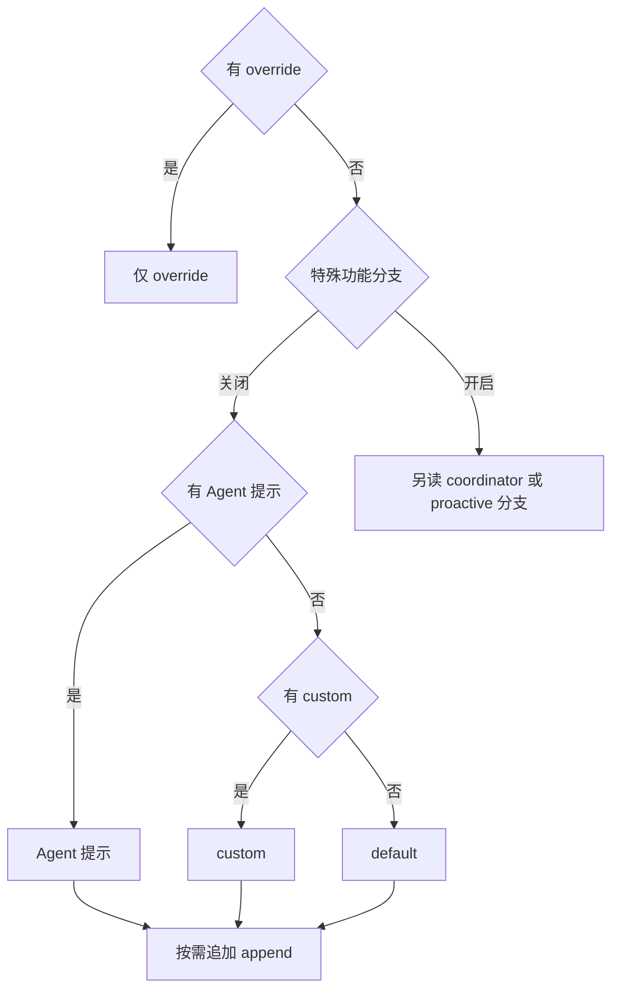

## 本章的问题

同一个修复任务，从 CLI 与 SDK 发出却表现不同。先不要把差异归给模型随机性：列出两端的 system、messages、tools 和采样参数，常常就能发现它们根本不是同一个请求。

coda 的 scripted provider 与可选 Anthropic adapter 共用 buildRequest。默认实验不会调用网络；显式提供 baseURL、apiKey 和 model 后才使用 live adapter。API 凭据没有进入请求轨迹、会话或 prefixHash。

先做一个最容易写错的基线：把所有提示片段无条件拼起来。override 本应提前返回，这个基线却把 append 也带进去；Agent 提示和 custom 提示也被错误叠加。我们改成与常规源码分支一致的选择树。

## 沿固定源码逐段拆解

@ccsrc system-prompt

### override 先返回，append 不是无条件存在

函数第一道 if 检查 overrideSystemPrompt 的 truthy 值并立即返回。常规分支再计算 Agent 提示；内置 Agent 与自定义 Agent 的 getSystemPrompt 调用参数不同。最终在 Agent、自定义、默认提示中选底座，然后追加 append。

coordinator 和 proactive 分支受 feature 与环境控制，其中 proactive 会把 Agent 指令追加到默认提示而不是替换。课程的差分实验关闭这些特殊 gate，只证明普通分支；不能把四行实验结果推广到所有产品模式。

@ccsrc api-params

### 从 paramsFromContext 看最终请求的四份材料

model 经过规范化；messagesForAPI 还会经过 addCacheBreakpoints；system 与 allTools 同时进入请求。max_tokens、thinking、beta 条件和 extraBodyParams 也参与结果。查“上下文为什么这么大”时只统计用户文字，会漏掉工具定义和系统提示。

| 材料 | 在请求层核对什么 | 错误比较方式 |
| --- | --- | --- |
| system | 底座来源与追加顺序 | 只看最后一行用户输入 |
| messages | 协议配对、裁剪、缓存标记 | 直接把 JSONL 当 wire |
| tools | 名称、schema 与排列 | 只数工具数量 |
| 采样字段 | 模型约束、输出与 thinking | 只替换 model 字符串 |

coda 的 prefixHash 只覆盖稳定的 system 与工具定义，用来观察哪些改动破坏前缀；它不是供应商真实 cache hit 的证明，也没有代替计费统计。

## 机制总览



## 接入贯穿项目

@implementation 02-request

### 逐步跟踪本章实现

从一条磁盘日志到一份 wire，中间有两次投影。`projectHistory` 先按 assistant.calls 的 id 重建结果，丢弃没有意图的孤立 tool 消息，并为中断调用补一条错误结果；它不改写原日志。`buildRequest` 再从工具对象挑出 name、description、schema，执行函数不会被序列化给模型。

`effectivePrompt` 的第一条 return 是关键：存在 override 时，agent、custom、defaults 和 append 都不进入这一分支。没有 override 才选择 agent/custom/defaults，再拼 append。memories 在调用处单独加入；因此“append 总在最后”必须说明它属于哪一层，而不能凭字段名推断。

`prefixHash` 只计算 system 与工具 schema。改变用户消息应保持这个值，改变工具定义应改变它。它是课程检查材料稳定性的摘要，不能直接证明服务端缓存命中。可选 Anthropic 适配器负责把内部 tool/result 转成供应商协议，离线实验没有调用该网络端口。

## 运行本章实验

```bash
node --disable-warning=ExperimentalWarning labs/chapters/02-request.mjs
```

@experiment 02-request

## 逐项解释实验结果

四组提示输入同时交给原创实现与提取的原函数，逐项比较输出。随后只改变用户历史，prefixHash 应不变；改变系统规则则应变化。输出中的哈希是可复查的结构证据，不能解读为实际缓存命中。

可选 live adapter 明确做了工具调用与结果的协议转换。它使用完整响应，暂未实现生产级 SSE、所有 beta 或跨 Provider 协议；这些边界不影响离线模型和其余章节的组合实验。

## 继续动手与验收

给同一个请求添加一项工具 schema，检查 prefixHash。再构造一个缺 tool_result 的历史，查看投影如何补齐，确认原始历史没有被修改。

::: interview 为什么 override 分支可能不保留 append？
先按 override 的提前返回确定主提示，再选择 agent/custom/defaults 与 append，最后装配记忆、工具 schema 和投影消息。prefixHash 只能检验前缀材料是否相同；服务端缓存是否命中还需要实际请求与响应证据。
:::

@observation 02-request
