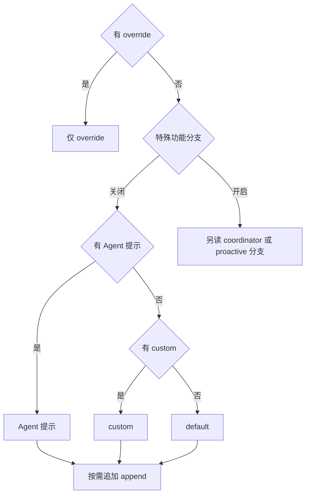

## 先找到 system prompt 的合成规则

@ccsrc system-prompt

`buildEffectiveSystemPrompt` 是比“请求里有三块系统提示”更稳定的解释入口。它按 override、Agent 指令、自定义或默认提示、append 等分支构造最终 SystemPrompt。某些协调和主动模式还受 feature 与运行状态影响。

关键在于替换和追加的差别：追加保留原始层；替换选择另一来源。若只检查某段文本是否出现，却没有记录当前 Agent 定义与 override 条件，很容易把配置变化误判成模型行为。

## 最终发送参数还包含工具和缓存策略

@ccsrc api-params

沿 `services/api/claude.ts` 的参数构造，能看到 model、经过缓存断点处理的 messages、system、allTools、tool choice、输出上限和 thinking 等同时被装入请求。缓存与工具 schema 不是 UI 上的一行设置，而是最终请求形状的一部分。

因此分析 token 消耗时，至少分开用户文本、历史消息、系统提示、工具定义和图片等模态。工具列表变化可能改变缓存可复用前缀；只看用户文字长度无法解释输入规模。

## source 中的条件需要分层验证

先检查调用者给了什么，再检查参数构造是否保留，再观察服务实际收到了什么。这三个环节能分别失败：配置层选择错模型，适配层丢字段，供应商拒绝不兼容参数。

| 问题 | 先找哪层证据 |
| --- | --- |
| 自定义 prompt 未生效 | buildEffectiveSystemPrompt 的来源和优先级 |
| 工具定义过大 | allTools 构造与发现过滤 |
| 缓存命中变化 | 缓存断点和前缀变化 |
| thinking 或长度报错 | 最终请求参数与供应商响应 |

2.1.88 的源码解释构造机制；2.1.296 的记录代理提供另一个版本的实际结构样本。原课程测得的块数与长度只属于记录样本，不应改写成所有 Claude Code 版本的常数。

## 用四组输入理解优先级，而不是背一句“可以自定义提示词”

把系统提示想成有优先级的组装过程。常规分支先在 Agent 提示、自定义提示和默认提示中选底座，再追加 append；最高层的 override 则直接提前返回。由此可以推导：append 并非无条件存在，override 可以让它不进入结果。

@lab node --disable-warning=ExperimentalWarning labs/engineering/run.mjs prompt

实验把 feature gate 关闭，逐个构造 default、custom、Agent、override 输入。执行的是实际 `buildEffectiveSystemPrompt`；Agent 判断、类型包装和配置是测试端口。因此它验证常规分支的优先级，不能覆盖所有产品模式。你可以增加“override 是空字符串”的用例，观察 truthy 判断与“字段已出现”之间的区别。

## 一次请求至少要分四个区域看

修复 `normalizeSlug` 时，用户消息可能只有十几个字，请求体却远不止这些。系统提示说明身份、工具约束与环境；历史保存此前读到的代码和工具结果；工具 schema 让模型知道调用参数；模型选项决定输出上限、thinking 和协议扩展。

| 区域 | 要问的问题 | 容易产生的误判 |
| --- | --- | --- |
| system | 哪一层选了这个底座 | 以为 append 总能覆盖全部规则 |
| messages | 是否归一化、裁剪、配对 | 把磁盘 JSONL 当作原样发送的请求 |
| tools | 哪些定义已暴露、哪些延迟 | 工具列表长度等于模型已知 schema 数量 |
| 采样与缓存参数 | 是否依模型和模式调整 | 只改模型名就认为协议可兼容 |

源码中的 `addCacheBreakpoints` 很关键：最终 messages 在这里增加缓存相关投影。外层应用看到的历史对象与传输层发送的结构可能不同。排查缓存命中率下降，应比较相邻请求的稳定前缀、工具顺序和附加块，不能只比较用户输入。

## 一个可以操作的排查题

如果“同一任务在 CLI 和 SDK 中表现不同”，先用完全相同的工作目录、模型和配置开始；分别记录 system 的来源、工具名字及 schema 数量、messages 的角色序列和采样参数。先比较结构和哈希，再按需检查内容，避免把大量私人代码写进调试日志。

本章后面的 2.1.296 请求实验有真实录制可回放。用它练习找这四个区域，再回到 2.1.88 的参数构造位置核对。完成标准是能指出一个具体结构差异如何影响模型，而不只是说“提示词不一样”。

::: interview 研究请求构造时，为什么既要看配置函数又要看最终 params？
配置表达意图，中间层可能按模式或模型重写，最终 params 才接近网络契约。应沿完整调用链记录来源、优先级和转换，再用对应版本的代理或 fake transport 验证。静态源码与实际请求相互约束，不能互相替代。
:::

@observation 02-request
