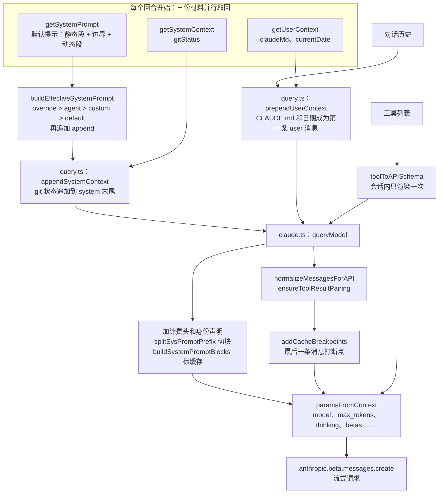
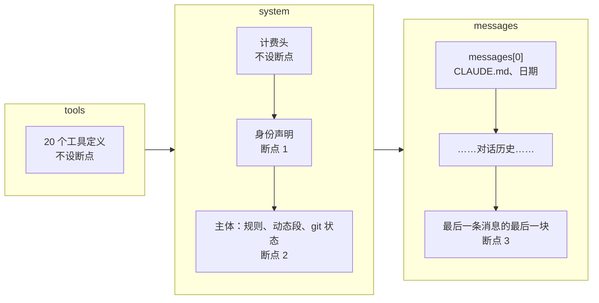

修 `add.js` 里的一个小 bug，Claude Code 发了 5 个请求。第一个请求有 15248 个输入 token，几乎全是新算的；后面四个，每个都有 97% 以上直接读自缓存。模型每一轮都要把到目前为止的全部内容再读一遍，缓存让这件事便宜了一个数量级，前提是**请求的开头一直没变**。

这个前提决定了请求怎么拼。要考虑的不只是“放什么”，还有“放在哪里”。日期写进 system，每天变一次，每次都让它后面的一切作废；git 状态随时在变，写进去更糟；47000 个字符的工具定义排在最前面，里面一个字节变了，后面全部重算。所以 Claude Code 把每一块内容按“多久变一次”排队：最稳的放最前面；会变的东西，要么只在会话开始时取一次快照，要么不去改前面，在末尾追加。

这一章沿着请求的组装过程走一遍。先看录下来的五个请求，再按它们在请求里的顺序读：工具定义；system prompt 由谁说了算、怎样分段；CLAUDE.md、git 状态、日期这三样走哪条路；缓存断点打在哪里、断了怎么查；消息怎样变成线上格式；其余字段。最后在 coda 里实现。

录制来自 Claude Code 2.1.296（由一个开放模型驱动，模型名是 `MiniMax-M3.1-Flash`），源码是 2.1.88。两个版本的请求有出入，出入处会直接指出来；结构上的原则两边一致。


@figure assets/course/ch02-request.png 一次请求像一个分层的信封：最稳定的工具定义在最底下，新的一句放在最上面，缓存断点夹在中间

## 先看现象：五个请求，后四个几乎全命中缓存

第 1 章那次运行（修 `add.js`）发出的 5 个请求都被记录代理截了下来，只保存结构，不保存 Anthropic 写的原文。先看缓存：

@lab node labs/ch02/request.ts cache

“输入 token”是这次请求里没走缓存、按原价算的部分，“读缓存”是走缓存的部分。写缓存一列全是 0，是这个第三方服务没有报告写入量，只看读缓存就够了。第 1 个请求几乎全是新的；从第 2 个起，读缓存占 97% 以上，新算的只有几十到几百个 token，也就是上一轮的工具结果和模型的回复。还有一列值得记住：“缓存标记在第几条”始终是**最后一条消息**。

第一个请求长什么样：

@lab node labs/ch02/request.ts overview

system 分成 3 块（计费头 74 个字符，不缓存；身份声明 62 个字符和主体 5742 个字符，各有一个缓存标记）；20 个工具定义共 46988 个字符；还有 `thinking`、`output_config`、`context_management` 和 9 个 beta。这些东西各从哪里来，下面一项一项对上源码。整个组装过程如下：



读之前先记住缓存的规则（原理在 Learn Pi Agent 第 6 章）：请求按**工具 → system → 消息**的顺序展开，服务端从第一个字节开始和之前的请求比较，遇到第一个不同的地方就停，后面的全部按原价算。断点（`cache_control`）告诉服务端“到这里为止存一份”。所以越靠前的东西越不能动。

## 工具定义：最大的一块，也最不能动

工具排在最前面，也是最大的一块：

@lab node labs/ch02/request.ts tools

20 个工具的描述合计 28493 个字符，加上参数 schema 是 46988 个，是 system 的 8 倍。很多“该怎么做”的规则住在工具描述里：`SendMessage` 一个工具的描述就有 4259 个字符，`Workflow`、`ScheduleWakeup`、`EnterWorktree` 各三千多，`Edit` 只有 360 个。好处是规则和它约束的动作放在一起，模型考虑用不用某个工具时，相关规则就在眼前，新增工具也不用改 system。Pi 同理：它的 `<rules>` 一节由每个工具自己的 `promptGuidelines` 拼出来。代价是固定开销：每个请求都带着这四万多个字符，而且排在缓存顺序的最前面。

所以工具定义一旦渲染出来就不许再变。`toolToAPISchema` 把每个工具渲染成 `{ name, description, input_schema }`，放进一个会话级的 Map：

@cc utils/toolSchemaCache.ts#L3-L26 hl=3-8,18

注释讲得很直白：工具定义在服务端排第二位（system 之前），任何字节级的变化都会让“整块约 11K token 的工具定义以及后面的一切”作废。会引起这种变化的事不止一件：功能开关在会话中途刷新，MCP 服务器重连，`tool.prompt()` 里带了动态内容（Agent 工具的描述里列着当前可用的子 Agent）。第 18 行的 `Map` 把第一次渲染出来的字节锁住，之后每个请求都从这里取。

`toolToAPISchema`（`utils/api.ts` 第 147–153 行）先查这个 Map，没有才去调用 `await tool.prompt(...)` 和 `zodToJsonSchema` 渲染；键是工具名，带自定义 JSON schema 的工具把 schema 也算进键里，免得同名不同 schema 的工具拿到过期的定义。清空它只发生在登录令牌变化和登出的时候（`auth.ts`、`logout.tsx`），`/clear` 和 `/compact` 都不碰它。代价也清楚：会话中途，哪怕工具描述的源头变了，发给模型的还是第一次渲染的版本。Claude Code 选了前缀稳定。

另外，2.1.88 里工具定义本身不设缓存断点：`queryModel` 调用 `toolToAPISchema` 时没有传 `cacheControl`，参数虽然留着，没有调用者用它。工具靠后面 system 块上的断点一起被缓存。

## 系统提示：谁说了算，怎样分段

### 五层来源，只选一层

system prompt 可以来自好几个地方：默认提示，命令行的 `--system-prompt`，主线程所用的 Agent 定义（`--agent` 或 `.claude/agents/` 里的自定义 Agent），`--append-system-prompt`，以及循环模式等场合给出的“整体替换”（override）。谁说了算，由 `buildEffectiveSystemPrompt` 决定。先读它的注释，注释就是规格：

@cc utils/systemPrompt.ts#L28-L40 hl=30-37,39

编号 0～4 是优先级，而且**只选一个底座**，不是把它们叠起来：Agent 的提示替换默认提示（主动模式例外，那里 Agent 的指令追加在默认提示后面），`--system-prompt` 同样是替换，不是补充。`append` 是唯一会叠加的层，永远在最后；能把它也丢掉的只有 override。代码在函数末尾：

@cc utils/systemPrompt.ts#L115-L123 hl=116-121

三元表达式从左到右就是优先级：`agentSystemPrompt`，然后 `customSystemPrompt`，最后 `defaultSystemPrompt`，再展开 `appendSystemPrompt`。前面还有 override 的提前 `return`，以及 coordinator 和 proactive 两个受功能开关控制的分支，普通路径走不到它们。下面的实验把这个函数从固定提交里装载出来，用 16 种组合和 coda 的 `effectivePrompt` 比：

@lab node --disable-warning=ExperimentalWarning labs/chapters/02-request.mjs priority

最容易记错的是 `agent + custom` 这一行：同时给了 Agent 和 `--system-prompt`，Agent 的提示赢。

**这只是交互模式的规则。** `-p` 和 SDK 走的 `QueryEngine` 不调用这个函数，它自己拼：有自定义提示就用自定义的，否则用默认提示，再加 append（`QueryEngine.ts` 第 316–325 行附近）。Agent 的提示在 `main.tsx` 第 2084 行附近才被翻译成 `systemPrompt`，条件是你没有给 `--system-prompt`。所以同时给 `--agent` 和 `--system-prompt`：交互模式 Agent 赢，`-p` 模式 `--system-prompt` 赢。同一组参数，入口不同，优先级就不同，这种事只有读到两个入口的源码才看得出来（第 12 章讲无界面入口）。

### 默认提示：静态段、边界和动态段

默认提示 `getSystemPrompt` 返回的是一个字符串**数组**，不是一整段文本。数组的末尾是这样的：

@cc constants/prompts.ts#L557-L576 hl=572-575

边界之前（第 561–571 行）是静态段：身份介绍，`# System`、`# Doing tasks`、`# Executing actions with care`、`# Using your tools`、`# Tone and style`、`# Output efficiency`。它们不依赖会话的运行时状态（只看启用了哪些工具和输出风格），同一套配置下所有用户的所有会话都一样。第 573 行是边界，一个字符串常量 `__SYSTEM_PROMPT_DYNAMIC_BOUNDARY__`，**只有全局缓存可用时才放进数组**。再往后是动态段，由 `resolveSystemPromptSections` 解析出来。

哪些东西必须在边界之后，`getSessionSpecificGuidanceSection` 的注释说得最清楚：这个函数里的每个条件都是一个运行时的位（有没有 AskUserQuestion 工具、是不是无界面会话、有没有 Skill），放在边界之前，全局缓存的前缀版本数会按 2 的 N 次方增长，缓存就碎了。动态段登记在 `systemPromptSections.ts` 里：

@cc constants/systemPromptSections.ts#L16-L58 hl=18,28-30,50-52

`systemPromptSection(name, compute)` 创建的小节**算一次，缓存到 `/clear` 或 `/compact`**：`resolveSystemPromptSections` 先查缓存（第 50 行），命中就不再调用 `compute`。`DANGEROUS_uncachedSystemPromptSection` 每轮重算，名字里的 DANGEROUS 和必填的 `reason` 参数都是提醒：值一变，缓存就断。整个动态区里只有一个小节这样用，MCP 服务器的使用说明：

@cc constants/prompts.ts#L508-L520 hl=513-519

`reason` 写的是“MCP 服务器会在回合之间连上或断开”。注释同时给出更好的办法：开启 delta 开关后，MCP 说明改为以附件的形式**追加在对话里**（`mcp_instructions_delta`），这个小节返回 `null`。这个思路下面会反复出现：变化的东西，以追加的方式告诉模型，不改前缀。

动态段里还有 `session_guidance`（Agent 工具和 Skill 的用法）、`memory`、`env_info_simple`（工作目录、是不是 git 仓库、平台、shell、系统版本、模型名）、`language`、`output_style` 等（`prompts.ts` 第 491–555 行）。录制里这一块（5742 个字符）的小节标题是 Harness、Session-specific guidance、Memory、Environment、Context management，和 2.1.88 拼出来的两套小节对不上：提示词本身在两个版本之间改写过。所以对录制只看结构，几块、多长、缓存标记在哪，不对照内容。

## 上下文：CLAUDE.md、git 状态、日期走哪条路

system prompt 之外还有两份会话背景：`getSystemContext()` 和 `getUserContext()`。它们和默认提示一起并行取回（`queryContext.ts` 的 `fetchSystemPromptParts`），这个文件的注释把三份材料统称为“API 缓存键前缀”。

@cc context.ts#L152-L188 hl=155,165-167,170-172,184-187

`getUserContext` 外面包着 `memoize`，整个进程只算一次。它读 CLAUDE.md（第 170–172 行；`CLAUDE_CODE_DISABLE_CLAUDE_MDS` 可以整个关掉，`--bare` 跳过自动发现），返回两项：`claudeMd`（所有说明文件拼成的一大段，第 4 章讲怎么发现和展开）和 `currentDate`。它的孪生 `getSystemContext` 返回 `gitStatus`：当前分支、主分支、git 用户名、`git status --short`（超过 2000 个字符就截断）、最近 5 条提交，开头明确写着“这是对话开始时的快照，不会更新”。

两份都是**快照**，不会每个请求重读。刷新发生在 `/clear`、压缩和恢复会话的时候（`commands/clear/caches.ts`、`postCompactCleanup.ts`），前两个时刻对话本来就要重新算缓存。

快照怎么进入请求？`query.ts` 在调用模型之前做了两件事（第 449 行和第 660 行）：

@cc utils/api.ts#L437-L474 hl=443-445,461-472

- `appendSystemContext` 把 systemContext 的每一项拼成 `key: value`，作为 system 数组的**最后一项**。git 状态走这条路。
- `prependUserContext` 把 userContext 做成一条 **meta 用户消息**（`isMeta: true`，界面不显示），用 `<system-reminder>` 包起来，放在整个对话的**最前面**，每个键一节（`# claudeMd`、`# currentDate`）。CLAUDE.md 和日期走这条路。

同一份快照交给原函数和 coda：

@lab node --disable-warning=ExperimentalWarning labs/chapters/02-request.mjs context

两个槽位的语义不一样。`fetchSystemPromptParts` 里，只要调用者给了自定义 system prompt，默认提示和 systemContext 都不取了（注释的理由是：git 状态是追加在默认提示后面的，默认提示不用了它就没有意义），而 userContext 照取。换了 system prompt，CLAUDE.md 和日期仍然会到达模型。第 4 章的录制把哨兵字符串写进各种 CLAUDE.md：启动时加载的几份（用户级、项目级、被导入的、本地的）都出现在 `messages[0]`，访问子目录时才按需加载的出现在后面的消息里，和这里的代码一致。

### 对话中途的 system 消息

2.1.296 的录制里，上下文之外的“提醒”不再混在 user 消息里，而是变成了独立的 system 消息。最后一个请求的 `messages` 数组：

@lab node labs/ch02/request.ts messages

第 0 条是 user，两个内容块：一条 577 个字符的 `<system-reminder>`（提交署名的说明）和用户的提问。**第 1、4、7、10、13 条的 role 是 `system`**：它们在 `messages` 数组里，不在顶层的 `system` 字段里。第 1 条紧跟在第一条 user 消息后面，8486 个字符，以 `# Environment` 开头；之后每一轮工具结果后面跟一条几十个字符的 system 消息，内容是剩余 token（`<total_tokens>`）。最后一条消息每次都是这样一条 system 消息，所以开头那张缓存表里“缓存标记在第几条”是 1、4、7、10、13，一个不差。

这就是请求头里 `mid-conversation-system` 这个 beta 的用途。Messages 接口原本只有 user 和 assistant 两种角色，这个 beta 的名字说明它允许在对话**中途**插入 system 消息。2.1.88 的源码里搜不到这个名字（见后面 betas 的实验），2.1.88 做同一件事的办法是 `<system-reminder>`：附件经 `normalizeAttachmentForAPI` 变成包着标签的 user meta 消息，`reorderAttachmentsForAPI` 让它们沿对话向前浮动，碰到 assistant 消息或工具结果才停，再并进那条 user 消息，成为它的一个文本块。新版本把其中大部分从 user 消息里拿了出来，单独放在它们产生的位置。第 7 章的 Hook 也走这条路：Hook 的 `additionalContext` 在 2.1.88 里是一条 `<system-reminder>` 包着的 user meta 消息（`messages.ts` 的 `hook_additional_context` 分支），2.1.296 里是一条 system 消息。

这样放，新信息只是追加在末尾，前缀一个字节也不动。会话文件里与这些消息对应的是一批 attachment 记录，`rendered` 字段是写进请求的文字，`renderedRole` 是它以什么身份进入请求：

@lab node labs/ch02/attachments.ts

环境、模型身份、Agent 列表、Skill 列表、剩余 token、日期，渲染后都是 system 身份；提交署名说明是 user 身份，和用户的提问同在 `messages[0]`。同样的信息在 2.1.88 里是这样放的：环境和模型名在 system 数组的动态段（`env_info_simple`），日期在 userContext，Agent 列表和 Skill 列表是 user 附件（`messages.ts` 的 `agent_listing_delta`、`skill_listing` 分支）。位置换了，原则没换：都不在被全局缓存的静态前缀里，变化都追加在后面。

### 日期：开头冻结，变化追加在末尾

userContext 里的日期是会话开始那天的日期。过夜的会话跨过午夜，这个日期就错了。最直接的办法是清掉 `getUserContext` 的缓存重新取一次。源码注释说他们**故意不这样做**：

@cc utils/attachments.ts#L1402-L1431 hl=1406-1411,1427-1431

新日期以 `date_change` 附件的形式追加在对话末尾，`messages[0]` 里的旧日期留着不动，因为清缓存会让前缀重新生成，整个对话在下一个请求里变成写缓存。注释估算，一个过夜会话每跨一次午夜就要多付约 92 万个有效 token。函数本身很短：第一次调用只记下今天的日期（第 1421–1425 行）；日期没变返回空数组（1427）；变了就记下新日期，返回一条 `date_change`（1443）。模型收到的提醒大意是“日期已经变了，现在是某月某日，不要向用户提起这件事”（`messages.ts` 的 `date_change` 分支）。

实验模拟 23:50、23:58、00:07、00:09 四个请求，比较两种做法。**A**：每个请求都重新取上下文，日期随之更新。**B**：用会话开始时的快照，日期变了就往历史里追加一条提醒。原函数用模拟的时钟驱动，coda 的 `dateChange` 做同样的判断；请求的尺寸参照录制（工具 46988 个字符，system 5878 个字符）：

@lab node --disable-warning=ExperimentalWarning labs/chapters/02-request.mjs midnight

表里是“和上一次请求相同的前缀占本次请求的多少”。B 全程 99%，每次只有新追加的内容是新的。A 在跨过午夜的那个请求里掉到 12%：日期在 `messages[0]`，改了它，只剩工具和 system 还能复用，整段对话要重新算；下一个请求又回到 99%。**代价只有一次，但和对话长度成正比**：短会话只掉到 85%，因为工具和 system 本来就占了大头。

::: insight 把会变的东西放在后面
这一章反复出现同一个做法。能冻结的就冻结：动态小节算一次，工具定义渲染一次，上下文取一次快照。必须变的就追加：MCP 说明、日期、Agent 列表，都是在末尾加一条，不去改前面。Learn Pi Agent 第 6 章的 mox 也是这样：系统提示分节，会话中途变了就生成补丁追加在对话末尾，而且刻意不在系统提示里写当前时间。
:::

## 缓存断点：打在哪里，为什么打在那里

先看默认模式下（录制里就是这种）一个请求的缓存布局：



### system 的块

`queryModel` 在 system 数组前面加两项，然后切块、标记：

@cc services/api/claude.ts#L1357-L1379 hl=1360-1365,1376-1379

两项是计费头（`getAttributionHeader`，以 `x-anthropic-billing-header` 开头，带着版本号和入口）和身份声明（`getCLISyspromptPrefix`：交互模式是 Claude Code 的标准一句话，`-p` 模式是 Agent SDK 的一句话，录制里的第二块正是后者）。切块的规则写在 `splitSysPromptPrefix` 的注释里：

@cc utils/api.ts#L296-L320 hl=308-313

三种模式：有 MCP 工具时，系统提示放弃全局缓存，计费头不缓存，其余两块都标组织级；全局缓存可用并且数组里找得到边界，静态段标 `global`（跨组织共享），动态段**自己不设断点**；其他情况（Bedrock 这类第三方，或者没有边界，比如自定义提示）整段合并，标组织级。块有了范围，`buildSystemPromptBlocks` 才把它写成 `cache_control`：

@cc services/api/claude.ts#L3213-L3237 hl=3221,3228-3234

范围是 `null` 的块不写 `cache_control`。`getCacheControl` 只在范围是 `global` 时写出 `scope`，组织级就是缺省值，所以录制里两个断点都只是 `{"type":"ephemeral"}`。第 3221 行的注释警告：不要再多加缓存块，否则会得到 400（API 对断点个数有上限，官方文档写的是 4 个）。下面把真正的 `splitSysPromptPrefix` 装载出来，用四种环境和 coda 的 `splitSystem` 比：

@lab node --disable-warning=ExperimentalWarning labs/chapters/02-request.mjs blocks

- ②是全局模式：边界之前的静态段是第一块，标 `global`；`APPEND` 和 `MEMORY` 在边界之后，成为第二块，不设断点。
- ③连了 MCP 工具：MCP 工具因人而异，而工具排在 system 前面，前缀不可能所有人都一样，系统提示就放弃全局缓存。
- ④自定义提示：自定义提示整体就是动态的，没有边界，退回组织级。

录制是默认模式（三块，两个断点）。有一处对不上：2.1.88 的 `shouldUseGlobalCacheScope` 只看 API 提供方和一个环境变量，不看服务地址，按这段逻辑，走第三方兼容服务的这次录制该落在全局模式。可能是新版本加了判断，2.1.88 的源码回答不了。全局模式的行为，看上面用真函数跑出来的实验。

两个项目之间，请求的哪些部分逐字相同：

@lab node labs/ch02/compare.ts

工具定义 46988 个字符逐字相同，身份声明相同；有变化的是计费头（带着指纹）、system 主体（长度一样，差在项目相关的路径上，第 4 章）、环境消息和用户的提问。越靠前越稳定，也就越有可能被跨项目、跨用户共享。

### 消息上的唯一断点

system 的断点是固定的，消息上的断点每个请求都要移动：

@cc services/api/claude.ts#L3078-L3101 hl=3078,3089-3091

注释的意思是：消息上**恰好一个**断点。服务端按断点保留缓存页，有两个断点，倒数第二个位置会多存活一轮，而之后不会有任何请求从那里恢复，纯属浪费。第 3089 行决定位置：最后一条消息，或者在 `skipCacheWrite`（一次性的分叉请求，比如旁路提问 `sideQuestion`、压缩时生成摘要）时前移一条，这样分叉不会留下自己的尾巴。`userMessageToMessageParam` 和 `assistantMessageToMessageParam` 把断点落在那条消息的**最后一个内容块**上，assistant 的思考块除外。

每个请求都把断点移到最新的末尾，上一个请求的末尾就恰好是这个请求的前缀：这就是开头那张表里 97% 的来源。Pi 的做法更简单一些：转换完成后给最后一条 user 或 system 消息的最后一块加标记，同时在 system 和最后一个工具定义上各设一个断点：

@pi packages/ai/src/api/anthropic-messages.ts#L1526-L1552 hl=1526-1531

把真正的 `addCacheBreakpoints` 和它依赖的两个转换函数装载出来，和 coda 的 `markCacheBreakpoint` 比：

@lab node --disable-warning=ExperimentalWarning labs/chapters/02-request.mjs markers

### 前缀不能变：几个手法

前面已经看到三个：动态小节算一次，工具定义渲染一次，上下文取快照。还有两个同类的：

@cc services/api/claude.ts#L1405-L1410 hl=1405-1408

beta 头也是缓存键的一部分。有的头是动态的（自动模式、快速模式、缓存编辑），源码用“粘性锁存”处理：一旦发出过，会话里就一直发，中途开关切换不改变缓存键，注释估算一次抖动要作废 5 万到 7 万个 token。1 小时 TTL 同理：`should1hCacheTTL` 把“用户是否有资格”在第一次判断时锁存，免得中途超额状态一翻转，`cache_control` 里的 `ttl` 就变了，注释估算每翻转一次作废约 2 万个 token。

### 缓存断了，怎么查

这些手法都是预防。万一还是断了，Claude Code 有一套诊断。请求发出之前，`recordPromptState` 给 system、工具等算指纹：

@cc services/api/promptCacheBreakDetection.ts#L274-L294 hl=274-281

system 和工具的指纹**先去掉 `cache_control`**，再单独给所有块的 `cache_control` 算一个指纹，否则范围或 TTL 变了、内容没变，就分不清是哪个原因。快照里除了 system 和工具，还有模型、全局缓存策略、排序后的 beta 列表、effort、额外的请求体参数等，一共十二个维度。请求返回之后，`checkResponseForCacheBreak` 看用量：

@cc services/api/promptCacheBreakDetection.ts#L483-L492 hl=483-489

读缓存比上一次少 5% 以上，**并且**至少少 2000 个 token，才算断了；小幅波动不报警。断了以后，把请求前算好的差异翻译成原因；差异为空，就看两次请求的间隔：超过 1 小时或 5 分钟，疑似 TTL 过期；不到 5 分钟，多半是服务端（第 573–588 行的注释说，一次分析里这类占了约九成）。coda 的 `cacheFingerprint`、`explainCacheBreak`、`isCacheBreak` 对应这三步：

@lab node --disable-warning=ExperimentalWarning labs/chapters/02-request.mjs diagnose

换模型、改 TTL，文本一个字没变，缓存照样不能复用：缓存键不只是文本。“第一条消息里的日期变了”是诊断的盲区：快照里没有消息，消息里的前缀变了，它看不见（压缩和缓存编辑有各自的通知，第 5 章讲）。

## 消息：从内部格式到线上格式

消息在发出之前还要整理。`queryModel` 的顺序是：`normalizeMessagesForAPI`，没有启用工具搜索时剥掉相关字段，`ensureToolResultPairing`，`stripExcessMediaItems`。其中 `normalizeMessagesForAPI`（`messages.ts` 第 1989 行起，近四百行的函数）做的事可以归成四类：

- **丢掉只给界面看的东西**：progress 消息、虚拟消息、不属于本地命令输出的 system 消息、合成的 API 错误消息。
- **附件上浮**：`reorderAttachmentsForAPI` 让附件向对话开头方向浮动，直到碰到 assistant 消息或工具结果才停，所以附件总落在“下一个 user 轮”里，不会越过 assistant。
- **合并**：相邻的 user 消息合成一条（注释的理由是 Bedrock 不支持连续多条 user，第一方 API 本来也会合并）；同一个 `message.id` 的 assistant 消息合成一条（流式输出时每个内容块产出一条 assistant 消息，第 1 章讲过）。
- **清理**：只剩思考块的孤儿 assistant 消息、末尾的思考块、纯空白的 assistant 消息，以及内容为空的补一个占位。

最后一道是 `ensureToolResultPairing`，因为 API 要求每个 `tool_use` 都有配对的 `tool_result`，而会话恢复、压缩切片、流式中断都可能留下残缺的历史。它向两个方向修：缺结果的调用补一条错误结果，孤立的和重复的结果去掉。把真函数装载出来，和 coda（`projectHistory` 加 `toApiMessages`）比：

@lab node --disable-warning=ExperimentalWarning labs/chapters/02-request.mjs pairing

“缺一个结果”和“中断”两行，两边都补了错误结果，顺序略有不同（原函数把补的放在前面）。“孤立的结果”一行，原函数去掉结果以后补一条占位 user 消息，保持角色交替；coda 直接丢掉孤立的结果。“重复的结果”，两边都只留一个。不管细节怎么不同，修完的历史都满足同一个不变式：每个调用恰好一个结果，没有孤立的结果。录制里最后一个请求（“对话中途的 system 消息”一节那张表）就是整理后的样子：第 2 条 assistant 里并行的三个 `tool_use`，对应第 3 条 user 里的三个 `tool_result`，合在一条消息里，和 coda 的 `toApiMessages` 做的是同一件事。

## 其余字段

`queryModel` 里的 `paramsFromContext` 是一个**函数**，不是一个值：重试时（`withRetry`）带着新的上下文重新算，上下文超限后 `max_tokens` 被调低（`maxTokensOverride`）、快速模式的开关变了，都会让重试的请求体和第一次不同。它的返回值就是请求体：

@cc services/api/claude.ts#L1699-L1728 hl=1700-1716,1718-1726

录制里每个字段在源码里都找得到出处：

| 字段 | 录制里的值 | 2.1.88 里怎么来的 |
| --- | --- | --- |
| `max_tokens` | 32000 | `getMaxOutputTokensForModel`：模型名不认识，取默认的 32000；`CLAUDE_CODE_MAX_OUTPUT_TOKENS` 可以覆盖 |
| `thinking` | `adaptive`（还带 `display: updates`） | 见下面；`display` 字段 2.1.88 里没有 |
| `output_config.effort` | `high` | `configureEffortParams` 只在 effort 有值时写这个字段；没设置时 2.1.88 只加 effort 的 beta 头，由 API 默认为 high。录制里显式写出了 `high`，是新版本的行为 |
| `context_management` | `clear_thinking_20251015`，`keep: all` | `getAPIContextManagement`；超过 1 小时没有请求，才改成只保留最近一轮思考 |
| `temperature` | 没有 | 只有关闭 thinking 时才发（值为 1） |

模型名 `MiniMax-M3.1-Flash` 是 Claude Code 不认识的，请求里却是自适应思考。原因在这里：

@cc utils/thinking.ts#L113-L143 hl=139-143

不认识的模型串，在第一方 API 和 Foundry 下默认当作“新一代模型”，支持自适应思考（Bedrock、Vertex 则不默认）。对没见过的模型，驾驶层的态度是“按最新的能力来”。再看 beta 头，录制里的 9 个，哪些在 2.1.88 里存在：

@lab node labs/ch02/betas.ts

五个是老的，有对应的常量；四个是 2.1.88 之后新增的，其中 `mid-conversation-system` 和 `mid-conversation-tool-changes` 的名字，对应前面的 system 角色消息和对话中途增减工具。Pi 1.5 的 `anthropic-messages.ts` 里有同名的能力开关（`supportsMidConvoSystemMessages`、`supportsMidConvoToolChanges`），Learn Pi Agent 第 12 章讲过它把工具变化记成对话里的事件。两边走到了同一个方向：变化追加在对话里，不改前缀。

## 为什么这样设计

把几种实现并排放：

| 问题 | Claude Code | Pi / mox | coda |
| --- | --- | --- | --- |
| system 由谁决定 | 五层按优先级只选一个底座，append 在最后；入口不同，优先级略有不同 | `customPrompt` 替换默认的 preamble、工具清单、规则、文档指引；addendum、项目说明、skills、cwd 照常追加 | `effectivePrompt`，同 Claude Code 的交互模式 |
| 项目说明放哪 | 第一条 user 消息（`userContext.claudeMd`） | system 里的 `<project_context>` 小节 | `memories` 追加在 system 的动态段（第 4 章再对齐） |
| 日期 | 开头快照，变了在末尾追加提醒 | 刻意不写时间 | `snapshotContext` + `dateChange` |
| git 状态 | system 末尾，开头的快照 | 没有 | `systemContext` |
| 会话中途变化 | 附件、提醒追加在末尾 | 小节补丁追加在末尾（`diffSystemPromptSections`） | 追加 meta 消息 |
| 缓存断点 | system 两块（全局模式一块）加最后一条消息 | system 一块、最后一个工具、最后一条 user 或 system 消息 | system 的块加最后一块 |
| 规则放哪 | 大量在工具描述里 | `<rules>` 由工具的 `promptGuidelines` 拼 | 工具的 `description` |

Pi 对“会话中途变了”的回答是一份小节补丁：

@pi packages/coding-agent/src/core/system-prompt.ts#diffSystemPromptSections

Claude Code 的回答是附件和提醒。两边的做法同构：**不改前面，在后面补**。

几个取舍值得说清楚：

- **快照会过时。** git 状态开头就写着“不会更新”，模型可能基于过时的状态判断，补救靠它自己再跑一次 `git status`。换来的是前缀稳定。
- **工具描述中途不更新**（前面讲过），同样是拿新鲜度换稳定。
- **userContext 和默认提示脱钩。** 换了 system prompt，CLAUDE.md 和日期仍然到达模型，git 状态则跟着默认提示一起消失。Pi 的 `customPrompt` 也只替换开头的 preamble，项目说明照常追加，两边在这一点上一致。
- **诊断有盲区。** 它只看 system、工具和请求参数，看不到消息里的前缀变化。

换一种做法，会坏在哪里：

- 日期每次请求都重新取：不管放在 system 还是 `messages[0]`，每天一次，它后面的一切作废。上面的实验里，长会话在跨过午夜的那个请求只能复用 12%。
- 动态小节每轮重算：MCP 服务器一连上，说明文字变了，system 主体和后面的对话都作废。这也是源码里把它改成附件的原因。
- 工具定义每次重新渲染：Agent 工具的描述里列着子 Agent，列表一变，47000 个字符的前缀连同后面的一切全部重算。
- 消息上多打断点：断点总数有上限，多打的那个还会让服务端多留一份没有请求会用到的缓存。

## coda 里的实现

对应关系和简化都写在 `coda/src/request.mjs` 的头部注释里。四个函数各对应源码里的一处。

**优先级。** `promptLayers` 返回选中的那一层和 `append`，`effectivePrompt` 只是把它们接起来；`buildRequest` 还要靠 `source` 判断有没有静态段。

@code coda/src/request.mjs#promptLayers hl=38,40-41

**请求。** `buildRequest` 把动态内容（append、项目说明、systemContext）排在边界之后；只有全局缓存可用、选中的是默认提示、后面确实跟着动态内容，才放边界。上下文快照走 `prependUserContext`，工具走 `renderTools`（调用者传入会话级的 `schemaCache` 就冻结）。`prefixHash` 仍然只覆盖 system 和工具。

@code coda/src/request.mjs#buildRequest hl=119,121,126-131

**协议和断点。** `toApiMessages` 做相邻合并和 `tool_result` 排前；`markCacheBreakpoint` 只在一个位置打断点；`splitSystem` 按边界切块。这三个函数对应 `normalizeMessagesForAPI` 的合并步骤、`addCacheBreakpoints` 和 `splitSysPromptPrefix`，真实函数里与 coda 无关的分支（缓存编辑、思考块、MCP 的工具搜索）都没有实现。

@code coda/src/request.mjs#markCacheBreakpoint hl=194,197-199

**诊断。** `cacheFingerprint` 先去掉 `cache_control` 再算指纹，`explainCacheBreak` 比较前后两份，没有客户端原因时按间隔归因。

@code coda/src/request.mjs#explainCacheBreak hl=259-260,262-263

第 13 章总装时，`app.mjs` 用上了这些新参数，项目说明走第一条用户消息；第 10 章的子任务仍然只传 `prompt`、`tools`、`memories`，新增的参数（`userContext`、`systemContext`、`schemaCache`、`global`）都是可选的，返回的字段没有变。`anthropicModel` 现在发给 Anthropic 的是带缓存断点的块数组，并在回复里多带一个 `usage`，可以配合 `isCacheBreak` 观察真实的缓存命中。

## 自己跑一遍

本章的实验在一个脚本里，可以整体运行，也可以只运行一节：

```bash
node --disable-warning=ExperimentalWarning labs/chapters/02-request.mjs            # 全部，27 项检查
node --disable-warning=ExperimentalWarning labs/chapters/02-request.mjs midnight   # priority / context / blocks / markers / midnight / pairing / diagnose
node labs/ch02/request.ts cache                                                    # 录制的分析：overview / tools / messages / cache
node labs/ch02/betas.ts                                                            # 录制里的 beta，哪些在 2.1.88 里
```

## 你来改

先写下预测，再动手验证。

::: predict 把项目说明放进边界之前
在 coda 里，两个项目的默认提示一样，但项目说明不同。第一种写法：`buildRequest(..., { prompt: { defaults: ["RULES"] }, memories: ["project A"], global: true })`；第二种：`prompt: { defaults: ["RULES", "project A"] }`，不传 `memories`。分别对 A、B 两个项目构造请求，用 `splitSystem(wire.system, { global: true })` 比较两个请求的**第一块**，哪种写法的第一块在两个项目之间一样？
???
第一种一样（都是 `RULES`，范围 `global`），第二种不一样（`RULES\n\nproject A` 和 `RULES\n\nproject B`）。第二种把因项目而异的内容放进了边界之前，全局缓存的那一块就没法在项目之间共享。这正是 `getSessionSpecificGuidanceSection` 注释里说的：每个运行时的位放在边界之前，前缀的版本数会按 2 的 N 次方增长。
:::

::: predict 日期变了，永远不提醒
把 `labs/chapters/02-request.mjs` 里 `midnight` 实验的 `dateChange(b.announced, tick.date)` 换成永远返回 `undefined`。设计 B 在 00:07 那个请求的复用比例是多少？长会话里，模型在午夜之后会怎样？
???
复用比例仍是 99%，因为前缀一个字节也没变。但模型被永远蒙在鼓里：`messages[0]` 里写的还是昨天，它会把昨天的日期写进提交说明和文档。缓存和正确性是两个目标，`date_change` 附件是让两者同时成立的最小改动：只在末尾多一条几十个字符的消息。
:::

::: predict 会话中途改了工具描述
```js
const cache = new Map();
const tool = { name: "Read", description: "v1", schema: { type: "object" } };
const a = buildRequest([], { tools: [tool], schemaCache: cache });
tool.description = "v2";
const b = buildRequest([], { tools: [tool], schemaCache: cache });
const c = buildRequest([], { tools: [tool] });
```
`a.prefixHash`、`b.prefixHash`、`c.prefixHash` 谁和谁相等？`b` 和 `c` 里模型看到的描述分别是什么？
???
`a` 和 `b` 相等，`c` 不同。`b` 里模型看到的还是 `v1`，`c` 里是 `v2`。传了 `schemaCache`，第一次渲染的版本被冻结，描述的源头怎么变，发出去的字节都不变，前缀稳定，代价是模型看到的是过时的描述。没传就每次重新渲染，描述一变，47000 个字符的前缀连同后面的一切都要重算。Claude Code 选的是前者。
:::

## 面试题

::: interview 一个 coding agent 发给模型的请求由哪几部分组成？为什么是这个顺序？
1. **工具定义 → system → 消息**，这是 Anthropic 计算提示缓存的顺序，缓存按前缀匹配，所以越稳定的越靠前。
2. 工具定义在会话内几乎不变（Claude Code 的一份约 47000 个字符，是 system 的 8 倍），system 的静态段对所有会话一样，动态段对一个会话稳定，对话只在末尾追加。
3. 会变的内容（日期、git 状态、CLAUDE.md）不进静态段：做成会话开始时的快照，挂在 system 末尾或做成第一条 user 消息。会话中途的变化以追加的方式表达，不改前面。
4. 加分：其余字段（`max_tokens`、`thinking`、betas、`context_management`）也是缓存键的一部分，Claude Code 用“粘性锁存”防止它们中途抖动。
:::

::: interview Claude Code 的 system prompt 是怎么选出来的？
1. 五层来源，**只选一个底座**：override > Agent 的提示 > `--system-prompt` > 默认提示；`append` 追加在最后，只有 override 会把它也丢掉（`buildEffectiveSystemPrompt`）。
2. 默认提示本身是数组：静态段、动态边界、动态段。动态小节登记在 `systemPromptSections` 里，算一次缓存到 `/clear` 或 `/compact`，只有 MCP 说明这类少数小节每轮重算，并且要写明原因。
3. 加分：优先级在不同入口不一样。交互模式 Agent 压过 `--system-prompt`，`-p` 模式相反；换了 system prompt，userContext（CLAUDE.md、日期）照常到达，systemContext（git 状态）则随默认提示一起消失。
:::

::: interview CLAUDE.md、git 状态和日期分别放在请求的哪里？为什么都做成快照？
1. git 状态是 systemContext，追加在 system 数组的最后一项；CLAUDE.md 和日期是 userContext，做成第一条 meta user 消息，包在 `<system-reminder>` 里。
2. 都是 `memoize` 的会话级快照，在 `/clear` 和压缩之后才刷新：这两个时刻对话本来就要重算缓存。每个请求重读，等于每个请求都改前缀。
3. 日期跨过午夜时，`messages[0]` 里的旧日期不动，新日期作为 `date_change` 附件追加在末尾。源码注释估算，清缓存重取，一个过夜会话每跨一次午夜要多付约 92 万个有效 token。
4. 加分：快照会过时，模型要靠工具（再跑一次 `git status`）自己补；Pi 刻意不在系统提示里写时间。
:::

::: interview 缓存断点打在哪几处？为什么消息上只打一个？
1. system 按块打：默认模式是身份声明和主体两块各一个，全局模式是静态段一个（`global` 范围），动态段不打；消息上只在**最后一条消息的最后一个内容块**打一个。工具定义本身不打。
2. 每个请求都把断点移到最新的末尾，上一个请求的末尾就是这个请求的前缀。再多一个断点（比如倒数第二条）没有收益：源码注释说，那个位置会多存活一轮，而没有任何请求会从那里恢复。
3. 一次性的分叉请求（`skipCacheWrite`）把断点前移一条，不留下自己的尾巴。
4. 加分：API 对断点总数有上限（4 个），所以注释警告 system 不要再多切缓存块；MCP 工具因人而异，有它就不能做全局缓存。
:::

::: interview 缓存命中率突然掉了，你怎么排查？
1. 先确认是不是真的断了：读缓存比上一次少 5% 以上并且少 2000 个 token 以上（Claude Code 的判断），小幅波动不算。
2. 客户端原因：给 system（去掉 `cache_control`）、每个工具、模型、beta 列表、`cache_control` 各算一个指纹，和上一次比。常见的是工具描述变了（Agent 工具里列着子 Agent）、MCP 工具增减、system 动态段变了、beta 头抖动、TTL 或范围变了。
3. 没有客户端原因：看两次请求的间隔，超过 5 分钟（或 1 小时）多半是 TTL 过期，否则多半是服务端路由或淘汰。
4. 加分：诊断看不到消息里的前缀变化（比如 `messages[0]` 里的日期被改了），这类要靠对比请求体；压缩和缓存编辑引起的下降是预期内的，有单独的通知把它们排除。
:::

::: interview 发请求之前，为什么还要把消息整理一遍？
1. 内部消息里有只给界面看的东西（progress、虚拟消息），要丢掉；流式输出时一个内容块一条 assistant 消息，要按 `message.id` 合并；相邻的 user 消息要合成一条；附件要上浮到它所属的 user 轮。
2. API 有硬性要求：每个 `tool_use` 都要有配对的 `tool_result`，不能有孤立或重复的结果，assistant 的内容不能为空，角色要交替。会话恢复、压缩切片、流式中断都可能留下残缺的历史，`ensureToolResultPairing` 在最后一刻双向修复：缺的补错误结果，多的去掉。
3. 加分：这一步是“投影”，不改原始历史；coda 的 `projectHistory` 和 `toApiMessages` 也是这样分工；整理步骤互相依赖，源码注释自己承认这些多遍处理天生脆弱，每一遍都可能制造出前一遍想要处理的情形。
:::
