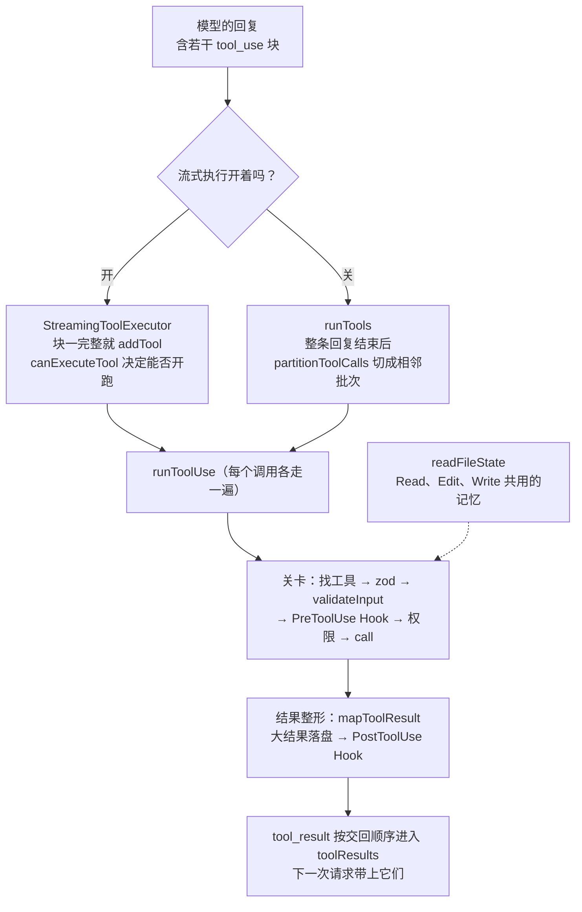

模型在一条回复里写了四个工具调用：读 `a.js`、读 `b.js`、改 `a.js`、再读一次 `a.js` 看改对没有。

怎么跑？全部同时开始最快，但最后那次 Read 可能抢在 Edit 前面，读到旧内容，模型会以为改动没生效。全部排队最稳，两个本来可以同时进行的读就白白等着。Claude Code 的做法是：只把**挨在一起的只读调用**并成一批，Edit 独占一批，像一道栅栏，谁也不能越过去。

这一章顺着一个工具调用往下走，一共四个机制：调用之间怎么调度；一个调用在被执行之前要过哪几道关，每道关失败时模型会收到什么；Edit 怎样确认“模型看到的文件”还是磁盘上的那一份；输出太大时放到哪里去。每个机制都有一次真实运行的输出和对应的源码摘录，并和 Pi、mox 对照；最后看 coda 里怎么实现。


@figure assets/course/ch03-tools.png 读可以一起走，写像一道栅栏；每个调用都要依次过校验、权限、执行三道关

## 先看现象：八次故意碰边界的调用

下面的任务让 Claude Code 严格按顺序做八件事，每件事试探一个工具的边界。录制用的是 Claude Code 2.1.296（由一个开放模型驱动），源码摘录来自 2.1.88，两者有出入的地方会指出。

@code labs/ch03/record.ts#L5-L13 title=录制任务

每次调用的结果，以及钩子有没有看到它：

@lab node labs/ch03/tools.ts calls

三个现象值得追问：

- 第 1、8 步没读过文件就改，**成功了**（见“先读后改”）。
- 第 3、5 步的 Edit 失败了，最后一列写着“没有”：PreToolUse 和 PostToolUse 钩子都没有收到这两次调用（见“一个调用要过的关”）。
- 第 7 步 `seq 1 50000` 输出了 282KB，模型收到的不是这些字符，而是一个文件路径和一小段预览（见“大输出去了哪里”）。

先看全程地图，后面每一节讲其中的一站：



## 哪些调用能同时跑

### 并发安全由工具声明，缺省是“不安全”

调度的第一个问题不是怎么切批，而是谁有资格并发。答案写在工具的默认值里：

@cc Tool.ts#TOOL_DEFAULTS hl=759-760

`buildTool` 给每个工具补默认值：`isConcurrencySafe` 缺省 `false`，`isReadOnly` 缺省 `false`。源码注释把这组默认值叫 fail-closed：一个新工具什么都不声明，就被当成独占的写操作。逐个翻工具文件里的 `isConcurrencySafe`：Read、Grep、Glob、WebFetch、WebSearch 返回 `true`，Agent 也是（子 Agent 之间可以并行）；Edit 和 Write 没有声明，所以是 `false`。Bash 最特别：`BashTool.tsx` 里它的 `isConcurrencySafe(input)` 直接返回 `isReadOnly(input)`，看这一条命令是不是只读。

注意签名里有 `input`：并发安全是**这一次调用**的性质，不只是工具的性质。

### 只合并相邻的调用

有了每个调用的资格，`partitionToolCalls` 负责切批：

@cc services/tools/toolOrchestration.ts#partitionToolCalls hl=97-98,102-105,109-112

::: steps partitionToolCalls 把五个调用切成三批
--- 模型在一条回复里写了五个调用：读、读、改、读、读。`partitionToolCalls` 从左到右逐个看，手里还没有任何批次。
flowchart LR
  R1[Read a.js]:::dim --> R2[Read b.js]:::dim --> E[Edit a.js]:::dim --> R3[Read a.js]:::dim --> R4[Read c.js]:::dim
--- 第一个 Read：输入能解析，`isConcurrencySafe` 为真。还没有批次，于是新开**第 1 批**，标为并发安全。
flowchart LR
  subgraph B1[第 1 批 · 并发]
    R1[Read a.js]:::on
  end
  R2[Read b.js]:::dim --> E[Edit a.js]:::dim --> R3[Read a.js]:::dim --> R4[Read c.js]:::dim
--- 第二个 Read 也是安全的，**上一批也是安全批**，所以追加进第 1 批：这两个读会同时开始。
flowchart LR
  subgraph B1[第 1 批 · 并发]
    R1[Read a.js]:::done
    R2[Read b.js]:::on
  end
  E[Edit a.js]:::dim --> R3[Read a.js]:::dim --> R4[Read c.js]:::dim
--- Edit 不是并发安全的：它自己开**第 2 批**。这一批是一道栅栏，后面的调用不能越过它并到前面去。
flowchart LR
  subgraph B1[第 1 批 · 并发]
    R1[Read a.js]:::done
    R2[Read b.js]:::done
  end
  subgraph B2[第 2 批 · 独占]
    E[Edit a.js]:::on
  end
  B1 --> B2
  R3[Read a.js]:::dim --> R4[Read c.js]:::dim
--- 第三个 Read 是安全的，但**上一批是独占批**，不能追加，只能新开第 3 批。所以它一定在 Edit 之后执行，读到改过的内容。
flowchart LR
  subgraph B1[第 1 批 · 并发]
    R1[Read a.js]:::done
    R2[Read b.js]:::done
  end
  subgraph B2[第 2 批 · 独占]
    E[Edit a.js]:::done
  end
  subgraph B3[第 3 批 · 并发]
    R3[Read a.js]:::on
  end
  B1 --> B2 --> B3
  R4[Read c.js]:::dim
--- 最后一个 Read 追加进第 3 批。结果是三批：`[Read Read] [Edit] [Read Read]`，批内并发，批与批之间按顺序。
flowchart LR
  subgraph B1[第 1 批 · 并发]
    R1[Read a.js]:::done
    R2[Read b.js]:::done
  end
  subgraph B2[第 2 批 · 独占]
    E[Edit a.js]:::done
  end
  subgraph B3[第 3 批 · 并发]
    R3[Read a.js]:::done
    R4[Read c.js]:::on
  end
  B1 --> B2 --> B3
:::


逐段看：

- 第 96–97 行按名字找工具，再用 zod 的 `safeParse` 解析输入。**解析失败，就不再问工具并发不并发**，直接按“不安全”处理。
- 第 98–108 行调用 `isConcurrencySafe`，抛异常也按 `false`（注释举的例子是 shell 命令解析失败）。三种“拿不准”——工具不存在、输入解析不了、判断过程出错——都落在串行这一边。
- 第 109–113 行：只有当前调用安全、**并且上一批也是安全批**，才追加到上一批；否则新开一批。写操作自己永远成一批，它既是独占者，也是栅栏，后面的 Read 没有办法并到前面去。

`runTools` 拿到批次后，安全批用 `all(…, 10)` 同时跑（上限 10，环境变量 `CLAUDE_CODE_MAX_TOOL_USE_CONCURRENCY` 可改），其余批一个一个跑。并发批里，工具想对上下文做的修改（`contextModifier`）先按调用 id 排队，整批结束后**按调用顺序**依次生效，而不是按谁先跑完——否则同一条回复的效果会取决于运行时的快慢。（下一节的流式执行器干脆不支持并发安全的工具修改上下文，源码注释说目前没有工具这样用。）

下面的实验把四种调用（正常的 Read、Edit，路径写成数字的 Read，不存在的工具）排列组合，比较三个实现的分批：Claude Code 的原函数（从固定提交里装载并运行，只替换它依赖的工具目录）、coda 的 `partition`，以及 Pi/mox 的做法。

@lab node --disable-warning=ExperimentalWarning labs/chapters/03-tools.mjs batches

前两列在 1364 种序列上完全一致。注意第二行：`Read Read Edit Read Read` 被切成 `[Read Read] [Edit] [Read Read]`，两头各有两个读同时进行。

最后一张表是这道栅栏保护的东西：同一条回复里 Read、Edit、Read。coda 的第三个调用读到 `"new"`。mox 把整批同时开始：Edit 要先登记文件锁、读文件、再写，几步异步操作；最后那个 Read 不用排队，更早读完，读到的是 `"old"`，尽管磁盘上最后确实是 `"new"`。Pi 的 `executeToolCalls` 是同样的结构：

@pi packages/agent/src/agent-loop.ts#L518-L533 hl=526-531

只要有一个工具标成 `sequential`，整条回复串行，否则整条并行。这不是疏漏，是另一种取舍：Pi 的设计等于假定“同一条回复里的调用互不依赖”，写写冲突用每个文件一把锁解决（mox 的 `withFileLock`），读写之间不排顺序。Claude Code 不依赖这个假定，用相邻分批把顺序保住，代价是 `Read Edit Read` 这类序列少了一点并行。

## 模型还没说完，工具已经在跑

Claude Code 的流式输出里，每个内容块一结束，就产出一条独立的 assistant 消息（`claude.ts` 在 `content_block_stop` 时 `yield`）。`query.ts` 每收到一条，就把其中的 `tool_use` 交给 `StreamingToolExecutor.addTool`。这时模型可能还在写后面的调用。

这条路径由服务端开关 `tengu_streaming_tool_execution2` 控制；开关关着时走上一节的 `runTools`，等整条回复结束再分批。两条路径的并发规则相同，执行器把它改成了“在线判断”：

@cc services/tools/StreamingToolExecutor.ts#L126-L151 hl=131-134,144-149

`canExecuteTool` 只有两种情况返回 `true`：现在没有任何调用在执行；或者我是并发安全的，**而且**正在执行的全是并发安全的。`processQueue` 按到达顺序扫描队列，碰到一个开不了的**独占**调用就 `break`，排在它后面的调用，哪怕是 Read，也不许越过。这和 `partitionToolCalls` 的栅栏是同一条规则，只是边收边判。

调用开始得早，结果怎么交回？

@cc services/tools/StreamingToolExecutor.ts#L412-L440 hl=428-430,436-438

`getCompletedResults` 同样按到达顺序检查：已完成的立刻交回；遇到“正在执行、并且不是并发安全”的就 `break`；而**正在执行的并发安全调用不挡路**，后面已经完成的结果可以先走。类顶部的注释说结果会按收到的顺序发出，这句话只对独占调用成立。

我们不必猜：把这个类从固定提交里装载出来运行，工具换成会睡几毫秒的假工具，四个调用每隔 10ms 到达一个。

@lab node --disable-warning=ExperimentalWarning labs/chapters/03-tools.mjs streaming

R2 比 R1 晚到，却先做完、先交回；E 要等 R1、R2 都结束才开始，R3 虽然是读，也排在 E 之后。第二张表是类里的另一条规则：**只有 Bash 出错才会取消同批的兄弟调用**（源码注释的理由是 shell 命令之间常有隐含的依赖，`mkdir` 失败了后面的命令就没意义），Read 出错不影响别人。被取消的调用也会收到一条 `is_error` 的结果，因为 API 要求每个 `tool_use` 都有配对的 `tool_result`。

真实录制里也看得到这种顺序。有一次实验里，模型把 `a.js` 和 `b.js` 的导出说反了，于是专门做了一个对照：并行读四个文件，`a.js` 有 4000 行，`b.js` 只有 10 行，同样的任务跑三次。

@lab node labs/ch03/order.ts

三件事：

- **结果按完成顺序排列。** 第 1、2 次 `b.js` 先读完，请求里的结果是 `b a c d`。Read 的结果只有带行号的内容，**没有文件名**，模型只能靠 `tool_use_id` 配对。
- **模型不一定按 id 配对。** 第 1 次，实验用的模型按位置配对，把 `a.js` 和 `b.js` 说反了；第 2 次顺序一样，它却答对了。
- **边说边跑。** 会话文件里的先后是 `调a 调b 果b 果a 调c`：`c.js` 的调用还没生成出来，前两个文件已经读完了。

Pi 和 mox 的选择不同：工具并发执行，结果按**调用顺序**放回对话（Pi 的事件按完成顺序发，消息按调用顺序放）。按调用顺序，对“按位置配对”的模型更宽容；按完成顺序，结果一到就能写进会话、显示出来，不必等最慢的那个。两种在协议上都合法。

## 一个调用要过的关

调用的资格和时机定下来之后，每个调用各自进入 `runToolUse`，真正的流水线在 `checkPermissionsAndCallTool` 里。先看全貌，虚线是失败出口，每个出口都会产生一条 `tool_result`：

::: steps 一个 Edit 调用依次过哪些关
--- 模型的回复里有一个 `tool_use`：`name` 加 `input`。它进入 `runToolUse`，真正的流水线在 `checkPermissionsAndCallTool` 里。先按名字找工具；工具不存在，或者调用已被取消，就不开始。
flowchart TD
  A["tool_use：name + input"]:::on --> B["找工具；已取消就不开始"]:::on --> D["zod safeParse"]:::dim --> V["tool.validateInput"]:::dim --> H["PreToolUse Hook<br/>给 allow / ask / deny 意见，可改参数"]:::dim --> P["权限<br/>resolveHookPermissionDecision"]:::dim --> K["tool.call"]:::dim --> M["mapToolResult → 大结果落盘<br/>先把 tool_result 放进结果"]:::dim --> Q["PostToolUse Hook<br/>只能追加信息"]:::dim --> OK["tool_result（成功）"]:::dim
  B -.->|不存在 / 已取消| ERR["tool_result：is_error<br/>tool_use_id 原样带回"]:::dim
  D -.->|解析失败| ERR
  V -.->|result: false| ERR
  P -.->|不是 allow| ERR
  K -.->|抛错：formatError + PostToolUseFailure| ERR
--- zod `safeParse`（`toolExecution.ts` 第 615 行）把模型传错的形状变成一段写给模型看的话，比如缺了必填参数。解析失败就走虚线出口，生成一条 `is_error` 的 `tool_result`。
flowchart TD
  A["tool_use：name + input"]:::done --> B["找工具；已取消就不开始"]:::done --> D["zod safeParse"]:::on --> V["tool.validateInput"]:::dim --> H["PreToolUse Hook<br/>给 allow / ask / deny 意见，可改参数"]:::dim --> P["权限<br/>resolveHookPermissionDecision"]:::dim --> K["tool.call"]:::dim --> M["mapToolResult → 大结果落盘<br/>先把 tool_result 放进结果"]:::dim --> Q["PostToolUse Hook<br/>只能追加信息"]:::dim --> OK["tool_result（成功）"]:::dim
  B -.->|不存在 / 已取消| ERR["tool_result：is_error<br/>tool_use_id 原样带回"]:::dim
  D -.->|解析失败| ERR
  V -.->|result: false| ERR
  P -.->|不是 allow| ERR
  K -.->|抛错：formatError + PostToolUseFailure| ERR
--- 工具自己的 `validateInput`。录制里 `old_string` 找不到、匹配多处的两次 Edit 失败，都在这里被拒（`result === false`），包成 `is_error` 直接 `return`。**后面的 Hook、权限、`call` 都没机会运行**，所以 Hook 看不到这类失败。
flowchart TD
  A["tool_use：name + input"]:::done --> B["找工具；已取消就不开始"]:::done --> D["zod safeParse"]:::done --> V["tool.validateInput"]:::on --> H["PreToolUse Hook<br/>给 allow / ask / deny 意见，可改参数"]:::dim --> P["权限<br/>resolveHookPermissionDecision"]:::dim --> K["tool.call"]:::dim --> M["mapToolResult → 大结果落盘<br/>先把 tool_result 放进结果"]:::dim --> Q["PostToolUse Hook<br/>只能追加信息"]:::dim --> OK["tool_result（成功）"]:::dim
  B -.->|不存在 / 已取消| ERR["tool_result：is_error<br/>tool_use_id 原样带回"]:::on
  D -.->|解析失败| ERR
  V -.->|result: false| ERR
  P -.->|不是 allow| ERR
  K -.->|抛错：formatError + PostToolUseFailure| ERR
--- 校验通过，才轮到 PreToolUse Hook：它给出 allow / ask / deny 的意见，还可以改参数。接着 `resolveHookPermissionDecision` 把 Hook 的意见和权限规则合成最终决定（第 6、7 章展开）；结果不是 allow，走虚线出口。
flowchart TD
  A["tool_use：name + input"]:::done --> B["找工具；已取消就不开始"]:::done --> D["zod safeParse"]:::done --> V["tool.validateInput"]:::done --> H["PreToolUse Hook<br/>给 allow / ask / deny 意见，可改参数"]:::on --> P["权限<br/>resolveHookPermissionDecision"]:::on --> K["tool.call"]:::dim --> M["mapToolResult → 大结果落盘<br/>先把 tool_result 放进结果"]:::dim --> Q["PostToolUse Hook<br/>只能追加信息"]:::dim --> OK["tool_result（成功）"]:::dim
  B -.->|不存在 / 已取消| ERR["tool_result：is_error<br/>tool_use_id 原样带回"]:::dim
  D -.->|解析失败| ERR
  V -.->|result: false| ERR
  P -.->|不是 allow| ERR
  K -.->|抛错：formatError + PostToolUseFailure| ERR
--- 执行 `tool.call`。抛出的任何异常（包括失败的 Shell 命令）都被接住，`formatError` 拼成 `is_error` 的结果并运行 PostToolUseFailure：异常不会冲出循环，模型总能看到发生了什么。
flowchart TD
  A["tool_use：name + input"]:::done --> B["找工具；已取消就不开始"]:::done --> D["zod safeParse"]:::done --> V["tool.validateInput"]:::done --> H["PreToolUse Hook<br/>给 allow / ask / deny 意见，可改参数"]:::done --> P["权限<br/>resolveHookPermissionDecision"]:::done --> K["tool.call"]:::on --> M["mapToolResult → 大结果落盘<br/>先把 tool_result 放进结果"]:::dim --> Q["PostToolUse Hook<br/>只能追加信息"]:::dim --> OK["tool_result（成功）"]:::dim
  B -.->|不存在 / 已取消| ERR["tool_result：is_error<br/>tool_use_id 原样带回"]:::dim
  D -.->|解析失败| ERR
  V -.->|result: false| ERR
  P -.->|不是 allow| ERR
  K -.->|抛错：formatError + PostToolUseFailure| ERR
--- 成功后 `mapToolResult` 把结果映射成给模型的文本，大结果落盘。非 MCP 工具在这里 `addToolResult`：**`tool_result` 已经定了**，后面的 Hook 改不了模型看到的这一条。
flowchart TD
  A["tool_use：name + input"]:::done --> B["找工具；已取消就不开始"]:::done --> D["zod safeParse"]:::done --> V["tool.validateInput"]:::done --> H["PreToolUse Hook<br/>给 allow / ask / deny 意见，可改参数"]:::done --> P["权限<br/>resolveHookPermissionDecision"]:::done --> K["tool.call"]:::done --> M["mapToolResult → 大结果落盘<br/>先把 tool_result 放进结果"]:::on --> Q["PostToolUse Hook<br/>只能追加信息"]:::dim --> OK["tool_result（成功）"]:::dim
  B -.->|不存在 / 已取消| ERR["tool_result：is_error<br/>tool_use_id 原样带回"]:::dim
  D -.->|解析失败| ERR
  V -.->|result: false| ERR
  P -.->|不是 allow| ERR
  K -.->|抛错：formatError + PostToolUseFailure| ERR
--- 最后运行 PostToolUse Hook：它能追加信息、能让后续的循环停下，但只能追加。交回的 `tool_result` 带着原来的 `tool_use_id`，每个调用恰好得到一条结果。
flowchart TD
  A["tool_use：name + input"]:::done --> B["找工具；已取消就不开始"]:::done --> D["zod safeParse"]:::done --> V["tool.validateInput"]:::done --> H["PreToolUse Hook<br/>给 allow / ask / deny 意见，可改参数"]:::done --> P["权限<br/>resolveHookPermissionDecision"]:::done --> K["tool.call"]:::done --> M["mapToolResult → 大结果落盘<br/>先把 tool_result 放进结果"]:::done --> Q["PostToolUse Hook<br/>只能追加信息"]:::on --> OK["tool_result（成功）"]:::on
  B -.->|不存在 / 已取消| ERR["tool_result：is_error<br/>tool_use_id 原样带回"]:::dim
  D -.->|解析失败| ERR
  V -.->|result: false| ERR
  P -.->|不是 allow| ERR
  K -.->|抛错：formatError + PostToolUseFailure| ERR
:::

顺序有两个值得记住的结论。

**校验在 Hook 之前，所以校验失败的调用 Hook 看不到。** zod 解析（`toolExecution.ts` 第 615 行）把模型传错的形状变成一段写给模型看的话，比如 ``The required parameter `x` is missing``；紧接着是工具自己的 `validateInput`：

@cc services/tools/toolExecution.ts#L682-L687 hl=683-687

校验不通过（`result === false`）时，下面这一段把错误包成一条 `is_error` 的 `tool_result` 并直接 `return`，后面的 Hook、权限、`call` 都没有机会运行：

@cc services/tools/toolExecution.ts#L717-L732 hl=717,722-726,732

这就是录制里两次失败的 Edit 没有触发任何钩子的原因，也是 PostToolUseFailure 不会统计它们的原因：这个事件只在 `call` 抛出异常时才触发。工具接口里对 `checkPermissions` 的注释也是同一个顺序：它只在 `validateInput` 通过之后才会被调用。想统计所有失败的调用，要看事件流或会话记录，不能靠 Hook。

**内置工具的结果，在 PostToolUse 之前就已经定了。**

@cc services/tools/toolExecution.ts#L1476-L1490 hl=1477-1479

非 MCP 工具在这里 `addToolResult`，把映射好的 `tool_result` 放进结果，随后才运行 PostToolUse。Hook 能追加信息、能停止后续的循环，但改不了模型看到的这条结果（只有 MCP 工具例外，它的输出会先让 Hook 过一遍）。“给模型的文本”和“给程序的结构化数据”从一开始就是两份：

@lab node labs/ch03/tools.ts shapes

Edit 的 `originalFile` 和 `structuredPatch` 让界面画 diff、让 Hook 做审计，模型只收到一句 “The file … has been updated successfully.”。mox 的 `ToolResult` 把这两份叫 `content` 和 `details`，coda 叫 `text` 和 `details`。

最后是失败的那一头：

@cc services/tools/toolExecution.ts#L1691-L1726 hl=1691,1700-1712,1719-1724

`call` 抛出的任何异常（包括被判定为失败的 Shell 命令）都在这里变成 `is_error` 的结果，同时运行 PostToolUseFailure。`formatError` 对 Shell 错误拼出 `Exit code N` 加上 stderr、stdout，超过一万字符就保留头尾各 5000，中间截掉。**异常不会冲出循环**，模型总能看到发生了什么，这和 Learn Pi Agent 第 3 章讲的原则一样：能变成消息的失败，就交回给模型。

权限那一关（`resolveHookPermissionDecision`、规则、模式）在第 6 章展开，Hook 的匹配与输出在第 7 章。这里只需要记住它们的位置：校验之后、执行之前。

### coda 的流水线，逐关对照

coda 的 `Toolset.execute` 把这条流水线缩成六步，每一步的失败都变成一条带着同一个 id 的错误结果：

@code coda/src/tools.mjs#execute hl=144,146-147,150-152,156-159

两处和原版不同：原版的 zod 和 `validateInput` 在这里合成一个 `validate`；Hook 改写参数后 coda 会**再校验一次**（第 150 行），原版没有这一步，它让改写后的输入直接进入权限判断，Edit 则在 `call` 里自己再核对一遍。多这一次校验是为了让第 7 章的“Hook 不能绕过校验”可以直接验证。

@lab node --disable-warning=ExperimentalWarning labs/chapters/03-tools.mjs pipeline

“经过的关卡”一列就是流水线走到哪里停了：不存在的工具、参数类型不对、没读过就 Edit，三种失败**一关都没到**，Hook 的记录是空的，和录制里的现象一致。Hook 把参数改成不合法的值，会在权限询问之前被挡下。工具抛错之后，执行后 Hook 不再运行。每个调用恰好得到一条结果，id 原样带回。

## 先读后改：readFileState 记着模型看到的版本

录制的第 1 步没读过 `add.js` 就 Edit，成功了。2.1.88 的源码却是另一个样子：Edit 的提示词明确要求在对话里至少先 Read 一次，`validateInput` 里有对应的检查。两个版本的差别在文档里有说明（意译）：Claude Opus 4.6、Haiku 4.5 和更早的模型总是要求先读；更新的模型在“读这个文件不需要权限确认、且 Read 工具可用”时可以直接改（[Tools reference · Edit tool behavior](https://code.claude.com/docs/en/tools-reference)）。实验用的模型 Claude Code 不认识，看来按“较新的模型”处理。**同一套驾驶层，规则会随模型的能力调整。**

2.1.88 的硬规则把机制摆得最清楚，下面按它讲。`readFileState`（`utils/fileStateCache.ts`）是一个 LRU 缓存（默认最多 100 项、25MB），键是规范化后的路径，值里有五个字段：`content`（读到的内容）、`timestamp`（当时的修改时间）、`offset`、`limit`（读了哪一段），以及 `isPartialView`（模型看到的是不是被加工过的内容，比如自动注入的 CLAUDE.md，第 4 章）。Read 写入它，Edit、Write 写完也写入它。

@cc tools/FileEditTool/FileEditTool.ts#L275-L311 hl=276,292,296-299

三个分支：

1. **没有记录，或者 `isPartialView`**（第 276 行）：返回 “File has not been read yet”。注意只有 `isPartialView` 才算“没看全”；用 `offset`、`limit` 读了一段，也算读过。
2. **修改时间晚于记录里的时间**（第 292 行）：文件在读过之后变了，返回 “modified since read … Read it again”。
3. **时间戳变了但内容没变**（第 296–299 行）：注释说这是为了 Windows 上云同步、杀毒软件碰一下时间戳造成的误报，所以内容相等就放行。但条件要求 `offset` 和 `limit` 都是 `undefined`，而 Read 总会记下一个数值的 `offset`（缺省为 1），所以按字面看，这条兜底只对 Edit、Write 自己写下的记录生效。

校验通过后还要检查 `old_string` 的匹配次数：零次是 “String to replace not found”，多于一次又没设 `replace_all` 是 “Found N matches … provide more context”。录制的第 3、5 步正是这两个错误。**错误信息本身就是给模型的操作指南**：不唯一时它告诉模型两条出路，多给上下文，或者设置 `replace_all`。

检查并没有到此为止。`validateInput` 之后还有 Hook 和权限询问，用户可能想了一分钟，linter 可能在这一分钟里改了文件。所以 `call` 开头把同样的检查再做一遍：

@cc tools/FileEditTool/FileEditTool.ts#L427-L468 hl=428-429,443,451-467

第 428–429 行的注释说明了写法的要求：`mkdir` 这些异步操作要放在“检查”和“写入”之外，因为这两步之间只要让出一次执行权，并发的编辑就可能插进来。从第 444 行读文件内容，到后面 `writeTextContent`，中间没有 `await`。这只保证同一个进程内不交错；跨进程的竞争（用户的编辑器同时保存）仍然存在，也是这套检查做不到的边界。

写完以后，立刻刷新记录：

@cc tools/FileEditTool/FileEditTool.ts#L519-L525 hl=520-524

新的 `content` 和 `timestamp`，`offset`、`limit` 都是 `undefined`。模型刚改完的版本就是它“知道”的版本，下一次编辑不用重读。Read 里的重复读取优化也靠这个 `undefined` 区分记录的来源：同一段内容没变时，再次 Read 只返回一句“文件没变”，但 Edit 写下的记录不参与，否则会让模型指回改动之前的那次读取。

::: steps Edit 的两次版本检查
--- Read 把读到的文件写进 `readFileState`（LRU，键是规范化路径）：`content`、读取时的 `timestamp`、`offset`、`limit`，以及 `isPartialView`。这是模型“看到的版本”。
flowchart LR
  RD["Read<br/>写入 readFileState<br/>content、timestamp、offset、limit"]:::on --> V1["validateInput<br/>没有记录 / isPartialView：拒绝<br/>修改时间变了且内容变了：拒绝<br/>old_string 零次或多次匹配：拒绝"]:::dim --> HP["PreToolUse Hook + 权限询问<br/>用户可能想了一分钟<br/>linter 可能改了文件"]:::dim --> V2["call 开头<br/>同样的检查再做一遍"]:::dim --> W["读内容 → writeTextContent<br/>中间没有 await"]:::dim --> R["刷新 readFileState<br/>新 content、timestamp<br/>offset、limit 为 undefined"]:::dim
  R -.->|下一次 Edit 不用重读| V1
--- Edit 的 `validateInput` 做第一次检查：没有记录或 `isPartialView` 返回 “File has not been read yet”；修改时间晚于记录就返回 “modified since read”（内容相等则放行）；再数 `old_string` 的匹配次数。
flowchart LR
  RD["Read<br/>写入 readFileState<br/>content、timestamp、offset、limit"]:::done --> V1["validateInput<br/>没有记录 / isPartialView：拒绝<br/>修改时间变了且内容变了：拒绝<br/>old_string 零次或多次匹配：拒绝"]:::on --> HP["PreToolUse Hook + 权限询问<br/>用户可能想了一分钟<br/>linter 可能改了文件"]:::dim --> V2["call 开头<br/>同样的检查再做一遍"]:::dim --> W["读内容 → writeTextContent<br/>中间没有 await"]:::dim --> R["刷新 readFileState<br/>新 content、timestamp<br/>offset、limit 为 undefined"]:::dim
  R -.->|下一次 Edit 不用重读| V1
--- 校验通过后还有 Hook 和权限询问。这段时间里文件可能被别的程序改了，第一次检查的结论已经不可靠。
flowchart LR
  RD["Read<br/>写入 readFileState<br/>content、timestamp、offset、limit"]:::done --> V1["validateInput<br/>没有记录 / isPartialView：拒绝<br/>修改时间变了且内容变了：拒绝<br/>old_string 零次或多次匹配：拒绝"]:::done --> HP["PreToolUse Hook + 权限询问<br/>用户可能想了一分钟<br/>linter 可能改了文件"]:::on --> V2["call 开头<br/>同样的检查再做一遍"]:::dim --> W["读内容 → writeTextContent<br/>中间没有 await"]:::dim --> R["刷新 readFileState<br/>新 content、timestamp<br/>offset、limit 为 undefined"]:::dim
  R -.->|下一次 Edit 不用重读| V1
--- 所以 `call` 开头把同样的检查再做一遍。注释要求：`mkdir` 这类异步操作放在检查和写入之外，免得两步之间让出执行权，被并发的编辑插进来。
flowchart LR
  RD["Read<br/>写入 readFileState<br/>content、timestamp、offset、limit"]:::done --> V1["validateInput<br/>没有记录 / isPartialView：拒绝<br/>修改时间变了且内容变了：拒绝<br/>old_string 零次或多次匹配：拒绝"]:::done --> HP["PreToolUse Hook + 权限询问<br/>用户可能想了一分钟<br/>linter 可能改了文件"]:::done --> V2["call 开头<br/>同样的检查再做一遍"]:::on --> W["读内容 → writeTextContent<br/>中间没有 await"]:::dim --> R["刷新 readFileState<br/>新 content、timestamp<br/>offset、limit 为 undefined"]:::dim
  R -.->|下一次 Edit 不用重读| V1
--- 第 444 行读文件内容，到 `writeTextContent` 写入，中间没有 `await`。这只保证同一个进程内不交错；用户的编辑器同时保存，这套检查拦不住。
flowchart LR
  RD["Read<br/>写入 readFileState<br/>content、timestamp、offset、limit"]:::done --> V1["validateInput<br/>没有记录 / isPartialView：拒绝<br/>修改时间变了且内容变了：拒绝<br/>old_string 零次或多次匹配：拒绝"]:::done --> HP["PreToolUse Hook + 权限询问<br/>用户可能想了一分钟<br/>linter 可能改了文件"]:::done --> V2["call 开头<br/>同样的检查再做一遍"]:::done --> W["读内容 → writeTextContent<br/>中间没有 await"]:::on --> R["刷新 readFileState<br/>新 content、timestamp<br/>offset、limit 为 undefined"]:::dim
  R -.->|下一次 Edit 不用重读| V1
--- 写完立刻刷新记录：新的 `content` 和 `timestamp`，`offset`、`limit` 都是 `undefined`。模型刚改完的版本就是它“知道”的版本，下一次编辑不用重读。
flowchart LR
  RD["Read<br/>写入 readFileState<br/>content、timestamp、offset、limit"]:::done --> V1["validateInput<br/>没有记录 / isPartialView：拒绝<br/>修改时间变了且内容变了：拒绝<br/>old_string 零次或多次匹配：拒绝"]:::done --> HP["PreToolUse Hook + 权限询问<br/>用户可能想了一分钟<br/>linter 可能改了文件"]:::done --> V2["call 开头<br/>同样的检查再做一遍"]:::done --> W["读内容 → writeTextContent<br/>中间没有 await"]:::done --> R["刷新 readFileState<br/>新 content、timestamp<br/>offset、limit 为 undefined"]:::on
  R -.->|下一次 Edit 不用重读| V1
:::

下面是 coda 里同一套规则的行为，每一步都是真实执行：

@lab node --disable-warning=ExperimentalWarning labs/chapters/03-tools.mjs file-state

读表时留意三处。第 4 行：紧接着再改一次，不用重读。外部程序追加了一行以后，下一次 Edit 被拒绝，重读之后恢复。只读了第 1 行（`limit: 1`），却能改第 2 行的 `y=1`：这套机制检查的是**版本**，不是**覆盖范围**；改的位置是否对，由“`old` 在整个文件里必须唯一”来保证。

## 大输出去了哪里

录制的第 7 步输出 282KB，模型收到的是路径和预览。顺着源码找，会发现大输出不是一个机制，而是三种。

**第一种：通用的落盘。** 每个工具声明自己的 `maxResultSizeChars`（Bash 30000、Grep 20000，多数工具 100000，Read 是 `Infinity`），实际阈值取它和全局默认值 50000 中较小的一个。超过时：

@cc utils/toolResultStorage.ts#L280-L333 hl=287-295,310-312,315-319,321,333

- 第 287–295 行：**空结果也要处理**。注释记录了一次事故：空的 `tool_result` 出现在提示末尾时，有些模型会误以为这一轮已经说完，直接结束回合。所以空输出被换成 `(Bash completed with no output)` 这样的一句话。
- 第 310–312 行：没超限，原样返回。
- 第 315–321 行：超限就把**整个内容**存成 `tool-results/<tool_use_id>.txt`（用 `wx` 方式写入，同一个 id 只写一次：microcompact 会重放原来的消息，不能每次都重写），再生成 `<persisted-output>`，写着大小、路径和开头 2000 字符的预览。预览尽量截在换行处。
- 存盘失败（`isPersistError`）就返回原内容，宁可多占上下文也不丢结果。

下面的实验用 coda 的实现复现这些行为，阈值那张表是**原函数** `getPersistenceThreshold` 算出来的：

@lab node --disable-warning=ExperimentalWarning labs/chapters/03-tools.mjs big-output

和录制对得上：50000 行的输出是 282.1 KB，模型只收到约两千字符。完整输出一字不差地存在文件里，给程序的 `details` 带着路径。预览和原函数 `generatePreview` 的结果一致。

**第二种：Read 自己限长，而且不落盘。** 把 Read 的结果存成文件，再让模型用 Read 去读那个文件，会绕成一个圈，所以它的声明是 `Infinity`。它改为在读之前自己拒绝：

::: tabs
@@ Claude Code
@cc tools/FileReadTool/limits.ts#L1-L14 hl=3-7,9-13
超限就抛错，让模型自己用 `offset` 和 `limit` 缩小范围。
@@ Pi
@pi packages/coding-agent/src/core/tools/truncate.ts#truncateHead
read 保留开头，按行数和字节数截断，不返回半行。
@@ mox
@mox mox/src/coding/read.ts#L30-L38
截断后附上“用 offset=N 继续读”的提示。
@@ coda
@code coda/src/files.mjs#L111-L115
照 Claude Code：超过上限直接抛错，提示用 offset 和 limit。
:::

不给 `limit` 时文件超过 256KB，或者读出的内容超过 25000 个 token，都是**抛错**，错误信息告诉模型用 `offset` 和 `limit`。下半段注释记录了一次实验：把超限改成“截断后返回”，错误率下降了，但平均 token 反而上升（报错只有大约 100 字节，截断却会塞进约 25K token），于是又改了回去。coda 的 Read 照这个思路，实验里 20000 行的文件被拒绝，`offset: 10000, limit: 3` 只返回三行。Pi/mox 选了另一条路：read 保留开头、bash 保留结尾（命令的报错通常在最后），截断时附上“用 offset=N 继续”的提示。

**第三种：Bash 根本不把输出放进内存。**

@cc tools/BashTool/BashTool.tsx#L728-L752 hl=732,737-749

Shell 命令的 stdout 和 stderr 直接写到文件描述符指向的文件里（`TaskOutput.ts` 顶部的注释），JS 这边只读取不超过 `getMaxOutputLength()`（默认 30000）的部分。超出时，只是把这个文件**硬链接**（失败再复制）到 `tool-results` 目录，上限 64MB。失控的命令不会撑爆进程的内存，而“落盘”几乎是零成本。

源码里还有第四层：单条消息里所有 `tool_result` 加起来的预算（`MAX_TOOL_RESULTS_PER_MESSAGE_CHARS`，200000 字符），防止十个并行工具各输出 4 万字符。它由功能开关控制，决定一旦做出就冻结（`seenIds`、`replacements`），保证相同的结果每次替换成完全相同的文本，不破坏提示缓存。我们没有单独观察这一层，coda 也不实现它。

## 三种实现的取舍

| 问题 | Claude Code | Pi / mox | coda |
| --- | --- | --- | --- |
| 谁决定能否并行 | 工具的 `isConcurrencySafe(input)`，缺省 `false` | 工具的 `executionMode`，缺省并行；有一个 `sequential`，整条回复串行 | `parallel` 标记 + `validate`，缺省 `false` |
| 怎么分批 | 相邻分批，写操作是栅栏；流式执行器在线判断 | 整条回复要么并行要么串行 | 相邻分批 |
| 同一文件的写冲突 | 写工具独占；Edit 检查 `readFileState` | 每个文件一把锁，读不排队 | 写工具独占；检查内容哈希 |
| 结果顺序 | 并发安全的调用按完成顺序，独占的按到达顺序 | 消息按调用顺序（事件按完成顺序） | 按调用顺序 |
| 先读后改 | 2.1.88 硬规则；更新的版本按模型放宽 | 没有；精确匹配 + 唯一性 | 硬规则 |
| 大输出 | 落盘 + 2000 字符预览；Read 报错；Bash 直写文件 | read 保留头、bash 保留尾，附继续读的提示 | 落盘 + 预览；Read 报错 |

同一件事——“一条回复里的多个调用怎么排”——在四份代码里的写法，切换标签对照着看：

::: tabs
@@ Claude Code
@cc services/tools/toolOrchestration.ts#partitionToolCalls
相邻分批：安全批只并入紧挨着的上一个安全批，写操作是栅栏。
@@ Pi
@pi packages/agent/src/agent-loop.ts#L518-L533
整条回复要么全部并行、要么全部串行，只要有一个工具声明 `sequential`。
@@ mox
@mox mox/src/tools.ts#runTools
和 Pi 相同的规则：并发执行，结果按调用顺序放回。
@@ coda
@code coda/src/tools.mjs#partition
照 Claude Code 写的十行版本。
:::

取舍的核心是**谁来保证顺序**。Pi 的设计相当于把它交给模型（别在一条回复里写互相依赖的调用）加上文件锁；Claude Code 把它写进调度，哪怕牺牲一点并行：模型写出 Read、Edit、Read 这样的序列，结果仍然正确。Pi 的做法更简单——没有栅栏，没有按输入判断并发的谓词，工具作者要考虑的事更少。“先读后改”是另一种取舍：硬规则最稳，却让强模型多读一遍，文档里的放宽就是这么来的。

换一种做法，会坏在哪里：

- 去掉栅栏、把所有只读调用并成一批：后面的 Read 越过 Edit，读到旧内容，结果的顺序也乱了（见“你来改”第一题）。
- 校验放在 Hook 之后：每个 Hook 脚本都要面对模型写错的参数，各自重复校验；审计里还会混进根本没执行过的调用。这一条是推理，不是源码里读到的。
- Edit 写完不刷新记录：模型每改一次就得重读一次（第二题）。
- 大输出直接截断：模型看不到被截掉的部分，也没有办法找回来；落盘加预览至少让它知道“还有，在这里”。

## coda 里的实现

三个函数各对应源码里的一处，每一处都有一条简化。

**分批。** `partition` 把 `partitionToolCalls` 缩成十行；`canRunInParallel` 对应“解析输入 + 并发安全谓词”，`validate` 兼任 `safeParse`。

@code coda/src/tools.mjs#partition hl=49,51-52

**版本检查。** `checkEdit` 对应 Edit 的 `validateInput`，`assertFresh` 是“读过吗、变了吗”。coda 不比较修改时间，只比较内容哈希，写入的记录也是哈希，所以连 Windows 上那个兜底都用不着；代价是每次检查要读一遍文件。

@code coda/src/files.mjs#assertFresh hl=61-64

**结果整形。** `shapeResult` 只改给模型的那一份文本（`text`），`details` 原样保留，并在落盘时加上 `persistedPath`。

@code coda/src/tools.mjs#shapeResult hl=88-89,91-94

## 自己跑一遍

本章所有实验在同一个脚本里，可以整体运行，也可以只运行一节：

```bash
node --disable-warning=ExperimentalWarning labs/chapters/03-tools.mjs            # 全部，24 项检查
node --disable-warning=ExperimentalWarning labs/chapters/03-tools.mjs pipeline   # batches / streaming / pipeline / file-state / big-output
```

## 你来改

先写下预测，再动手验证。

::: predict 把分批改成“所有只读调用并进同一批”
把 `partition` 里的 `const last = batches.at(-1)` 改成 `const last = safe ? batches.find((b) => b.safe) : undefined`，`if` 条件改成 `if (last)`。同一条回复 Read、Edit、Read，用 `runCalls` 执行，第三个调用读到什么？返回的结果数组是什么顺序？
???
读到 `"old"`，结果数组的顺序变成 1、3、2。两个 Read 被并进了第一批，在 Edit 之前就跑完了；Edit 所在的批次排在后面。磁盘上最后是 `"new"`，但模型读到的是旧内容，而且结果的顺序和调用的顺序对不上。这就是只收集“所有只读调用”会越过写操作的后果：并发安全首先是顺序问题，其次才是吞吐。
:::

::: predict 写完不刷新记录
删掉 `Edit.execute` 里的 `remember(file)`。先 Read，再连续 Edit 两次（`x=1` → `x=2`，再 `x=2` → `x=3`），第二次会怎样？
???
第一次成功，第二次被拒绝：`file changed since it was read`。第一次 Edit 改变了文件内容，记录里还是改之前的哈希。和 Claude Code 对照：它在 `call` 末尾（第 520 行）刷新 `readFileState`，所以模型自己的编辑不会让下一次编辑失效。没有这一步，每改一次都要重读，白白多花一次往返和上下文。
:::

::: predict 把替换值直接传给 replace
把 `text.replace(input.old, () => input.next)` 改成 `text.replace(input.old, input.next)`。文件里是 `const price = "$5";`，Edit 的 `old` 是 `"$5"`，`next` 是 `"$$5 ($&)"`，文件会变成什么？
???
变成 `const price = "$5 ("$5")";`。字符串形式的替换值里，`$$` 会变成一个 `$`，`$&` 会展开成匹配到的原文，模型想写的字面量被悄悄改了。Claude Code 的 `applyEditToFile` 同样用函数形式（`() => replace`）。这类错误不会报错，只会写出和模型意图不一致的文件，所以工具内部的“看起来很小”的细节也需要用实验守住。
:::

## 面试题

::: interview 模型一次发出多个工具调用，哪些可以并行？怎样保证 Read 不会越过 Edit？
1. **资格由工具声明**，而且看这一次的输入：`isConcurrencySafe(input)`，缺省 `false`（fail-closed）。Read、Grep、Glob、只读的 Bash 声明为 `true`，Edit、Write 不声明。
2. **只合并相邻的安全调用**：`partitionToolCalls` 把调用切成批次，安全批只能并入紧挨着的上一个安全批；写操作自己成一批，既是独占者，也是栅栏。输入解析失败、工具不存在、谓词抛错，都按不安全处理。
3. 加分：流式执行器用 `canExecuteTool` 在线实现同样的规则，碰到独占调用就停止扫描；对照 Pi 的整批并发 + 文件锁，说明取舍是“谁来保证顺序”。
:::

::: interview 一个工具调用从参数到达到结果交回，要经过哪些检查？校验失败的调用，Hook 能看到吗？
顺序是：找工具 → 是否已取消 → schema 解析 → 工具的 `validateInput` → PreToolUse Hook → 权限 → `call` → 结果映射与大结果落盘 → PostToolUse Hook。

- 校验失败**直接返回**一条带原 id 的错误结果，Hook 看不到它，PostToolUseFailure 也不会触发（它只覆盖 `call` 抛错）。想统计所有失败要看事件流或会话记录。
- 所有失败出口都生成 `tool_result`，不抛异常，因为 API 要求每个 `tool_use` 都有配对的结果。
- 加分：内置工具的结果在 PostToolUse 之前就已经放好，Hook 只能追加，不能改写；MCP 工具例外。
:::

::: interview 设计一个文件编辑工具，怎样防止模型基于过期的内容修改？
1. 记录模型**最后一次看到的版本**（内容或时间戳）：Read、Edit、Write 写入这份记录。
2. 编辑前检查：没有记录 → 拒绝；记录之后文件变了 → 拒绝并要求重读；`old_string` 必须在文件里唯一。错误信息要告诉模型下一步怎么做。
3. 检查要做**两次**：校验时一次，写入前一次，因为中间有 Hook 和权限询问；两次之间不能有异步操作，才不会被并发的编辑插入。
4. 写完立刻刷新记录，模型自己的连续编辑不用重读。
5. 加分：用内容哈希还是修改时间；“先读后改”可以按模型能力放宽（Claude Code 新版本就是这样），因为它检查的是版本，不是模型有没有看懂；跨进程的竞争靠这套检查解决不了。
:::

::: interview 并行调用的结果应该按调用顺序还是完成顺序放回对话？有什么坑？
- **完成顺序**（Claude Code 对并发安全的调用）：结果一到就可以写进会话、显示出来，不必等最慢的一个，可以配合“边收边跑”。
- **调用顺序**（Pi、mox、coda）：并发执行，全部完成后排好，对按位置配对的模型更宽容。
- 坑：Read 的结果里只有内容、没有文件名，乱序时按位置配对的模型会张冠李戴（我们的录制里就出现了一次）。对策：按 id 配对的模型、按调用顺序排列，或者在结果里带上关键参数。
- 加分：Claude Code 里非并发安全的调用仍按到达顺序交回，且并发批里对上下文的修改按调用顺序生效。
:::

::: interview 工具的输出太大怎么办？
1. 不塞进上下文，也不悄悄截断。**每个工具声明上限**，超限就把完整内容存成文件，模型收到路径、大小和开头的预览；需要更多时再读那个文件或搜索它。
2. 例外：Read 自己限长（超限报错，提示 offset / limit），因为把它的结果落盘再读回来会绕圈。
3. Bash 让进程直接写文件，超过阈值只是把文件链接过去，不占内存。
4. 空输出也要处理：换成一句说明，免得模型把空结果当成回合结束。
5. 加分：替换文本一旦确定就要冻结，保证每次请求的前缀字节相同，不破坏提示缓存；还要有“同一条消息里所有结果加起来”的总预算。
:::

::: interview 并行的工具里一个失败了，其他的要取消吗？
看失败的类型。Claude Code 的流式执行器里，**只有 Bash 出错才取消同批的兄弟调用**：shell 命令之间常有隐含的依赖（`mkdir` 失败，后面的命令就没意义）；Read、WebFetch 这类彼此独立的调用，一个失败不应该连累别人。被取消的调用不会消失，而是得到一条 `is_error` 的合成结果，这样每个 `tool_use` 仍有配对的 `tool_result`。用户中断、流式回退（streaming fallback）走同样的合成结果路径。
:::
