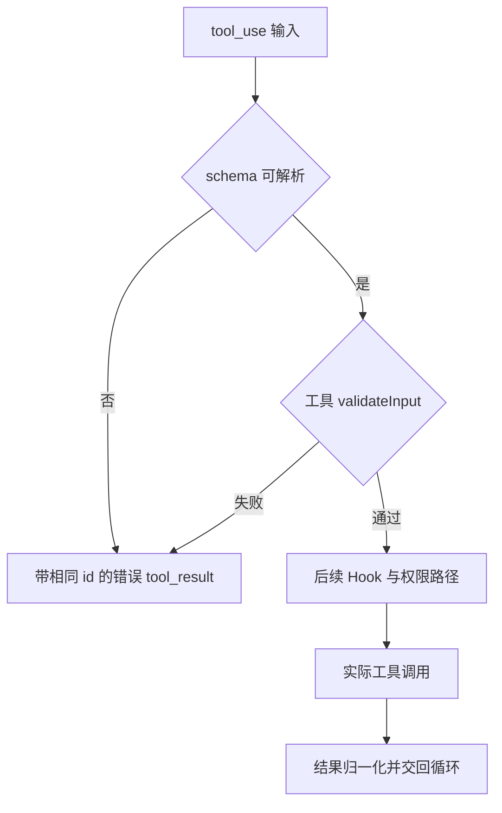

## 本章的问题

Read A、Read B、Edit A、Read A 看似有三个只读调用。把所有 Read 收集到一起并行，会让最后一次读取看不到编辑后的内容。并发安全首先是顺序问题，随后才是吞吐优化。

本章把调度和执行分开：partition 只分相邻批次；Toolset 负责校验、Hook、权限、实际执行与结果；codingTools 保存每个文件的读取观察。这样一个调用失败时，能明确指出它被哪一层拒绝。

模型第一次直接 Edit，应该得到可修正的错误；Read 后再 Edit 才成功。然后人为从外部改文件，检查旧观察是否会覆盖新内容。磁盘字节是验收依据，错误文案只是辅助。

## 沿固定源码逐段拆解

@ccsrc tool-partition

### 从 safeParse 到相邻批次

先按名称找工具，再解析输入。只有成功解析后才调用 isConcurrencySafe；判断本身抛错也降级为不安全。reduce 只向最后一个安全批次追加，遇到屏障即新建批次，没有把后面的 Read 搬到前面。

@ccsrc tool-validate

### schema 与 validateInput 分担两类错误

schema 失败会返回带 tool_use_id、is_error 的工具结果。随后工具的 validateInput 判断输入的实际语义。这里提前返回，后面的执行前逻辑可能完全看不到该调用，统计失败不能只依赖 PostToolUse。

@ccsrc edit-read-state

### Edit 用读取事实约束修改

readFileState 没记录或 isPartialView 为真时拒绝。修改时间更新后，完整读取还有内容相等的回退，以减少时间戳变化引起的误拒绝。随后 findActualString 处理匹配，零次和多次匹配分别给出不同错误。replace_all 是显式意图，不能在出现歧义时擅自默认为真。

coda 使用内容哈希表达读取版本，并要求唯一 old 字符串。atomicWrite 使替换写入更完整，却不构成跨进程的原子 compare-and-swap；校验和写入之间的系统级竞争仍是边界。

## 机制总览



## 接入贯穿项目

@implementation 03-tools

### 逐步跟踪本章实现

先看 `partition`，再看 `execute`。分组只把相邻且声明 parallel 的调用合并；一次顺序工具会切开前后两组。分组阶段校验失败不会执行副作用，而是落入独立批次，随后在 execute 中产生可交回模型的错误。

`execute` 的顺序是信封检查、参数检查、before hook、改写后再次校验、gate、实际执行、after hook。第二次校验不能省：合法 path 可以被 hook 改成越界路径。错误最终保留 call.id，模型才有机会针对失败调用修正参数。

Read 保存完整文件的 hash 和 partial 标志，Edit 要求读过完整文件、版本未变化且 old 只匹配一次，并在执行时再次核对。写入后清掉读取凭据，下一次修改必须重新读。并发批次使用 Promise.all 保留结果数组的调用顺序；applyContext 在批次结束后按这个顺序作用于上下文。

## 运行本章实验

```bash
node --disable-warning=ExperimentalWarning labs/chapters/03-tools.mjs
```

@experiment 03-tools

## 逐项解释实验结果

实验比较实际源码分批函数与 coda 的分组；接着依次检查未读取、读取后修改、外部更新后的修改。最后一项失败时文件仍是 external，说明失败发生在效果之前。

源码函数的工具目录和 schema parser 是明确端口，比较的是分批算法。文件实验则执行 coda 的真实工具，不宣称运行了产品 Edit。两份证据解决不同问题。

## 继续动手与验收

把文件写成两个 old，断言编辑被拒且字节不变。再写两个并发安全的慢工具，证明完成顺序可以变化，而返回列表和上下文修改仍按调用顺序消费。

::: interview 只读工具为什么不能跨 Edit 任意重排？
并发资格来自工具契约，分组还要受相邻顺序屏障约束。Read、Edit、Read 不能合并成一组；Edit 的副作用发生前还要验证版本和唯一匹配。用真实文件状态和事件顺序，而非 Promise 数量，检查执行是否正确。
:::

@observation 03-tools
