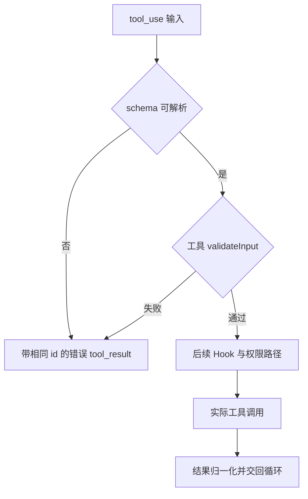

## 先看调度，再看单个工具

@ccsrc tool-partition

`partitionToolCalls` 把相邻的并发安全工具组成一批。是否安全依赖工具查找、schema 解析和 `isConcurrencySafe`，解析或判断抛错会保守地视为不安全。它并不是“所有 read-only 名称都可以并行”的硬编码名单。

`runTools` 对安全批次并发执行，但会把 context modifier 按原调用块顺序应用。输出完成顺序与共享上下文修改顺序因此可以不同。非安全操作走串行路径，避免副作用随 promise 调度漂移。

## 参数不合法时，可以根本到不了执行器

@ccsrc tool-validate

toolExecution 先做 schema 检查，再调用工具特有的 validateInput。失败会构造带相应 tool_use id 的错误结果，随后模型才能在下一轮修正参数。权限检查、PreToolUse 与实际 call 的相对位置，需要继续沿同文件核对，不能从 Hook 名字推断。

这种层次关系解释了一个常见现象：注册了 Hook 却没看到某次调用，不一定是 Hook 系统坏了，可能调用在更早的参数检查处已经终止。

## Edit 的先读后改是状态契约

@ccsrc edit-read-state

Edit 检查 readFileState；没有读取记录或只有 partial view 会拒绝。若修改时间更新，完整读取情况下还会比较内容，避免只因时间戳变化而误报。之后才判断 old string 是否存在、多处匹配是否需要 replace_all。

所以“文件读过”应具体到标准化路径、读取范围和内容版本。只把一个布尔值设成 true 不足以表达这个契约。测试也应检查失败时文件字节保持原样，而不是仅匹配错误文案。

## 为什么不能把所有只读调用提前执行

模型可能在一条消息里依次给出 Read A、Read B、Edit A、Read A。最后一次读取需要看到编辑后的内容。若调度器先把所有 Read 收集到一起，即使 Read 本身没有写副作用，也破坏了原有的先后关系。

本版本的选择是按**相邻区间**分批：连续且并发安全的调用合在一起；遇到不安全的调用，开启新批次。工具不存在、schema 解析失败、并发安全判定抛错，都不能加入安全批次。保守串行会损失吞吐，代价比错误重排小。

@lab node --disable-warning=ExperimentalWarning labs/engineering/run.mjs partition

实验对真实分组函数提供一个简化工具目录。第一个输入被分成 Read+Read、Edit、Read+Read；未知工具和判定异常成为屏障。注意这没有执行真实 Read/Edit，也没有证明模型生成的调用就是这个顺序；它只验证给定调用序列怎样分批。

## 从“参数是 JSON”走到“可以执行”

schema 校验解决形状问题，例如路径是否为字符串；工具自己的 `validateInput` 解决语义问题，例如文件是否已读、旧字符串是否唯一。失败也会生成 tool_result，并保留原调用 id。这样模型可以知道哪次调用失败，并决定重读或修正参数；直接丢掉错误会让历史失去配对。

## Edit 的读取契约，是乐观并发控制

把 `readFileState` 理解成一个观察版本：Agent 根据某次读取形成编辑意图，执行前要确认基础事实仍然成立。源码先拒绝未读取或 partial view；若文件修改时间更新，完整读取还允许用内容相等作回退，避免同步工具只改变时间戳便造成误报。最后再查旧字符串是否存在、是否多次出现。

逐个构造反例，会比“先读后写”四个字更清楚：

| 场景 | 检查的风险 | 应如何继续 |
| --- | --- | --- |
| 没读过文件 | 对未知内容盲改 | 先读 |
| 只得到 partial view | 可见内容不足以支撑编辑 | 获取充分读取状态 |
| 读后被用户改了 | 覆盖别人修改 | 重读并重新制定编辑 |
| 时间变了但完整内容没变 | 元数据引起的误拒绝 | 使用内容回退分支 |
| old_string 出现两次 | 修改目标有歧义 | 提供更多上下文或明确 replace_all |

这个设计不是数据库事务。校验完成与最终写入之间仍要继续读真实执行路径，不能凭本片段宣称整个文件系统具备原子 compare-and-swap。

## 练习：让失败可以定位

为 Read、Edit、Read 的序列写出每一批开始前预期的文件内容；再把 Edit 的 schema 变成无效，说明它为什么仍然阻隔重排。第二题把“只读”误改成“并发安全”来思考：一个只读但依赖共享上下文更新的工具，是否也能任意并行？验收答案必须同时讨论外部效果和内部状态。

::: interview 工具并发输出乱序，为什么不一定代表历史状态也乱序？
执行器可以让独立任务并行完成、及时流出结果，再按确定的调用顺序提交共享上下文修改。需要区分执行顺序、事件交付顺序和状态应用顺序；回归测试应分别检查，而不能只截一张终端日志。
:::

@observation 03-tools
