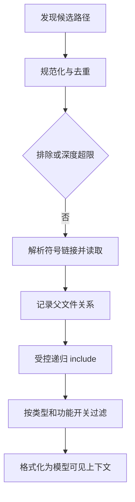

## 说明文件的读取和注入是两个步骤

@ccsrc memory-include

`processMemoryFile` 先做路径规范化、去重、深度限制、排除规则和软链接解析，再读取内容，最后递归处理 include。已处理集合和深度上限不是装饰：它们阻止循环引用让扫描无限展开。

外部 include 是否允许也由参数控制。看到一个 `@path` 出现在 Markdown 中，不能直接推出该文件已进入模型上下文；还要检查读取边界、解析结果与后续过滤。

## 最终写进请求前，还会再次选择

@ccsrc memory-inject

`getClaudeMds` 按记忆类型组织注入文字，且存在类型过滤和跳过项目级内容的分支。项目说明、个人本地说明、自动记忆等来源在这一层被区分。文件名相近，不表示可信度、生命周期和用途相同。

@ccsrc memory-filter

`filterInjectedMemoryFiles` 在一个开关启用时把自动/团队记忆索引从这条注入路径排除，由其他检索路径提供相关内容。这是源码中的条件分支，不能不记录开关就断言“MEMORY.md 永远放在 system prompt”或“永远不会放进去”。

## 用金丝雀验证具体链条

可追踪的实验应该包含四项：文件实际内容、读取路径与类型、过滤/feature 条件、最终请求中的出现位置。金丝雀只用于识别自己的合成输入，不需要复制用户真实记忆或密钥。

源码说明了有哪些选择步骤；一个对应版本的实验才能告诉你此次走了哪条路径。下面旧实验保留在 2.1.296 分区，帮助比较同一问题在后续版本的观察结果。

## 从一个 include 环读懂防御顺序

假设项目 `CLAUDE.md` 引用 `docs/rules.md`，后者又引用根文件。没有 visited set，递归会一直绕圈。源码在递归前规范化路径并记录 processedPaths；若目标是符号链接，还把解析后的路径身份记录进去。同一个文件经由两种写法被发现时，才有机会被识别为同一个事实。

深度上限和去重解决不同问题：前者限制一条不断增长的新文件链，后者阻止已访问节点形成的环。两者不能互相替代。外部 include 控制又是第三件事——即使深度很浅，路径也可能越出原始工作目录。

## 发现了文件，为什么模型仍然没看到

本实现至少存在三个集合：磁盘上存在的文件、发现与读取成功的文件、最终注入请求的文件。`getClaudeMds` 还会检查类型 filter、项目级跳过开关及内容；`filterInjectedMemoryFiles` 则可能去掉 AutoMem 和 TeamMem 索引。配置问题要沿着集合逐层缩小，不能看到磁盘文件就归因于模型不遵守。

@lab node --disable-warning=ExperimentalWarning labs/engineering/run.mjs memory

实验只替换一个 feature flag lookup，执行实际过滤函数。flag 关闭时三类都保留，打开后剩 Project。这里的名称描述源码类型，不代表本机三个目录真的存在，也不代表 AutoMem 功能在任意发行构建中都启用。

## 指令不是一份全能的配置

CLAUDE.md 的文字进入模型上下文后，影响的是模型的判断。把“不要改 `.env`”写进记忆，并不等于执行层建立了不可绕过的访问限制。团队规矩可以通过 Hook 检查，工具许可通过权限系统决定，进程效果由沙箱约束；这些层能互相补充。

课程例子里，规则文件说“修改后运行测试”。你应检查它是否实际注入，再观察工具轨迹里是否运行了测试；不能把“文件里写了”当作“任务已验证”。这条链也适用于长期记忆：保存成功、下次找到、正确注入、被模型使用，是四个不同结果。

## 动手：做一份注入诊断表

在临时教学目录中画出根文件、子文件、循环 include 和一个外部 include。对每个候选记录原路径、规范化身份、父节点、类型和最终是否注入；指出是在哪一步被跳过。先按源码推导，再用本章后面的独立版本录制观察实际现象。验收重点是能够解释“存在却未注入”的具体原因。

::: interview 为什么读文件成功不能证明模型已经获得这份指令？
读取只是获取候选数据，之后还有去重、类型选择、条件规则、预算与最终请求投影。应沿 reader 到 composer 再到最终请求核对，并记录功能开关与版本；不能用磁盘状态替代上下文证据。
:::

@observation 04-memory
