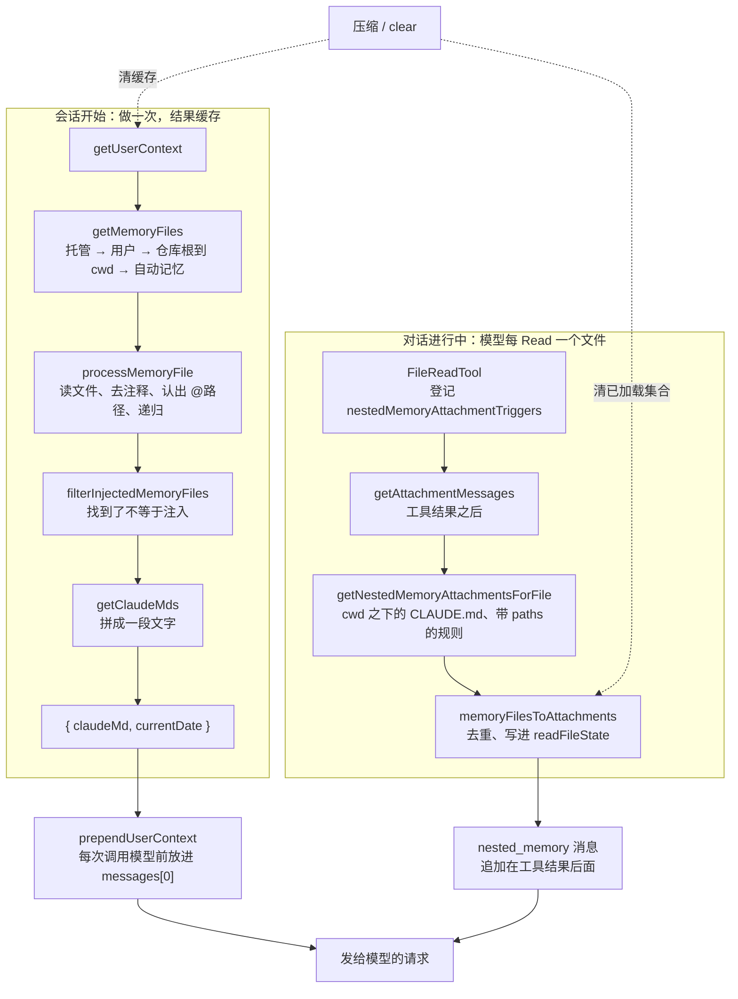

你在 CLAUDE.md 里写了一条规矩：“改完代码必须运行 `pnpm test:unit`”。模型改完代码，直接说“好了”，没有跑测试。

是它没听话，还是这句话根本没有送到它眼前？两种情况看上去一模一样，修法却完全不同：前一种要改措辞，后一种要查文件放对了位置没有、有没有被过滤、有没有被读到。所以排查的第一步永远是：**这句话进了请求没有，进了请求的哪个位置。**

这一章沿着一份 CLAUDE.md 走完它的路：Claude Code 怎样找到它、按什么顺序拼起来；里面的 `@路径` 怎样展开、怎样不绕圈；放进请求时变成什么样；子目录里的说明为什么要等模型读到那里才出现。每一站都有源码摘录、真实录制和能重跑的实验，最后在 coda 里把同样的机制写出来，并和 Learn Pi Agent 里更简单的做法对照。


@figure assets/course/ch04-memory.png 各层的 CLAUDE.md 沿 @ 引用被摘下，装进请求的第一条消息；子目录里的那张，读到那里才加载

## 先看现象：给每份说明文件放一只金丝雀

Claude Code 把这类文件统称“记忆文件”：用户级和项目级的 `CLAUDE.md`、本机私有的 `CLAUDE.local.md`、`.claude/rules/` 下的规则、被 `@路径` 引用的文件，还有模型自己写的 `MEMORY.md`（本章最后讲）。它们进了请求的哪里？最直接的办法，是在每个文件里放一个独一无二的字符串（金丝雀），再到截下来的请求里找它。

录制用 Claude Code 2.1.296，由一个开放模型驱动；本章的源码摘录来自 2.1.88，两者有出入的地方会指出。项目里有这些文件：用户级 `CLAUDE.md`；项目的 `CLAUDE.md`（里面有一行 HTML 注释，和一行 `@docs/conventions.md`）；被引用的 `docs/conventions.md`；`CLAUDE.local.md`；`AGENTS.md`；`src/CLAUDE.md`；`.claude/rules/api.md`（frontmatter 写着 `paths: src/api/**`）。任务是先读 `src/api/handler.js`，再读 `src/util.js`，所以一共两个请求：

@lab node labs/ch04/instructions.ts where

逐行看：

- **四个文件在第一个请求里就有**：用户级、项目级、被引用的、本机私有的。它们都在 `messages[0]`，一条用户消息里，不在系统提示里。
- **`AGENTS.md` 没有出现。** 2.1.88 的源码里，除了 `/init` 的提示词，没有任何地方读它；2.1.296 的 init 事件里多了一个内置插件 `cc-plugin-agents-md`，看来由它负责，这次项目里已经有 `CLAUDE.md`，它没有加载（推测）。
- **HTML 注释里的字符串没有出现**：写给维护者的备注，进请求之前就被删掉了。
- **`src/CLAUDE.md` 和带 `paths` 的规则只出现在第 2 个请求里**，位置是 `messages[4]`，紧跟在两个 Read 的结果后面。模型读了 `src/api/handler.js`，它们才跟着来。录制里这条消息的 role 是 system；2.1.88 的源码把它造成一条包在 `<system-reminder>` 里的用户消息，后面会看到。

Claude Code 有一个 `InstructionsLoaded` 钩子（第 7 章），每加载一份说明触发一次。录制里挂了它，正好把“为什么加载”也记下来了：

@lab node labs/ch04/instructions.ts hooks

`load_reason` 把来路分得很清楚：会话开始（`session_start`）、被引用（`include`，带着引用者）、读了子目录里的文件（`nested_traversal`）、读了匹配 `paths` 的文件（`path_glob_match`）。源码里还有第五种，压缩之后重新加载的 `compact`。

金丝雀看的是“请求里有什么”。录制的最后一句话，是让模型自己列出它看到的规则：

@lab node labs/ch04/answer.ts

七条规则里六条来自这些文件，来源都说对了；第 7 条是环境注入的提交署名要求，和说明文件无关。模型甚至发现 `handler.js` 违反了第 6 条规则。内容不但到了请求里，模型也确实在用。

先把全程画出来，后面每一节讲其中的一站：



左边在会话开始时做一次：找到文件、展开引用、拼成文字，缓存起来，之后每次请求前放到第一条用户消息里。右边发生在对话里：模型每读一个文件，就检查这个文件所在的目录，把该附的说明追加在工具结果后面。两条路在请求处汇合。压缩和 `/clear` 会同时清掉两边的缓存。

## 发现：去哪些位置找，按什么顺序拼

第一个问题最直白：哪些文件会被读，谁先谁后？答案写在 `claudemd.ts` 的文件头：

@cc utils/claudemd.ts#L1-L26 hl=4-7,9-10,15-16,23

整理成表（括号里是 `getMemoryFiles` 里的类型名）：

| 类型 | 位置 | 谁写 | 是否进版本库 |
| --- | --- | --- | --- |
| 托管（`Managed`） | 托管目录里的 `CLAUDE.md` 和 `.claude/rules/*.md`，如 `/etc/claude-code/` | 组织管理员 | 不适用 |
| 用户（`User`） | `~/.claude/CLAUDE.md`、`~/.claude/rules/*.md` | 你自己 | 否 |
| 项目（`Project`） | 仓库根到当前目录的**每一层**：`CLAUDE.md`、`.claude/CLAUDE.md`、`.claude/rules/*.md` | 团队 | 是 |
| 本机（`Local`） | 每一层的 `CLAUDE.local.md` | 你自己 | 否（不提交） |
| 自动记忆（`AutoMem`） | 项目对应的记忆目录里的 `MEMORY.md` | 模型 | 否 |

注释里有一句关键的话：文件“按优先级的反序加载，最后加载的优先级最高，模型更留意它们”。注意这里的“优先级”不是覆盖：没有任何合并、去重或冲突处理，两条互相矛盾的规则会**同时**出现在请求里。所谓优先，只是**位置**：越靠后，离模型的注意力越近。所以离当前目录越近的、越私人的文件排得越靠后。

托管和用户级排在最前面：

@cc utils/claudemd.ts#L803-L835 hl=805-811,826-834

托管文件永远加载，它是组织的策略；用户级受 `userSettings` 开关控制，并且传进去的 `includeExternal` 是 `true`（第 833 行）：你自己的文件可以 `@` 引用任何地方，因为它是你写的，不是仓库里别人写的。

项目那一层怎么走，看代码：

@cc utils/claudemd.ts#L849-L934 hl=854-857,868-875,878,887-888,899-900,910-919,923-925

- 第 854–857 行从当前目录一路向上收集目录，第 878 行 `dirs.reverse()` 把顺序倒过来：**仓库根在前，当前目录在后**。原版一直走到文件系统的根；coda 为了让实验不读到你机器上真实的文件，只走到 `root`。
- 第 887 行：项目文件受 `isSettingSourceEnabled('projectSettings')` 控制。用户级、本机私有各有一个类似的开关，命令行的 `--setting-sources` 可以关掉其中一部分。
- 每一层的顺序固定：`CLAUDE.md`、`.claude/CLAUDE.md`、`.claude/rules/` 里**没有 `paths` 的**规则、最后是 `CLAUDE.local.md`。所以同一层里，私人备注排在项目说明后面。
- 第 868–875 行处理 git worktree：当 worktree 嵌套在主仓库里，向上走会经过两个仓库根，同一份提交进版本库的 `CLAUDE.md` 会读两遍，所以跳过主仓库那一份；`CLAUDE.local.md` 没有提交，只存在于主仓库，照常读。Pi 的 `findShadowedContextFile` 解决的是同一个问题。
- 带 `paths` 的规则不在这里：规则目录是用 `conditionalRule: false` 扫的，只留下没有 `paths` 的那些。

把同一份布局交给 coda 的 `discoverMemories`，对照那次真实录制的会话文件（它的 `instructions` 附件记着加载了哪些文件、什么顺序）：

@lab node --disable-warning=ExperimentalWarning labs/chapters/04-memory.mjs discover

第一张表是真实录制：用户级在最前，然后是项目的 `CLAUDE.md`，**被它引用的 `docs/conventions.md` 紧跟在后面**，最后是 `CLAUDE.local.md`。coda 找到的文件、顺序，以及每份交给模型的正文（删掉了注释，保留了 `@docs/conventions.md` 那一行）都与录制逐字一致。第二张表把层数拉满：托管 → 用户 → 仓库根 → `packages` → `packages/app`，每一层里规则目录排在 `CLAUDE.md` 后面、本机备注最后，自动记忆压轴。表下面那两份没有出现的文件，是后面“读到哪里，加载哪里”的主角。

## 一份文件被读成什么样

找到文件只是开始。每份文件在交给模型之前，先被改写一遍。这件事发生在 `parseMemoryFileContent`，一个只处理字符串、不碰文件系统的函数：

@cc utils/claudemd.ts#parseMemoryFileContent hl=350-354,371-374,376-379,382-385,388,394-396

- **第 350–354 行：扩展名白名单。** `@` 引用只读文本文件（`.md`、`.txt`、各种源码和配置），图片、PDF 进不来。没有扩展名的文件放行。
- **第 356–374 行：去 frontmatter，去块级 HTML 注释。** `paths` 被单独抽出来成为 `globs`，其余的 YAML 丢掉。注释只删“单独占一行”的 `<!-- ... -->`，行内的、代码块里的不动；没有闭合的 `<!--` 原样留着，免得一个手误吞掉后面整个文件。
- **第 376–379 行：** 同一次词法分析顺便把 `@路径` 抽出来，正文不用扫两遍。
- **第 382–385 行：** 自动记忆的 `MEMORY.md` 还要截断，本章最后再看。
- **第 388–396 行：`contentDiffersFromDisk`。** 交给模型的文字和磁盘上的不一样，就标出来，磁盘原文留在 `rawContent` 里。这个标记在第 3 章露过面：`readFileState` 里的 `isPartialView`。模型看到的是删过注释、去过 frontmatter 的版本，没见过磁盘上的原样，所以不能凭它去 Edit 这个文件。后面“读到哪里，加载哪里”会看到它是怎么写进去的。

所以磁盘上的 CLAUDE.md 和模型看到的 CLAUDE.md 可能不一样，而且 Claude Code 自己清楚这一点。

## 正文里的 @路径：哪些算引用

引用的写法很宽松：`@docs/a.md`、`@./b.md`、`@~/notes.md`、`@/abs/path` 都行。那正文里的哪些 `@` 算引用？答案在 `extractIncludePathsFromTokens`：

@cc utils/claudemd.ts#L455-L514 hl=459,465-471,473,477-486,496-498,503-514

- 它吃的是 Markdown 词法分析器（marked）切好的 token，不是原始字符串。`code` 和 `codespan` 直接跳过（第 496–498 行），HTML token 只检查注释之外剩下的部分（第 503–514 行）。所以代码块、行内代码、注释里的 `@` 都不算，你可以放心在 CLAUDE.md 里写 `@types/node` 这样的代码片段。
- 正则 `(?:^|\s)@(...)`（第 459 行）要求 `@` 前面是行首或空白，邮箱 `me@example.com` 不会误中。
- `#片段` 被去掉（第 465–471 行），转义的空格 `\ ` 还原，然后只认四种形状：`./`、`~/`、`/` 开头，或者以字母数字开头的裸路径（第 477–483 行）。`expandPath` 把它们变成绝对路径，起点是**引用者所在的目录**（第 486 行）。

把十五种写法分别交给原函数（从固定提交里装载运行）和 coda 的 `extractIncludes`：

@lab node --disable-warning=ExperimentalWarning labs/chapters/04-memory.mjs syntax

原函数认出什么，coda 就认出什么，包括那些“看着像、其实不算”的：代码里的、注释里的、邮箱、`@@x`。

## 展开 @引用：深度优先，父文件在前

认出路径以后，`processMemoryFile` 负责把它们读进来，同时不能出事。看一个会出事的例子：`CLAUDE.md` 引用 `a.md` 和 `b.md`，它们都引用 `shared.md`，`b.md` 还引用回 `CLAUDE.md`：

::: steps processMemoryFile 展开 @ 引用：深度优先，父文件在前
--- 从 `CLAUDE.md` 开始。`processedPaths` 是整次发现共用的集合，先把它记进去；内容读出来非空，于是 `result.push` 它自己——在处理引用的循环**之前**，所以父文件排在前面（序号 ①）。
flowchart LR
  C["CLAUDE.md ①"]:::on --> A["a.md ②"]:::dim
  A --> S["shared.md ③"]:::dim
  C --> B["b.md ④"]:::dim
  B -. "已读过，跳过" .-> S
  B -. "已读过，跳过" .-> C
--- 对第一个引用 `a.md` 递归，`depth + 1`，父亲是 `CLAUDE.md`。集合里没有它，读到、非空，先 push 自己（②），再处理它的引用。
flowchart LR
  C["CLAUDE.md ①"]:::done --> A["a.md ②"]:::on
  A --> S["shared.md ③"]:::dim
  C --> B["b.md ④"]:::dim
  B -. "已读过，跳过" .-> S
  B -. "已读过，跳过" .-> C
--- `a.md` 引用 `shared.md`，继续往深处走：不在集合里，读到、push（③）。`shared.md` 没有别的引用，这一支到头，回到 `CLAUDE.md` 的循环。
flowchart LR
  C["CLAUDE.md ①"]:::done --> A["a.md ②"]:::done
  A --> S["shared.md ③"]:::on
  C --> B["b.md ④"]:::dim
  B -. "已读过，跳过" .-> S
  B -. "已读过，跳过" .-> C
--- `CLAUDE.md` 的第二个引用 `b.md`：读到、push（④）。深度优先的结果是：父文件先，子文件紧跟，`shared.md` 归先到达它的 `a.md`。
flowchart LR
  C["CLAUDE.md ①"]:::done --> A["a.md ②"]:::done
  A --> S["shared.md ③"]:::done
  C --> B["b.md ④"]:::on
  B -. "已读过，跳过" .-> S
  B -. "已读过，跳过" .-> C
--- `b.md` 里的两个引用 `shared.md` 和 `CLAUDE.md` 都已经在 `processedPaths` 里，入口处的检查直接返回，什么也不加。有环、有钻石，每个文件仍然只读一份。另有深度上限 `MAX_INCLUDE_DEPTH`（5）防止过长的链。
flowchart LR
  C["CLAUDE.md ①"]:::on --> A["a.md ②"]:::done
  A --> S["shared.md ③"]:::on
  C --> B["b.md ④"]:::on
  B -. "已读过，跳过" .-> S
  B -. "已读过，跳过" .-> C
:::

圆圈里的数字是加载顺序，虚线是被拦下的边。拦它们的是这个函数：

@cc utils/claudemd.ts#L614-L685 collapse=false hl=616,629-632,635-637,640-648,650-654,657-664,666-682

- **第 629–632 行，两个出口。** `processedPaths` 是调用者传进来的一个集合，**整次发现共用同一个**。它防的不只是环，还有重复：钻石形的引用里 `shared.md` 只读一次，归先到达它的那条路（图里的 ③）。`depth >= MAX_INCLUDE_DEPTH`（5）是另一道防线：没有环，一条特别长的链也不能把整个仓库拖进上下文。
- **第 635 行：** 设置里的排除规则（`claudeMdExcludes`）在这里生效，比如在 monorepo 里排除别的团队的 CLAUDE.md。
- **第 640–648 行：符号链接。** 原路径和真实路径都记进集合，别名不会让同一份内容进来两遍；真实路径还是后面解析相对引用的起点。
- **第 650–654 行：** 读失败（不存在、是个目录）或者内容为空（去掉注释之后什么都没剩），整棵子树放弃，它的引用也不再跟。注意集合里已经记过它了。
- **第 657–664 行：** 记下 `parent`，然后 `result.push(memoryFile)`——在循环**之前**。父文件排在它引用的文件前面。
- **第 666–682 行：** 对每个引用，不在原工作目录里（`isExternal`）又没有批准（`includeExternal` 为 false）就静默跳过；否则递归，`depth + 1`，父亲是当前文件。

这里有个值得记住的小插曲。回头看文件头：第 23 行写着“被引用的文件作为独立条目，排在引用它的文件**之前**”，`processMemoryFile` 上方的文档注释（第 616 行）也这么说，函数体里的注释（第 663 行）和代码却是父文件先、子文件后。以谁为准？不用猜，运行它。下面所有“原函数”都是从固定提交里装载出来的，只替换了它依赖的文件系统和路径判断：

@lab node --disable-warning=ExperimentalWarning labs/chapters/04-memory.mjs include

- **顺序：** 钻石那一行，`shared.md` 归 `a.md`，排在 `a.md` 后面、`b.md` 前面。父文件先，子文件紧跟，深度优先。注释过期了，以代码为准；上面真实录制里 `docs/conventions.md` 紧跟 `CLAUDE.md` 也印证了这一点。读源码时，注释是线索，不是证据。
- **防环防重复：** 环、自引用都只留一份；规则目录那一组更有意思：`CLAUDE.md` 引用了 `.claude/rules/x.md`，随后规则目录扫到同一个文件，因为共用同一个集合，它不会第二次出现。
- **防失控：** 七层长链只读到第 5 个文件。不存在的文件、目录、去掉注释后为空的文件、图片，全部悄悄跳过，没有报错。
- **防越权：** 引用项目之外的文件，默认不读；用户批准之后才读（原版是一个弹窗，批准结果记在项目配置里）。User 类型的文件例外，它是你自己写的，可以引用任何地方。
- **符号链接：** 原函数的外部判断（`pathInWorkingPath`，读过它的实现）只比较路径字符串，不看符号链接指向哪里，所以仓库里一个指向项目外的链接，按字面看“在项目里”。表里原函数那一行取决于这条判断（端口按它的写法实现），属于读代码得出的推论，没有在真实产品里验证。coda 更严，连真实位置也看。
- **随机对照：** 400 张随机生成的引用图（有环、有自引用、有空文件、有假引用），coda 与原函数加载的文件和顺序一张不差。

## 变成请求里的一条消息

文件找齐、展开完了，还差最后几步：过滤、拼成文字、放进请求。先看拼文字：

@cc utils/claudemd.ts#getClaudeMds hl=1158-1166,1168-1177,1185,1194

- 第 1163–1166 行：`filter` 参数和一个服务端开关 `tengu_paper_halyard`（默认关）都可以让 `Project`、`Local` 类型的文件不进来。
- 第 1168–1177 行：每个文件按类型附上一句来源说明，让模型知道这份说明是谁的、提交没提交。
- 第 1185 行：每份文件一段：`Contents of <路径> (<来源>):`，空一行，再是正文。路径是原样的绝对路径，所以模型能看出“这条规则来自哪个文件”（上面那一问，它就是这么回答的）。
- 第 1194 行：全部拼起来，前面放一句总的提醒（`MEMORY_INSTRUCTION_PROMPT`，大意是这些指令覆盖默认行为、必须照办）。

谁调用它、结果去哪里：

@cc context.ts#L155-L188 hl=155,165-167,170-172,176,184-187

- 第 155 行：`getUserContext` 被 `memoize` 包着，**整个会话只算一次**。这是后面“会话中途改了文件”那一节的关键。
- 第 165–172 行：`CLAUDE_CODE_DISABLE_CLAUDE_MDS` 是硬开关；`--bare` 跳过自动发现，但仍然尊重显式给的 `--add-dir`。过滤发生在 `getClaudeMds` 之前：`filterInjectedMemoryFiles` 一个开关就能让 `MEMORY.md` 索引不进上下文，所以“找到了”不等于“注入了”。
- 第 176 行：算好的文字另存一份，给第 6 章的自动模式分类器用，它能看见的就是这份 CLAUDE.md。
- 第 184–187 行：返回值是一个小对象 `{ claudeMd, currentDate }`。日期和说明文件**住在同一条消息里**。

对象变成消息，是每次调用模型之前发生的：

@cc query.ts#L659-L661 hl=660

@cc utils/api.ts#prependUserContext hl=461-473

`prependUserContext` 在 `messagesForQuery` 前面加一条用户消息（`isMeta: true`，界面不显示），每个键写成一段 `# claudeMd`、`# currentDate`，整个包在 `<system-reminder>` 里。注意两点。第一，**它不在历史里**：每次请求前现拼一份放在最前面，因为 `getUserContext` 是缓存的，每次拼出来的字节完全相同。压缩只改写历史，这条消息还在，说明文件不会因为压缩而丢。第二，末尾那句话的口气和 `getClaudeMds` 开头相反：一边是“必须照办”，一边是“这些内容不一定和任务有关，除非高度相关不要回应”。源码里没有解释两句话怎么配合。录制里模型能逐条复述这些规则，还拿它们去检查代码，说明它把这些内容当成了要遵守的规则，而不是噪音。

把这条链路上的真函数跑一遍（`getClaudeMds`、`prependUserContext`、`filterInjectedMemoryFiles` 都是原函数，端口只有功能开关和“造一条用户消息”），再看 coda 的对应实现：

@lab node --disable-warning=ExperimentalWarning labs/chapters/04-memory.mjs inject

原版的输出里，用户级和自动记忆的路径是绝对路径，项目文件是相对路径，每份一个标题行。coda 的标题行和它的顺序一致，来源说明各写各的。第二张表是原函数造出的那条消息：`isMeta` 为真，段落顺序是 `claudeMd`、`currentDate`，紧接着才是用户真正输入的话。最后一张表是开关：`tengu_moth_copse` 打开时，`MEMORY.md` 索引就不注入了，改为按需检索相关记忆（`filterInjectedMemoryFiles` 上方的注释这么写）。

录制版本提示一句：2.1.296 的会话文件里，这段内容是一个独立的 `instructions` 附件，渲染成第一条用户消息里的一个 `<system-reminder>` 块，日期是另一个附件。2.1.88 的 `prependUserContext` 是请求前现拼、不进历史。包装不同，位置没变：对话最前面的一条用户消息。

## 为什么放在第一条消息里，而不是系统提示

Learn Pi Agent 的做法正好相反。mox 把说明文件拼进系统提示的一节：

::: tabs
@@ Claude Code
@cc utils/api.ts#prependUserContext hl=461-473
说明文件做成第一条 `isMeta` 用户消息，包在 `<system-reminder>` 里；系统提示一个字节不动。
@@ Pi
@pi packages/coding-agent/src/core/system-prompt.ts#renderProjectContext
项目说明渲染成系统提示里的 `project_context` 小节。
@@ mox
@mox mox/src/context.ts#discoverContextFiles
@mox mox/src/context.ts#L68-L70
每个目录取一个文件，拼进系统提示的一节。
@@ coda
@code coda/src/memory.mjs#contextMessage
照 Claude Code：说明文件走第一条用户消息。
:::

它每个目录只取一个文件（`AGENTS.override.md`、`AGENTS.md`、`CLAUDE.md` 依次找，第一个存在的算数），从全局目录一路排到当前目录，没有引用，没有子目录说明，没有规则。Pi 的 `loadProjectContextFiles` 是同一个思路（Learn Pi Agent 第 6 章读过）。两种放法都对，差别在**改一行说明要付的代价**：

@lab node --disable-warning=ExperimentalWarning labs/chapters/04-memory.mjs placement

表里 `prefixHash` 是系统提示加工具声明的指纹。拼进 system，改一行 CLAUDE.md 系统提示就变了；放进第一条消息，系统提示和工具声明纹丝不动，变的是 `messages[0]`。这两者对提示缓存的意义不同，源码里能找到的直接证据，是处理跨午夜的那段注释：

@cc utils/attachments.ts#L1404-L1416 hl=1408-1412

注释说得很明白：`messages[0]` 的日期**故意**不更新，因为清掉 `getUserContext` 的缓存会重生成这个前缀，整段对话在下一轮全部变成缓存写入（注释估计一次跨午夜要多花约 92 万个有效 token）；新日期改成在对话**尾部**追加一个 `date_change` 附件。可见 Claude Code 把 `messages[0]` 当作缓存前缀的一部分来保护，会话中途不重读说明文件，是同一个道理：开头一动，后面全废。

至于为什么不放系统提示，源码没有写明动机，下面是推断：系统提示里与项目无关的部分，可以让所有项目共享缓存；说明文件每个项目都不同，放进去会让它所在的那一段没法共享。Pi 的办法是第 6 章讲过的“小节补丁”：系统提示分成命名小节，会话中途只把变化的小节作为一条消息追加到历史末尾。目标一致，都是**不回头改开头**。

表的下半部分是缓存本身：会话开始读一次，磁盘上改了再读，读到的还是旧的，直到 `clear()`。这就是 `memoize` 的效果，下面“会话中途”一节接着讲。

## 读到哪里，加载哪里：子目录里的说明

大仓库里可能有几十个子目录各自带 `CLAUDE.md`。全部在开头加载，大半和当前任务无关，白占上下文。Claude Code 的做法是：**模型读到那个目录里的文件，才把那个目录的说明告诉它。** 这是第 9 章 Skill 的同一个思路，渐进式披露。

触发的那一行在 Read 工具里：

@cc tools/FileReadTool/FileReadTool.ts#L1032-L1038 hl=1038

Read 读完文本文件，把完整路径放进 `nestedMemoryAttachmentTriggers` 这个集合（读 notebook 和图片的两个分支各有一行同样的代码）。集合里的路径到下一步才被消费，消费的位置在主循环里，**工具结果之后**：

@cc query.ts#L1580-L1590 hl=1580,1588-1589

`getAttachmentMessages` 产出的附件被追加到 `toolResults` 里，和工具结果一起进入下一次请求。这就是录制里 `messages[4]` 紧跟在 `messages[3]`（两个 Read 的结果）后面的原因。附件的生成在 `getNestedMemoryAttachmentsForFile`：

@cc utils/attachments.ts#L1799-L1856 hl=1801-1803,1805,1809-1815,1818-1821,1830-1839,1843-1856

- 第 1801 行：不在允许的工作目录里的文件，不触发。
- 第 1805 行：每个触发路径一个**新的** `processedPaths`，只管这一次触发里的去重。
- **阶段一**（第 1809–1815 行）：托管和用户级规则里带 `paths` 的，看目标文件匹不匹配。
- **阶段二**（第 1830–1839 行）：从 cwd 往下、直到目标文件所在目录的每一层（不含 cwd，它的 CLAUDE.md 开头就加载过）：`CLAUDE.md`、`CLAUDE.local.md`、全部无条件规则、匹配的条件规则。
- **阶段三**（第 1843–1856 行）：从仓库根到 cwd 的每一层，**只补带 `paths` 的规则**；它们的 `CLAUDE.md` 已经在开头了。

这两组目录由 `getDirectoriesToProcess` 算出来，直接把原函数拿来跑，和 coda 的 `directoriesFor` 对照；再回到真实录制，看 coda 的 `NestedMemory` 在同一个项目上附上的文件、顺序和 `load_reason`：

@lab node --disable-warning=ExperimentalWarning labs/chapters/04-memory.mjs nested

第一张表是录制：读了 `src/api/handler.js` 和 `src/util.js`，会话文件里多了两个 `nested_memory` 附件，先是 `src/CLAUDE.md`，再是 `.claude/rules/api.md`；coda 附上的文件、顺序、原因（`nested_traversal`、`path_glob_match`）逐项相同。录制里那条规则的 `globs` 是 `["src/api"]`：源码把 `paths` 末尾的 `/**` 去掉了（目录模式会匹配目录下的一切），`contentDiffersFromDisk` 为真，因为 frontmatter 被去掉了。

第二张表是三个目标文件各自要检查的目录。读 `README.md`（就在 cwd）或者读 cwd 之外的文件，都没有新的“cwd 之下的目录”可查。

第三张表是端到端：一个会读文件的模型跑在 coda 的 Engine 上。每读完一个文件，`NestedMemory` 把该附的说明排进队列。看几件事：

- `src/CLAUDE.md` 在第一次读 `src/` 下的文件时附上，**只附一次**；
- `src/api/handler.js` 带来 `src/api/CLAUDE.md` 和匹配 `src/api/**` 的规则；
- `Write` 在 `lib/` 里新建文件，什么都不触发，直到 `Read lib/x.js`，`lib/CLAUDE.md` 才出现；
- 追加的说明紧跟在触发它的工具结果后面，开头的消息纹丝不动，缓存前缀不受影响。

最后一张表是压缩：历史被换成摘要，之前附过的说明也跟着没了，所以 `reset()` 之后再读同一个文件，要重新附上。

谁有资格触发？直接在固定提交的源码里搜：

@lab node --disable-warning=ExperimentalWarning labs/chapters/04-memory.mjs triggers

整个源码里，只有 `FileReadTool` 登记触发。附件系统自己读文件也走 `FileReadTool.call`（表里第三行：`@` 提及的文件由 `generateFileAttachment` 读，改动检测由 `getChangedFiles` 读），所以它们同样会触发。IDE 里打开的文件走另一条路，直接调用 `getNestedMemoryAttachmentsForFile`。**Edit、Write、Grep、Bash 都不触发。** 第 3 章说过，2.1.88 要求先 Read 再 Edit，所以改文件之前一定读过，触发总会发生；而较新版本里模型可以不读就改，那时子目录里的规则就可能一直没有机会出现——这是由两处源码推出的结论，没有专门录制。清空“已加载”集合的位置也在表里：两条压缩路径和 `/clear`。

::: steps 读到哪里，加载哪里：一份子目录说明怎样进入请求
--- 任务是先读 `src/api/handler.js`。模型发出一个 Read 调用，这是整条链的起点；Edit、Write、Grep、Bash 都不会触发它。
flowchart LR
  RD["模型 Read<br/>src/api/handler.js"]:::on --> TR["FileReadTool 读完文本文件<br/>路径进 nestedMemoryAttachmentTriggers"]:::dim --> RES["tool_result<br/>进 toolResults"]:::dim --> GA["query.ts：getAttachmentMessages<br/>工具结果之后消费触发集合"]:::dim --> G["getNestedMemoryAttachmentsForFile<br/>先看文件在不在允许的目录里"]:::dim
  G --> P1["阶段一<br/>托管和用户级、带 paths 的规则"]:::dim --> P2["阶段二<br/>cwd 往下到目标目录的每一层<br/>CLAUDE.md、无条件规则、匹配的规则"]:::dim --> P3["阶段三<br/>仓库根到 cwd<br/>只补带 paths 的规则"]:::dim
  P3 --> DD["memoryFilesToAttachments<br/>loadedNestedMemoryPaths 和 readFileState 去重"]:::dim --> W["写进 readFileState<br/>文字和磁盘不同：记磁盘原文 + isPartialView"]:::dim --> OUT["nested_memory 消息<br/>追加在工具结果后面，带 load_reason"]:::dim
--- `FileReadTool` 读完文本文件，把完整路径放进 `nestedMemoryAttachmentTriggers` 集合（读 notebook 和图片的分支各有一行同样的代码）。此刻只是登记，还没有加载任何说明。
flowchart LR
  RD["模型 Read<br/>src/api/handler.js"]:::done --> TR["FileReadTool 读完文本文件<br/>路径进 nestedMemoryAttachmentTriggers"]:::on --> RES["tool_result<br/>进 toolResults"]:::dim --> GA["query.ts：getAttachmentMessages<br/>工具结果之后消费触发集合"]:::dim --> G["getNestedMemoryAttachmentsForFile<br/>先看文件在不在允许的目录里"]:::dim
  G --> P1["阶段一<br/>托管和用户级、带 paths 的规则"]:::dim --> P2["阶段二<br/>cwd 往下到目标目录的每一层<br/>CLAUDE.md、无条件规则、匹配的规则"]:::dim --> P3["阶段三<br/>仓库根到 cwd<br/>只补带 paths 的规则"]:::dim
  P3 --> DD["memoryFilesToAttachments<br/>loadedNestedMemoryPaths 和 readFileState 去重"]:::dim --> W["写进 readFileState<br/>文字和磁盘不同：记磁盘原文 + isPartialView"]:::dim --> OUT["nested_memory 消息<br/>追加在工具结果后面，带 load_reason"]:::dim
--- 工具的结果先进入 `toolResults`。随后 `query.ts` 在**工具结果之后**调用 `getAttachmentMessages`，消费触发集合里的路径。
flowchart LR
  RD["模型 Read<br/>src/api/handler.js"]:::done --> TR["FileReadTool 读完文本文件<br/>路径进 nestedMemoryAttachmentTriggers"]:::done --> RES["tool_result<br/>进 toolResults"]:::on --> GA["query.ts：getAttachmentMessages<br/>工具结果之后消费触发集合"]:::on --> G["getNestedMemoryAttachmentsForFile<br/>先看文件在不在允许的目录里"]:::dim
  G --> P1["阶段一<br/>托管和用户级、带 paths 的规则"]:::dim --> P2["阶段二<br/>cwd 往下到目标目录的每一层<br/>CLAUDE.md、无条件规则、匹配的规则"]:::dim --> P3["阶段三<br/>仓库根到 cwd<br/>只补带 paths 的规则"]:::dim
  P3 --> DD["memoryFilesToAttachments<br/>loadedNestedMemoryPaths 和 readFileState 去重"]:::dim --> W["写进 readFileState<br/>文字和磁盘不同：记磁盘原文 + isPartialView"]:::dim --> OUT["nested_memory 消息<br/>追加在工具结果后面，带 load_reason"]:::dim
--- `getNestedMemoryAttachmentsForFile` 先检查目标在不在允许的工作目录里，每个触发路径起一个新的 `processedPaths`。阶段一看托管和用户级规则里带 `paths` 的，匹配才附。
flowchart LR
  RD["模型 Read<br/>src/api/handler.js"]:::done --> TR["FileReadTool 读完文本文件<br/>路径进 nestedMemoryAttachmentTriggers"]:::done --> RES["tool_result<br/>进 toolResults"]:::done --> GA["query.ts：getAttachmentMessages<br/>工具结果之后消费触发集合"]:::done --> G["getNestedMemoryAttachmentsForFile<br/>先看文件在不在允许的目录里"]:::on
  G --> P1["阶段一<br/>托管和用户级、带 paths 的规则"]:::on --> P2["阶段二<br/>cwd 往下到目标目录的每一层<br/>CLAUDE.md、无条件规则、匹配的规则"]:::dim --> P3["阶段三<br/>仓库根到 cwd<br/>只补带 paths 的规则"]:::dim
  P3 --> DD["memoryFilesToAttachments<br/>loadedNestedMemoryPaths 和 readFileState 去重"]:::dim --> W["写进 readFileState<br/>文字和磁盘不同：记磁盘原文 + isPartialView"]:::dim --> OUT["nested_memory 消息<br/>追加在工具结果后面，带 load_reason"]:::dim
--- 阶段二：从 cwd 往下、直到目标文件所在目录的每一层（不含 cwd，它的 CLAUDE.md 开头就加载过）：`src/CLAUDE.md` 在这里被找到。
flowchart LR
  RD["模型 Read<br/>src/api/handler.js"]:::done --> TR["FileReadTool 读完文本文件<br/>路径进 nestedMemoryAttachmentTriggers"]:::done --> RES["tool_result<br/>进 toolResults"]:::done --> GA["query.ts：getAttachmentMessages<br/>工具结果之后消费触发集合"]:::done --> G["getNestedMemoryAttachmentsForFile<br/>先看文件在不在允许的目录里"]:::done
  G --> P1["阶段一<br/>托管和用户级、带 paths 的规则"]:::done --> P2["阶段二<br/>cwd 往下到目标目录的每一层<br/>CLAUDE.md、无条件规则、匹配的规则"]:::on --> P3["阶段三<br/>仓库根到 cwd<br/>只补带 paths 的规则"]:::dim
  P3 --> DD["memoryFilesToAttachments<br/>loadedNestedMemoryPaths 和 readFileState 去重"]:::dim --> W["写进 readFileState<br/>文字和磁盘不同：记磁盘原文 + isPartialView"]:::dim --> OUT["nested_memory 消息<br/>追加在工具结果后面，带 load_reason"]:::dim
--- 阶段三：从仓库根到 cwd 的每一层，只补带 `paths` 的规则。`.claude/rules/api.md` 的 `paths: src/api/**` 匹配这个文件，附上，`load_reason` 是 `path_glob_match`。
flowchart LR
  RD["模型 Read<br/>src/api/handler.js"]:::done --> TR["FileReadTool 读完文本文件<br/>路径进 nestedMemoryAttachmentTriggers"]:::done --> RES["tool_result<br/>进 toolResults"]:::done --> GA["query.ts：getAttachmentMessages<br/>工具结果之后消费触发集合"]:::done --> G["getNestedMemoryAttachmentsForFile<br/>先看文件在不在允许的目录里"]:::done
  G --> P1["阶段一<br/>托管和用户级、带 paths 的规则"]:::done --> P2["阶段二<br/>cwd 往下到目标目录的每一层<br/>CLAUDE.md、无条件规则、匹配的规则"]:::done --> P3["阶段三<br/>仓库根到 cwd<br/>只补带 paths 的规则"]:::on
  P3 --> DD["memoryFilesToAttachments<br/>loadedNestedMemoryPaths 和 readFileState 去重"]:::dim --> W["写进 readFileState<br/>文字和磁盘不同：记磁盘原文 + isPartialView"]:::dim --> OUT["nested_memory 消息<br/>追加在工具结果后面，带 load_reason"]:::dim
--- 去重：`loadedNestedMemoryPaths` 是不会淘汰的集合，`readFileState` 里已有的也不再附。附上的写进 `readFileState`：文字和磁盘不一样（frontmatter 被去掉）就记磁盘原文并标 `isPartialView`，所以这类文件“看过但不算读过”。最后作为 `nested_memory` 消息追加在工具结果后面，录制里就是 `messages[4]`。
flowchart LR
  RD["模型 Read<br/>src/api/handler.js"]:::done --> TR["FileReadTool 读完文本文件<br/>路径进 nestedMemoryAttachmentTriggers"]:::done --> RES["tool_result<br/>进 toolResults"]:::done --> GA["query.ts：getAttachmentMessages<br/>工具结果之后消费触发集合"]:::done --> G["getNestedMemoryAttachmentsForFile<br/>先看文件在不在允许的目录里"]:::done
  G --> P1["阶段一<br/>托管和用户级、带 paths 的规则"]:::done --> P2["阶段二<br/>cwd 往下到目标目录的每一层<br/>CLAUDE.md、无条件规则、匹配的规则"]:::done --> P3["阶段三<br/>仓库根到 cwd<br/>只补带 paths 的规则"]:::done
  P3 --> DD["memoryFilesToAttachments<br/>loadedNestedMemoryPaths 和 readFileState 去重"]:::on --> W["写进 readFileState<br/>文字和磁盘不同：记磁盘原文 + isPartialView"]:::on --> OUT["nested_memory 消息<br/>追加在工具结果后面，带 load_reason"]:::on
:::

按需加载的最后一步是去重和记录：

@cc utils/attachments.ts#L1718-L1771 hl=1722-1724,1725-1732,1742-1750,1755-1759

- 第 1722–1724 行：`loadedNestedMemoryPaths` 是一个**不会淘汰**的集合。注释解释了为什么不能只靠 `readFileState`：它是 100 项的 LRU，忙起来会淘汰旧记录，同一份 CLAUDE.md 就会每轮重新注入一次。
- 第 1725 行：`readFileState` 里已经有的（模型自己 Read 过的，或者开头加载的）不再附。
- 第 1742–1750 行：附上之后写进 `readFileState`。如果注入的文字和磁盘不一样，记的是**磁盘原文**，并标 `isPartialView: true`——第 3 章 Edit 的第一道检查正是 `!readTimestamp || isPartialView`，于是这类文件“看过但不算读过”，必须再 Read 一次才能改；`offset`、`limit` 为 `undefined`，让 `getChangedFiles` 还能发现中途的改动。
- 第 1755–1759 行：`load_reason` 就是这么算的：带 `globs` 是 `path_glob_match`，有 `parent` 是 `include`，其余是 `nested_traversal`。

用原函数验证这三件事：

@lab node --disable-warning=ExperimentalWarning labs/chapters/04-memory.mjs attach

第二次调用一份也不附；frontmatter 被去掉的规则标 `isPartialView`，普通的 `CLAUDE.md` 不标。

## 会话中途改了文件，压缩之后呢

你在编辑器里改了 CLAUDE.md，模型什么时候知道？分三种情形。

**第一，开头那份不会变。** `getUserContext` 被缓存，`prependUserContext` 每次拼出的字节相同（前面的 `placement` 实验里能看到：磁盘改了，`get()` 还是旧的）。

**第二，交互界面里会有一条“文件被改动”的提示。** 交互界面启动时，把加载到的每个记忆文件登记进 `readFileState`：

@cc screens/REPL.tsx#L3797-L3817 hl=3798,3805-3816

再看每一轮都会运行的 `getChangedFiles`：

@cc utils/attachments.ts#L2063-L2091 hl=2066,2076-2078,2088-2091

它遍历 `readFileState` 里**整文件**的记录（`offset`、`limit` 都是 `undefined` 的那些），修改时间比记录里新，就把差异作为 `edited_text_file` 附件追加到尾部。CLAUDE.md 既然登记过，就在其中。这是读源码得到的推论，没有录制验证；它只在交互界面里发生：登记的代码在 `REPL.tsx` 里，没有看到 `-p` 路径做同样的事。

**第三，压缩或 `/clear` 之后会重新读。**

@cc services/compact/postCompactCleanup.ts#L31-L62 hl=36-39,51-61

第 59–60 行清掉 `getUserContext` 的缓存，并让下一次 `getMemoryFiles` 以 `load_reason: 'compact'` 重读磁盘；前面实验里看到的 `loadedNestedMemoryPaths` 在 `compact.ts` 里同时清空。注释还记了一个坑：只清内层的 `getMemoryFiles` 缓存没有用，外层 `getUserContext` 的缓存会挡在前面。子 Agent 的压缩不会动主线程的缓存（第 36–39 行的判断）。所以压缩顺带成了“刷新说明文件”的时机：此时磁盘上的新内容才真正进入 `messages[0]`。

## 自动记忆：模型写给自己的 CLAUDE.md

`CLAUDE.md` 是人写给模型的；自动记忆是模型写给自己的。同一个项目开两个会话，让第一个记住一件事：

@lab node labs/ch04/memory.ts

会话一里模型做了两步：先写一个记忆文件（名字、一行描述、类型，正文带着 Why 和 How to apply），再在 `MEMORY.md` 里加一行指针。这个流程不是它发明的，是系统提示里 “Memory” 一节的要求：

@cc memdir/memdir.ts#L218-L234 hl=221,223,227,229

“两步保存”的第二步是索引，第 229 行告诉模型：索引**总是**会加载进对话，超过 200 行的部分会被截断，所以保持简短。会话二是全新的会话，`MEMORY.md` 的一行指针出现在第一条用户消息里，模型直接答对了。这里能看出分工：**怎么写**的规则放在系统提示里（录制的系统提示有一节叫 Memory），**写了什么**的内容走 `getMemoryFiles`（类型 `AutoMem`），和 CLAUDE.md 同一条路，同一个位置。第二个会话的会话文件也印证了：`instructions` 附件里只有一份 `AutoMem`。

索引太长会被截断，先按行数、再按字符数。直接运行原函数 `truncateEntrypointContent`，对照 coda 的 `truncateIndex`，并把录制的第二个会话重放一遍：

@lab node --disable-warning=ExperimentalWarning labs/chapters/04-memory.mjs auto

模型是用普通的 Write 工具写这些文件的，没有专门的记忆工具；写进记忆目录也不用问你，原因在权限检查里：

@cc utils/permissions/filesystem.ts#L1564-L1581 hl=1564-1571,1572-1580

注释说得直接：默认记忆目录在 `~/.claude/` 下，而这个目录在“危险目录”清单里，写入按理要先过安全检查，所以专门开了一个口子，放在安全检查之前直接放行（第 6 章会回到这里）。路径由 `getAutoMemPath` 决定，它有个很小心的细节：用户可以用设置项改记忆目录，但**项目级设置（提交进仓库的 `.claude/settings.json`）被排除在外**，否则一个恶意仓库可以把目录指到 `~/.ssh`，借这个口子静默写入。

记忆是一个持久的写入面，这和 Learn Pi Agent 第 10 章讨论的是同一个问题：

| | Learn Pi Agent 的记忆扩展 | Claude Code 的自动记忆 |
| --- | --- | --- |
| 存储 | 每个项目一个目录：`MEMORY.md` 索引 + 每条记忆一个文件 | 相同（`~/.claude/projects/<项目>/memory/`） |
| 进入上下文 | 只有索引，放在系统提示的一节 | 只有索引（前 200 行或 25000 字符），放在第一条用户消息 |
| 写入 | 专门的 `save_memory` 工具，模型主动写的要等用户批准 | 普通 Write，权限检查里专门放行 |
| 防投毒 | 用户明确要求的才直接生效，拒绝疑似密钥 | 没有单独的审批环节；记忆目录的位置不能由项目设置决定 |

没有审批，机制就简单得多，记忆就是文件，你随时能打开看、能改；代价是“记住了什么”要靠你定期查看，或者用权限规则、钩子约束对记忆目录的写入。

## 取舍：每个设计在防什么

| 问题 | Claude Code | mox / Pi | coda |
| --- | --- | --- | --- |
| 文件名 | `CLAUDE.md`、`CLAUDE.local.md`、`.claude/rules/*.md`；2.1.88 不读 `AGENTS.md` | 每层第一个存在的：`AGENTS.override.md`、`AGENTS.md`、`CLAUDE.md` | 同 Claude Code |
| 发现 | 托管 → 用户 → 仓库根到 cwd 逐层 → 自动记忆 | 全局 + 根到 cwd，每层一个文件 | 同 Claude Code，只走到 `root` |
| 引用 | `@路径`，深度 5，共享已读集合，外部引用要批准 | 无 | 同 Claude Code |
| 子目录说明 | 读到文件才附加，带 `paths` 的规则按匹配 | 无 | `NestedMemory` |
| 放在哪里 | 第一条用户消息，`isMeta`，缓存住 | 系统提示的 `project_context` 一节 | `contextMessage`，第 13 章总装时 `app.mjs` 改用它 |
| 会话中途改了 | 开头不动；压缩后重读；交互界面有改动提示 | 小节补丁追加到历史末尾 | `sessionMemory.clear()` |
| 陌生仓库的说明 | 外部引用要批准；内容本身靠权限和沙箱 | 项目信任只管扩展；内容靠沙箱 | `includeExternal` 默认关 |

换一种做法，会坏在哪里：

- **已读集合改成只记祖先链**：环还是拦得住，但钻石形的引用会让 `shared.md` 注入两次，同一条规则出现两遍，多花 token，模型还会以为它特别重要（下面第一题）。
- **不限深度**：没有环，一条几十层的链照样把一个仓库拖进上下文。
- **不要求批准外部引用**：克隆下来的仓库里写一行 `@~/.ssh/config`，内容就跟着请求发给了模型服务商。批准弹窗是这条路上唯一的人。
- **子目录说明全部在开头加载**：大仓库每次会话先塞几十份大半无关的文件，还都是固定的开销。
- **按需加载的说明改写 `messages[0]`**：缓存前缀每次都变，整段历史重新计费。追加在工具结果之后，不改开头，才是缓存友好的。
- **压缩后不清已加载集合**：压缩把附过的说明连同历史一起换成了摘要，集合里的路径却还在，同一目录的规则再也不会出现（下面第二题）。

## coda 里的实现

`coda/src/memory.mjs` 的每一段对应上面读过的一处源码。

**展开引用。** `readMemoryTree` 对应 `processMemoryFile`，四个出口（已读、到顶、空内容、外部引用）和原函数一一对应，400 张随机图对照过。差别是外部判断更严：路径字符串和符号链接指向的真实位置，有一个在 `root` 外面就算外部。

@code coda/src/memory.mjs#readMemoryTree hl=230,233,243,245,247

**发现。** `discoverMemories` 对应 `getMemoryFiles`：托管、用户、仓库根到 cwd 逐层、自动记忆，顺序与会话文件里的 `instructions` 附件相同。它只走到 `root`，不读你机器上真实的 CLAUDE.md。

@code coda/src/memory.mjs#discoverMemories hl=296-297,299-303,313-318,320-324

**注入。** `contextMessage` 合并了 `getClaudeMds` 和 `prependUserContext`；`sessionMemory` 就是 `getUserContext` 的 `memoize`。

@code coda/src/memory.mjs#contextMessage hl=366-368,372

**按需加载。** `NestedMemory` 对应 `getNestedMemoryAttachments` 和 `memoryFilesToAttachments`：`triggers` 是 `nestedMemoryAttachmentTriggers`，`loaded` 是 `loadedNestedMemoryPaths`，`reset()` 是压缩时的清空。简化是少了 `readFileState` 那一层去重，也没有 `InstructionsLoaded` 钩子。

@code coda/src/memory.mjs#NestedMemory hl=445-446,449-451,454-456,463-471

兼容的接口没动：`loadMemories(root, entry, options)` 和 `memoryPrompt(files)` 照旧，`app.mjs` 调用的方式不变。变化是：正文里的 `@路径` 行保留（原版也保留），默认深度 5，外部引用静默跳过而不是抛错。

## 自己跑一遍

本章的实验在同一个脚本里，可以整体运行，也可以只运行一节：

```bash
node --disable-warning=ExperimentalWarning labs/chapters/04-memory.mjs            # 全部，28 项检查
node --disable-warning=ExperimentalWarning labs/chapters/04-memory.mjs include    # discover / syntax / include / inject / placement / triggers / nested / attach / auto
node labs/ch04/instructions.ts where                                              # 录制：金丝雀在请求的哪里
```

## 你来改

先写下预测，再动手验证。

::: predict 把已读集合改成只记祖先链
在 `readMemoryTree` 里，把递归调用的 `ctx` 改成 `{ ...ctx, seen: new Set(ctx.seen) }`（每个分支一份拷贝）。钻石形的例子（`CLAUDE.md` 引用 `a.md`、`b.md`，两者都引用 `shared.md`）会加载几个文件？环还拦得住吗？
???
加载 5 个：`CLAUDE.md`、`a.md`、`shared.md`（引用者 `a.md`）、`b.md`、`shared.md`（引用者 `b.md`）。`shared.md` 出现两次，因为它被记进的是 `a.md` 那一支的拷贝，`b.md` 这一支看不到。环还是拦得住：`a.md` 引用回 `CLAUDE.md` 时，`CLAUDE.md` 在 `a.md` 继承的拷贝里。原版把同一个集合传到底，防的就是这种重复，不只是环。
:::

::: predict 压缩之后忘记 reset
在 `04-memory.mjs` 的 `nested` 实验里，把压缩那一段的 `nested.reset();` 去掉。压缩之后再读 `src/util.js`，会附上 `src/CLAUDE.md` 吗？
???
不会，实验里“压缩前不重复，压缩后重新附上”那项检查会失败。`loaded` 集合里还留着 `src/CLAUDE.md` 的路径，`collect()` 认为它已经附过了。但压缩已经把历史换成了摘要，那条说明早就不在上下文里：模型从此再也看不到 `src/` 的规矩，而且没有任何报错。这就是原版要在压缩时清空 `loadedNestedMemoryPaths`（和 `readFileState`）的原因，`triggers` 实验的表里列着那几处 `clear`。
:::

::: predict 删掉外部引用的判断
把 `readMemoryTree` 里的 `if (isExternal(ctx, target) && !ctx.includeExternal) continue;` 整行删掉。`include` 实验里“引用项目之外的文件”那一行，以及符号链接那一行，coda 会加载什么？
???
两行都会多读一个文件：`../outside.md` 和符号链接指向的 `secret.md` 的内容都进了结果。第一行 coda 不再与原函数一致（原函数在没有批准时跳过它），实验的对照检查会失败；第二行 coda 和原函数变得一致了，但那是因为两边一起放行。这一行判断是仓库里的 CLAUDE.md 和你的文件系统之间唯一的闸门：没有它，克隆来的仓库一句 `@~/.ssh/config` 就能把本机文件读进请求。
:::

## 面试题

::: interview CLAUDE.md 从哪些位置加载？顺序和优先级怎么定？
1. 五类：托管（组织下发）、用户（`~/.claude/CLAUDE.md` 和 rules）、项目（仓库根到当前目录**每一层**的 `CLAUDE.md`、`.claude/CLAUDE.md`、`.claude/rules/*.md`）、本机私有（每层的 `CLAUDE.local.md`，不提交）、自动记忆（模型写的 `MEMORY.md`）。
2. 顺序就是上面这个，项目层从根往下。最后加载的“优先级最高”——但这里没有覆盖或合并逻辑，矛盾的规则会同时出现在请求里，所谓优先只是位置靠后、离模型更近。
3. 带 `paths` 的规则和 cwd 之下的 `CLAUDE.md` 不在开头加载，等模型读到相关文件才附上。
4. 加分：git worktree 嵌套时跳过主仓库已提交的那一份，避免重复；每类来源可以由设置开关关掉。
:::

::: interview `@import` 是怎么实现的？怎样防循环、防失控、防越权？
1. 只在 Markdown 的文本节点里认 `@路径`，代码块、行内代码、HTML 注释里的不算；路径相对于引用者所在的目录；只读文本扩展名。
2. 深度优先，父文件排在被引用的文件前面，`parent` 记录来源。
3. **防环和重复**：整次发现共用一个已读集合，同一文件无论从几条路径到达只读一次；符号链接的两个名字都记。**防失控**：引用链深度上限 5。**防越权**：项目外的引用默认跳过，用户批准后才读。
4. 加分：读失败、空内容、非文本都静默跳过；文件头注释写“引用的文件在前”，代码实际是父文件在前，以运行结果为准；原版的外部判断只比较路径字符串，符号链接可能绕过（读代码推论）。
:::

::: interview 子目录里的说明怎么做到“读到才加载”？有什么代价？
1. Read 工具读完文件，把路径放进触发集合；下一轮请求前，主循环在工具结果之后生成附件：从 cwd 到该文件所在目录的每一层加载 `CLAUDE.md` 和规则，仓库根到 cwd 的每一层只补带 `paths` 的规则。
2. 用不会淘汰的已加载集合去重；附件**追加在工具结果后面**，不改动开头，不破坏提示缓存；注入时把磁盘原文和 `isPartialView` 记进 `readFileState`。
3. 压缩把历史换成摘要，已加载集合同时清空，之后再读才重新附上。
4. 代价：只有 Read 触发。不读就改（较新版本允许）、只 Grep、只用 Bash，这些目录的规则就不会出现。
5. 加分：和 Skill 的渐进式披露是同一个思路：用延迟换取不必要的上下文开销。
:::

::: interview 项目说明应该放在请求的什么位置？Claude Code 和 Pi 为什么选得不一样？
1. Claude Code：第一条用户消息，`isMeta`，包在 `<system-reminder>` 里，每次请求前现拼、内容缓存住；Pi/mox：系统提示的一节。
2. 取舍：放系统提示最简单，说明与规则同属“背景”；放消息里则系统提示可以与项目无关、跨项目共享，而且说明不在历史里，压缩时不会丢。
3. 共同点是**不回头改开头**：Claude Code 缓存 `getUserContext`，连跨午夜的日期都故意不更新（源码注释估计重建一次要多花约 92 万有效 token），变化追加到尾部；Pi 用小节补丁追加到历史末尾。
4. 加分：说明文件的内容是不可信输入——陌生仓库的 CLAUDE.md 等于仓库作者给你的 Agent 下指令，外部引用的批准和沙箱才是真正的闸门。
:::

::: interview 模型没有遵守 CLAUDE.md 里的规则，你怎么排查？
1. 先分清两种情况：规则**没进请求**，还是进了请求**没被遵守**。前者查，后者调措辞。
2. 查进没进：`InstructionsLoaded` 钩子逐文件告诉你加载原因；在文件里放一个金丝雀字符串，到请求里找；`/memory` 和 `/context` 都基于 `getMemoryFiles` / `filterInjectedMemoryFiles`。
3. 常见原因：文件不在发现路径上；子目录的规则要等 Read；带 `paths` 的规则 glob 没匹配；被 `claudeMdExcludes` 或 `--setting-sources` 排除；超出了长度上限（单文件建议 4 万字符，自动记忆索引 200 行）；会话开始之后才改的，开头那份是旧的。
4. 加分：要想让模型知道子目录规则，别指望它直接改文件；以及，写给模型的规则要具体、可验证。
:::

::: interview 设计一个 Agent 的长期记忆：谁来写？怎样防止被滥用？
1. 写的人：可以是用户（CLAUDE.md），也可以是模型（自动记忆）。Claude Code 的做法：模型用普通文件工具写，两步保存——记忆文件 + 索引里一行指针；索引总是加载（有行数和字符数上限），正文按需读。
2. 分工：**怎么写**的规则放系统提示，**写了什么**走和 CLAUDE.md 同一条注入路径。
3. 防滥用：记忆目录的位置不能由提交进仓库的设置决定（否则恶意仓库可以把它指到 `~/.ssh`，借写入口子写任意位置）；用户随时可以查看、编辑；记忆会出现在之后的每个会话里，所以防被网页、文件里的注入诱导写入，要靠用户定期检查，必要时用权限规则或钩子限制对记忆目录的写入。
4. 加分：对照 Learn Pi Agent 的专门工具 + 审批：更安全，也更重；Claude Code 选了更简单、更透明的“记忆就是文件”。
:::
