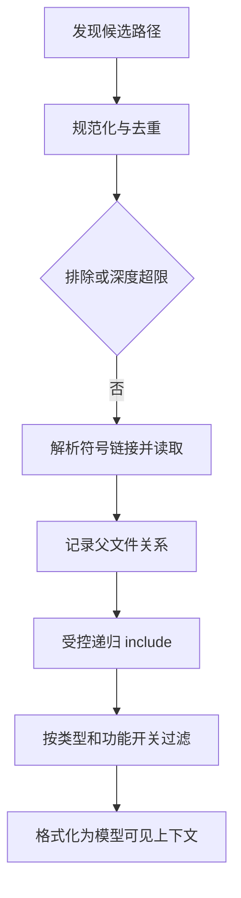

## 本章的问题

修复成功以后忘记运行测试，可能是模型没有遵守，也可能是规则从未进入请求。我们先写 CLAUDE.md，再让它 include 子文件，子文件反过来 include 根文件。没有去重的递归会无限绕圈。

coda 用物理路径记录 visited，用独立深度上限阻止无限的新文件链，把父关系保存在读取结果里。最后才按类型过滤并格式化。发现集合和注入集合分开，才能解释“磁盘上存在但模型没看到”。

## 沿固定源码逐段拆解

@ccsrc memory-include

### processMemoryFile 的顺序是一套防御链

先规范化路径并检查 processedPaths 与 MAX_INCLUDE_DEPTH，再执行排除规则。随后解析符号链接，把原路径与解析路径的身份都记入 processedPaths。读取为空就返回；父文件先加入 result，子 include 再递归并携带 parent。

includeExternal 控制越出原工作目录的引用。深度、去重和外部范围各管一种风险，不能互相替代。一次“文件没加载”的调查，需要分别记录在哪个判断处被跳过。

@ccsrc memory-filter

### 过滤函数能删除已经找到的索引

skipMemoryIndex 打开时，AutoMem 与 TeamMem 被剔除。它没有删除磁盘文件，也没有证明记忆功能不存在；它改变的是本次注入视图。

@ccsrc memory-inject

### getClaudeMds 再做类型选择与来源标注

函数还接受 filter，并可能跳过 Project/Local。对不同类型附加来源描述，再拼成最终文本。父关系、类型和来源不只是 UI 元数据，也帮助审计一条指令为什么出现。

coda 使用小型 @include 方言，只接受工作区内指令，范围比产品窄。它没有扫描用户真实全局目录，因此实验不会被个人配置污染。

## 机制总览



## 接入贯穿项目

@implementation 04-memory

### 逐步跟踪本章实现

`visit(entry, 0)` 把入口当成一棵文件图的起点，而非单个字符串。每次先用 workspacePath 得到物理文件，再用 visited 去重，因此 A 引用 B、B 又引用 A 时不会无限递归；同一文件的两个符号链接别名也不会注入两遍。

文件正文和 include 指令有不同用途。实现从最终 text 中去掉 `@include` 行，却继续逐条解析引用，并相对当前文件构造下一级位置。结果项保留 path、parent、type，后续能够解释某条说明来自哪里，而不是得到无法追溯的一整段 prompt。

深度检查发生在读取之前；达到 maxDepth 的节点不再展开。完成收集后再过滤空正文以及指定类型，memoryPrompt 最后添加带来源的说明。这个实现没有自动监听文件变化，createCoda 在创建时抓取一份记忆；更新何时生效是应用层必须另定的契约。

## 运行本章实验

```bash
node --disable-warning=ExperimentalWarning labs/chapters/04-memory.mjs
```

@experiment 04-memory

## 逐项解释实验结果

输出列出两个物理文件及 parent，并展示真正传入请求的文字。深度改为 1 时只剩根文件；AutoMem 过滤后集合为空；指向工作区外的符号链接被拒绝。

从这几种不同输出，可以明确区分没发现、读到但过滤、以及范围校验失败。不能只用一个 loaded 布尔值描述全过程。

## 继续动手与验收

为第三个文件增加第二条 include，让它能经两条路径到达。验证只注入一次，并解释父关系采用哪一次发现。然后讨论“先完成所有发现再统一排序”会怎样改变来源顺序。

::: interview 文件存在为什么仍可能没有进入模型上下文？
先规范化到物理文件再去重，并在读取前限制深度；正文保留来源与父引用，include 行只用于发现。实验同时覆盖循环、别名、空正文和越界，不能只检查最后拼出的字符串长度。
:::

@observation 04-memory
