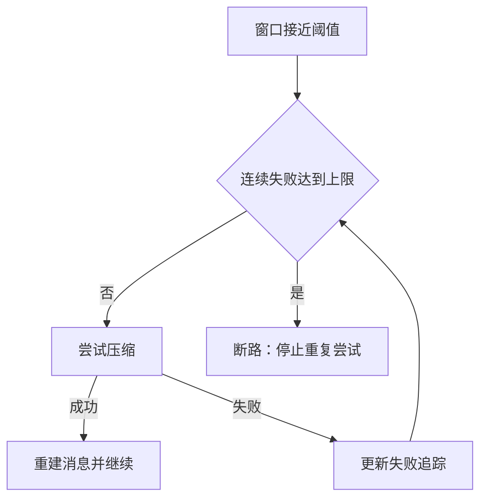

## 会话事实与模型请求不是同一个对象

转录保存消息和关联关系，压缩则为后续请求构造更短的上下文。先读 sessionStorage 的持久入口，再读 compact 服务。不能仅凭最终摘要文字推断磁盘历史被删除或替换。

@ccsrc session-record

## 阈值先给摘要输出留空间

@ccsrc compact-threshold

自动压缩阈值建立在有效上下文窗口之上，扣除 buffer 后决定何时提前处理。有效窗口本身还会考虑摘要输出预留；百分比覆盖值通过 min 约束，不能随意把阈值推到更危险的位置。

这些是该源码版本的公式和条件。原实验中把窗口调小以触发压缩，是一种测试手段，不应把实验参数写成产品默认值。token 估算、供应商限制和实际失败响应也需要区分。

## 连续失败会改变下一步决策

@ccsrc compact-breaker

`autoCompactIfNeeded` 先检查禁用配置与连续失败状态，再判断是否到阈值。当前源码有三次连续失败的断路器；它避免同一段不可压缩历史在每次循环都发起注定失败的请求。

回归测试不应只检查“出现压缩提示”，还应覆盖连续失败后是否停止重试，以及成功后追踪状态怎样更新。用户取消、输出截断和供应商拒绝也不该一律算成相同故障。

## 压缩结果由多种材料重建

@ccsrc compact-rebuild

`buildPostCompactMessages` 保持明确顺序：边界、摘要、保留消息、附件、hook 结果。它表明压缩结果不是一个孤立字符串，而是重建后续上下文的协议数据。继续沿保存和 resume 路径检查父子关联，才能解释恢复行为。

## 历史是一份事实，请求是它的一次投影

修复任务跑了很久之后，磁盘转录可能包含许多工具结果。模型窗口有限，下一次请求不可能永远携带全部原文。持久记录的责任是保存可恢复事实；请求构造的责任是提供这次推理需要的材料。压缩改变后者，不应被理解成“会话被换成一条随便写的摘要”。

`recordTranscript` 让你找到事实层的入口；`buildPostCompactMessages` 让你找到模型可见序列的重建入口。读两者之间的调用者，才知道哪些消息保留、如何链接、何时写入。只看摘要文字无法判断分支历史和工具配对是否仍正确。

## 亲手算一个阈值

令有效窗口为 W、缓冲为 B，默认触发阈值就是 W−B。环境百分比 p 只有在有效范围内才参与；即便 p=100%，也要与默认阈值取较小者。因此这个 override 适合让测试更早触发，不能把缓冲硬抹掉。

@lab node --disable-warning=ExperimentalWarning labs/engineering/run.mjs compact

实验使用人为的 W=100000、B=13000。50% 得到 50000，100% 仍然是 87000，非法值回落默认。数值来自测试端口，并非本版本产品对所有模型统一使用的真实窗口或缓冲。

同一实验还执行真实消息重建函数，得到 boundary、summary、retained、attachment、hook 的顺序。为什么附件和 Hook 结果要放回来？因为摘要只是历史压缩的一部分，环境说明、运行提示和保留的消息还需要重新构成下一次工作的上下文。

## 压缩也会失败，不能无限压缩自己

摘要请求本身可能因长度、模型错误或协议问题失败。若每轮都马上再次尝试，会出现用户看到 Agent 在压缩、账单却持续增加的情况。断路器把“必须恢复”改成“有界尝试，然后交出失败”，这是长任务可靠性的组成部分。

## 练习：检查摘要是否真的可继续工作

给 normalizeSlug 任务做一份中途摘要。它至少应保留用户目标、已修改文件、测试结果、未解决错误和下一步。加入一个反例：测试命令已经执行但失败原因被省略，恢复后 Agent 会不会重复同一错误？

这项人工练习没有证明产品摘要质量。它教你设计一个评估任务：固定原始历史和待执行下一步，比较压缩前后的任务完成率、错误重复率与调用成本。先测能否继续工作，再看摘要是否“读起来通顺”。

::: interview 为什么压缩成功仍可能导致恢复问题？
摘要生成、格式校验、消息链重建和持久提交是不同边界。丢失工具配对、错误父节点或只提交了一半状态，都可能使后续请求失败。应测试重建顺序、失败原子性和 resume，而不能只验证摘要文本看起来合理。
:::

@observation 05-sessions-compaction
