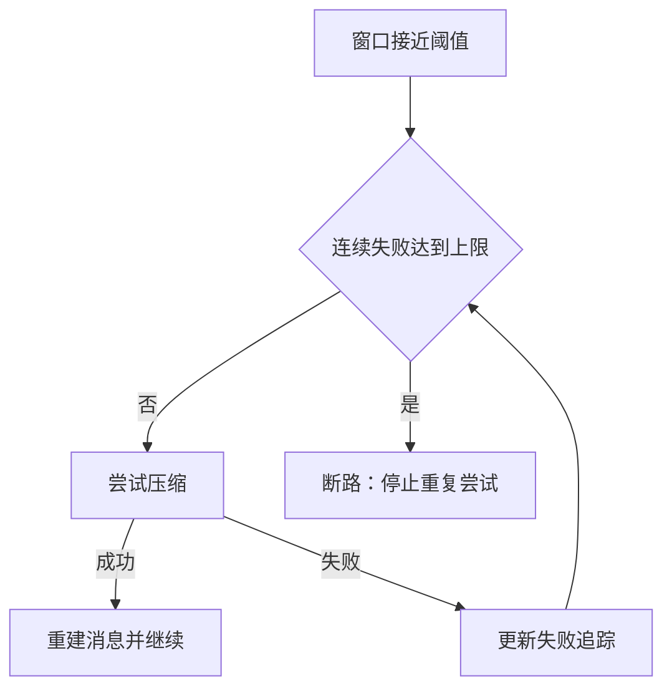

## 本章的问题

Agent 改到一半进程退出，日志末尾只写了半条 JSON。恢复程序既不能因为最后一行残缺就丢掉整个会话，也不能把中间损坏当作普通断尾忽略。继续追加前，还必须截去未提交尾部，否则下次它就变成了中间损坏。

coda 用带序号与哈希链的 Journal 保存事实，Session 再增加 parent 形成分支。压缩是另一个模块：它生成摘要和保留后缀，绝不修改原始 Session 日志。

## 沿固定源码逐段拆解

@ccsrc session-record

### 从 recordTranscript 找持久层

transcript 负责保存消息事实。模型请求可能增加附件、合并、裁剪或修复协议；磁盘记录与 wire messages 不能被视作同一份对象。分支恢复还依赖消息身份与父关系，而不只是文件里第几行。

@ccsrc compact-threshold

### 阈值先扣缓冲，再接受只向下的覆盖

有效窗口减 AUTOCOMPACT_BUFFER_TOKENS 得到默认值；百分比合法时与默认值取较小者。100% 也不能抹去预留。这个 override 用于提早触发测试，不是扩大模型窗口。

@ccsrc compact-breaker

### 摘要失败需要跨迭代记账

连续失败超过上限时直接返回未压缩，避免每轮重复发起注定失败的摘要。判断是否需要压缩与实际生成摘要是两层操作，错误归因也应该分开。

@ccsrc compact-rebuild

### 摘要不能吞掉剩余上下文

重建顺序包含 boundary、summary、messagesToKeep、attachments、hookResults。摘要本身只是其中一项。留下工具结果却裁掉对应调用，会产生协议错误；保存一份读起来通顺的摘要，并不足以证明任务能继续。

coda 的 projectHistory 在请求副本里补缺失结果、排除孤立结果。压缩选择用户边界保留原子后缀，摘要器是可替换端口，测试不消耗模型额度。

## 机制总览



## 接入贯穿项目

@implementation 05-sessions-compaction

### 逐步跟踪本章实现

`Session.append` 先确认 parent 存在，再写入带新 id 的节点并移动 head。branch 只改变当前 head；history 通过 parent 链向前追溯，所以同一份追加日志可以保留另一条分支，却只投影当前选择的祖先。重开实例默认读取最后写入的节点，分支选择没有被另外持久化。

压缩器操作请求视图，不删除日志事实。它先投影历史，再从末尾寻找最近的 user 边界，避免把一个 assistant/tool 组切成两半；边界之前交给 summarize，之后原样保留，最后补附件与 hook 结果。摘要端口必须返回非空文本，才构造 changed=true 的新视图。

failures 属于 Compactor 实例而不是局部请求变量。连续摘要失败会打开断路器，成功才清零；阈值覆盖也只能把正常阈值往下调。这让“需要更早压缩”和“反复压缩仍失败”成为两种独立状态。课程字符估算不是真实 tokenizer，测的是边界与恢复行为。

## 运行本章实验

```bash
node --disable-warning=ExperimentalWarning labs/chapters/05-sessions-compaction.mjs
```

@experiment 05-sessions-compaction

## 逐项解释实验结果

实验真实创建两条会话分支，追加一个残缺尾部，再恢复和继续写入。随后观察原始 history 与修复视图的差别。压缩器连续两次失败以后第三次不再调用摘要器；成功摘要则保留 next 用户任务。

这里验证格式、协议和失败控制，没有测摘要是否忠实。要评价摘要质量，需要固定历史与后续任务，比较压缩前后能否继续完成。

## 继续动手与验收

修改日志中间一条记录的消息字节，确认完整性校验拒绝它。再构造包含两个工具调用的历史，尝试在工具组中间切分，设计一个能防止错误压缩的测试。

::: interview 历史保存、请求投影与压缩为什么需要分开？
日志保留不可变节点与 parent，history 选择当前祖先；请求投影再补齐中断结果和形成压缩视图。摘要失败不会删除旧事实，断路器限制重复失败；正常重开、分支选择和崩溃恢复需要分别验证。
:::

@observation 05-sessions-compaction
