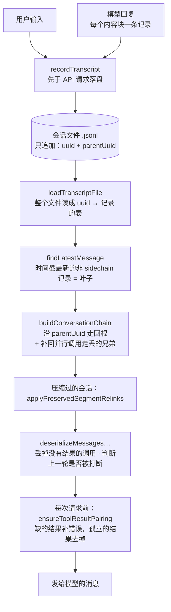

关掉终端，第二天执行 `claude --continue`，模型会看到什么？干了一个小时，上下文逼近窗口，Claude Code 在下一次请求之前做了什么，请求里还剩下什么？

这是同一个设计的两面：磁盘上有一份**只追加的记录**，每次请求用的是**从记录重建的视图**。Learn Pi Agent 第 7、8 章在 Pi 上讲过这套分层：会话是一棵只追加的树，压缩是“摘要加切点”。这一章在 Claude Code 上读一遍，有三处和 Pi 差得很远：

- 模型一次回复里的三个并行 Read，在会话文件里不是一条链，而是一张分叉的图。读回来时有专门一步把走丢的记录补上。
- 写摘要的请求，是把上一个请求**原样重发**，再追加一句指令，为的是命中提示缓存。
- 名叫 microcompact 的东西，在发布的 2.1.88 里默认什么都不做。

全章分两半，先会话，后压缩，最后用 coda 的 `Session` 和 `Compactor` 把两半接起来。


@figure assets/course/ch05-compaction.png 会话文件只追加，一页不撕；压缩只是用摘要和最近几页重新拼出请求

## 上半 · 会话：文件里只追加，请求里重建

### 一次运行留下的文件

会话文件在 `~/.claude/projects/<工作目录>/<会话 id>.jsonl`，目录名是把工作目录里所有非字母数字的字符换成 `-`（`getTranscriptPath`、`sanitizePath`）。下面是让 Claude Code 读三个文件之后留下的那份。录制用的是 Claude Code 2.1.296，源码摘录来自 2.1.88；两者有出入的地方会指出，字段名一致的地方不再区分。

@lab node --disable-warning=ExperimentalWarning labs/ch05/transcript.mjs kinds

30 行里只有 23 行在“链”上：对话本身，加上系统注入的附件。第 2 章说过，环境、日期、CLAUDE.md 这些内容以 system 身份进入请求；它们同样被当作消息记进文件，带 uuid，挂在链上。这样做的回报在恢复的时候。先看同一个会话先后运行三次（读文件、`--resume` 后 `/compact`、再 `--resume` 提问）时文件的变化：

@lab node labs/ch05/session.ts file

三次运行写的是**同一个文件**，每次只在末尾追加，前面的行一行没动；`SessionStart` 钩子收到的 `source` 说明了每次是怎么开始的。再把第一次运行的最后一个请求，和 `--resume` 之后的第一个请求逐条比较：

@lab node labs/ch05/session.ts resume

除了最后追加的那一段，**一字不差**，连 8486 字符的环境信息都一样，缓存命中 93%。恢复不是重新生成上下文，而是重放记下的东西。如果恢复时重新采集日期和目录状态，开头一变，整个前缀的缓存就作废了。最后那一段（`CRITICAL: Respond with TEXT ONLY`）是 `/compact` 的指令，留到压缩那一半。

下面是整条链路，后面的小节逐站读：



### 写入：提问先落盘

每条消息变成文件里的一行，是 `insertMessageChain` 干的，核心是给它盖上 `parentUuid`：

@cc utils/sessionStorage.ts#L1025-L1048 hl=1030-1037,1040-1041

- 第 1030–1037 行：默认的父亲是“上一条参与链的消息”（`parentUuid` 这个游标；进度提示 progress 不参与，见 `isChainParticipant`）。**tool_result 是例外**：它的父亲是发起它的那一条 assistant 记录（`sourceToolAssistantUUID`）。下一节的“图”就是这一行造成的。
- 第 1040–1041 行：压缩边界反过来，`parentUuid` 写 `null`，原来的位置挪进 `logicalParentUuid`——一个新的根，加一个只用来回头看的指针。压缩那一半细讲。

调用它的是 `recordTranscript`：

@cc utils/sessionStorage.ts#recordTranscript hl=1416-1431

它拿到的消息数组里，哪些已经写过，调用者不用操心：用 `messageSet`（文件里已有的 uuid）去重，只把没写过的交给 `insertMessageChain`。`QueryEngine` 每次传整个数组，REPL 的 `useLogMessages` 只传新增的尾巴并附上父亲的提示，两种用法都对。落盘本身由 `Project` 管：每个文件一条写队列，每 100ms 刷一批，文件权限 0600；直到第一条 user 或 assistant 消息出现才创建文件，只有元数据不会留下空文件。

什么时候写？答案藏在 `QueryEngine` 的一段注释里：

@cc QueryEngine.ts#L436-L444

用户的提问在进入查询循环**之前**就写盘。如果等 API 回复，进程在那之前被杀，文件里只有 queue-operation，`--resume` 会报“找不到对话”。助手的回复则是边流边写：每个内容块结束就产出一条 assistant 记录，不等整条回复。

### 读回来：从最新的消息走回根

`--resume <id>` 走 `getLastSessionLog`：把整个文件读进一张以 uuid 为键的表，用 `findLatestMessage` 选出**时间戳最大**的非 sidechain 消息当叶子（不是“文件最后一行”），再交给 `buildConversationChain`：

@cc utils/sessionStorage.ts#buildConversationChain hl=2076-2091,2093

沿着 `parentUuid` 一路向上，`seen` 集合防止环（有环就返回已走的部分并上报），走完反转，最后把结果交给第 2093 行的后处理。`--continue` 是同一条路，只是会话由 `loadMessageLogs` 按日期排序、取当前目录里最近的一个。`--fork-session` 不沿用旧 id：

@cc utils/sessionRestore.ts#L452-L455

新会话用新 id，旧消息通过 `recordTranscript` 复制进新文件（文件里的 uuid 去重是按会话文件算的，所以复制得进去），旧文件不再追加。

### 并行的 Read 让文件变成一张图

第 2093 行的后处理是为谁准备的？看真实录制。第一次运行里，模型一次回复调用了三个 Read；下面是文件里这几行的父子关系，和两种读法的对比：

@lab node --disable-warning=ExperimentalWarning labs/ch05/transcript.mjs dag

::: steps 单链遍历走丢了两行，recoverOrphanedParallelToolResults 把它们补回来
--- 模型一次回复调用了三个 Read。流式输出时每个内容块一条记录，三条 tool_use 的 `message.id` 相同、uuid 不同。每条 `tool_result` 的父亲是**发起它的那条 assistant 记录**（`sourceToolAssistantUUID`），所以文件里是一张有向无环图，不是一条链。
flowchart TD
  L15["15 文字：I'll read the three files"]:::done --> L16["16 调用 Read a.js"]:::on
  L16 --> L17["17 调用 Read b.js"]:::on
  L17 --> L18["18 结果 ← b.js"]:::dim
  L16 --> L19["19 结果 ← a.js"]:::dim
  L19 --> L20["20 调用 Read c.js"]:::on
  L20 --> L21["21 结果 ← c.js"]:::dim
  L21 --> L28["…叶子（第 28 行）"]:::dim
--- `--resume` 走 `getLastSessionLog`：整个文件读成 uuid → 记录的表，`findLatestMessage` 选出**时间戳最新**的非 sidechain 消息当叶子（不是“文件最后一行”）。这里是第 28 行。
flowchart TD
  L15["15 文字：I'll read the three files"]:::dim --> L16["16 调用 Read a.js"]:::dim
  L16 --> L17["17 调用 Read b.js"]:::dim
  L17 --> L18["18 结果 ← b.js"]:::dim
  L16 --> L19["19 结果 ← a.js"]:::dim
  L19 --> L20["20 调用 Read c.js"]:::dim
  L20 --> L21["21 结果 ← c.js"]:::dim
  L21 --> L28["…叶子（第 28 行）"]:::on
--- `buildConversationChain` 沿 `parentUuid` 往上走：叶子 → 21 → 20 → 19 → 16 → 15。走完反转，得到 21 行。`seen` 集合防止环。
flowchart TD
  L15["15 文字：I'll read the three files"]:::on --> L16["16 调用 Read a.js"]:::on
  L16 --> L17["17 调用 Read b.js"]:::dim
  L17 --> L18["18 结果 ← b.js"]:::dim
  L16 --> L19["19 结果 ← a.js"]:::on
  L19 --> L20["20 调用 Read c.js"]:::on
  L20 --> L21["21 结果 ← c.js"]:::on
  L21 --> L28["…叶子（第 28 行）"]:::on
--- 第 17、18 行（b.js 的调用和结果）不在这条路上：从叶子往回走，只会经过 19，不会经过 17。单链遍历把它们丢了。如果不管，模型会看到 a、c 的结果，却看不到 b。
flowchart TD
  L15["15 文字：I'll read the three files"]:::done --> L16["16 调用 Read a.js"]:::done
  L16 --> L17["17 调用 Read b.js"]:::on
  L17 --> L18["18 结果 ← b.js"]:::on
  L16 --> L19["19 结果 ← a.js"]:::done
  L19 --> L20["20 调用 Read c.js"]:::done
  L20 --> L21["21 结果 ← c.js"]:::done
  L21 --> L28["…叶子（第 28 行）"]:::done
--- 后处理 `recoverOrphanedParallelToolResults` 按 `message.id` 把同一次回复的兄弟记录和它们的结果找回来，插在该组最后一个链上成员（第 20 行）后面。最终是 23 行，17、18 排在 20 和 21 之间。
flowchart TD
  L15["15 文字：I'll read the three files"]:::done --> L16["16 调用 Read a.js"]:::done
  L16 --> L17["17 调用 Read b.js"]:::on
  L17 --> L18["18 结果 ← b.js"]:::on
  L16 --> L19["19 结果 ← a.js"]:::done
  L19 --> L20["20 调用 Read c.js"]:::done
  L20 --> L21["21 结果 ← c.js"]:::done
  L21 --> L28["…叶子（第 28 行）"]:::done
:::

从叶子往回走，经过 21、20、19，再到 16——第 17、18 行（b.js 的调用和结果）不在这条路上，被单链遍历丢掉了。原因写在后处理函数的注释里：

@cc utils/sessionStorage.ts#L2096-L2117 hl=2100-2105,2108-2109

流式输出时，每个内容块结束就产出一条 assistant 记录：三个并行调用就是三条，`message.id` 相同、uuid 不同。每条 tool_result 的父亲是它自己的那条 assistant，所以拓扑是**有向无环图**，而“沿父亲往上走”只能走一条路。`recoverOrphanedParallelToolResults` 按 `message.id` 把同一次回复的兄弟记录和它们的结果找回来，插在该组最后一个链上成员的后面：上面表格的最后一列是补回之后的位置，统计句是 23 行对 21 行。

Pi 和 mox 没有这一步：一条 assistant 消息自带整个 `toolCall` 数组，结果依次追加，树就够了。这是“按内容块存记录”（边流边写、崩溃时已完成的块不丢）要付的代价。

### 恢复时的整理：被打断的一轮怎么办

读回来的链还不能直接用。进程可能死在任何时刻，`deserializeMessagesWithInterruptDetection` 在发回对话之前做三件事：

@cc utils/conversationRecovery.ts#L186-L224 hl=187-189,204,210-217

- 第 187 行：`filterUnresolvedToolUses` 丢掉**所有**工具调用都没有结果的助手消息。服务商不接受没有结果的调用；只缺一部分的消息保留，留给请求前的配对修复。
- 第 191–202 行再过滤两种会让 API 报错的残渣：只有思考块的孤儿、只有空白的助手消息。
- 第 204 行起判断上一轮的状态。`detectTurnInterruption` 看最后一条有效消息：

@cc utils/conversationRecovery.ts#L297-L324 hl=303,307-309,320,323

助手消息收尾，视为正常结束（源码注释解释了：流式路径下落盘的助手消息 `stop_reason` 总是 null，只能这样推断）；普通的用户提问收尾，是 `interrupted_prompt`——提问发出去了，模型还没开口；工具结果收尾，是 `interrupted_turn`——工具跑完了，模型没看到，这时补一条“接着做”的用户消息（第 210–217 行）。

coda 的 `restore` 做同样的整理，对照原函数跑五种场景：

@lab node --disable-warning=ExperimentalWarning labs/chapters/05-sessions-compaction.mjs resume

读表时留意两处。第三行，调用写进了文件、结果没来：恢复后只剩一句文字，判断是“正常结束”，所以下一句话来了，对话照常继续，模型不会看到半截的调用。第四行，两个调用只有一个有结果：这条助手消息保留，判断是 `interrupted_turn`；缺的那个结果，在**每次请求之前**由 `ensureToolResultPairing` 补上（表的下半部分：原函数补的是一条 `[Tool result missing…]` 的错误结果，孤立的结果直接去掉）。补出来的东西只存在于这次请求里，文件里原样不动。存储记事实，投影管协议，和 Pi 第 7 章是同一条原则。

## 下半 · 压缩：换掉请求里的旧对话，文件里的事实原样留着

### 一次自动压缩，从头到尾

用环境变量把 Claude Code 假设的窗口调到 75000，让它依次读六个各约 8K token 的文件，第 4 个文件之后触发了自动压缩。每个请求的时间线（录制，2.1.296）：

@lab node labs/ch05/auto.ts timeline

三个现象：

- **压缩发生在一次运行的中间**，模型接着读完了剩下的文件，用户什么都不用做。
- **压缩请求（第 9 个）的消息数和第 8 个相同**，42645 个输入 token 里有 41216 个读自缓存（97%）。压缩之后的第 13 个请求，开头换成了摘要，只命中 186 个，缓存要从头重建（之后又回到 75%、80%）。
- 压缩之后，`alpha`、`beta`、`gamma` 在上下文里只剩摘要里的一句话；Claude Code 还对这三个文件各调用了一次 `count_tokens`，要决定能不能把它们重新附上，结果每个都超过 5000 token，只附上“文件引用”。

整个过程在代码里是这样走的：

::: steps 一次自动压缩：从 microcompact 到新的根
--- `queryLoop` 每一圈在发请求之前，先做便宜的 `microcompact`（第 412 行的注释就是这条顺序的出处）。2.1.88 里它只有两个分支：时间触发默认关，缓存编辑被编译掉，所以默认原样返回。
sequenceDiagram
  participant Q as queryLoop（每一圈）
  participant M as microcompact
  participant A as autoCompactIfNeeded
  participant C as compactConversation
  participant S as 摘要模型（fork）
  participant F as 会话文件
  rect rgb(255,230,213)
    Q->>M: 先做便宜的：旧工具结果还要不要留
    M-->>Q: 2.1.88 默认原样返回
  end
--- 接着 `autoCompactIfNeeded` 问：当前大小（`tokenCountWithEstimation`）是否到了触发线 = 有效窗口 − 13000？到了，并且连续失败不到 3 次，就调用 `compactConversation`。
sequenceDiagram
  participant Q as queryLoop（每一圈）
  participant M as microcompact
  participant A as autoCompactIfNeeded
  participant C as compactConversation
  participant S as 摘要模型（fork）
  participant F as 会话文件
  Q->>M: 先做便宜的：旧工具结果还要不要留
  M-->>Q: 2.1.88 默认原样返回
  rect rgb(255,230,213)
    Q->>A: 上下文 ≥ 触发线吗？
    A->>C: 是（连续失败不到 3 次）
  end
--- `compactConversation` 先跑 PreCompact Hook，然后用 `runForkedAgent` 起一个只跑一轮的分身：把主对话的 `cacheSafeParams`（系统提示、工具、模型、消息前缀）**原样重发**，只多一条压缩指令，借用主对话的提示缓存。
sequenceDiagram
  participant Q as queryLoop（每一圈）
  participant M as microcompact
  participant A as autoCompactIfNeeded
  participant C as compactConversation
  participant S as 摘要模型（fork）
  participant F as 会话文件
  Q->>M: 先做便宜的：旧工具结果还要不要留
  M-->>Q: 2.1.88 默认原样返回
  Q->>A: 上下文 ≥ 触发线吗？
  A->>C: 是（连续失败不到 3 次）
  rect rgb(255,230,213)
    C->>C: PreCompact Hook
    C->>S: 上一个请求原样重发 + 压缩指令
  end
--- 摘要模型先写一段 `<analysis>` 草稿，再写 `<summary>`，九节格式，其中有“全部用户消息”。`formatCompactSummary` 之后会剥掉草稿。
sequenceDiagram
  participant Q as queryLoop（每一圈）
  participant M as microcompact
  participant A as autoCompactIfNeeded
  participant C as compactConversation
  participant S as 摘要模型（fork）
  participant F as 会话文件
  Q->>M: 先做便宜的：旧工具结果还要不要留
  M-->>Q: 2.1.88 默认原样返回
  Q->>A: 上下文 ≥ 触发线吗？
  A->>C: 是（连续失败不到 3 次）
  C->>C: PreCompact Hook
  C->>S: 上一个请求原样重发 + 压缩指令
  rect rgb(255,230,213)
    S-->>C: <analysis> 草稿 + <summary> 正文
  end
--- 摘要之后重新附上几样东西：最近读过的文件（最多 5 个，每个限 5000 token）、计划、用过的 Skill、各种增量声明，再跑一次 SessionStart（`source=compact`）Hook。返回的是边界、摘要、附件和 Hook 结果。
sequenceDiagram
  participant Q as queryLoop（每一圈）
  participant M as microcompact
  participant A as autoCompactIfNeeded
  participant C as compactConversation
  participant S as 摘要模型（fork）
  participant F as 会话文件
  Q->>M: 先做便宜的：旧工具结果还要不要留
  M-->>Q: 2.1.88 默认原样返回
  Q->>A: 上下文 ≥ 触发线吗？
  A->>C: 是（连续失败不到 3 次）
  C->>C: PreCompact Hook
  C->>S: 上一个请求原样重发 + 压缩指令
  S-->>C: <analysis> 草稿 + <summary> 正文
  rect rgb(255,230,213)
    C->>C: 重新读最近的文件 · SessionStart(compact) Hook
    C-->>Q: 边界 · 摘要 · 附件 · Hook 结果
  end
--- 会话文件里追加这几条：边界的 `parentUuid` 为 `null`，是一个新的根。然后用压缩后的消息发出这一圈的请求，缓存要从头重建。
sequenceDiagram
  participant Q as queryLoop（每一圈）
  participant M as microcompact
  participant A as autoCompactIfNeeded
  participant C as compactConversation
  participant S as 摘要模型（fork）
  participant F as 会话文件
  Q->>M: 先做便宜的：旧工具结果还要不要留
  M-->>Q: 2.1.88 默认原样返回
  Q->>A: 上下文 ≥ 触发线吗？
  A->>C: 是（连续失败不到 3 次）
  C->>C: PreCompact Hook
  C->>S: 上一个请求原样重发 + 压缩指令
  S-->>C: <analysis> 草稿 + <summary> 正文
  C->>C: 重新读最近的文件 · SessionStart(compact) Hook
  C-->>Q: 边界 · 摘要 · 附件 · Hook 结果
  rect rgb(255,230,213)
    Q->>F: 追加：边界是新的根（parentUuid = null）
    Q->>Q: 用压缩后的消息发出这一圈的请求
  end
:::

顺序先看源码。`query.ts` 每一圈在发请求之前，先 microcompact，再 autocompact：

@cc query.ts#L412-L419 hl=412

第 412 行的注释就是这条顺序的出处。两步之间源码里还有 snip 和 context collapse（注释说 collapse 要抢在 autocompact 之前跑，这样它能把上下文压到线下，autocompact 就成了空操作），发布版里它们被编译期开关去掉了，后面有表。

### 什么时候压缩：窗口减去两笔预留

触发线是一道减法。先是**有效窗口**：模型窗口，扣掉“写摘要时输出要占的空间”。

@cc services/compact/autoCompact.ts#L33-L49 hl=34-37,40-45,48

预留是 `min(模型最大输出, 20000)`，源码注释写着依据：摘要输出的 p99.99 是 17387 个 token。`CLAUDE_CODE_AUTO_COMPACT_WINDOW` 只能把窗口往小调（第 44 行取 `min`）。再从有效窗口里扣一笔缓冲，就是触发线：

@cc services/compact/autoCompact.ts#L62-L91 hl=62,75-76,79-88

`AUTOCOMPACT_BUFFER_TOKENS` 是 13000。`CLAUDE_AUTOCOMPACT_PCT_OVERRIDE` 是测试用的覆盖：按有效窗口的百分比算，**取较小的一个**，所以只能提早触发，推迟不了。用来比较的“当前大小”不是现数一遍：

@cc utils/tokens.ts#tokenCountWithEstimation hl=232-234,253-256

从后往前找最近一条带真实用量（`usage`）的助手消息，加上它之后新增消息的粗略估算（第 253–256 行）。第 232–234 行的细节又是并行调用造成的：一次回复拆成的几条记录共享同一份用量，要退回到最前面那一条，夹在中间的 tool_result 才不会漏数。下面运行的是固定提交里真正的两个阈值函数（窗口和最大输出换成可调的数字）：

@lab node --disable-warning=ExperimentalWarning labs/chapters/05-sessions-compaction.mjs threshold

200K 的窗口，触发线是 167000，83.5%；窗口越大，预留占的比例越小。最后两行把公式和录制对上：窗口 75000 的录制里，第 8 个请求的输入是 41361，没有触发；读入 delta.js 之后到 47692，触发了。公式给出 42000，正好夹在中间。只看录制，很容易把触发线读成“窗口减 32000”（32000 是请求的 `max_tokens`）：它在这两份录制里同样说得通，因为录制只能把线夹在一个区间里，分不出 33000 和 32000。答案要看源码：20000 加 13000。

两处版本差异：录制里用 `CLAUDE_CODE_MAX_CONTEXT_TOKENS` 调小窗口，2.1.88 里读这个变量的 `getContextWindowForModel` 只对内部构建（`USER_TYPE === 'ant'`）生效，外部构建用上面的 `CLAUDE_CODE_AUTO_COMPACT_WINDOW`；`DISABLE_AUTO_COMPACT` 或设置里关掉自动压缩后，改由 `calculateTokenWarningState` 在有效窗口减 3000 处直接拦下请求，留出手动 `/compact` 的余地。

### microcompact：不叫模型写摘要的那一种

“microcompact”这个名字听上去像一档轻量压缩。2.1.88 的 `microcompactMessages` 是这样：

@cc services/compact/microCompact.ts#L253-L293 hl=261-270,276-278,288-292

只有两个分支。**时间触发**：距离最近一条助手消息超过阈值，就把旧的工具结果换成一句固定的占位文字。理由写在注释里：服务端的提示缓存已经过期，下一个请求反正要整个重写前缀，不如先把旧结果清掉，让重写的内容少一点。**缓存编辑**（`cache_edits`，服务端原地删除而不动缓存前缀）受 `feature('CACHED_MICROCOMPACT')` 控制。第 288–292 行：旧的“本地微压缩”已经删掉，其余情况这里什么都不发生，上下文压力交给 autocompact。

哪些分支在发布的包里走得到？下面的脚本去数它们的标志字符串在不在 `cli.js` 里、模块在不在 source map 里：

@lab node --disable-warning=ExperimentalWarning labs/ch05/gates.mjs

缓存编辑式微压缩的模块不在 source map 里，字符串也不在 `cli.js` 里，编译期被去掉了。时间触发那条在包里，服务端灰度开关的缺省配置是 `enabled: false`：**默认关**，什么时候开由服务端决定。这张表还说明了第 1 章那个结论在本章的对应：`reactive compact`、上下文折叠、snip 在 2.1.88 里都走不到；会话记忆压缩（后台持续维护一份记忆文件，压缩时直接拿它当摘要；`/compact` 不带说明文字时会先试它）要两个灰度开关同时为真，缺省都是 false。所以发布的 2.1.88 里，实际起作用的压缩只有：自动压缩、手动 `/compact`，加上一个默认关着的时间触发。

时间触发的那条路：

@cc services/compact/microCompact.ts#L446-L467 hl=456,458-463,465-467

先收集所有“可压缩工具”（`COMPACTABLE_TOOLS`：读文件、Shell、Grep、Glob、抓取、搜索、编辑、写入）的调用 id，保留最近 `keepRecent`（缺省 5）个，其余的结果清掉。第 458–461 行的注释记着一个坑：`slice(-0)` 会返回整个数组，保留 0 个反而什么都不清；而全部清掉又会让模型一点工作上下文都没有，所以下限是 1。没有东西可清就返回 null，调用者原样使用。我们运行固定提交里的原函数（时钟换成固定的、配置换成“已开启”），和 coda 的 `microcompact` 比较：

@lab node --disable-warning=ExperimentalWarning labs/chapters/05-sessions-compaction.mjs microcompact

闲置 59 分钟什么都不做，61 分钟清掉 t1、t2：八轮调用里有七个 Read 和一个 Agent，保留最近 5 个 Read，Agent 的结果因为不在名单里原样保留。coda 和原函数清掉的是同一批。它做的不是摘要，是**丢掉模型大概率不再需要的原文**，不请求模型，没有失败的可能（保留 0 个的坑是“你来改”的第三题）。

### 摘要请求借用主对话的缓存

真正的压缩是 `compactConversation`，手动 `/compact` 和自动压缩走的是同一个函数，只有三处不同：手动的 `/compact 说明文字` 会把说明文字作为附加指令拼进提示词（并且先合并 PreCompact Hook 给的指令）；自动压缩要求摘要之后“直接接着做，别问用户”；手动压缩出错会弹出提示，自动压缩的失败静悄悄地等下一圈重试。最值得读的是摘要请求怎么发：

::: tabs
@@ Claude Code
@cc services/compact/compact.ts#L1178-L1200 hl=1181-1187,1189-1195
分身带着主对话的缓存键参数，原样重发再加一句指令。
@@ Pi
@pi packages/coding-agent/src/core/compaction/compaction.ts#L644-L695
把旧对话序列化成文字，配专门的摘要系统提示，另起一个请求。
@@ mox
@mox mox/src/compaction.ts#summaryPrompt
同 Pi：序列化后塞进一条摘要提示。
@@ coda
@code coda/src/compact.mjs#summaryRequest
照 Claude Code：在原请求后面追加压缩指令，前缀逐字不变。
:::

它用 `runForkedAgent` 起一个只跑一轮的分身，把主对话的 `cacheSafeParams`（系统提示、工具、模型、消息前缀）原样带过去，只多一条压缩指令。注释说得很直白：**不要设置 `maxOutputTokens`**，它会改动思考预算，让缓存键对不上，缓存整个作废。工具定义也照发，哪怕不让用——这个矛盾在提示词的开头有交代：

@cc services/compact/prompt.ts#L12-L26 hl=12-18,19,24

分身继承了完整的工具集（缓存键要求如此），有的模型会忍不住调用，所以提示词第一行就用大写说“只回复文本”，并说明调用会被拒绝（`createCompactCanUseTool` 对所有工具返回 deny）。摘要请求失败时有一条退路：不共享缓存，换一个只带 Read 的普通请求。

用 coda 的请求形状把缓存的差别算出来：做法 A 是 Claude Code（重发加一句指令），做法 B 是 Pi（把旧对话序列化成文字，另配一个专门的系统提示）。

@lab node --disable-warning=ExperimentalWarning labs/chapters/05-sessions-compaction.mjs cache

缓存按“工具、系统提示、消息”的顺序匹配前缀，第一处不同之后全部重算。A 只有最后追加的指令是新的；B 从第一段（工具）就对不上。录制的真实请求也是如此：前面 `session.ts resume` 那一行，压缩请求只有 6401 字符的指令是新的。代价在另一头：摘要模型看到的是**原始的**对话，包括那些会误导人的乱序工具结果（见本章最后一节）。

三种请求的形状放在一起：


模型先写一段 `<analysis>` 整理思路，再写 `<summary>`，提示词要求九节：用户的请求和意图、关键概念、文件和代码、错误和修复、解决的问题、**全部用户消息**、待办、当前的工作、下一步。比 Pi 的六节格式多出“全部用户消息”：用户原话最不能丢。进入上下文的是这样包装的：

@cc services/compact/prompt.ts#L337-L374 hl=345-347,349-351,357-359

`formatCompactSummary` 先剥掉 `<analysis>` 草稿（草稿只用来提高摘要质量，写完就没用了）；第 349–351 行告诉模型，需要压缩前的原话、精确的报错、自己生成的代码，可以去读完整的 transcript。**摘要有损，事实没丢**：会话文件还在磁盘上，模型知道路径。自动压缩（`suppressFollowUpQuestions` 为真）还会追加一段：直接接着做，别回顾，别问用户。

### 压缩之后，请求里剩下什么

摘要是起点，不是全部。`compactConversation` 在摘要之后重新附上几样东西：

@cc services/compact/compact.ts#L1415-L1464 hl=1421-1432,1440-1442,1457-1459

- **最近读过的文件**，最多 5 个（第 1432 行），按 `readFileState` 的时间戳从新到旧；每个读磁盘上**现在**的内容，单个文件限 5000 token（第 1441 行），超过的只留一个 `compact_file_reference`（只有路径）；总量不超过 50000（第 1457–1459 行）。保留下来的消息里已经读过的文件跳过，CLAUDE.md 和计划文件不在这里恢复。
- 计划文件和计划模式、用过的 Skill（每个最多 5000，合计 25000，截头保留）、后台子 Agent 的状态，以及工具、Agent 列表、MCP 指令的“增量声明”：原来承载它们的消息被摘要替换了，要重新声明一遍。
- **SessionStart Hook**（`source=compact`）的输出：Hook 在压缩后再跑一次，用户可以借此补上下文。

CLAUDE.md 不走这里。`runPostCompactCleanup` 清掉 `getUserContext` 的缓存，下一次请求像第 4 章讲的那样重新读（`resetGetMemoryFilesCache('compact')`）；`readFileState` 和已加载的子目录记忆（`loadedNestedMemoryPaths`）都被清空。所以子目录里的 CLAUDE.md 压缩后不会自动回来，要等模型再读到那个目录的文件。拼起来的顺序固定在一个函数里：

@cc services/compact/compact.ts#L326-L338 hl=328,331-336

边界、摘要、保留的消息、附件、Hook 结果。看录制的实际效果：先是钩子的顺序和边界事件，再是压缩之后的第一个请求。

@lab node labs/ch05/session.ts compact

@lab node labs/ch05/session.ts after

钩子顺序与源码一致：PreCompact（带着 `/compact` 后面的要求）、写摘要、SessionStart、PostCompact（收到的摘要比放进上下文的长，因为带着 `<analysis>`）。第 0 条是摘要；第 1 条是被保留的最后一条回复；第 2 条里 `CANARY-ROOT-CLAUDEMD` 重新出现（根目录的 CLAUDE.md 重新读了），第 3 条里三个文件的内容重新读了回来；而 `src/CLAUDE.md` 的金丝雀只出现在摘要里，是摘要模型碰巧记下的。必须一直生效的规则，写在根目录的 CLAUDE.md。

“被保留的消息”是版本之间有出入的地方：录制的 2.1.296 把压缩请求之后产生的几条消息原样保留；2.1.88 的 `compactConversation` 返回值里没有 `messagesToKeep`，保留尾巴是部分压缩和会话记忆压缩两条路径的做法。coda 保留“当前这一轮”：自动压缩发生在一次运行的中间，模型得知道自己正在做什么。下面是 coda 的 `Compactor` 做一次完整压缩的结果，摘要模型用脚本代替：

@lab node --disable-warning=ExperimentalWarning labs/chapters/05-sessions-compaction.mjs compact

### 压缩在会话文件里的样子

压缩没有删除任何东西，也没有复制保留的消息。回到真实的会话文件，看 `/compact` 之后追加的那几行，和恢复时读回来的对话：

@lab node --disable-warning=ExperimentalWarning labs/ch05/transcript.mjs compacted

边界是第 35 行：`parentUuid` 为 null，一个新的根，`logicalParentUuid` 指回压缩前的末尾。恢复时从叶子往回走，走到边界就停了，边界之前的 21 行不会加载。可是被“原样保留”的那两条（第 27、28 行）物理上还在边界**之前**，父子关系是旧的，单链遍历走不到。边界的元数据里记着它们的头、尾和锚（摘要）；`applyPreservedSegmentRelinks`（右列就是运行这个原函数的结果）把头接到摘要后面，再把锚的其他孩子接到尾后面，最后删掉边界之前其余的记录。保留的消息不用复制，旧记录一条没删，磁盘上仍有完整的历史，可以审计、可以回头找。

新的根还有一个工程上的好处，藏在加载大文件的注释里：

@cc utils/sessionStorage.ts#L3521-L3541 hl=3521-3525,3538-3541

会话文件可以长到几百 MB。超过 5MB 时，加载器分块往前读，遇到压缩边界就把之前攒的内容直接丢弃，峰值内存是**输出**的大小而不是文件的大小（注释里的例子：151MB 的文件只分配约 32MB）。边界是新的根，意味着它之前的字节根本不用解析。保留段正好破坏这一点：被保留的消息物理上在边界之前，所以只要边界带着保留段（`hasPreservedSegment`），这种预先跳过就要让步。“保留尾巴”不是免费的。

这和 Learn Pi Agent 第 8 章的做法是同一个思想，实现不同：Pi 追加一条压缩记录，用 `firstKeptEntryId` 指出从哪里开始保留，链不断；Claude Code 切断链、开一个新根，再用元数据把保留的那一段缝回来。后者让“加载多少”变成了一次沿链的遍历，不需要先读完整个文件才知道要丢哪些；代价是 `applyPreservedSegmentRelinks` 这样的缝合代码，以及源码里大量关于“边界之后又追加了什么”的边界情形。

### 压缩失败，以及压缩完又很快满了

每一圈 `autoCompactIfNeeded` 都可能被调用，所以失败也要记账：

@cc services/compact/autoCompact.ts#L257-L265 hl=260-263

连续失败 3 次，之后不再尝试。注释记着一个统计：1279 个会话连续失败超过 50 次，最多的 3272 次，全球每天白白浪费约 25 万次 API 调用。失败次数在这一圈和下一圈之间怎么传？

@cc services/compact/autoCompact.ts#L334-L350 hl=341-349

计数放在 `tracking` 里，由 `query.ts` 带着穿过循环的每一圈；成功清零（前面 `consecutiveFailures: 0`）。压缩请求本身也可能因为太长失败，`compactConversation` 的办法是丢掉最旧的几组消息重试，最多 3 次（`truncateHeadForPTLRetry`）。我们运行真正的 `autoCompactIfNeeded`，把 `compactConversation` 换成一定失败的函数，和 coda 的 `Compactor` 比较，然后看另一种循环：

@lab node --disable-warning=ExperimentalWarning labs/chapters/05-sessions-compaction.mjs breaker

上半张表：两边都在第 3 次失败后不再请求摘要。下半张表是另一种循环：**压缩成功了，但每一圈都立刻又满**。2.1.88 的源码里没有对付它的东西（还原源码里搜不到 `rapid_refill` 这个终止原因，上面的表里 `cli.js` 也没有）；录制的 2.1.296 有。窗口调到 60000，触发线只有 27000 左右，压缩之后剩约 8.5K，读一个 8K 的文件再加上一万五千多的固定开销，立刻又超过：

@lab node labs/ch05/auto.ts thrash

每压缩一次，模型只前进了一个文件。连续三次“压缩后很快又满了”，Claude Code 停下来，结果标记为错误，`terminal_reason` 是 `rapid_refill_breaker`，提示可能是某个文件或工具输出对这个窗口来说太大，建议分段读取或 `/clear`。coda 的 `refillGuard` 做了同样的事（默认关闭，和 2.1.88 一致）。没有它，Agent 会一直“读文件、压缩、读文件、压缩”，每圈付一次摘要的钱，任务永远完不成。

### 摘要会把错误变成事实

最后是压缩的局限。上面三次运行里藏着一个错误：

@lab node labs/ch05/fidelity.ts

第一次回答就把 `a.js` 和 `b.js` 说反了：三个并行 Read，`b.js` 先读完，结果以 `b a c` 的顺序回到请求（第 3 章的实验），实验用的模型按位置而不是 id 配对。写摘要的模型看到同样乱序的结果，犯了同样的错，还把它写成了一行看似原样引用的代码。用户特意要求“重点保留每个文件的导出”，保留下来的恰恰是错的。压缩之后，三个小文件被重新读回来，模型看到矛盾，才主动更正。

压缩前，错误只是对话里的一句回答，后面还有工具结果可以对照；压缩后，工具结果没了，摘要成了唯一的记忆，语气笃定，格式规整。这次能纠正，靠的是从磁盘重新读取；文件超过 5000 token，压缩后只剩路径，模型就只剩那份错误的摘要了。Learn Pi Agent 第 8 章的结论在这里有了更尖锐的例子：**能从磁盘或结构化数据得到的事实，不要只交给模型去总结。**

## 换一种做法，会坏在哪里

- **压缩时直接改写、删除文件里的旧记录**：模型写错的摘要（见上一节）再也无法对照原文纠正，`--resume` 回到压缩之前的某一点也做不到，崩溃发生在改写中途时整个会话都可能丢。现在的做法里，压缩只是追加几行。
- **恢复时重新采集环境、日期、CLAUDE.md**：恢复后的开头和中断前不同，缓存整段作废，模型看到的“过去”也变了。把注入的内容当作消息记下来，恢复才是重放。
- **摘要请求另起炉灶**（序列化成文字、专用系统提示）：材料更干净，但没有任何缓存，几万 token 的输入按全价算；同时要多维护一套“怎样把对话变成文字”的代码。Claude Code 选了省钱，代价是摘要模型也看到了误导性的内容。
- **失败不记账**：源码注释里的统计说明了后果，一个注定失败的压缩被每一圈重复发起，全球每天浪费约 25 万次请求。
- **微压缩保留 0 个、或者在缓存有效时清理**：前者让模型没有上下文，后者是白白打破还热着的缓存。时间触发的设计正是只在“缓存反正已经过期”时才动手。

## 和 Pi、mox 的取舍

mox 的触发只有一行：

@mox mox/src/compaction.ts#shouldCompact

| | Claude Code 2.1.88 | Pi / mox |
| --- | --- | --- |
| 会话文件 | JSONL，uuid + parentUuid；并行调用是图 | JSONL，id + parentId；一条消息一条记录，是树 |
| 叶子 | 时间戳最新的非 sidechain 消息 | 文件里最后一条记录 |
| 恢复前的整理 | 丢掉没有结果的调用、判断上一轮是否被打断、请求前再配对 | 请求前投影：补缺的结果，跳过失败的回复 |
| 触发 | 窗口 − min(最大输出, 20000) − 13000 | 窗口 − 16384 |
| 便宜的一档 | 时间触发的微压缩，默认关 | 没有 |
| 写摘要的请求 | 重发主请求 + 指令，借缓存 | 序列化成文字，专用系统提示，没有缓存 |
| 保留什么 | 摘要 + 重新读的最近 5 个文件、计划、Skill、Hook 输出 | 摘要 + 最近约 20000 token，附读过和改过的文件清单 |
| 会话文件里 | 新的根 + logicalParentUuid，保留段靠元数据缝回 | 一条压缩记录 + firstKeptEntryId |
| 失败 | 连续 3 次失败熔断；请求太长则丢最旧的几组重试 | 溢出后补救一次 |
| 压缩完又满 | 2.1.88 没有；录制的 2.1.296 有熔断 | 没有 |

最大的分歧在摘要请求：Pi 给摘要模型一份干净的材料，换来的是一次完整的缓存未命中；Claude Code 让摘要请求就是“下一轮对话”，几乎全部命中，但摘要模型看到的是原生的工具调用和结果。另一个分歧是**谁来保证事实不丢**：Pi 用程序提取的文件清单，Claude Code 重新读磁盘上的文件，并告诉模型完整记录的路径。

## coda 里的实现

`session.mjs` 和 `compact.mjs` 顶部的注释写明了每个函数对应源码里的哪一处，以及简化了什么。先看 `Session` 本身，一个小场景：读一个文件、让模型用 Python 重写，觉得不对，回退一步换方向；然后模拟进程崩溃，文件末尾留下半行。

@lab node --disable-warning=ExperimentalWarning labs/chapters/05-sessions-compaction.mjs session

回退没有删除任何东西（6 行都在，只有 4 行在当前分支上），重新打开文件，叶子是最后写下的那一行；半行的尾巴在下一次追加前被截掉，中间的记录被改过则直接拒绝加载（日志层 `runtime/journal.mjs` 的哈希链）。对应关系：

| coda | Claude Code 2.1.88 | 简化 |
| --- | --- | --- |
| `Session.append` / `history` | `insertMessageChain` / `buildConversationChain` | 一条消息一条记录，没有图，不需要补回兄弟 |
| `Session.fork` | `--fork-session` | 复制到新文件，旧文件不再追加 |
| `restore` | `deserializeMessagesWithInterruptDetection` | 省略占位的助手消息 |
| `projectHistory` | `ensureToolResultPairing` | 补的错误结果文字不同 |
| `Session.appendCompaction` | 压缩边界 + `logicalParentUuid` | 保留的消息复制到边界后面，不做“保留段缝合” |
| `microcompact` | `maybeTimeBasedMicrocompact` | 闲置时间由调用者传入 |
| `threshold` / `effectiveWindow` | `getAutoCompactThreshold` / `getEffectiveContextWindowSize` | 大小用字符数除以 4 估算 |
| `Compactor.compact` | `autoCompactIfNeeded` + `compactConversation` | 摘要由端口提供；不做“请求太长就丢最旧一组再试” |
| `fileAttachments` | `createPostCompactFileAttachments` | 从历史里翻最近的 Read，而不是 `readFileState` |

恢复整理：

@code coda/src/session.mjs#restore hl=129,134-137,141-146

对应 `deserializeMessagesWithInterruptDetection`。coda 的一条助手消息里文字和调用在一起，所以去掉没有结果的 `calls` 保留文字；原版按内容块存记录，文字块本来就是单独一条。压缩之后的新起点：

@code coda/src/session.mjs#appendCompaction hl=97,100,104

第一条的 `parent` 是 `null`，`logicalParent` 指回旧叶子，`history()` 走到这里就停。最后是一次压缩的全部步骤：

@code coda/src/compact.mjs#compact collapse=false hl=224,227,231-236,251-254,258-260,264-273,285

①熔断 ②微压缩 ③触发线 ④切点 ⑤摘要 ⑥重建，顺序和 `query.ts` 里每一圈一致。切点只落在用户或助手消息上（`cutPoint`），整段历史只有一个回合时退到最后一组“调用加结果”之前；摘要失败只增加 `failures`，什么都不改；`force` 是手动的 `/compact`，不看熔断也不看触发线。本章的 `compactor` 只处理请求视图；把结果写回 `Session`（`session.appendCompaction`），让压缩后的消息成为新起点，是第 13 章总装时在 `app.mjs` 里接上的。运行本章全部实验：

```bash
node --disable-warning=ExperimentalWarning labs/chapters/05-sessions-compaction.mjs            # 全部，60 项检查
node --disable-warning=ExperimentalWarning labs/chapters/05-sessions-compaction.mjs breaker    # 只跑一节：session、resume、threshold、microcompact、cache、compact、breaker
```

## 你来改

先写下预测，再动手验证。

::: predict 切点落在工具结果上
把 `cutPoint` 的函数体换成一行 `return messages.length - 1`。历史是“用户、助手（调用 c1）、工具（c1）、助手（调用 c2）、工具（c2）”，强制压缩之后，下一次请求里还看得到 c2 的结果吗？
???
看不到，也没有任何报错。压缩后的消息是 `[摘要, c2 的结果]`，`buildRequest` 里的 `projectHistory` 发现这条结果前面没有紧邻的调用，把它当孤立的结果丢掉。摘要只总结了切点之前的内容，调用 c2 在切点之前，它的结果在切点之后：这次读到了什么，既不在摘要里，也不在保留的消息里。这就是切点只能落在用户或助手消息上的原因，Pi 的 `isCutPointMessage` 同样排除工具结果。
:::

::: predict 压缩边界的父亲写成旧叶子
把 `appendCompaction` 里的 `let parent = null` 改成 `let parent = previous`。压缩之后 `session.history()` 有几条？
???
压缩前有多少条，就有多少条再加上新的消息（实验里是 12 + 8 = 20）。压缩只是在旧对话后面接了一份摘要，旧消息仍在从叶子走回根的路径上，下一次请求照样全带着，压缩什么都没省。`parent: null` 让 `history()` 走到边界就停，这正是原版边界 `parentUuid` 为 null 的作用；`logicalParent` 只是一个回头看的指针，不参与遍历。
:::

::: predict 微压缩保留 0 个
把 `microcompact` 里的 `slice(-Math.max(1, keepRecent))` 改成 `slice(-keepRecent)`，传 `keepRecent: 0`，闲置两小时。三个可压缩的结果会清掉几个？
???
一个也不清。`slice(-0)` 等于 `slice(0)`，返回整个数组，“保留最近 0 个”变成了“全部保留”，和意图正好相反。原版的注释专门写了这个坑，并把下限定为 1：清掉全部结果会让模型没有一点工作上下文。
:::

## 面试题

::: interview Claude Code 的会话是怎么存、又怎么恢复的？
1. **存**：每条消息一行 JSONL，追加写入，带 `uuid` 和 `parentUuid`，存在 `~/.claude/projects/<工作目录>/<会话 id>.jsonl`。提问在请求之前落盘，助手回复按内容块边流边写。
2. **读**：整个文件读成 uuid → 记录的表，选时间戳最新的非 sidechain 记录当叶子，沿 `parentUuid` 走回根；有压缩边界就先把保留的那一段缝回去。
3. **整理**：丢掉所有调用都没有结果的助手消息；按最后一条有效消息判断上一轮有没有被打断，必要时补一句“接着做”；每次请求前再做一次工具调用与结果的配对修复。
4. **重放**：附件（环境、日期、CLAUDE.md）也是记录，恢复后的请求与中断前逐字相同，所以缓存能直接命中。
5. 加分：整理只改读到的副本，不回头改文件；`--fork-session` 用新 id，把旧消息复制进新文件。
:::

::: interview 为什么 Claude Code 的会话文件不是一条链？恢复时怎么处理？
流式输出里每个内容块结束就产出一条 assistant 记录。模型一次回复里有三个并行的工具调用，就是三条记录，`message.id` 相同、uuid 不同；每条 `tool_result` 的父亲是发起它的那一条，于是形成分叉的有向无环图。从叶子沿父亲往上走只能走一条路，会丢掉其余的调用和结果，而一个有调用没结果的消息服务商会拒绝。`recoverOrphanedParallelToolResults` 按 `message.id` 把兄弟记录和它们的结果找回来，插在该组最后一个链上成员后面。代价是读取时要多一步；好处是边流边写，崩溃时已经完成的块不会丢。对照 Pi：一条消息自带整个调用数组，树就够了。
:::

::: interview 自动压缩什么时候触发？触发后请求里还剩什么？
触发线 = 模型窗口 − min(最大输出, 20000) − 13000，200K 的窗口是 167000。比较用的大小是最近一次回复的真实用量加上之后新增消息的估算。

压缩之后，请求里是：一条用户消息形式的摘要（九节，剥掉了 `<analysis>` 草稿，末尾带完整记录的路径）；重新读取的最近 5 个文件（每个限 5000 token，超过只给路径，总量 50000）；计划、用过的 Skill、各种增量声明；SessionStart Hook 的输出；CLAUDE.md 通过清缓存在下一次请求时重新读。子目录里按需加载的 CLAUDE.md 不会回来。加分：压缩后保不保留尾巴，2.1.88 的 `compactConversation`（整段交给摘要）和录制的 2.1.296（保留压缩请求之后的几条）不同。
:::

::: interview microcompact 是什么？和 compact 有什么区别？
microcompact 不请求模型，只把旧的工具结果（读文件、Shell、搜索、抓取、编辑）换成一句固定的占位文字，保留最近几个。2.1.88 里实际存在的是时间触发的一档：距离上一条助手消息超过 60 分钟，说明服务端缓存已过期，反正要重写前缀，先清掉旧结果让重写的更少；服务端灰度的缺省配置是关闭。缓存编辑式的一档是编译期开关，发布版本里没有。compact 则请求模型写摘要，替换掉整段旧对话，有成本、会失败、会丢信息。两者在 `query.ts` 里每一圈依次运行：先便宜的，再贵的。
:::

::: interview 怎样让写摘要这一步本身便宜？有什么代价？
让摘要请求复用主对话的缓存：工具、系统提示、模型、已有消息逐字不变，只在最后追加压缩指令。连“不许调用工具”时也要照发工具定义，也不能为它单独设置 `max_tokens`，因为任何一项变化都会让缓存键对不上。所以提示词第一行要用大写强调只回复文字，并让所有工具调用返回拒绝。代价：摘要模型看到的是原始对话，包括会误导人的东西（并行 Read 乱序返回的结果，一次真实的录制里摘要就把两个文件的导出写反了）；压缩之后的第一个请求，开头换成了摘要，缓存要重建一次，不应频繁压缩。对照 Pi：序列化成文字、专用提示，材料干净但完全没有缓存。
:::

::: interview 自动压缩可能陷入哪两种循环？怎么处理？
一种是**压缩本身一直失败**（比如上下文已经大到摘要请求也放不下）：每一圈都发起注定失败的摘要。Claude Code 把连续失败次数放在 `tracking` 里带着穿过每一圈，满 3 次就不再尝试；请求过长时先丢最旧的几组消息重试，最多 3 次。另一种是**压缩成功但立刻又满**：读一个大文件、压缩、再读、再压缩，每圈付一次摘要的钱，任务没有进展。2.1.88 的源码里没有对策；录制的 2.1.296 连续三次压缩后很快又满就停下，报 `rapid_refill_breaker`，提示分段读取或 `/clear`。根本的办法是控制单次工具输出的大小（第 3 章：大输出落盘，只给预览）。
:::
