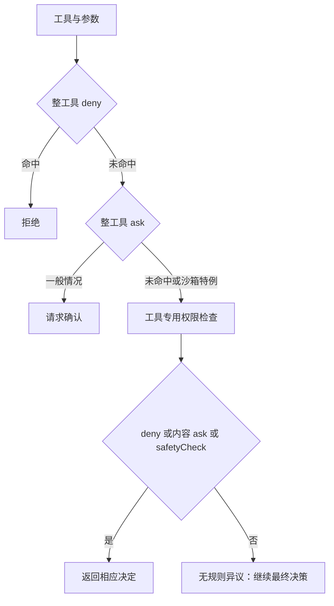

## 本章的问题

配置里同时出现 allow Edit 与 deny Edit，究竟哪个生效？更隐蔽的问题是，一个局部检查器返回 null，调用方把它当成允许，剩余模式与交互便被绕过去了。

本章先定义局部 ruleStage，再定义最终 permissionGate。前者可以表达“没有异议”，后者必须给出是否能执行。无界面模式不擅自把 ask 变成 true；等待确认期间，取消信号必须能终止等待。

## 沿固定源码逐段拆解

@ccsrc permission-rules

### checkRuleBasedPermissions 的 null 是阶段结果

它先处理整工具 deny，再处理整工具 ask，然后执行工具专用检查。工具返回 deny、内容 ask 或 safetyCheck ask 时都可能提前返回。没有这些异议才返回 null，而返回类型本身没有 allow。

Bash 的 ask 还有严格的沙箱特例：必须同时满足工具类型、沙箱启用、自动授权配置和该命令实际采用沙箱。不能把“安装了 sandbox runtime”直接当成许可。

@ccsrc permission-inner

### 最终决策仍然有自己的入口

hasPermissionsToUseToolInner 先检查 abort，再读取 appState 和规则。后面还要结合模式与调用方处理。改权限时应追整个调用链，确认一个 allow 来源能覆盖什么、不能覆盖什么。

| 结果 | 含义 | 在 coda 中的消费者 |
| --- | --- | --- |
| deny | 明确拒绝 | 不执行，返回错误工具结果 |
| ask | 需要用户或控制协议答复 | permissionGate 等待 ask 端口 |
| null | 本阶段没有反对 | 继续最终模式和授权判断 |

coda 的规则只做精确工具名匹配，路径硬边界由真实工作区解析完成。它没有假装实现完整 shell 语法授权、组织策略或产品分类器。

## 机制总览



## 接入贯穿项目

@implementation 06-permissions

### 逐步跟踪本章实现

把 gate 看成有顺序的决策程序。路径边界先检查；ruleStage 再按 deny、ask、本地风险返回结果。返回 null 只表示这一局部阶段没有决定，不能提前转成允许。显式 ask 也不能被后面的 allow 或 readOnly 悄悄覆盖。

局部阶段未要求询问时，allow、只读工具或 acceptEdits 中的 Edit/Write 才能放行。plan 与 dontAsk 随后拒绝尚未授权的调用；default 则进入 ask 端口。模式不是可以覆盖所有安全约束的一张通行证，检查顺序本身就是策略。

等待用户回答时 signal 与 ask 竞争。取消必须使 gate 尽快拒绝，Toolset 在 gate 返回后还会再检查 signal，防止回答与取消同时发生时继续执行。课程不把这个 JS 决策函数当作操作系统隔离，真实进程的约束在第 11 章单独验证。

## 运行本章实验

```bash
node --disable-warning=ExperimentalWarning labs/chapters/06-permissions.mjs
```

@experiment 06-permissions

## 逐项解释实验结果

同一输入分别走 deny、ask、acceptEdits、dontAsk 和外部路径。实验还制造一个永远不答复的 ask，再主动 abort，确认等待会拒绝。每条测试检查实际执行许可，不只匹配提示文字。

这些结果说明权限是带取消与交互的运行状态，而不是一个同步 if。它还需要第 12 章的控制协议来承接无界面答复。

## 继续动手与验收

增加一个只读工具，验证显式 deny 仍能阻止它。再为 ask 端口设置超时策略，区分用户拒绝、超时和任务取消，确保三种结果都不会产生写入。

::: interview 局部权限函数返回 null 可以当作允许吗？
ruleStage 的 null 只表示当前局部检查没有决定，最终 gate 还要结合规则、模式和用户回答。显式 deny 优先，ask 也不能被 allow 覆盖；实验应检查拒绝后磁盘与执行计数仍未变化。
:::

@observation 06-permissions
