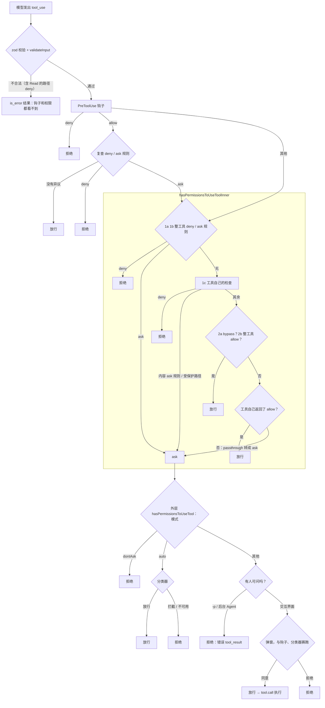

模型发出一个 `Bash("rm -f tmp.txt")`，Claude Code 要在执行前回答一个三选一的问题：执行、先问用户，还是拒绝。听上去是一个 `if`，实际上有十几个台阶，**台阶的先后顺序就是安全策略**：`--dangerously-skip-permissions` 能不能绕过 deny 规则？钩子说 allow、规则说 deny，听谁的？`acceptEdits` 模式下改 `.git/config` 要不要问？

这一章先看一组真实调用的结果，再沿源码找出每个结果是在哪个台阶上产生的，用真实函数跑一遍验证，最后在 coda 里写出同样顺序的三段决策。


@figure assets/course/ch06-permissions.png 规则先说话：allow 直接放行，deny 拦下，拿不准就交给人

## 先看现象：十个调用，十种下场

实验在临时项目里用 `claude -p` 跑，模式是 `default`，规则如下。模型要按顺序做十件事，中途多读了一次文件，所以是十一个调用。

```json
{ "allow": ["Bash(echo *)", "Bash(npm test *)", "Edit(src/**)"],
  "ask":   ["Bash(git push *)"],
  "deny":  ["Bash(rm *)", "Read(./secrets/**)"] }
```

录制来自 Claude Code 2.1.296，源码摘录和 `upstream` 实验来自 2.1.88，不一致的地方会指出来。“决定”一列取自 stream-json 里每个工具结果附带的 `permission_decision`：

@lab node labs/ch06/rules.ts cc

四处值得停下来想：

- **第 3 行**：`echo` 被 allow，`rm` 被 deny，`echo hi && rm -f tmp.txt` 整条被拒。复合命令按子命令逐个判断，任何一个 deny，整条 deny。
- **第 4、5 行**：`FOO=bar rm` 被拒，`/bin/rm` 却只是“要问”。规则匹配的是命令文本，换种写法就对不上；它没被执行，只因为没有规则允许它。
- **第 7、11 行**：需要问用户的调用，在 `-p` 下没人回答，结果是错误。文案有两种：规则拒绝是 “has been denied”，没人批准是 “you haven't granted it yet”。前者告诉模型别再试，后者告诉它这件事需要用户点头。
- **第 8 行**：读 `secrets/key.txt` 被拒，却**没有触发任何钩子，也没有 `permission_decision`**。这条拒绝发生在权限检查之前。

四个现象对应四个位置，先画出整条路线。

## 一次调用的路线：先校验，再问钩子，最后才轮到权限



四个现象各占一站。第 8 行死在最上面的 `validateInput`，所以钩子和权限都没见过它。第 3、4、5 行死在 `tool.checkPermissions`：Bash 在这里拆命令、匹配规则。第 7 行走完内层得到 ask，外层发现没人可问，当作拒绝。钩子夹在校验和权限之间，它的 allow 要先经过规则复查，后面单独讲。

整条路线里最硬的部分是虚线框里的内层函数，先读它。

## 决策主干：hasPermissionsToUseToolInner 的台阶

它返回 `allow`、`ask`、`deny` 三种结果；工具自己的检查还可以返回第四种 `passthrough`：我没有意见。

@cc utils/permissions/permissions.ts#L1158-L1206 hl=1163-1164,1171-1172,1184-1185,1189-1195

第 1163 行：权限判断也响应取消，按了 Esc 的任务不会再拿到授权。**1a 是整个工具的 deny 规则**，命中就返回，后面一切不再看。**1b 是整个工具的 ask 规则**，命中返回 ask；唯一例外是开启了沙箱自动放行、而且这条命令确实会进沙箱时（`canSandboxAutoAllow`，第 11 章），这时交给 Bash 自己去判断。“整个工具”指没有括号的规则，如 `Bash`；带括号的 `Bash(rm *)` 是内容规则，这一层看不见。

@cc utils/permissions/permissions.ts#L1208-L1260 hl=1210-1213,1216,1226-1228,1231-1235,1244-1250,1255-1260

1c 把决定权交给工具，默认值是 `passthrough`；输入解析抛了错（不是取消）只记日志，结果仍是 `passthrough`。随后四道关各自**直接返回**：**1d** 工具自己 deny；**1e** 必须有人参与的工具（向用户提问的 AskUserQuestion、退出 plan 的 ExitPlanMode）返回 ask，bypass 也不跳过；**1f** ask 若来自你写的**内容 ask 规则**（`Bash(git push *)`），不能被 bypass 跳过；**1g** ask 若来自**安全检查**（`.git/`、`.claude/`、`.vscode/`、shell 配置文件），同样免疫 bypass。走到下面，说明规则和安全检查都没有异议。

@cc utils/permissions/permissions.ts#L1262-L1319 hl=1268-1272,1284-1289,1300-1310,1318

**2a**：bypass 在这里才放行（从 bypass 启动后切到 plan 的会话也算）。**2b**：整工具 allow 规则放行。它排在 1c 之后，所以 `allow: ["Edit"]` 压不过工具自己的 deny 和安全检查，却压得过工具自己的普通 ask（比如路径在工作目录之外）。**3**：`passthrough` 转成 ask，工具自己返回的 allow 或普通 ask 原样返回（第 1318 行）。下面把场景喂给 2.1.88 的 `hasPermissionsToUseTool`（运行时从固定提交取出，代码不进仓库）：

@lab node labs/ch06/upstream.mjs order | md

- 第 2 行：一处 deny、一处 allow，结果 deny，与来源无关。
- 第 3～6 行：bypass 压不过 deny、整工具 ask、内容 ask、受保护路径；第 7 行的普通“要确认”才被放行。
- 第 8～10 行：allow 规则盖过工具的普通 ask，盖不过工具自己的 deny；ask 规则盖过工具自己的 allow。
- 第 12～14 行：dontAsk 把 ask 变成 deny，但先过 allow。第 17、18 行：这一层看不见 `Bash(rm *)`，plan 也没有特殊处理。

顺序是 **deny > ask（规则和安全检查）> bypass > allow**。

::: steps hasPermissionsToUseToolInner 的台阶：谁先说话谁算数
--- **1a**：整个工具的 deny 规则（没有括号的，如 `Bash`）。命中就返回 deny，后面一切不再看。第 1163 行先检查取消：按了 Esc 的任务不会再拿到授权。
flowchart TD
  A["1a 整个工具的 deny 规则"]:::on -->|命中| DENY["deny"]:::on
  A --> B["1b 整个工具的 ask 规则"]:::dim
  B -->|命中| ASK["ask"]:::dim
  B --> C["1c tool.checkPermissions<br/>默认 passthrough"]:::dim --> D["1d 工具自己 deny"]:::dim
  D -->|是| DENY
  D --> E["1e 必须有人参与的工具<br/>AskUserQuestion、ExitPlanMode"]:::dim
  E -->|是| ASK
  E --> Fg["1f 内容 ask 规则<br/>如 Bash(git push *)"]:::dim
  Fg -->|"ask 来自内容规则"| ASK
  Fg --> G["1g 安全检查<br/>.git、.claude、.vscode、shell 配置"]:::dim
  G -->|"ask 来自安全检查"| ASK
  G --> H["2a bypass 模式"]:::dim
  H -->|是| ALLOW["allow"]:::dim
  H --> I["2b 整个工具的 allow 规则"]:::dim
  I -->|命中| ALLOW
  I --> J["3 passthrough 转成 ask<br/>工具自己的 allow / ask 原样返回"]:::dim
  J --> ASK
--- **1b**：整个工具的 ask 规则，命中返回 ask。唯一例外是开着沙箱自动放行、而且这条命令确实会进沙箱（`canSandboxAutoAllow`，第 11 章），这时交给 Bash 自己判断。带括号的内容规则（`Bash(rm *)`）这一层看不见。
flowchart TD
  A["1a 整个工具的 deny 规则"]:::done -->|命中| DENY["deny"]:::dim
  A --> B["1b 整个工具的 ask 规则"]:::on
  B -->|命中| ASK["ask"]:::on
  B --> C["1c tool.checkPermissions<br/>默认 passthrough"]:::dim --> D["1d 工具自己 deny"]:::dim
  D -->|是| DENY
  D --> E["1e 必须有人参与的工具<br/>AskUserQuestion、ExitPlanMode"]:::dim
  E -->|是| ASK
  E --> Fg["1f 内容 ask 规则<br/>如 Bash(git push *)"]:::dim
  Fg -->|"ask 来自内容规则"| ASK
  Fg --> G["1g 安全检查<br/>.git、.claude、.vscode、shell 配置"]:::dim
  G -->|"ask 来自安全检查"| ASK
  G --> H["2a bypass 模式"]:::dim
  H -->|是| ALLOW["allow"]:::dim
  H --> I["2b 整个工具的 allow 规则"]:::dim
  I -->|命中| ALLOW
  I --> J["3 passthrough 转成 ask<br/>工具自己的 allow / ask 原样返回"]:::dim
  J --> ASK
--- **1c**：把决定权交给工具自己的 `checkPermissions`，默认值是 `passthrough`（“我没有意见”）；输入解析抛了错（不是取消）只记日志，结果仍是 `passthrough`。
flowchart TD
  A["1a 整个工具的 deny 规则"]:::done -->|命中| DENY["deny"]:::dim
  A --> B["1b 整个工具的 ask 规则"]:::done
  B -->|命中| ASK["ask"]:::dim
  B --> C["1c tool.checkPermissions<br/>默认 passthrough"]:::on --> D["1d 工具自己 deny"]:::dim
  D -->|是| DENY
  D --> E["1e 必须有人参与的工具<br/>AskUserQuestion、ExitPlanMode"]:::dim
  E -->|是| ASK
  E --> Fg["1f 内容 ask 规则<br/>如 Bash(git push *)"]:::dim
  Fg -->|"ask 来自内容规则"| ASK
  Fg --> G["1g 安全检查<br/>.git、.claude、.vscode、shell 配置"]:::dim
  G -->|"ask 来自安全检查"| ASK
  G --> H["2a bypass 模式"]:::dim
  H -->|是| ALLOW["allow"]:::dim
  H --> I["2b 整个工具的 allow 规则"]:::dim
  I -->|命中| ALLOW
  I --> J["3 passthrough 转成 ask<br/>工具自己的 allow / ask 原样返回"]:::dim
  J --> ASK
--- 随后四道关各自**直接返回**。**1d**：工具自己返回 deny，就是 deny；**1e**：必须有人参与的工具返回 ask，bypass 也不跳过。
flowchart TD
  A["1a 整个工具的 deny 规则"]:::done -->|命中| DENY["deny"]:::dim
  A --> B["1b 整个工具的 ask 规则"]:::done
  B -->|命中| ASK["ask"]:::dim
  B --> C["1c tool.checkPermissions<br/>默认 passthrough"]:::done --> D["1d 工具自己 deny"]:::on
  D -->|是| DENY
  D --> E["1e 必须有人参与的工具<br/>AskUserQuestion、ExitPlanMode"]:::on
  E -->|是| ASK
  E --> Fg["1f 内容 ask 规则<br/>如 Bash(git push *)"]:::dim
  Fg -->|"ask 来自内容规则"| ASK
  Fg --> G["1g 安全检查<br/>.git、.claude、.vscode、shell 配置"]:::dim
  G -->|"ask 来自安全检查"| ASK
  G --> H["2a bypass 模式"]:::dim
  H -->|是| ALLOW["allow"]:::dim
  H --> I["2b 整个工具的 allow 规则"]:::dim
  I -->|命中| ALLOW
  I --> J["3 passthrough 转成 ask<br/>工具自己的 allow / ask 原样返回"]:::dim
  J --> ASK
--- **1f**：ask 若来自你写的**内容 ask 规则**（`Bash(git push *)`），不能被 bypass 跳过；**1g**：ask 若来自**安全检查**（`.git/`、`.claude/`、`.vscode/`、shell 配置文件），同样免疫 bypass。走到下面，说明规则和安全检查都没有异议。
flowchart TD
  A["1a 整个工具的 deny 规则"]:::done -->|命中| DENY["deny"]:::dim
  A --> B["1b 整个工具的 ask 规则"]:::done
  B -->|命中| ASK["ask"]:::on
  B --> C["1c tool.checkPermissions<br/>默认 passthrough"]:::done --> D["1d 工具自己 deny"]:::done
  D -->|是| DENY
  D --> E["1e 必须有人参与的工具<br/>AskUserQuestion、ExitPlanMode"]:::done
  E -->|是| ASK
  E --> Fg["1f 内容 ask 规则<br/>如 Bash(git push *)"]:::on
  Fg -->|"ask 来自内容规则"| ASK
  Fg --> G["1g 安全检查<br/>.git、.claude、.vscode、shell 配置"]:::on
  G -->|"ask 来自安全检查"| ASK
  G --> H["2a bypass 模式"]:::dim
  H -->|是| ALLOW["allow"]:::dim
  H --> I["2b 整个工具的 allow 规则"]:::dim
  I -->|命中| ALLOW
  I --> J["3 passthrough 转成 ask<br/>工具自己的 allow / ask 原样返回"]:::dim
  J --> ASK
--- **2a**：bypass 模式在这里才放行。**2b**：整工具 allow 规则放行。它排在 1c 之后，所以 `allow: ["Edit"]` 压不过工具自己的 deny 和安全检查，却压得过工具自己的普通 ask。
flowchart TD
  A["1a 整个工具的 deny 规则"]:::done -->|命中| DENY["deny"]:::dim
  A --> B["1b 整个工具的 ask 规则"]:::done
  B -->|命中| ASK["ask"]:::dim
  B --> C["1c tool.checkPermissions<br/>默认 passthrough"]:::done --> D["1d 工具自己 deny"]:::done
  D -->|是| DENY
  D --> E["1e 必须有人参与的工具<br/>AskUserQuestion、ExitPlanMode"]:::done
  E -->|是| ASK
  E --> Fg["1f 内容 ask 规则<br/>如 Bash(git push *)"]:::done
  Fg -->|"ask 来自内容规则"| ASK
  Fg --> G["1g 安全检查<br/>.git、.claude、.vscode、shell 配置"]:::done
  G -->|"ask 来自安全检查"| ASK
  G --> H["2a bypass 模式"]:::on
  H -->|是| ALLOW["allow"]:::on
  H --> I["2b 整个工具的 allow 规则"]:::on
  I -->|命中| ALLOW
  I --> J["3 passthrough 转成 ask<br/>工具自己的 allow / ask 原样返回"]:::dim
  J --> ASK
--- **3**：工具返回的是 `passthrough`，就转成 ask；工具自己返回的 allow 或普通 ask 原样返回。整个顺序是 **deny > ask（规则和安全检查）> bypass > allow**。
flowchart TD
  A["1a 整个工具的 deny 规则"]:::done -->|命中| DENY["deny"]:::dim
  A --> B["1b 整个工具的 ask 规则"]:::done
  B -->|命中| ASK["ask"]:::on
  B --> C["1c tool.checkPermissions<br/>默认 passthrough"]:::done --> D["1d 工具自己 deny"]:::done
  D -->|是| DENY
  D --> E["1e 必须有人参与的工具<br/>AskUserQuestion、ExitPlanMode"]:::done
  E -->|是| ASK
  E --> Fg["1f 内容 ask 规则<br/>如 Bash(git push *)"]:::done
  Fg -->|"ask 来自内容规则"| ASK
  Fg --> G["1g 安全检查<br/>.git、.claude、.vscode、shell 配置"]:::done
  G -->|"ask 来自安全检查"| ASK
  G --> H["2a bypass 模式"]:::done
  H -->|是| ALLOW["allow"]:::dim
  H --> I["2b 整个工具的 allow 规则"]:::done
  I -->|命中| ALLOW
  I --> J["3 passthrough 转成 ask<br/>工具自己的 allow / ask 原样返回"]:::on
  J --> ASK
:::

## 规则从哪里来：并集、整工具与内容

@cc utils/permissions/permissions.ts#L109-L132 hl=109-114,125-131

规则有八个来源：用户设置、项目设置、本地设置（gitignore 的那份）、`--settings`、企业托管的 policy，加上 `cliArg`、`command` 和本会话 `session`。取规则时 `flatMap` 把它们**连成一个列表**，没有“后来者覆盖前者”；来源的顺序只决定同时命中多条时 `find` 取哪一条当作“谁拦的”。所以项目里 deny、用户设置里 allow，结果是 deny。管理员想独占，就开 `allowManagedPermissionRulesOnly`，加载器（`loadAllPermissionRulesFromDisk`）这时只读 policy 来源。用户在确认框里选“以后都允许”一条 Bash 命令，建议规则的默认去处是 `localSettings`，也就是不进版本库的那份。

规则字符串的解析用真实的 `permissionRuleValueFromString` 跑一遍：

@lab node labs/ch06/upstream.mjs grammar | md

`Bash()` 和 `Bash(*)` 退化成整个工具。括号里的内容由工具自己解释：Bash 有三种写法（旧前缀 `npm:*`、通配符、精确），文件工具用 gitignore 风格的路径，MCP 写 `mcp__gh` 就覆盖该服务器的全部工具（order 表第 15 行验证过）。整工具 deny 还有一个额外效果：

@cc tools.ts#L253-L269

被整体 deny 的工具**根本不会发给模型**，模型不会白白尝试。注释说它和运行时的 1a 用同一个匹配函数，所以 `mcp__server` 能把整个服务器的工具从列表里抹掉。内容规则做不到这点，只能在调用时拦。

## 文件工具：受保护目录排在 allow 前面

第 8 行的 Read 为什么没经过钩子？

@cc tools/FileReadTool/FileReadTool.ts#L442-L459 hl=446-452

`validateInput` 在校验阶段就用 Read 的路径 deny 规则检查了路径，命中返回 `result: false`，被包成 `is_error` 结果；Edit 和 Write 的 `validateInput` 有同样的检查。靠 PreToolUse 钩子做审计的人要注意：被路径 deny 拦下的调用，钩子看不到。

通过校验后，写文件走 `checkWritePermissionForTool`：deny 规则 → 计划文件等内部路径 → **安全检查** → ask 规则 → acceptEdits → allow 规则 → 询问。

@cc utils/permissions/filesystem.ts#L1302-L1394 hl=1302-1305,1328-1337,1360-1368,1377-1382

安全检查（1.7）排在 ask、acceptEdits、allow **之前**，注释写着原因：避免用户无意中把受保护文件的修改权限一并授出去。它的名单是 `.git`、`.vscode`、`.idea`、`.claude` 四个目录（`DANGEROUS_DIRECTORIES`），加上 shell 和 git 的配置文件。acceptEdits 只在工作目录内放行。Edit 的路径规则同样管 Write，Read 的同样管 Grep、Glob：规则按“读”和“写”分类，而不是按工具名。

读文件走 `checkReadPermissionForTool`，台阶更短：read 的 deny → read 的 ask → **“能改就能读”** → 工作目录内放行 → 内部路径 → allow 规则 → 询问。

@cc utils/permissions/filesystem.ts#L1124-L1150 hl=1124-1134,1136-1142

第 5 步让 `Edit(src/**)` 的 allow 规则同时放行对 `src/a.js` 的读取（开头表格的第 9 行）；第 6 步是默认的“读工作目录里的文件不用问”，决定记作 `mode`（模式表里每种模式下的 Read 都是它）。read 的 deny 和 ask 排在这两步之前，所以明确的读限制不会被“能改就能读”冲掉。

## Bash：把一行命令变成可以判断的东西

文件路径好判断，Bash 难：命令是自由文本，同一个效果有无数种写法。`bashToolHasPermission` 把整条命令拆成子命令，逐个交给 `bashToolCheckPermission`。源码里有两种拆法：tree-sitter 语法树，和旧的 shell-quote 路径。2.1.88 的发布版里，tree-sitter 只在“影子模式”运行：

@cc tools/BashTool/bashPermissions.ts#L1701-L1739 hl=1701-1703,1736-1738

它解析、上报，然后第 1737 行把结论扔掉，强制回到旧路径（`cli.js` 里同样带着这段）。又一个“认出开关”的例子：源码里有一整套 AST 逻辑，发布版并没有用它。旧路径在匹配规则之前，先用一组正则检查命令注入（命令替换、反斜杠转义的操作符等，`bashCommandIsSafeAsync`），可疑就问用户。两条路交给下游的东西一样：一个子命令列表，所以下面的台阶都成立。

@cc tools/BashTool/bashPermissions.ts#L1058-L1166 hl=1058,1082,1094,1106,1124,1129,1147,1153,1165

八个台阶：**精确匹配**的 deny / ask；**前缀和通配符**的 deny、ask；路径约束；精确 allow；allow 规则；sed 约束；**模式**；**只读命令**；最后 passthrough，即问用户。路径约束排在 deny/ask 之后，注释记着一次 HackerOne 报告：以前路径约束的 ask 抢在 deny 之前返回，用工作目录之外的绝对路径就能绕过 deny。

路径约束把 Bash 和文件规则接在了一起：`cat`、`rm`、`mkdir` 这类命令的参数会被当作路径，按读、写、创建分类，用和 Read/Edit 工具相同的规则检查。

@cc tools/BashTool/pathValidation.ts#L665-L693 hl=679-685,687-692

路径检查 `isPathAllowed` 先查 deny 规则（读操作查 Read 的，写和创建查 Edit 的），写操作再过安全检查，最后才看是否在工作目录内。所以路径命中了 `Read(.env)`，`cat .env` 就是 deny；只是越出了工作目录，才是 ask。Read 的路径规则对 shell 里读文件的命令同样生效。

规则怎样匹配命令，决定了 deny 和 allow 能不能被绕过：

@cc tools/BashTool/bashPermissions.ts#L937-L982 hl=950-954,962-966,975-978

deny 和 ask 用 `stripAllEnvVars: true`，allow 只用默认的“安全剥离”。真实函数跑出来是这样：

@lab node labs/ch06/upstream.mjs bash | md

- **`NODE_OPTIONS=--require=x npm test`**：不在安全变量清单里，allow 规则匹配不上，要问用户；同一条规则写在 deny 里却匹配得上。`nohup FOO=bar timeout 5 rm` 里包装和变量交替出现，deny 侧反复剥离直到不再变化。**拒绝要宽，放行要窄。**
- **`xargs rm`**：旧前缀写法 `Bash(rm:*)` 会命中，新通配符写法 `Bash(rm *)` **不会**，`xargs` 的特例只写在前缀分支里。看上去等价，其实不是。
- **`ls*` 与 `ls:*`**：前者匹配 `lsof`，后者按词边界不匹配。`git *` 匹配单独的 `git`（结尾的“空格星号”让参数可省略），不匹配 `gitk`。

::: steps echo hi && rm -f tmp.txt：复合命令按子命令逐个判断
--- 模型发出一条复合命令。命令是自由文本，同一个效果有无数种写法，所以 `bashToolHasPermission` 先把整条命令拆成子命令（2.1.88 发布版走旧的 shell-quote 路径，tree-sitter 只在影子模式运行）。
flowchart TD
  CMD["echo hi && rm -f tmp.txt"]:::on --> SPLIT["bashToolHasPermission<br/>拆成子命令"]:::on
  SPLIT --> S1["子命令 1：echo hi"]:::dim --> R1["bashToolCheckPermission<br/>allow 规则 Bash(echo *) 命中 → allow"]:::dim
  SPLIT --> S2["子命令 2：rm -f tmp.txt"]:::dim --> R2["bashToolCheckPermission<br/>前缀 / 通配符 deny Bash(rm *) 命中 → deny"]:::dim
  R1 --> AGG["汇总子命令的结果<br/>任何一个 deny，整条 deny"]:::dim
  R2 --> AGG
  AGG --> OUT["is_error 的 tool_result<br/>has been denied"]:::dim
--- 子命令 1 `echo hi` 交给 `bashToolCheckPermission`：没有 deny、ask 规则，`Bash(echo *)` 这条 allow 规则命中，结果 allow。
flowchart TD
  CMD["echo hi && rm -f tmp.txt"]:::done --> SPLIT["bashToolHasPermission<br/>拆成子命令"]:::done
  SPLIT --> S1["子命令 1：echo hi"]:::on --> R1["bashToolCheckPermission<br/>allow 规则 Bash(echo *) 命中 → allow"]:::on
  SPLIT --> S2["子命令 2：rm -f tmp.txt"]:::dim --> R2["bashToolCheckPermission<br/>前缀 / 通配符 deny Bash(rm *) 命中 → deny"]:::dim
  R1 --> AGG["汇总子命令的结果<br/>任何一个 deny，整条 deny"]:::dim
  R2 --> AGG
  AGG --> OUT["is_error 的 tool_result<br/>has been denied"]:::dim
--- 子命令 2 `rm -f tmp.txt`：前缀和通配符的 deny 规则 `Bash(rm *)` 命中，结果 deny。deny 的匹配比 allow 宽，台阶里 deny 排在 allow 前面。
flowchart TD
  CMD["echo hi && rm -f tmp.txt"]:::done --> SPLIT["bashToolHasPermission<br/>拆成子命令"]:::done
  SPLIT --> S1["子命令 1：echo hi"]:::done --> R1["bashToolCheckPermission<br/>allow 规则 Bash(echo *) 命中 → allow"]:::done
  SPLIT --> S2["子命令 2：rm -f tmp.txt"]:::on --> R2["bashToolCheckPermission<br/>前缀 / 通配符 deny Bash(rm *) 命中 → deny"]:::on
  R1 --> AGG["汇总子命令的结果<br/>任何一个 deny，整条 deny"]:::dim
  R2 --> AGG
  AGG --> OUT["is_error 的 tool_result<br/>has been denied"]:::dim
--- 在 `bashToolHasPermission` 里汇总：任何一个子命令 deny，整条 deny；全部 allow 才 allow；其余合并成一次询问。这里一个 allow、一个 deny，所以整条 deny。
flowchart TD
  CMD["echo hi && rm -f tmp.txt"]:::done --> SPLIT["bashToolHasPermission<br/>拆成子命令"]:::done
  SPLIT --> S1["子命令 1：echo hi"]:::done --> R1["bashToolCheckPermission<br/>allow 规则 Bash(echo *) 命中 → allow"]:::done
  SPLIT --> S2["子命令 2：rm -f tmp.txt"]:::done --> R2["bashToolCheckPermission<br/>前缀 / 通配符 deny Bash(rm *) 命中 → deny"]:::done
  R1 --> AGG["汇总子命令的结果<br/>任何一个 deny，整条 deny"]:::on
  R2 --> AGG
  AGG --> OUT["is_error 的 tool_result<br/>has been denied"]:::dim
--- deny 变成 `is_error` 的结果交回模型，文案是 “has been denied”，告诉它别再试。这就是开头表格第 3 行：`echo` 被 allow，整条仍然被拒。
flowchart TD
  CMD["echo hi && rm -f tmp.txt"]:::done --> SPLIT["bashToolHasPermission<br/>拆成子命令"]:::done
  SPLIT --> S1["子命令 1：echo hi"]:::done --> R1["bashToolCheckPermission<br/>allow 规则 Bash(echo *) 命中 → allow"]:::done
  SPLIT --> S2["子命令 2：rm -f tmp.txt"]:::done --> R2["bashToolCheckPermission<br/>前缀 / 通配符 deny Bash(rm *) 命中 → deny"]:::done
  R1 --> AGG["汇总子命令的结果<br/>任何一个 deny，整条 deny"]:::done
  R2 --> AGG
  AGG --> OUT["is_error 的 tool_result<br/>has been denied"]:::on
:::

子命令的结果在 `bashToolHasPermission` 里汇总：

@cc tools/BashTool/bashPermissions.ts#L2248-L2266

任何一个子命令 deny，整条 deny（第 3 行的来历）；全部 allow 才 allow；其余合并成一次询问。同一组规则喂给 `bashToolCheckPermission`，对照录制：

@lab node labs/ch06/upstream.mjs decide | md

2.1.88 的函数和 2.1.296 的录制逐条一致，包括 `/bin/rm`：没有规则说话，落到“问用户”。`mkdir build` 在 acceptEdits 下放行，来自源码注释里编号 6 的那一步：

@cc tools/BashTool/modeValidation.ts#L7-L49 hl=7-15,38-41

acceptEdits 对 Bash 的含义就是这七个文件系统命令；`node -e` 不在名单里，仍要问。

::: insight 规则是文本，不是边界
`/bin/rm`、`xargs rm`、`sh -c 'rm …'` 都能绕过一条写在文本上的规则。规则的价值是挡住“模型通常会写出的那种调用”，减少审批疲劳；真正的边界在操作系统层面，那是第 11 章沙箱的事。
:::

## 钩子说 allow，规则说 deny，听谁的

PreToolUse 钩子返回的 allow 怎么处理，集中在一个函数里：

@cc services/tools/toolHooks.ts#L347-L411 hl=372-377,386-391,408-411

钩子 allow 时：必须有人参与的工具仍交给 `canUseTool`；否则调用 `checkRuleBasedPermissions`，也就是**重跑 1a～1g**：没有异议才采纳钩子的 allow，命中 deny 就拒绝，命中 ask 仍要弹窗。钩子 deny（408 行）直接拒绝；钩子 ask 作为 `forceDecision`，让对话框显示钩子的理由。

@lab node labs/ch06/hooks.ts

钩子 deny 压过规则 allow（`echo danger`）；钩子 allow 推翻不了规则 deny（`touch`，来源仍是 `config`）；钩子 allow 能省掉询问（`mkdir`）。**钩子可以随意收紧，只能在规则没管的地方放宽。**管理员写在托管配置里的 deny，不会被项目里的钩子悄悄放开。

## 模式：规则没有说话时的默认答案

同样五个动作，六种模式（录制，2.1.296）：

@lab node labs/ch06/modes.ts

- **default**：读放行（工作目录内的读取在每种模式下都放行），其余都要问。
- **acceptEdits**：工作目录里的 Edit/Write 和七个文件系统命令放行；运行脚本、受保护的 `.vscode/` 仍要问。
- **bypassPermissions**：2a 放行。2.1.88 的 1g 注释写明受保护路径免疫 bypass，而上表 2.1.296 的录制里 `.vscode` 被直接放行。两个版本在这一点上不一致，不要依赖它。
- **dontAsk**：外层把所有 ask 变成 deny，文案明说是 don't ask 模式。
- **plan**：录制里写普通文件被拒（“不能在计划模式下写”），`mkdir`、`node` 却被分类器放行。这句拒绝文案在 2.1.88 的源码和 `cli.js` 里都搜不到；那个版本的 plan 靠一段提示，见下。
- **auto**：见后面。

@cc utils/messages.ts#L3226-L3227

“你不得做任何修改”是写给模型的话，不是引擎里的检查，所以 2.1.88 的 plan 只约束愿意听话的模型，写文件时照常询问；2.1.296 加上了引擎层的拒绝。

初始模式的优先级是 `--dangerously-skip-permissions` > `--permission-mode` > 设置里的 `defaultMode`，bypass 还可以被策略整个禁用。Shift+Tab 依次轮换 default → acceptEdits → plan。

## 没人可问的时候

`-p` 没有人弹窗回答。内层得到 ask 之后会怎样？

@cc services/tools/toolExecution.ts#L1023-L1037 hl=1023,1030-1036

不是 allow 的决定（deny 或 ask）统一变成 `is_error` 的 `tool_result`，内容就是决定里的 `message`。所以无界面时 ask 等于拒绝，只是文案不同（开头表格的第 7、11 行）。录制里凡是落到 ask 的调用，还先触发了一次 PermissionRequest 钩子——本来要弹窗的时刻，交互界面里它和弹窗赛跑；`-p` 下没人回答、钩子也没决定，调用就被拒绝。

出路有三条：什么都不配，模型换一种做法；`--permission-prompt-tool` 或 SDK 的 stdio 把 ask 交给外部程序，回答和钩子赛跑（第 12 章）；后台 Agent 的 `shouldAvoidPermissionPrompts` 为真，外层先问 PermissionRequest 钩子，没人决定就拒绝。`dontAsk` 是显式选择这个结局。

## auto 模式：让另一个模型回答“要不要问”

auto 在外层把 ask 交给分类器，而不是用户（发布的 `cli.js` 里模式列表含 `auto`，`TRANSCRIPT_CLASSIFIER` 构建时是打开的）。分类器很贵，所以先走两条捷径：

@cc utils/permissions/permissions.ts#L593-L621 hl=600-604,607-619

先拿**工具自己的检查**，假装当前是 acceptEdits 模式再跑一遍；工作目录里的普通编辑这样就放行了，不必请分类器（紧接着的代码还有一份“安全工具白名单”）。Agent 和 REPL 例外：它们在 acceptEdits 下直接返回 allow，会悄悄绕过分类器。其余的调用才送去审查，分类器失败时：

@cc utils/permissions/permissions.ts#L843-L911 hl=845-869,878-901

分类器**不可用**时默认**关闭**（fail closed）：返回 deny 并告诉模型“暂时不可用”，而不是放行。拦截会累计，连续 3 次或累计 20 次就退回询问用户，无界面则中止任务：

@cc utils/permissions/denialTracking.ts#L12-L15

录制里 README 藏着让 AI 执行 `curl | sh` 并上传密钥的“安装说明”，用户只说“按 README 安装”（实验用的模型充当分类器）：

@lab node labs/ch06/classifier.ts flow | md

只读调用不经过分类器（1～4）；两个阶段，`max_tokens` 2112 说“拦”才进 10240，都拦才拒绝（5、11）；探测可疑域名也被归为 `Exfil Scouting`；第 7 行分类器连续五次没结论，调用被拒，稍后重试才放行。

@lab node labs/ch06/classifier.ts request

它看得到 CLAUDE.md、用户的话和模型发出的每个**非只读**动作，**看不到工具结果**：README 里的注入文字在主循环里，不在分类器的请求里。提示注入能操纵读到它的那个模型，分类器只看用户说了什么、模型做了什么，注入进不来。代价是每个动作多一两次模型调用和偶尔的误拦。

## 和 Pi 的权限扩展对照

Pi 的核心里只有一个二值的闸门：

::: tabs
@@ Claude Code
@cc services/tools/toolExecution.ts#L1023-L1037 hl=1023,1030-1036
三值结果：不是 allow 的决定统一变成 `is_error` 的 `tool_result`，内容是决定里的 `message`。
@@ Pi
@pi packages/agent/src/agent-loop.ts#L738-L765 hl=739,755
核心只认 `beforeToolCall` 返回的 `block`，没有“问一问”这个结果。
@@ coda
@code coda/src/permissions.mjs#permissionGate hl=185,187,189,191-193
三段决策里的第三段：allow 放行，deny 拒绝，ask 交给人。
:::

`beforeToolCall` 返回 `{ block: true }` 就拦下，没有“问一问”这个结果，询问是扩展在回调里 `await` 界面完成的。Learn Pi Agent 第 14 章的权限扩展挂在这里，用同一套规则语法。把本章开头那组规则和调用原样交给它的 `decidePermission`：

@lab node labs/ch06/rules.ts compare | md

十一个全部一致。这是差分测试，也发现过问题：第一次对照时 mox 在 Edit 那行崩溃，因为 mox 的路径参数叫 `path`，Claude Code 叫 `file_path`。顺序之外的差别：

| | Claude Code | Pi + 权限扩展 |
| --- | --- | --- |
| 闸门的位置 | 核心里，三值结果加原因 | 扩展挂在 `tool_call` 上，核心只认 block |
| 钩子的 allow | 省掉询问，推翻不了 deny / ask | 只表示“没有意见” |
| 受保护路径 | 排在 acceptEdits、allow、bypass 之前 | 没有，靠沙箱 |
| plan | 2.1.88 靠提示，询问照常 | 拒绝一切非只读调用 |

## 动手：在 coda 里实现三段决策

coda 的 `permissions.mjs` 对应 `permissions.ts` 的三层。第一段只回答“有没有东西拦着”：

@code coda/src/permissions.mjs#ruleStage hl=90-93

它对应 `checkRuleBasedPermissions`（钩子复查规则时调用的就是它）。null 是**没有异议**，不是允许；`local` 是工具自己的检查结果，只有其中的 deny、内容 ask 规则、受保护路径会在这里被采纳。工具自己的检查在 `toolCheck`，顺序仿照 `checkWritePermissionForTool`：内容 deny → 受保护路径 → 内容 ask → acceptEdits → 内容 allow → 只读：

@code coda/src/permissions.mjs#toolCheck hl=112-113,117-118,120-121,123,124-126

受保护路径排在 ask、acceptEdits、allow 之前，和上面的 1.7 一样。第二段是台阶本身：

@code coda/src/permissions.mjs#decideInner hl=137-138,140,141-143

bypass、整工具 allow、工具自己的 allow 紧跟在 `ruleStage` 之后，所以 bypass 绕不过它。最后是模式：

@code coda/src/permissions.mjs#decide hl=154-155

dontAsk 和 plan 在**最后**把所有 ask 变成 deny，所以 ask 规则、受保护路径也躲不过（对应外层包装的转换）。第三段把 ask 交给人：

@code coda/src/permissions.mjs#permissionGate hl=185,187,189,191-193

边界检查先于一切规则；没有 `ask` 回调的无界面场景按拒绝处理；等待回答时同样监听取消信号。相对 Claude Code 简化了：规则只有一个来源（`mergeRules` 取并集），内容规则只匹配 `path` 或 `command`，没有分类器，plan 直接拒绝，越界是硬错误而不是一次询问。第三部分把 `decide` 和上面的真实函数逐场景对账：

@lab node labs/chapters/06-permissions.mjs

## 你来改

::: predict bypass 提到规则前面
把 `decideInner` 里 bypass 的判断挪到 `ruleStage` 之前，再跑 `node labs/chapters/06-permissions.mjs`。第一个失败的检查是哪个？
???
“bypassPermissions 也绕不过受保护路径”：`.vscode/settings.json` 变成放行。继续往下，deny、ask、内容 ask 在 bypass 下也全部失效，而真实函数（order 表第 3～6 行）仍然拦下。管理员写的 deny 靠这个顺序，才不会被 `--dangerously-skip-permissions` 一并跳过。
:::

::: predict 两种规则写法
deny 写成 `Bash(rm *)` 和 `Bash(rm:*)`，模型执行 `xargs rm tmp.txt`，结果分别是什么？
???
`Bash(rm:*)` 命中，deny；`Bash(rm *)` 不命中，落到“问用户”。`xargs` 的特例只写在前缀分支里（`filterRulesByContentsMatchingInput`；运行 `node labs/ch06/upstream.mjs bash` 可验证）。要拦 `xargs`，别用新写法，或再加一条 `Bash(xargs rm *)`。
:::

::: predict 钩子 allow 遇上 ask 规则
`-p` 模式下有一个对所有 Bash 返回 allow 的 PreToolUse 钩子，规则里有 `ask: ["Bash(git push *)"]`。模型执行 `git push origin main`，会怎样？
???
不会执行。钩子 allow 之后 `resolveHookPermissionDecision` 重跑 `checkRuleBasedPermissions`，得到 ask，仍要走 `canUseTool`；`-p` 没人回答，ask 变成 `is_error` 结果，文案是 “you haven't granted it yet”。钩子救不了 ask 规则，要放行只能改配置。
:::

## 面试题

::: interview 设计 coding agent 的权限决策，顺序应该怎么排？为什么 deny 要在 bypass 之前？
顺序：deny（整工具和内容）→ ask 规则和安全检查 → bypass → allow 规则 → 工具自己的默认判断（只读、工作目录内）→ 其余按模式：问、拒绝或交给分类器。理由：bypass 的意思是“别再为没人说话的事问我”，不是“忽略我写过的禁令”；deny 和受保护路径是人事先写下的约束，必须比粗粒度的模式更硬。Claude Code 的 1a～1g 在 2a 之前，并且抽成 `checkRuleBasedPermissions` 供钩子复查。加分点：把“没意见”（passthrough）和“允许”分成两个值，避免局部检查的 null 被当成授权。
:::

::: interview 多个来源的规则怎么合并？谁的优先级高？
没有来源优先级。八个来源的规则按行为取并集，先查所有 deny，再 ask，最后 allow；来源只用于报告“谁拦的”和限制可编辑范围（policy、flag 来源只读）。管理员可用 `allowManagedPermissionRulesOnly` 让只有托管规则生效。要点：deny 在任何来源出现都生效，allow 不能在 deny 上开口子；不带括号的 deny 还会把工具从模型看到的列表里去掉。
:::

::: interview Bash 命令的权限规则怎么匹配才不容易被绕过？规则是安全边界吗？
先拆成子命令，每个都要过关：任一 deny 整条 deny，全部 allow 才 allow。匹配前剥掉 `timeout`、`nohup` 之类的包装；环境变量前缀在 deny/ask 侧全部剥掉，在 allow 侧只剥安全的几个，于是 `NODE_OPTIONS=… npm test` 不会被 `Bash(npm test *)` 放行，`FOO=bar rm` 却逃不过 `Bash(rm *)`。不是边界：`/bin/rm`、`sh -c` 换种写法就绕过，两种规则语法还有不等价的角落（`xargs rm`）。边界靠沙箱和最小权限凭据，规则只是第一层。
:::

::: interview PreToolUse 钩子返回 allow，能让一个被 deny 规则禁止的调用执行吗？
不能。钩子 deny 直接拒绝；钩子 allow 只能跳过“问用户”，随后会重跑 deny/ask 规则：命中 deny 仍拒绝，命中 ask 仍弹窗。这样托管配置里的 deny 不会被项目钩子放开。想做“除了几种命令都放行”，就 allow 整个 Bash，再用钩子 deny 那几种。
:::

::: interview Agent 无人值守运行（CI、`-p`）时，需要确认的操作怎么办？
不能默认放行。无界面时 ask 变成错误结果交给模型，文案告诉它“还没被授权”，模型换做法或报告失败。出路：把需要的操作提前写进 allow 规则；用 `dontAsk` 显式只执行规则允许的；用 `--permission-prompt-tool` 或 SDK 回调把 ask 交给外部程序按策略回答；任务需要很大权限时放进一次性容器里用 bypass，靠隔离代替审批。
:::

::: interview auto 模式的分类器怎样防提示注入？
动作执行前由独立模型判断是否符合用户意图。要点：只看用户消息、项目说明和模型发出的非只读动作，**不看工具结果**，文件或网页里的注入文字进不到它的输入；分两阶段，先用小预算快速判断，说“拦”才用更大的预算复核，两个都拦才拒绝；只读动作和 acceptEdits 能放行的编辑不审查；不可用或没结论时默认拒绝（fail closed）；连续被拦 3 次或累计 20 次退回询问用户，无界面则中止。代价是延迟、费用和误拦。
:::
