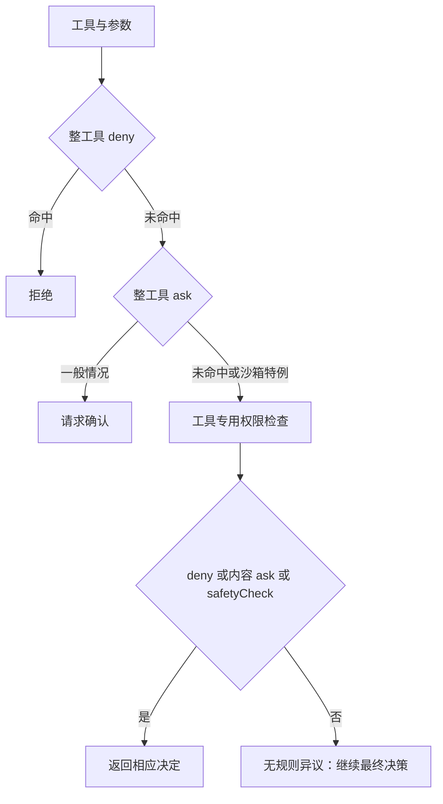

## 先找规则检查与最终决策之间的接口

@ccsrc permission-rules

`checkRuleBasedPermissions` 先找整项工具 deny，再处理 ask 与工具特定检查；内容级 ask 和安全检查也可能提前返回。它返回 null 只是“本规则阶段没有反对意见”，不能当成最终授权。

其中 sandbox auto-allow 对某些 bash ask 规则有特定条件；安全检查又有不能被简单放行的分支。读这一层时，应记下 decisionReason、rule 和 behavior，避免只看最后一段提示文字。

@ccsrc permission-inner

`hasPermissionsToUseToolInner` 还处理当前模式与其他分支。一个可靠解释应沿 toolExecution、canUseTool、规则/工具检查、交互或分类器决策，直到真实 tool.call。只改界面上的询问，不代表其他入口获得相同保护。

## 模式、规则、Hook 和沙箱分别控制什么

| 机制 | 应追踪的内容 |
| --- | --- |
| 模式 | 当前运行配置及模式分支 |
| 规则 | tool 与输入内容如何匹配 |
| Hook | 生命周期返回的决定与修改 |
| 沙箱 | 执行进程的系统级能力边界 |

这些机制存在交互和例外，不能简单排成“一条 allow 总能覆盖其他 deny”。源码给出了具体顺序和免绕过检查，验证需要覆盖真正命中的分支。

## 一个有意义的权限实验

为同一个临时目标，通过原生文件工具与 bash 各触发一次操作，记录输入、模式、命中规则、是否询问、是否实际执行及返回结果。若要研究自动模式，另存分类器请求和结论；只听模型说“我会询问”没有证明执行受到约束。

下面实验属于 2.1.296。它测得的模式数量和分类器细节不能未经检查就作为 2.1.88 的固定结构。

## 读返回类型，先于读模式名称

`checkRuleBasedPermissions` 的返回类型包含 ask、deny 和 null。null 的语义是“此规则阶段没有提出异议”，并非“允许执行”。后续仍有模式、交互和调用方逻辑。如果把 null 写成 allow，等于绕开剩余授权流程。

@lab node --disable-warning=ExperimentalWarning labs/engineering/run.mjs permissions

实验直接执行规则检查函数。整工具 deny、ask、工具内部 deny、安全检查 ask 都得到相应结果；工具内部返回 allow 时，此阶段却返回 null。它只验证规则阶段，未运行最终授权器。这个反例值得记住：局部函数的名字里有 permissions，也不表示它拥有最终决定权。

## 一次 Bash 调用的决策问题

用户要求运行测试，模型提出 `npm test`。决策器要知道工具名、具体输入、当前模式、规则来源、是否沙箱执行，以及是否允许出现交互。整工具规则和命令内容规则也不完全相同：一个 Bash 可以承载测试、发布或删除。

图中沙箱特例的条件来自实际代码：Bash、沙箱启用、配置允许沙箱自动授权、此命令实际使用沙箱。缺少任何一个条件，都不能用“机器装了沙箱”来跳过 ask。

## “先检查了，所以执行时安全”仍然不够

权限判断和执行之间可能发生输入改写、目录改变或符号链接变化。读完整路径时，需要确认最终执行的参数与接受检查的参数一致。对 Hook 的 allow 也要问：它能覆盖哪些规则，哪些 safetyCheck 仍必须确认？源码在此把 safetyCheck ask 保留下来，说明授权来源之间存在边界。

无界面运行还多一个问题：ask 如何获得回答？没有终端或控制协议时，ask 不能神奇地变成同意。接入 SDK 时应明确权限回调、取消、超时和默认处理；第 12 章再把这条线接到 IO 协议。

## 动手：写决策表，而不是背 mode 清单

选择 Read、Edit、Bash 三个具体调用，为它们分别设置显式 deny、显式 ask、无规则和执行前取消，逐行写出应该走到哪个阶段。然后用本章后面的 2.1.296 录制对照 mode 行为。若两个版本结果不同，记录变化的证据，不用新版结果倒推旧版源码。

::: interview 规则检查返回 null，应怎样解释？
只能说该阶段没有产生 ask 或 deny。调用者还可能依据模式、Hook、工具专用规则或交互决策处理。判断是否授权必须沿最终执行路径检查，不能让一个局部函数的空返回值替代整个权限系统。
:::

@observation 06-permissions
