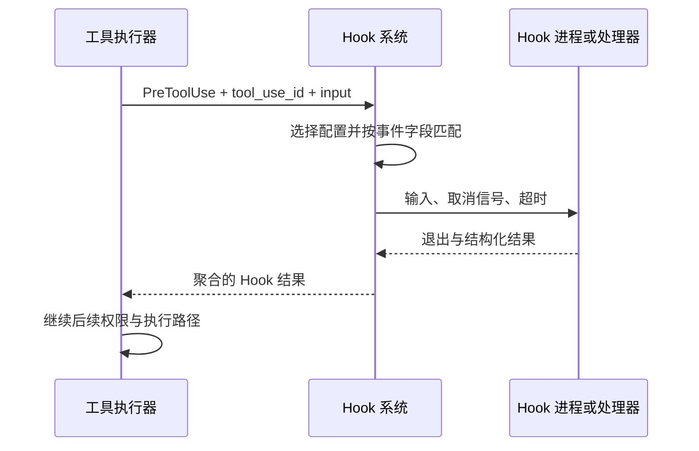

## 本章的问题

团队要求编辑发布配置前先停止。写一个 Hook 可以实现这条规矩，但脚本报错、策略阻止和超时不是同一件事。若把所有非零退出都叫 deny，调试错误就会被伪装成用户策略。

另一种危险基线是先校验路径，然后接受 Hook 改写后的路径直接执行。Hook 把 safe 改成 ../outside，就绕过了前面的校验。本章显式对改写后的输入再次验证。

## 沿固定源码逐段拆解

@ccsrc hook-match

### getMatchingHooks 根据事件选择匹配字段

工具事件使用 tool_name；SessionStart 使用 source；压缩事件使用 trigger；子 Agent 事件使用 agent_type。相同 matcher 文本放在不同事件下，查的对象不同。先得到候选，才谈运行与结果聚合。

@ccsrc hook-pretool

### executePreToolHooks 交接的不只是工具名

基础输入、permissionMode、tool_name、tool_input 与 tool_use_id 一起交给执行层，并传入 signal、timeout 和上下文。tool_use_id 让同名连续调用可被区分；日志只写 Edit 会丢失关联。

### 顺序决定 Hook 能观察什么

第 3 章的 schema 和工具语义校验可以提前失败。读 Hook 时需要回到执行器的调用点，而不能从 PreToolUse 这个名字推断它能修复任何输入。执行后的多个 patch 也应按确定顺序消费，否则审计与结果改写会竞争。

coda 定义自己的简化协议：退出 2 表达策略阻止，退出 0 解析 JSON，其他退出和超时是执行失败。真实产品还有更丰富的事件与 JSON 字段，不能互相混称。

## 机制总览



## 接入贯穿项目

@implementation 07-hooks

### 逐步跟踪本章实现

`Hooks.before` 按注册顺序，把上一条 hook 的 input 交给下一条。遇到 block 立即返回，不再执行后面的 hook；遇到 input 替换则复制数据，随后回到 Toolset 做完整校验和授权。这种实现允许改写参数，却没有给 hook 一条绕过 gate 的通道。

`commandHook` 使用 Node argv 启动实际子进程，以 stdin 传入一次 JSON。退出码 2 被解释为策略阻止，其他非零码是执行故障；stdout 非空才按 JSON 解析。超时或取消由进程运行器处理，stderr 的策略原因与 stdout 的结构化返回也各有位置。

after hooks 在工具副作用已经发生后依次合并结果。它们能够改变交回模型的文本和结构化信息，不能把发生过的写入撤销。实验因此分别检查“磁盘是否变了”和“模型收到什么”；只检查最后一段文本，会漏掉执行边界上的错误。

## 运行本章实验

```bash
node --disable-warning=ExperimentalWarning labs/chapters/07-hooks.mjs
```

@experiment 07-hooks

## 逐项解释实验结果

实验启动三个真实 Node Hook：明确阻止、输出损坏 JSON、一直等待。随后让 before Hook 把路径改到工作区外，断言没有任何外部文件。最后两个 after Hook 按顺序改写结果，第二个确实看到了第一个 patch。

超时测试会终止进程；它验证退出收尾，不靠手写“timeout=true”模拟。系统进程与权限端口各有自己的测试层。

## 继续动手与验收

给 Hook 加一个仅匹配 Test 的事件，证明其他工具不运行它。再让 after Hook 把成功变成失败，明确模型、审计与调用方分别看到哪份结果。

::: interview 如何区分策略阻止、Hook 报错与超时？
before hook 的参数改写后必须重新校验和授权，不能沿用旧参数得到的许可。命令 hook 的策略阻止、执行失败、解析失败和超时各有路径；after hook 发生在副作用之后，只改变结果不等于撤销动作。
:::

@observation 07-hooks
