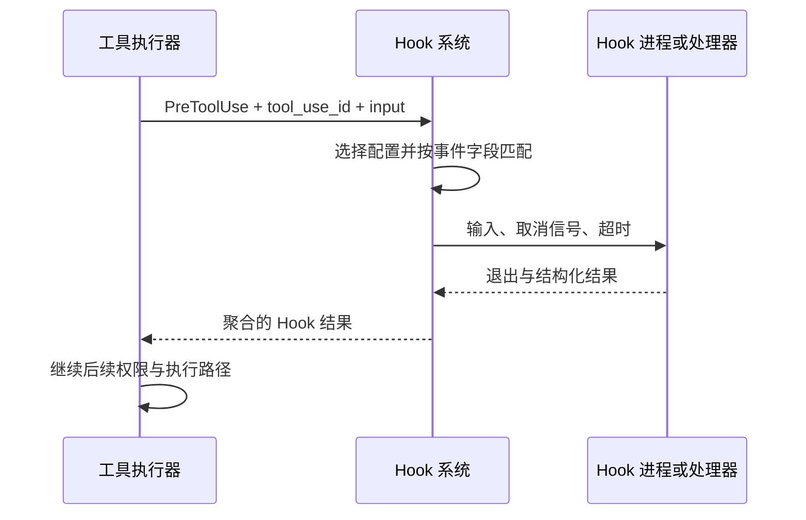

## Hook 的事件名不等于执行时机保证

先读 toolExecution 中校验和权限阶段的顺序，再进入 hooks。若 schema 或工具 validateInput 已失败，后续事件未触发可能是有意的短路；不能只凭一个 Hook 没写日志就认定配置无效。

@ccsrc tool-validate

## 匹配和执行分开研究

@ccsrc hook-match

`getMatchingHooks` 是候选选择入口。调用者还要根据生命周期选择执行方式，处理输入、超时、取消和错误。匹配到了配置与命令执行成功是两条独立事实，调查时应分别留下证据。

@ccsrc hook-pretool

`executePreToolHooks` 检查当前事件是否有 Hook，构造基础输入，再添加事件、tool name、tool input 和 tool use id，最后委托执行层。输入中这些关联字段使 Hook 日志可以和模型工具调用对应起来。

## 同步阻塞与异步反馈是不同契约

某些 Hook 能阻塞继续执行，另一些只产生消息或后续反馈。应阅读返回值由谁消费、是否覆盖输入或权限决定，再判断它能影响什么。不要把“Hook 程序退出 0”理解为任何工具都被允许，也不要把输出文字误认为已经修改了运行时状态。

检查失败时，区分命令找不到、输入格式错误、超时、取消、JSON 解析失败和显式阻塞。每一种故障都应该有可解释的默认行为。

## 为什么还要保留实验

源码给出数据契约；真实模型被 Hook 拦下后是否换一种工具调用，是模型与环境的行为。下方后续版本实验保留这种观察，但不把模型的一次选择上升为稳定规则。

## 一个 Hook 有四步：被配置、被匹配、被运行、被解释

“配置里有脚本”只完成第一步。`getMatchingHooks` 先按事件选择查询字段：工具事件用 tool_name，会话启动用 source，压缩用 trigger，子 Agent 事件用 agent_type。同样的 matcher 文本，放在不同事件下面，匹配的是不同对象。

`executePreToolHooks` 再组装结构化输入，带入基础会话信息、工具名称、参数和 tool_use_id。这个 id 连接了模型意图、Hook 检查和实际工具效果；日志只有工具名，遇到连续两次 Edit 就难以定位。

## 什么错误适合放在 Hook

假设团队禁止在修复 slug 时改发布配置。这是一个与团队工作流有关的约束，可以用 Hook 针对 Edit/Write 路径检查，并给模型一条能够修正行为的消息。它不应该通过替换所有工具实现来完成。

但 Hook 不是完整权限系统，也不是系统隔离。它可能依赖脚本解释器、工作目录和配置；若脚本自身出错，产品必须解释这个失败。你要分别读输入解析失败、脚本正常返回、策略明确阻止、超时和信号取消的处理，而不是把非零退出统一概括成“拦截”。

本章后面的独立实验专门比较这些失败形状。先写自己的预测，再查看真实输出；特别注意 stderr 的提示与交给模型的上下文是否是同一通道。

## 为什么 Hook 和 validateInput 的顺序值得读

工具参数如果连 schema 都不合法，Hook 是否能修正它，要看调用顺序，不能想当然。第 3 章已看到执行器会先做 schema 与工具语义校验。这里继续搜索 `executePreToolHooks` 的调用点，检查通过校验的输入何时交给 Hook，Hook 改写后又怎样继续检查。

变更顺序是一项行为变更：若把检查提早，旧 Hook 可能从此不再收到某类错误；若让未校验输入进入脚本，脚本又必须承担更多防御。代码评审应该提出一个能区分新旧顺序的测试。

## 练习：给策略失败设计可修复信息

为“禁止修改发布目录”的 Hook 写三种输出：允许普通源码、阻止发布目录、输入 JSON 不合法。阻止时告诉模型哪个目标被拒绝和什么替代操作可行；程序错误则保留诊断，不要伪装成用户策略。验收时使用临时目录和固定输入，不需要请求模型。

::: interview 想证明 Hook 改变了运行结果，最少要记录什么？
原始工具调用、交给 Hook 的输入、Hook 的退出与结构化返回、宿主消费结果的分支，以及真实执行结果。还要固定版本和模式，才能区分 Hook 本身、权限层与模型重试造成的变化。
:::

@observation 07-hooks
