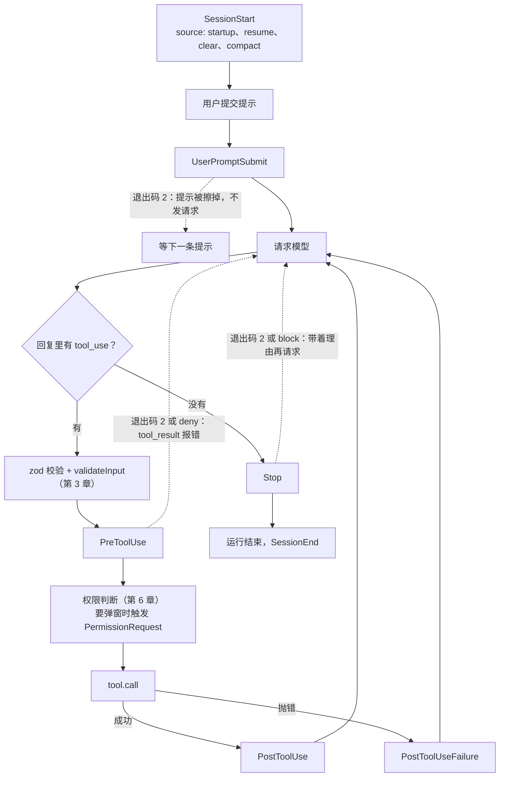
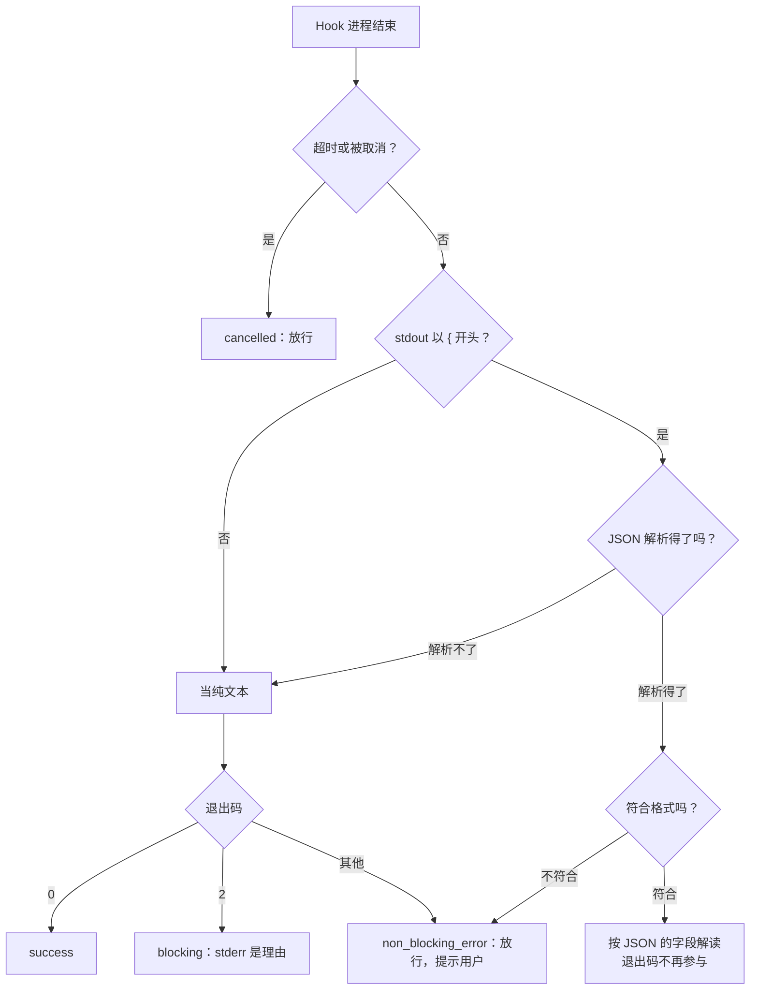

Learn Pi Agent 第 13 章为 Pi 和 mox 写了一组 Hook 脚本：拦下 `rm -rf`，给部署命令加 `--dry-run`，禁止读 `.env`，抹掉输出里的密钥，没说“测试通过”就不让结束。七个脚本，在脚本化的模型下全部生效。

这一章把同一份配置原封不动交给 Claude Code，换成真实的模型。一半像预期：`rm -rf build` 确实被拦下了。另一半不是：模型接着试了九种别的删法，`.env` 的内容也交到了它手里，因为它根本没用 Read 工具。

顺着这个现象往下拆：一个事件发生时哪些 Hook 被选中，怎样作为子进程并行运行；退出码和 stdout 怎样被读成“放行、拦下、改参数、补话”；这些话最后落在请求的哪个位置；Stop Hook 收到什么；Hook 自己坏了会怎样。协议本身（配置格式、退出码、JSON 字段）Learn Pi Agent 第 13 章已经讲过，这一章看 Claude Code 一侧的源码和边界行为。录制用的是 Claude Code 2.1.296，源码摘录来自 2.1.88，两者不同的地方会指出。


@figure assets/course/ch07-hooks.png Hook 挂在流水线的固定位置：能拦下、能补话，自己坏了也不挡路

## 先看现象：同一份配置，真实模型怎么绕

任务和 Learn Pi Agent 第 13 章一样：“清理构建目录（rm -rf build），用 ./deploy.sh production 部署到生产环境，再看看 .env 和 config.txt 里的配置。”七个 Hook 各管一件事，每个事件上还挂了一个记录器。模型一共调用了 22 次工具：

@lab node labs/ch07/scenario.ts steps

逐行读这张表：

- **第 4 步，`.env` 原样交给了模型。** `protect-env.mjs` 的 matcher 是 `Read|Edit|Write`，模型用的是一条 Bash `cat`，根本不经过它。同一条命令里 `config.txt` 的密钥倒是被抹掉了，因为 `redact-secrets.mjs` 挂在 Bash 的 PostToolUse 上。
- **第 5 步，`rm -rf build` 被拦下。** 第 6 到 17 步，模型换了九种写法：`find -delete`、逐个 `rm`、Python 的 `shutil.rmtree`、`mv` 走……还去读了 Hook 脚本和 settings，想弄清是什么拦住了它；第 16 步甚至加上 `dangerouslyDisableSandbox` 再试一次 `rm -rf`，Hook 照样拦下。九种写法没有一种匹配 `rm -rf`，Hook 全部放行。它们没有执行，是因为这次是 `-p` 模式，需要批准的命令没有人批准（第 6 章）。换成 `bypassPermissions`，`build` 早没了。
- **第 19 步，部署命令被改写成 `--dry-run`。** 最后 Stop Hook 触发了两次。

拦截理由是写给模型看的话，看看这句话本身：

@lab node labs/ch07/scenario.ts blocked | md

`block-dangerous.sh` 的最后一句是“请换一种更安全的做法”，模型照做了，总结里写的是“按钩子提示换了几种更安全的做法”。Hook 拦住了一种写法，自己还在邀请模型换写法。**按命令文本匹配的 Hook，挡住的是写法，不是效果。**

## Hook 挂在流水线的哪些位置

先看全景。实线是正常往下走，虚线是 Hook 说“不”时走的路：



事件的完整名单是一个常量数组：

@cc entrypoints/sdk/coreTypes.ts#HOOK_EVENTS

27 个事件，Pi 扩展实现了其中 6 个。按位置分四组：会话级（`SessionStart`、`SessionEnd`、`InstructionsLoaded`、`CwdChanged`、`FileChanged`……）；一次输入级（`UserPromptSubmit`、`Stop`、`StopFailure`）；工具级（`PreToolUse`、`PostToolUse`、`PostToolUseFailure`、`PermissionRequest`、`PermissionDenied`）；其余跟着功能走（压缩前后的 `PreCompact`、`PostCompact`，子 Agent 的 `SubagentStart`、`SubagentStop`，`Notification`，MCP 的 `Elicitation`……）。上面那次录制触发了其中八种。

下面把一次 PreToolUse 从头走到尾：模型要运行 `rm -rf build`，看这条调用怎样变成一个决定。每一步的细节在后面各节展开。

::: steps 一次 PreToolUse：从事件到决定
--- 模型发出 `Bash(rm -rf build)`，通过 zod 校验和 `validateInput` 后，流水线在权限判断之前触发 **PreToolUse**。这个事件的匹配字段是 `tool_name`（`utils/hooks.ts` 第 1615–1633 行的 `switch`）。
flowchart TD
  EV["PreToolUse<br/>Bash: rm -rf build"]:::on
  SEL["getMatchingHooks<br/>matcher + 去重"]:::dim
  H1["block-dangerous.sh"]:::dim
  H2["dry-run-deploy.mjs"]:::dim
  H3["protect-env.mjs<br/>matcher: Read|Edit|Write"]:::dim
  RD["读回答<br/>JSON 优先，再看退出码"]:::dim
  MG["executeHooks 向外 yield<br/>blockingError / 权限意见"]:::dim
  TE["toolHooks + toolExecution<br/>采纳 Hook 的决定"]:::dim
  EV --> SEL
  SEL --> H1
  SEL --> H2
  SEL -.-> H3
  H1 --> RD
  H2 --> RD
  RD --> MG --> TE
--- `getMatchingHooks` 按 matcher 选 Hook：`Bash` 走精确匹配，选中 `block-dangerous.sh` 和 `dry-run-deploy.mjs`；`protect-env.mjs` 的 matcher 是 `Read|Edit|Write`，对不上 `Bash`，根本不会启动。各来源的配置先合并，同一条命令只留一个（第 1744–1754 行）。
flowchart TD
  EV["PreToolUse<br/>Bash: rm -rf build"]:::done
  SEL["getMatchingHooks<br/>matcher + 去重"]:::on
  H1["block-dangerous.sh"]:::on
  H2["dry-run-deploy.mjs"]:::on
  H3["protect-env.mjs<br/>不匹配，不启动"]:::dim
  RD["读回答<br/>JSON 优先，再看退出码"]:::dim
  MG["executeHooks 向外 yield<br/>blockingError / 权限意见"]:::dim
  TE["toolHooks + toolExecution<br/>采纳 Hook 的决定"]:::dim
  EV --> SEL
  SEL --> H1
  SEL --> H2
  SEL -.-> H3
  H1 --> RD
  H2 --> RD
  RD --> MG --> TE
--- 选中的两个 Hook **同时**作为子进程启动：`spawn(命令文本, [], { shell: true })`（第 973–984 行），事件 JSON 写进 stdin，每个 Hook 有自己的超时（第 2194–2198 行，缺省 10 分钟）。
flowchart TD
  EV["PreToolUse<br/>Bash: rm -rf build"]:::done
  SEL["getMatchingHooks<br/>matcher + 去重"]:::done
  H1["block-dangerous.sh<br/>子进程运行中"]:::on
  H2["dry-run-deploy.mjs<br/>子进程运行中"]:::on
  H3["protect-env.mjs<br/>不匹配，不启动"]:::dim
  RD["读回答<br/>JSON 优先，再看退出码"]:::dim
  MG["executeHooks 向外 yield<br/>blockingError / 权限意见"]:::dim
  TE["toolHooks + toolExecution<br/>采纳 Hook 的决定"]:::dim
  EV --> SEL
  SEL --> H1
  SEL --> H2
  SEL -.-> H3
  H1 --> RD
  H2 --> RD
  RD --> MG --> TE
--- 子进程结束，`executeHooks` 读各自的回答。`dry-run-deploy.mjs` 对这条命令没有意见：退出码 0、没有输出，是 `success`。`block-dangerous.sh` 没有输出 JSON，所以轮到退出码：**2** 变成 `blockingError`，理由是 `[命令文本]: stderr`（第 2660–2663 行）。
flowchart TD
  EV["PreToolUse<br/>Bash: rm -rf build"]:::done
  SEL["getMatchingHooks<br/>matcher + 去重"]:::done
  H1["block-dangerous.sh<br/>退出码 2 + stderr"]:::on
  H2["dry-run-deploy.mjs<br/>退出码 0，无输出"]:::on
  H3["protect-env.mjs<br/>不匹配，不启动"]:::dim
  RD["读回答<br/>JSON 优先，再看退出码"]:::on
  MG["executeHooks 向外 yield<br/>blockingError / 权限意见"]:::dim
  TE["toolHooks + toolExecution<br/>采纳 Hook 的决定"]:::dim
  EV --> SEL
  SEL --> H1
  SEL --> H2
  SEL -.-> H3
  H1 --> RD
  H2 --> RD
  RD --> MG --> TE
--- `for await (const result of all(hookPromises))` 按**完成顺序**逐个消费（第 2743–2761 行）：`blockingError` 原样放出去。如果有 Hook 在 JSON 里给了权限意见，才会进 deny、ask、allow 的折叠（第 2820–2868 行）。
flowchart TD
  EV["PreToolUse<br/>Bash: rm -rf build"]:::done
  SEL["getMatchingHooks<br/>matcher + 去重"]:::done
  H1["block-dangerous.sh<br/>退出码 2 + stderr"]:::done
  H2["dry-run-deploy.mjs<br/>退出码 0，无输出"]:::done
  H3["protect-env.mjs<br/>不匹配，不启动"]:::dim
  RD["读回答<br/>JSON 优先，再看退出码"]:::done
  MG["executeHooks 向外 yield<br/>blockingError / 权限意见"]:::on
  TE["toolHooks + toolExecution<br/>采纳 Hook 的决定"]:::dim
  EV --> SEL
  SEL --> H1
  SEL --> H2
  SEL -.-> H3
  H1 --> RD
  H2 --> RD
  RD --> MG --> TE
--- `runPreToolUseHooks` 把 `blockingError` 改写成 `behavior: 'deny'`，消息是 `PreToolUse:Bash hook error: …`（`toolHooks.ts` 第 481–498 行）；`toolExecution` 存下这个结果（第 831–844 行）。deny 就是 deny：`rm` 不会执行，模型收到的是一条报错的 `tool_result`。
flowchart TD
  EV["PreToolUse<br/>Bash: rm -rf build"]:::done
  SEL["getMatchingHooks<br/>matcher + 去重"]:::done
  H1["block-dangerous.sh<br/>退出码 2 + stderr"]:::done
  H2["dry-run-deploy.mjs<br/>退出码 0，无输出"]:::done
  H3["protect-env.mjs<br/>不匹配，不启动"]:::dim
  RD["读回答<br/>JSON 优先，再看退出码"]:::done
  MG["executeHooks 向外 yield<br/>blockingError / 权限意见"]:::done
  TE["deny：rm 不执行<br/>tool_result 报错"]:::on
  EV --> SEL
  SEL --> H1
  SEL --> H2
  SEL -.-> H3
  H1 --> RD
  H2 --> RD
  RD --> MG --> TE
:::

## 一个事件发生时，哪些 Hook 会运行

选 Hook 靠两样东西：事件名，和 matcher 对**这个事件的匹配字段**的判断。

### matcher 的三种写法

@cc utils/hooks.ts#matchesPattern hl=1347,1351,1353,1360,1365,1376-1379

空或 `*` 匹配全部（第 1347 行）。只含字母、数字、下划线和竖线（第 1351 行的正则）时是**精确匹配**：`Edit|Write` 是“Edit 或 Write”，单独的 `Notebook` 匹配不到 `NotebookEdit`，`mcp__github` 也匹配不到它名下的任何工具。其余写法当作正则，而且**不锚定**，工具名里出现这个模式就算数。

最后一段是个静默的陷阱：正则写坏了，`catch` 里只写一行调试日志就返回 `false`，永远匹配不上，不报错，也不提醒用户。把 Pi 扩展的 matches、coda 的 matches 和这个原函数放在一起比：

@lab node --disable-warning=ExperimentalWarning labs/chapters/07-hooks.mjs matcher

原函数是从固定提交里装载运行的，coda 与它在这些写法上完全一致。三处值得留意：`Edit,Write` 在 2.1.88 里**匹配不到** Write（逗号不在那个字符集里，整串被当成正则，要求工具名里出现 `Edit,Write` 这串字符），Pi 扩展却接受逗号分隔，同一份配置在两边行为不同；`bash` 小写匹配不到 `Bash`；`Stop` 和 `UserPromptSubmit` 没有匹配字段，matcher 写什么都照样运行。

### 每个事件匹配自己的字段

@cc utils/hooks.ts#L1615-L1633 hl=1617-1622,1624-1625,1630-1632

工具事件匹配 `tool_name`；`SessionStart` 匹配 `source`（`startup`、`resume`、`clear`、`compact`）；压缩事件匹配 `trigger`（`manual` 或 `auto`）。再往下，`SessionEnd` 匹配 `reason`，子 Agent 事件匹配 `agent_type`，`FileChanged` 匹配文件的 basename。有些事件不在这个 `switch` 里，比如 `Stop`、`UserPromptSubmit`，`matchQuery` 就一直是 `undefined`：

@cc utils/hooks.ts#L1681-L1686 hl=1681,1686

`matchQuery` 为空时，三元式直接取全部 matcher 组，连 `matchesPattern` 都不调用。`TeammateIdle`、`TaskCreated` 这些在 `switch` 里列了名却没有赋值的事件也一样。给 Stop Hook 写 `matcher` 没有任何效果。

### 来源合并，同一条命令只留一个

用户级、项目级、本地级的设置里都可以有 `hooks`，它们不互相覆盖：

@cc utils/settings/settings.ts#settingsMergeCustomizer hl=542-544

数组被拼起来再去重，每个来源的 `PreToolUse` 匹配组都会参与。拼完以后，`getMatchingHooks` 再按“命令文本，连同 shell 和 `if` 条件”去重：

@cc utils/hooks.ts#L1744-L1754 hl=1748-1752

两个来源写了同一条命令，只运行一次。`if` 字段用第 6 章的权限规则语法（`Bash(git *)`），在启动进程**之前**把不相关的调用筛掉，免得每次工具调用都白白拉起一个子进程。

## Hook 是子进程，匹配到的同时开跑

command 类型的 Hook 就是一个 shell 命令：

@cc utils/hooks.ts#L973-L984 hl=975-977

非 Windows 上是 `spawn(命令文本, [], { shell: true })`，整串文本交给 `/bin/sh` 解析，所以管道、重定向都能直接写。环境变量里有 `CLAUDE_PROJECT_DIR`（第 884 行），事件写成 JSON 加一个换行，送进 stdin。每个 Hook 有自己的超时：

@cc utils/hooks.ts#L2194-L2198 hl=2195-2197

配置里的 `timeout` 以秒计，没写就是 10 分钟（第 166 行的常量）。超时和用户取消共用一个组合信号，所以到了后面，“超时”和“被取消”是同一个结果。所有匹配到的 Hook 一起启动：

@cc utils/hooks.ts#L2743-L2745 hl=2744

`all(hookPromises)` 是个“谁先产出谁先出来”的合并器，内部是 `Promise.race`。结果按**完成顺序**被消费，不是配置顺序。coda 的 `Hooks.fire` 做同样的事，后面的实验会量出时间。

command 只是四种 Hook 之一。`schemas/hooks.ts` 里还有 `prompt`（让小模型判断条件是否满足，`execPromptHook.ts` 要它回答 `{ ok, reason }`，`ok` 为 false 就按拦下处理）、`agent`（起一个子 Agent 去验证）和 `http`（把输入 POST 到一个地址，必须返回 JSON）。它们都走同一个 `executeHooks`，匹配、并行、合并、失败语义一样。

## 退出码和 stdout，怎样变成一个决定

子进程结束以后，`executeHooks` 里有一串固定顺序的判断：



源码里是这样排的：

@cc utils/hooks.ts#L2499-L2555 hl=2500,2504,2533,2544-2550

先 `parseHookOutput`（第 2500 行），再看有没有 `validationError`（第 2504 行，有就是 `hook_non_blocking_error`，放行）。只要拿到了 `json`（第 2533 行），就交给 `processHookJSONOutput`（第 2544 行），**这条分支里没有任何地方读 `result.status`**：退出码 2 配上一段 allow 的 JSON，源码的结论是听 JSON 的。更早一步，第 2473 行的 `result.aborted` 已经把超时和取消处理掉了。

没有 JSON，才轮到退出码：

@cc utils/hooks.ts#L2647-L2696 hl=2648,2660-2663,2670-2671,2688

退出码 2 变成 `blockingError`，理由是 `[命令文本]: stderr`（第 2661 行），这个方括号前缀会原样出现在模型看到的错误里。**其他所有非零退出码**（第 2670 行的注释写得很直白：non-critical error）只生成一条 `hook_non_blocking_error`，给用户看，调用继续。退出码 0 排在它们之前（第 2617 行），生成 `hook_success`，stdout 作为文本保存。

`parseHookOutput` 有个容易忽略的细节：以 `{` 开头但解析不了的输出，在它的 `catch` 里被当作纯文本，**不算错误**；合法 JSON 但格式不对（比如 `decision` 写成了 `maybe`）才算 `validationError`。把十三种典型输出交给 coda（真的启动子进程），Pi 扩展并排放在旁边：

@lab node --disable-warning=ExperimentalWarning labs/chapters/07-hooks.mjs outputs

四点：

- **只有 `blocking` 拦下调用。** 退出码 1、127（命令不存在）、超时、JSON 格式错误，全是“放行 + 提示用户”。
- **欢迎语加 JSON 那一行**：第一行是普通文字，整段输出不以 `{` 开头，被当成纯文本，deny 无效。录制里的 `case2` 正是这样（见“Hook 自己出错时”）。
- **JSON 先于退出码**，所以 Pi 和 coda 在两行上分歧：allow 的 JSON 配退出码 2，Pi 拦下，coda 按 2.1.88 的源码放行；顶层 `decision: block` 在 PreToolUse 里，Pi 不认，源码认。这两行来自源码，没有录制。
- **ask 不是 Hook 自己能兑现的**：它是“请把这件事交给用户”，由权限那一层去问，coda 的 Hook 层只带上意见。

## JSON 输出的每个字段

JSON 里每个字段变成什么，由 `processHookJSONOutput` 决定。PreToolUse 的核心分支：

@cc utils/hooks.ts#L592-L623 hl=595-613,618-620,622

`permissionDecision` 三选一：`allow`、`deny`、`ask`。`deny` 同时生成 `blockingError`，理由取 `permissionDecisionReason`，没有再取顶层的 `reason`。`updatedInput` 是改写后的**整个**输入对象，不是补丁。`additionalContext` 是补充信息。其他事件有各自的字段：`SessionStart` 和 `UserPromptSubmit` 只认 `additionalContext`，`PostToolUse` 多一个 `updatedMCPToolOutput`。顶层还有 `decision`、`continue`、`stopReason`、`systemMessage`。这个函数可以单独运行，输入一些 JSON，看输出：

@lab node --disable-warning=ExperimentalWarning labs/chapters/07-hooks.mjs json

前一张表是 `parseHookOutput` 的分类，后一张是 `processHookJSONOutput` 把字段变成什么。几处值得记住：`allow` 只带来权限意见和改写，**没有**阻止；`Stop` 的 `decision: block` 变成阻止信息，循环据此再来一圈（后面讲）；`continue: false` 是“整个运行停下”，和“拦下这一次”是两件事；Hook 在 PreToolUse 里回答了 PostToolUse 的格式，函数直接抛错，上层把它记成 non-blocking error，不会按字面执行。

## PreToolUse：拦、改、补话

PreToolUse 在第 3 章的流水线里排在校验之后、权限之前，所以校验失败的调用 Hook 看不到。它的结果在 `checkPermissionsAndCallTool` 里被分头消费：

@cc services/tools/toolExecution.ts#L831-L844 hl=832,837,840,843

权限意见存进 `hookPermissionResult`，改写后的输入直接覆盖 `processedInput`，`preventContinuation` 和 `stopReason` 各存一份。到 `call` 之前，**输入没有再被校验**：`safeParse` 在第 615 行，`validateInput` 在第 683 行，都在 Hook 之前。Hook 改写后的参数靠权限判断和工具自己的检查兜底，比如 Edit 的 `call` 开头会再核对一遍文件版本（第 3 章）。coda 的 Toolset 在 Hook 之后多做了一次校验，把“改写不能绕过校验”变成可以直接验证的事。

Hook 说 allow 能走多远，第 6 章已经逐行读过：`resolveHookPermissionDecision` 在采纳 allow 之前会重跑一遍规则检查，settings 里的 deny 规则照样拒绝，ask 规则照样弹窗；Hook 自己的 deny 直接拒绝，ask 作为 `forceDecision` 交给弹窗。所以 Hook 能收紧，也能在规则没意见时省掉询问，推翻不了 deny。

### 多个 Hook 意见不一样

同一个事件上可以匹配到好几个 Hook，每个结果按完成顺序进入这个折叠：

@cc utils/hooks.ts#L2820-L2868 hl=2827-2830,2831-2836,2837-2842,2851-2856

`deny` 一旦出现就定了；`ask` 盖过 `allow`，盖不过 `deny`；`allow` 只在还没有别的意见时才算数。优先级 deny、ask、allow，与谁先跑完无关。`updatedInput` 不一样：每次 `yield` 只带着**当前这个 Hook** 的改写（第 2851–2856 行，且只在它自己是 allow 或 ask 时），而 `toolExecution` 每收到一次都整个覆盖 `hookPermissionResult`。按这段代码读，一个 Hook 说 allow 并改写、另一个说 ask 不改写，后到的会盖掉先到的改写。这是读代码的推论，没有构造录制去验证；实践的结论是别让两个 Hook 改同一个调用的参数。coda 的合并不依赖完成顺序：按注册顺序，靠后的改写生效。

@lab node --disable-warning=ExperimentalWarning labs/chapters/07-hooks.mjs parallel

三个各睡 0.2 秒的 Hook 一起跑，总耗时约 0.2 秒；快慢顺序对调，合并结果一样；两个 Hook 都拦下时，两条理由都留给模型；用户级和项目级配置里的同一条命令只运行一次。

## Hook 的话落在请求的哪个位置

Hook 说的话，模型在哪里读到？所有 Hook 附件在发给 API 之前，经过同一个函数转换：

@cc utils/messages.ts#L4090-L4138 hl=4090-4097,4099-4108,4117-4128,4130-4137

四种附件会变成 `<system-reminder>` 包起来的 meta 用户消息：Hook 的阻止信息、`SessionStart` 和 `UserPromptSubmit` 的纯文本输出、`additionalContext`、`continue: false` 的停止原因。看第 4099–4105 行：纯文本的 `hook_success` **只有** `SessionStart` 和 `UserPromptSubmit` 两个事件会交给模型，PreToolUse、PostToolUse 的普通 stdout 只记录，不进请求。再看另一端：

@cc utils/messages.ts#L4252-L4261 hl=4255-4258

`hook_cancelled`、`hook_error_during_execution`、`hook_non_blocking_error`、`hook_system_message` 统统返回 `[]`：**Hook 的故障，模型永远看不到**。用户能在界面和会话记录里看到，模型看到的只是一次正常（或被拦下）的工具调用。

录制的请求里能找到对应：

@lab node labs/ch07/scenario.ts where

PreToolUse 的补充信息出现在第 17 个请求里，开头是 `PreToolUse:Bash hook additional context:`，正是上面的模板；拦截理由在**工具结果**里。被抹掉的密钥**从未出现在任何请求里**：PostToolUse 的改写发生在结果进入对话之前。这里有一处版本差异：2.1.88 的 `toolHooks.ts` 只认 `updatedMCPToolOutput`，而且只对 MCP 工具生效（第 146 行的 `isMcpTool` 判断）；录制用的 2.1.296 里，同一份脚本用 `updatedToolOutput` 改写了 Bash 的输出。位置一栏写着“system 消息”，是 2.1.296 的另一种包装（这个版本启用了 `mid-conversation-system`，第 2 章），文字模板和位置与源码一致。

### UserPromptSubmit：被拦下的提示不会发出去

@cc utils/processUserInput/processUserInput.ts#L193-L209 hl=194,198-207

`blockingError` 一出现就 `return`，`shouldQuery: false`：原始提示被擦掉（注释写的是 erasing the original user input），界面上只有一条警告，把原提示附在后面给用户看，**一个请求都不会发出**。录制里带密码的提示被拦下之后，这次运行发出的请求数是 0。没被拦下的话，`additionalContext` 最多保留一万字符。

## Stop Hook：Hook 一侧收到什么，能说什么

循环怎样在 Stop 处多跑一圈，第 1 章已经读过：`stop_hook_blocking` 站点、`stopHookActive` 状态、API 错误后跳过 Stop Hook。这一节看另一侧：Hook 拿到什么，说什么能让循环再来一圈。输入由 `executeStopHooks` 组装：

@cc utils/hooks.ts#L3660-L3685 hl=3660-3661,3674,3683-3684

`last_assistant_message` 是从最后一条助手消息里抽出的文字，注释写得明白：让 Hook 不用读会话文件，就能检查模型的结尾。`stop_hook_active` 是循环传进来的标志。子 Agent 结束时走同一个函数，事件名换成 `SubagentStop`，多带 `agent_id` 和 `agent_transcript_path`。Hook 的回答怎样回到循环：

@cc query/stopHooks.ts#L257-L280 hl=258-263,269-279

每个阻止变成一条 `isMeta` 的用户消息，内容是 `Stop hook feedback:` 加上 Hook 给的理由，交给循环接在对话后面；`continue: false` 变成 `hook_stopped_continuation` 附件，循环以 `stop_hook_prevented` 退出。录制里 `require-tests.mjs` 用的是 JSON 的 `decision: block`，下一次请求的末尾因此有两条：第 57 条是 `Stop hook feedback:` 用户消息，第 58 条是同一次阻止附带生成的 `hook_blocking_error`（“Stop hook blocking error from command”）。

`stop_hook_active` 只是告诉 Hook“这一圈是你逼出来的”，由 Hook 决定要不要放行；我在 `query.ts` 和 `stopHooks.ts` 里没有找到别的次数上限，而 Hook 逼出来的重试不增加 `turnCount`，`maxTurns` 管不住它。coda 的 Engine 结构相同，`Hooks.stop` 直接作为 `onStop`：

@lab node --disable-warning=ExperimentalWarning labs/chapters/07-hooks.mjs stop

第一行是认真的 Hook：第一次想结束被拦下，看到 `stop_hook_active` 为真就放行。第二行是永远说“还不行”的 Hook，即使 `maxTurns` 设成 3，它也被问了 5 次，一直到脚本化模型的回复用完才以 `model_error` 收场；换成真实的模型，就是烧到额度用完。`continue: false` 直接终止。Hook 自己崩了（最后一行）按放行处理，运行照常完成。

把 Hook 一侧和循环一侧合起来，一次“被拦下、再来一圈、放行”的完整往返是这样的（Hook 用的是录制里的 `require-tests.mjs`）：

::: steps Stop Hook 把循环多推一圈
--- 模型回复了“都处理好了”，没有 `tool_use`，`queryLoop` 走到结束的位置。上一轮没有出 API 错误，所以调用 `handleStopHooks`，此时 `stopHookActive` 还是 `undefined`（`query.ts` 第 1267–1276 行）。
sequenceDiagram
  participant M as 模型
  participant L as queryLoop
  participant S as handleStopHooks
  participant H as require-tests.mjs
  M->>L: 回复“都处理好了”，没有 tool_use
  L->>S: handleStopHooks(…, stopHookActive = undefined)
--- `executeStopHooks` 组装输入（`hooks.ts` 第 3660–3685 行）：`last_assistant_message` 取自最后一条助手消息的文字，`stop_hook_active` 是循环传进来的标志。Hook 作为子进程运行，输入从 stdin 进去。
sequenceDiagram
  participant M as 模型
  participant L as queryLoop
  participant S as handleStopHooks
  participant H as require-tests.mjs
  M->>L: 回复“都处理好了”，没有 tool_use
  L->>S: handleStopHooks(…, stopHookActive = undefined)
  S->>H: stdin：last_assistant_message，stop_hook_active = false
--- 回复里没有“测试通过”，Hook 输出 `decision: block` 加理由。JSON 优先于退出码，`handleStopHooks` 把它变成一条 `isMeta` 的用户消息 `Stop hook feedback: …`，放进 `blockingErrors`（`stopHooks.ts` 第 257–263 行）。
sequenceDiagram
  participant M as 模型
  participant L as queryLoop
  participant S as handleStopHooks
  participant H as require-tests.mjs
  M->>L: 回复“都处理好了”，没有 tool_use
  L->>S: handleStopHooks(…, stopHookActive = undefined)
  S->>H: stdin：last_assistant_message，stop_hook_active = false
  H-->>S: decision: block，reason：请先运行 npm test
  S-->>L: blockingErrors = [Stop hook feedback: …]
--- `blockingErrors` 不为空，循环把它接在对话后面，带着 `stopHookActive: true` 和 `transition: stop_hook_blocking` 再请求一次（`query.ts` 第 1285–1302 行）。注意这一圈不增加 `turnCount`。
sequenceDiagram
  participant M as 模型
  participant L as queryLoop
  participant S as handleStopHooks
  participant H as require-tests.mjs
  M->>L: 回复“都处理好了”，没有 tool_use
  L->>S: handleStopHooks(…, stopHookActive = undefined)
  S->>H: stdin：last_assistant_message，stop_hook_active = false
  H-->>S: decision: block，reason：请先运行 npm test
  S-->>L: blockingErrors = [Stop hook feedback: …]
  L->>M: 带着反馈再请求，stopHookActive = true
--- 模型运行 `npm test`，再回复“测试通过”。这一次 Hook 收到 `stop_hook_active = true`，并且回复里有“测试通过”，什么也不输出、退出码 0。`blockingErrors` 为空，循环才真正结束。
sequenceDiagram
  participant M as 模型
  participant L as queryLoop
  participant S as handleStopHooks
  participant H as require-tests.mjs
  M->>L: 回复“都处理好了”，没有 tool_use
  L->>S: handleStopHooks(…, stopHookActive = undefined)
  S->>H: stdin：last_assistant_message，stop_hook_active = false
  H-->>S: decision: block，reason：请先运行 npm test
  S-->>L: blockingErrors = [Stop hook feedback: …]
  L->>M: 带着反馈再请求，stopHookActive = true
  M->>L: 运行 npm test，回复“测试通过”
  L->>S: handleStopHooks(…, stopHookActive = true)
  S->>H: stdin：stop_hook_active = true
  H-->>S: 无输出，退出码 0
  S-->>L: blockingErrors 为空，循环结束
:::

循环一侧的写法，Claude Code 和 coda 并排看：

::: tabs
@@ Claude Code
@cc query.ts#L1267-L1304 hl=1267,1278-1279,1282,1300,1302
`stop_hook_prevented` 直接退出；`blockingErrors` 非空就带着 `stopHookActive: true` 再来一圈，`turnCount` 原样带过去。
@@ coda
@code coda/src/engine.mjs#L163-L181 hl=163,169,172,176,178,179
结构相同：`prevent` 退出，`block` 变成一条 meta 用户消息，`turnCount` 不变，`stopHookActive: true`。
:::

所以写 Stop Hook 有三条规矩：先检查 `stop_hook_active`；判断依据用真实状态（读 `transcript_path` 看测试有没有跑，或者查测试结果文件），不要相信模型自己写的“测试通过”；理由写具体，它会作为一条用户消息出现在模型面前。

## Hook 自己出错时

退出码 1、输出不是 JSON、超时，在源码里都是 non-blocking，调用照常往下走。录制里有个专门的脚本，按命令里的 `caseN` 表现出不同的故障。下面是 Claude Code、Pi/mox 扩展和 coda 在同一个脚本、同一个 2 秒超时下的表现：

@lab node labs/ch07/failures.ts

“会话文件里的记录”一列是 Claude Code 写下的附件类型：`hook_non_blocking_error`、`hook_success`、`hook_cancelled`，和 coda 的 `hooks.log` 里三种 outcome 一一对应。用户在记录里看得见，模型什么都不知道（上一节 `[]` 的那一组）。

**这是一个有代价的取舍。** Hook 是用户自己写的脚本，`jq` 没装、路径写错这类问题天天有，每个出错的 Hook 都拦下所有调用，Agent 就用不了了。代价是安全类 Hook 一旦出错就等于不存在：`jq: command not found` 是退出码 127，不是 2。源码里还有个反过来的坑，记在 `execCommandHook` 里一段关于插件目录的注释中：

@cc utils/hooks.ts#L824-L835 hl=825-830

脚本缺失时，`python3 <缺失的文件>.py` 的退出码恰好是 2，**和 Hook 协议里“拦下”是同一个数字**。注释说，启动之后“缺失脚本的 2”和“有意拦下的 2”无法区分，所以插件 Hook 在启动前专门检查目录是否存在，否则 `UserPromptSubmit` 或 `Stop` 会被卡死到重启。

写安全类 Hook 的规矩因此只有一条：**自己捕获所有异常，该拦就明确地 `exit 2`**，别指望脚本出错时 Claude Code 替你拦。

## Hook 不是安全边界

回到开头：`.env` 为什么还是被读到了？换一个思路，不用 Hook，用第 6 章的 deny 规则 `Read(./.env)`，并且用 `bypassPermissions`（除了 deny 规则什么都不问），看规则自己能挡住什么：

@lab node labs/ch07/scenario.ts envrule

Read 工具被拒绝，这是规则的本职。`cat .env` 也被拒绝：权限系统认得出 Bash 命令在读哪个文件，这是只看 `tool_name` 的 Hook 做不到的。Python 脚本读到了：规则管不到“自己去打开文件”的子进程，要靠第 11 章的沙箱。三层各管一段，Hook 最适合**策略和自动化**：改写参数、补充上下文、审计、要求跑测试、通知。开头那次运行里还有个讽刺的细节：`prompt-guard.mjs` 把带 `hunter2` 的提示拦得干干净净，可 `hunter2` 早在第 4 步 `cat .env` 时就进了对话。防线的强度取决于最弱的一环。

Hook 本身是自动执行的代码，源码里有两道闸门。第一道是信任：

@cc utils/hooks.ts#L286-L296 hl=287-291,293-295

交互模式下，**所有** Hook 都要先通过工作区信任（`executeHooks` 第 1992 行的注释写着 RCE，远程代码执行）。克隆一个陌生仓库，它 `.claude/settings.json` 里的 `SessionStart` Hook 在你确认信任之前不会运行。非交互模式（SDK、`-p`）下，注释写的是 trust is implicit，直接运行。第二道是策略：

@cc utils/hooks/hooksConfigSnapshot.ts#getHooksFromAllowedSources hl=22-24,27-29,47-49

托管策略里的 `disableAllHooks` 让所有 Hook 失效；`allowManagedHooksOnly` 让用户、项目、本地设置里的 Hook 都不运行，只留管理员配置的；用户自己设的 `disableAllHooks` 只能关掉自己这一层，关不掉托管的。企业部署用这些开关，把 Hook 从“谁都能写”收窄成“只有管理员能写”。coda 的 `Hooks` 用一个 `trusted` 开关表示第一道闸门，“用户提交提示”那个实验里能看到：同一条带密码的提示，在没被信任的工作区里 Hook 一个都没运行。

## 和 Learn Pi Agent 的 Hook 扩展对照

Pi 扩展按文档实现了同一套协议，同一份脚本在 Pi、mox、Claude Code 里都能用：

@lab node labs/ch07/compat.ts outcomes

七个 Hook 的行为一致，唯一的 ✗ 不是实现差异，而是模型的选择：脚本模型用 read 读 `.env`，真实模型用了 Bash。**脚本模型只会走你预想的路。** 再比较两边交给 Hook 的数据：

@lab node labs/ch07/compat.ts payloads

公共字段一致。Claude Code 多出 `transcript_path`（Hook 可以读完整的会话文件）、`prompt_id`、`effort`、PostToolUse 的 `duration_ms`、Stop 的 `background_tasks`，还有 mox 完全没有的两个事件 `PermissionRequest` 和 `PostToolUseFailure`。其余差别集中在几个设计选择上：

| | Claude Code | Pi / mox 扩展 | coda |
| --- | --- | --- | --- |
| 事件 | 27 个 | 6 个 | 5 个 |
| Hook 类型 | command、prompt、agent、http，外加进程内回调 | command | command，外加进程内回调 |
| matcher | 字母数字下划线竖线精确匹配，其余正则 | 另外接受逗号、连字符、空格 | 同 Claude Code |
| 运行方式 | `spawn(命令, { shell: true })`，缺省超时 10 分钟 | `sh -c`，缺省 600 秒，超时杀进程组 | `sh -c`，缺省 10 秒 |
| JSON 与退出码 | JSON 优先，退出码不参与 | 退出码优先，JSON 只在退出码为 0 时解析 | JSON 优先 |
| 出错 | 放行，没有配置项 | 放行，可配 `onFailure: "block"` | 放行 |
| 补充信息放哪里 | meta 用户消息，每条 `additionalContext` 一条 | SessionStart 进系统提示的一节，其余进隐藏消息或附在工具结果后 | 附在工具结果后 |
| Stop | `handleStopHooks`，`stop_hook_prevented` 终止 | `agent_before_settle`，`continue: true` | `Engine.onStop` |

Pi 版本的 `onFailure` 是 Claude Code 没有的配置项，它存在的原因正是前面那个取舍：

::: tabs
@@ Claude Code
@cc utils/hooks.ts#L2647-L2696 hl=2648,2660-2663,2670-2671,2688
只有退出码 2 生成 `blockingError`；其他非零退出码一律是 `non_blocking_error`，没有配置项。
@@ mox
@mox extensions/hooks/protocol.ts#L94-L96 hl=94
@@ coda
@code coda/src/hooks.mjs#readHookOutput hl=81,82,86
照 Claude Code 写：退出码 2 才是 blocking，其余非零是 non_blocking_error。
:::

`blocked` 的第二个条件让配置了 `onFailure: "block"` 的 Hook 在任何非零退出码时都按拦下处理。需要“出错就拒绝”的安全 Hook，在 Pi 里是一个配置项；在 Claude Code 里，只能写进脚本自己的错误处理。

## coda 里的实现

`Hooks` 把前面讲的几站各写成一个小函数。**读回答**对应 `executeHooks` 里那串固定顺序的判断：

@code coda/src/hooks.mjs#readHookOutput hl=64,68,75-78,81,82,86

五个出口：超时取消、JSON、退出码 0、退出码 2、其余。JSON 分支成功就 `return`（第 78 行），退出码根本不看。**选出、运行、合并**对应 `getMatchingHooks`、`executeHooks` 里的并行启动，以及那段 deny > ask > allow 的折叠：

@code coda/src/hooks.mjs#L270-L297 hl=273,277,288,290-293

`select` 按事件、匹配字段和 `key` 挑出条目，`Promise.all` 让它们并行；`runOne` 永远不抛异常，Hook 出错就记成 `non_blocking_error`（或 `cancelled`），换一个空 patch 继续。整套“失败时放行”只用了这个 `try/catch`。

@code coda/src/hooks.mjs#mergeResults hl=205-208,209-210,211,217

deny、ask、allow 靠 `RANK` 排；多条拦下的理由用换行拼起来，都留给模型；`input` 按注册顺序，靠后的生效。最后是 Toolset 和 Engine 调用的入口：

@code coda/src/hooks.mjs#before hl=310-313,314-315

被拦下时返回 `{ block, reason }`，理由前面加上 `PreToolUse:工具名 hook error:`，这就是模型会看到的样子。没被拦下返回 `{ input }`，`permission` 一并带上；目前 Toolset 的 gate（第 6 章）总是自己决定，所以 Hook 的 allow 不会跳过询问，这是“Hook 的 allow 越不过规则”最保守的版本。补充信息要等工具结果出来才能附上，所以先按 `call.id` 暂存。`after` 把输出替换和补充信息附在结果文字后面；`stop` 的签名正好可以作为 Engine 的 `onStop`。下面的实验把它们接进 Toolset 和真实子进程：

@lab node --disable-warning=ExperimentalWarning labs/chapters/07-hooks.mjs pipeline

`rm -rf` 被拦下，理由里带着 Hook 的命令；部署命令被改写成 `--dry-run`，补充信息附在结果后面；密钥在进入模型之前就被抹掉；Hook 把 Write 的路径改成 `../outside`，被 Toolset 的第二次校验挡下；Hook 以退出码 1 结束，工具照常执行。用户提交提示和会话开始，不在工具流水线里：

@lab node --disable-warning=ExperimentalWarning labs/chapters/07-hooks.mjs prompt

## 自己跑一遍

```bash
node --disable-warning=ExperimentalWarning labs/chapters/07-hooks.mjs            # 全部，35 项检查
node --disable-warning=ExperimentalWarning labs/chapters/07-hooks.mjs outputs    # 只跑一个：matcher、outputs、json、parallel、pipeline、stop、prompt
node labs/ch07/failures.ts                                                        # 录制的故障 + mox + coda 对照
```

## 你来改

先写下预测，再动手验证。

::: predict 把 Hook 的退出码从 2 改成 1
`labs/chapters/07-hooks.mjs` 的 `pipeline` 实验里，`blockDangerous` 那条命令最后的 `exit 2` 改成 `exit 1`，模型再调用 `rm -rf build`，会怎样？
???
`build` 目录被删掉了。退出码 1 属于“其他非零退出码”，只生成一条 `non_blocking_error`：用户在记录里看到“Hook 以退出码 1 结束”，模型得到的是一次正常成功的 `rm`。只有 2（或 JSON 里的 deny）能拦下调用。这就是安全类 Hook 要明确 `exit 2` 的原因：`exit 1` 看起来像“失败了，所以拦下”，实际是放行。
:::

::: predict 把 matcher 写成小写的 bash
把 `{ event: "PreToolUse", matcher: "Bash", ... }` 改成 `matcher: "bash"`，`rm -rf build` 还会被拦下吗？Hook 的运行记录里有什么？
???
不会被拦下，运行记录是空的。`bash` 只含字母，走精确匹配分支，区分大小写，匹配不到 `Bash`；Hook 根本没有被选中，所以没有错误、没有提示，也没有 `hooks.log`。写坏的正则（比如 `(`）同样静默：原函数的 `catch` 只写一行调试日志。配了 Hook 却没有生效，先检查 matcher。
:::

::: predict PostToolUse 的 Hook 退出码 2，能撤销写入吗
一个 PostToolUse Hook 在 Write 之后退出码 2，写入的文件会怎样？模型会看到什么？
???
文件还在。PostToolUse 发生在工具执行**之后**：`toolHooks.ts` 第 105–115 行，`blockingError` 只是变成一条 `hook_blocking_error` 附件，`tool_result` 在 Hook 运行之前就已经放进了结果（第 3 章）。模型看到的是原结果，加上一条带着 Hook 理由的消息；coda 的 `after` 也是这样，把理由附在结果文字后面。想在写入之前拦下，必须用 PreToolUse。
:::

## 面试题

::: interview Claude Code 的 Hook 退出码和 JSON 输出，各自能做什么？
1. **退出码**是最简单的通道：0 成功；**2 是唯一能拦下的**，stderr 是理由；其他非零只提示用户，调用继续。退出码 2 的含义随事件而变：PreToolUse 拦下工具调用，UserPromptSubmit 擦掉提示，Stop 让循环再来一圈，PostToolUse 因为工具已执行，只能把理由告诉模型，SessionStart 里的拦截被忽略。
2. **JSON** 能表达更多：`hookSpecificOutput.permissionDecision`（allow、deny、ask）、`updatedInput` 改写参数、`additionalContext` 补充信息、`decision: block`、`continue: false` 让整个运行停下。
3. 顺序是：超时先处理，然后 JSON，然后才是退出码。输出以 `{` 开头且合法就按 JSON 解读，**退出码不再参与**；解析不了的当纯文本；格式不对是 non-blocking error。
4. 加分：纯文本的 stdout 只有 SessionStart 和 UserPromptSubmit 会交给模型。
:::

::: interview Hook 和权限规则是什么关系？Hook 说 allow，规则说 deny，听谁的？
听规则的。PreToolUse 的 allow 只能**跳过询问**：`resolveHookPermissionDecision` 在采纳 allow 之前会重跑规则检查，碰到 deny 规则就用规则的拒绝，碰到 ask 规则仍然弹窗。Hook 能收紧（deny、ask），或在规则没意见时省掉询问，推翻不了 settings 里的 deny。
分工上：权限规则是声明式的，理解工具语义（`cat .env` 在读哪个文件）；Hook 是任意程序，能做规则表达不了的事（改写参数、审计、质量门禁），但只看到工具名和参数文本，很容易被换一种写法绕过。安全边界交给规则和沙箱，Hook 做策略。
:::

::: interview Hook 脚本自己出错或超时，应该放行还是拒绝？安全类 Hook 怎么写？
Claude Code 的做法是**放行**：只有退出码 2 拦下，其他退出码、超时、JSON 格式错误都是 non-blocking，只提示用户并记入会话记录，模型看不到（这些附件在 `normalizeAttachmentForAPI` 里被映射成 `[]`）。理由是可用性：用户的脚本常出小问题，不能让 Agent 因此瘫痪。
代价是安全 Hook 一出错就失效，而且 `jq` 不存在是 127 不是 2。所以：自己捕获所有异常并明确 `exit 2`；不依赖可能缺失的命令；输出 JSON 的脚本只输出 JSON（多一行欢迎语，整段就被当成纯文本）。加分：还有反方向的坑，`python3` 找不到脚本时退出码恰好是 2，会被当成“有意拦下”，源码为此在启动插件 Hook 前专门检查目录；对比 Pi 扩展的 `onFailure: "block"` 配置项。
:::

::: interview Stop Hook 能做什么？怎样避免它让 Agent 停不下来？
Stop 在模型准备结束时运行。它可以拦下（退出码 2 或 `decision: block`），理由作为一条 meta 用户消息（`Stop hook feedback:`）交给模型，循环带着它再请求一次；也可以 `continue: false` 直接终止（`stop_hook_prevented`）。典型用途是质量门禁：测试没跑、lint 有错就不让结束。
防循环：循环只把 `stop_hook_active` 告诉 Hook，表示“这一圈是你逼出来的”，由 Hook 决定放行；源码里没有别的次数上限，而且 Hook 逼出来的重试不增加 `turnCount`，`maxTurns` 管不住。所以 Hook 要检查 `stop_hook_active`，更稳妥的是检查真实状态（读 `transcript_path` 看测试有没有跑，查测试结果文件），不要相信模型自己的“测试通过”。API 错误之后不运行 Stop Hook，避免 error → block → retry 的死循环。
:::

::: interview 同一个事件匹配到多个 Hook 时，怎样运行、怎样合并？
1. **匹配**：按事件的匹配字段（工具名、source、trigger……）过滤 matcher；没有匹配字段的事件（Stop、UserPromptSubmit）不看 matcher。各来源的配置数组拼接，相同的命令文本（连同 shell 和 `if`）去重，只运行一次。
2. **运行**：全部并行，各有各的超时，结果按完成顺序被消费，**不要依赖顺序**。
3. **合并**：权限意见 deny > ask > allow；拦下的理由都保留；多个 Hook 的 `updatedInput` 没有可靠的合并规则，按源码读后到的会覆盖先到的，所以不要让两个 Hook 改同一个调用的参数。
4. 加分：`if` 字段用权限规则语法在启动进程之前过滤，省掉无关的子进程。
:::

::: interview Hook 的输出在请求里出现在什么位置？哪些信息模型永远看不到？
Hook 附件在序列化给 API 时被映射成 `<system-reminder>` 包起来的 meta 用户消息（2.1.296 里是 system 角色消息）：拦截理由进工具结果；每条 `additionalContext` 是一条 “hook additional context” 消息；SessionStart、UserPromptSubmit 的纯文本 stdout 会交给模型；PreToolUse、PostToolUse 的普通 stdout 只记录。
模型看不到的：`hook_cancelled`、`hook_non_blocking_error`、`hook_error_during_execution`、`hook_system_message`，也就是所有故障和只给用户的提示。被 PostToolUse 抹掉的密钥从未进入请求，因为改写发生在结果进入对话之前（2.1.88 里仅限 MCP 工具，新版本放宽到所有工具）。加分：UserPromptSubmit 被拦下的提示不发出请求；Claude Code 里所有 Hook 的话都在对话中，系统提示不因 Hook 而变，Pi 扩展则把 SessionStart 的信息放进系统提示的一节。
:::
