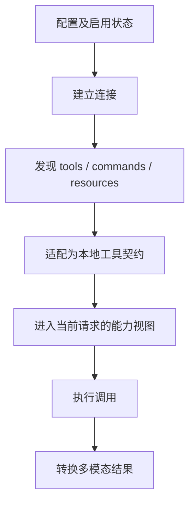

## 本章的问题

把工具清单写进配置，不代表模型马上能调用它。必须先连接，完成初始化，发现工具，再适配 schema 与执行函数，最后把能力放进请求。本章会真的启动一个本地 MCP fixture，不把合成 JSON 当成服务已经运行。

客户端同时发出 A 和 B，依靠 request id 对应响应。未知方法、没有答复、进程退出和主动关闭，都必须让相应 pending Promise 得到结算，否则程序可能一直不退出。

## 沿固定源码逐段拆解

@ccsrc mcp-discovery

### 先剔除 disabled，再按传输组织连接

getMcpToolsCommandsAndResources 从配置读取 entries；disabled 服务返回禁用状态且空能力，不进入连接批次。本地服务与远程服务分组，反映进程启动与网络连接的资源差别。

### 发现与模型可见性之间仍有发布过程

连接成功、tools/list 完成、本地 Tool 适配、当前请求暴露工具，是连续但不同的边。排查“连上却没有工具”，应找首次缺失的那一步，而不是只重启进程改变时序。

@ccsrc mcp-transform

### transformResultContent 有类型分支和副作用

text 可以直接变为文本块；image 需要尺寸与格式处理；audio 与非图像 blob 可能持久化为可引用文本；resource 还要保留 URI 与来源。transform 这个名字并不意味着纯函数。

coda 的 fixture 只声明 text 输入与 text 输出。通用 RPC 传输和文本 MCP 适配被分开，没有把有限的 fixture schema 校验宣称为完整 JSON Schema 支持。图片和资源的扩展练习需要单独测试转换和持久化端口。

## 机制总览



## 接入贯穿项目

@implementation 08-mcp

### 逐步跟踪本章实现

`connectMcp` 在返回工具目录前完成 initialize、initialized 通知与 tools/list。发现到的工具被包装成普通工具定义，进入既有 Toolset；MCP 因而复用权限、hook 和工具结果归属，不另写一套旁路执行逻辑。

StdioRpc 的 pending 按 request id 保存 resolve、reject 与计时器。并发 tools/call 即使乱序返回，也按 id 找到自己的等待者；JSON-RPC error 和协议里的工具 isError 是不同层的失败，前者拒绝请求，后者是一次完成但出错的工具结果。

连接异常时 fail 拒绝所有未完成请求，close 等待真实子进程退出。初始化中途出错也在 catch 中关闭 peer，避免遗留进程。这里实现的是课程 fixture 所需的 stdio 子集和 text 参数校验；扩展到任意 MCP schema、通知与传输方式还需要独立协议工作。

## 运行本章实验

```bash
node --disable-warning=ExperimentalWarning labs/chapters/08-mcp.mjs
```

@experiment 08-mcp

## 逐项解释实验结果

实验真实完成 initialize、tools/list、两次并发调用、远端错误、超时与 close。超时后 pending Map 必须为空；close 返回后进程确实退出。工具的结果会继续交给相同的 Toolset 和权限 gate。

打开 runtime/rpc.mjs 的 close，看它怎样拒绝 pending、关闭 readline、结束 stdin 并等待子进程退出。只 child.kill 而不等待，会把资源泄漏留给下一章。

## 继续动手与验收

给 fixture 增加一个返回 isError 的工具，确认它成为工具结果而非连接崩溃。再加入 text resource，明确来源信息保存在哪；不要直接把整个二进制 JSON 塞进模型文本。

::: interview MCP 已连接为什么还不代表模型能调用？
连接层请求 id 解决并发响应归属，Toolset 的 call.id 解决模型结果归属。初始化、工具目录、调用和关闭都要跨实际 stdio 验证；JSON-RPC error 与工具 isError 分别代表协议调用失败和工具执行失败。
:::

@observation 08-mcp
