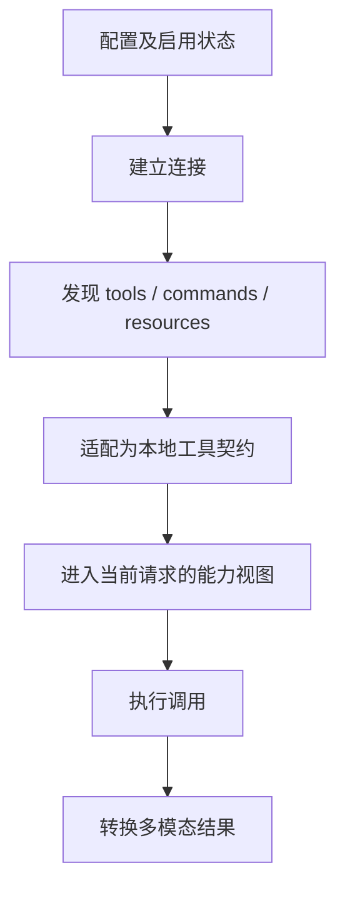

## 从连接走到可供模型选择的工具

@ccsrc mcp-discovery

`getMcpToolsCommandsAndResources` 把连接对象转换为工具、命令与资源。配置存在、握手成功、列表发现完成、工具进入当前请求、实际调用成功，是五个不同阶段。

因此“服务器 connected 但模型没用工具”没有直接给出根因。应先检查发现列表和工具名，再追工具搜索/延迟加载过滤，最后看模型选择。不要在没有 schema 的请求中期待模型猜对复杂参数。

## 外部结果需要适配和边界控制

@ccsrc mcp-transform

`transformResultContent` 按 text、audio、image 与 resource 分支处理内容。图片涉及尺寸和编码转换；某些二进制内容会保存后变成文字引用。这里的处理既影响模型能否接收，也影响上下文成本。

MCP 结果不是系统指令。来源标识、工具调用关联、错误语义和内容信任需要由宿主保留；把外部文字直接提升为高优先级命令，会混淆边界。

## 连接、认证和会话过期分别恢复

继续读 client 的连接缓存、超时包装和过期错误处理。网络重连并不自动证明旧的 tool call 可以安全重试；有副作用的工具尤其要考虑是否已经执行、结果是否只是丢失。

一次最小调查应包含 server identity、transport、发现版本、tool name、call id、返回内容类型与错误。避免把一个传输层问题修成“永远忽略异常”，那会让真实用户失败变得不可见。

## 对照记录的用途

2.1.296 的握手和工具搜索录制可以帮助提出问题；2.1.88 的代码负责解释本基准的装配与转换。延迟工具 schema 的精确行为，需要同时追该基准的 tool search 代码和实际请求。

## 从“服务连上了”到“模型能调用”还有多步

配置被读取后，禁用服务会先被剔除，避免它们发起连接。活跃服务再按本地与远程分类：本地 stdio 往往意味着启动进程，和发起 HTTP 请求的资源成本不同。连接完成之后还需要发现工具、适配 schema、发布能力，再进入本次请求。

如果服务已连接但模型没看到工具，沿这条链找第一个缺失的结果。直接重启服务可能暂时改变时序，却没有说明是发现失败、发布滞后还是请求捕获过早。

## 结果适配为什么不是 JSON.stringify

模型协议和 MCP 的内容类型不同。源码对 text 直接生成文本块；audio 会持久化为可引用文本；image 需要调整大小并转成模型接受的图像块；resource 还分 text 和 blob。资源的 URI 与服务名会进入前缀，帮助保留来源。

| MCP 内容 | 需要的适配 | 如果简单转 JSON |
| --- | --- | --- |
| text | 文本块 | 增加无用结构噪声 |
| image | 尺寸、格式、base64 图像块 | 模型看到字符串而非图像 |
| audio / 非图像 blob | 持久化并产生说明 | 大二进制挤占上下文 |
| text resource | 内容与 URI 来源 | 丢失来源关系或浪费预算 |

读这段函数时要同时看输入类型、输出类型和存储副作用。一个 `transform` 名字不意味着它是纯函数。对带 blob 的分支设计测试时，应替换持久化和图像处理端口，分别验证结构与真实文件行为。

## 工具名、连接名与调用 id 各管什么

多个服务器都可能提供 search。模型可见名称需要解决冲突，服务器名决定连接，调用 id 则标识某一次请求。重连后“相同名字的工具”不一定仍绑定同一连接代；一个长时间运行的 Turn 还可能握着旧能力视图。这是适配器工程里常见的生命周期问题。

本章随附的 2.1.296 实验包含本地 stdio 服务与真实调用录制。读完后可以复现三个故障：工具不存在、服务返回错误、进程意外退出。分别看错误如何变成工具结果，以及退出时子进程是否被清理。

## 练习：定义一个结果转换矩阵

给 text、image、text resource、blob resource 各写一条最小合成输入；逐项说明输出应包含什么、哪个依赖会被调用、哪个分支会落盘。不能只检查函数“不抛错”，应断言模型协议能接受的结构和来源标签。

::: interview MCP 连接成功能证明工具可用吗？
只能证明某个连接阶段成功。还要完成 tools/list、过滤、当前上下文发布、请求 schema 投影和实际调用。应沿这条时间线检查，而不是让 UI 的 connected 标签代替全部能力验收。
:::

@observation 08-mcp
