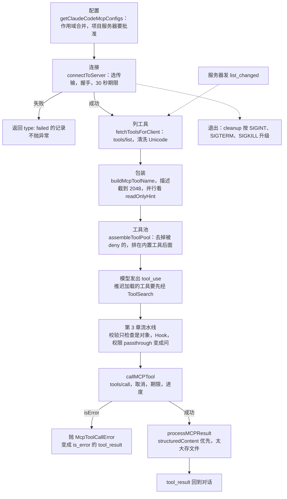
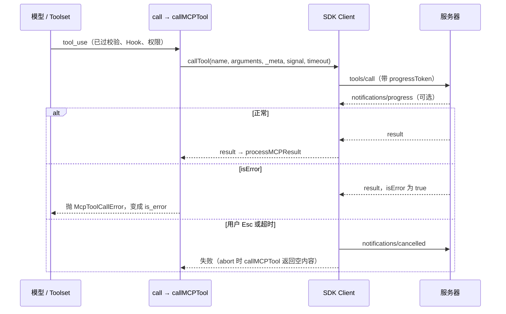

你在项目里放一份 `.mcp.json`，写上一个 issue 系统的服务器，然后问 Claude Code：“有哪些和压缩有关的 open issue？”几秒后模型调用了 `mcp__issues__search_issues`，答案回来了。

从回车到答案，这个服务器走了七站：配置里的一行被信任，进程被拉起并握手，工具列表被取回，每个工具被包装成和 Read、Edit 一样的工具对象，模型调用它，结果被转成文字，会话结束时进程被收走。Learn Pi Agent 第 12 章已经把协议讲清楚了：JSON-RPC、握手、`tools/list` 与 `tools/call`，以及一个客户端要扛住的超时、取消、崩溃。这一章默认你读过它，只讲 Claude Code 在协议之上做的事。

先看一个结构上的事实：`services/mcp/client.ts` 自己不拼装、也不解析 JSON-RPC 消息。请求配对、超时、`notifications/cancelled` 都在官方的 MCP SDK 里（还原源码的 `node_modules` 带着它）；client.ts 管的是产品层的决定。coda 也照这样拆成两层：`runtime/rpc.mjs` 是 SDK 那一层，`coda/src/mcp.mjs` 是产品这一层。


@figure assets/course/ch08-mcp.png 外部服务器握手接入，工具统一换上 mcp__server__tool 的名字，退出时分三步拉闸

## 先看现象：一次真实连接里，线上说了什么

在 Claude Code 和服务器之间夹一个窃听器（`labs/ch08/mcp-tap.mjs`，原样转发每一行，同时记下 JSON-RPC 消息），让模型按顺序调用五个工具。服务器是第 12 章那个假的 issue 系统。录制用的是 Claude Code 2.1.296，源码摘录来自 2.1.88，两者有出入的地方会指出。

@lab node labs/ch08/mcp.ts wire

- **先试探、再降级。** 第一条消息是 `server/discover`，带着一个比服务器支持的更新的协议版本；服务器回答“没有这个方法”，客户端才退回 `initialize`。2.1.88 打包的 SDK 没有这一步，握手直接从 `initialize` 开始，这是两个版本的 SDK 不同。
- **客户端声明了两种能力**：`roots`（服务器可以问工作目录）和 `elicitation`（服务器可以反过来向用户要信息）。
- **每个 `tools/call` 都带着 `_meta`**：一个 Claude Code 自己的调用 id，和一个 `progressToken`。
- **工具列表会变。** `enable_admin_tools` 执行时，服务器先发 `notifications/tools/list_changed`，客户端立刻重新 `tools/list`，拿到 9 个工具。

再看模型从这五次调用里拿到了什么：

@lab node labs/ch08/mcp.ts calls

四个现象留到后面解释：搜索同时返回了文字和 `structuredContent`，模型收到的却是 JSON；`create-issue` 要问用户，其余四个有规则放行；`dump_log` 的 12 万字符变成了一个文件路径；`fail` 什么原因也没给，模型看到的是 “Unknown error”。

把整条链画出来，后面每一节讲其中一站：



## 配置：谁能让 Claude Code 启动一个进程

`mcpServers` 里的每一项都是“运行这个命令”，所以第一个问题是信任：这份配置是谁写的？Claude Code 有好几个来源，合并的顺序写得很直白：

@cc services/mcp/config.ts#L1231-L1238

后面的覆盖前面的同名服务器：插件 < 用户 < 项目 < 本地。命令行的 `--mcp-config` 再覆盖它们（`main.tsx` 里是 `{...existingMcpConfigs, ...dynamicMcpConfig}`），`--strict-mcp-config` 让自动发现的来源全部不参与（上面的录制用的就是它，保证只有窃听器后面那一个服务器）。企业的 `managed-mcp.json` 只要存在就独占，其他来源一概不读（`getClaudeCodeMcpConfigs` 开头的 `doesEnterpriseMcpConfigExist()` 分支）。

注意第三项是 `approvedProjectServers`，不是 `projectServers`。项目里的 `.mcp.json` 提交在仓库里，是别人写的，每个服务器都要先过一道批准：

@cc services/mcp/utils.ts#getProjectMcpServerStatus hl=359-365,367-374,398-403

三个结论。`disabledMcpjsonServers` 里有它就是 rejected，排在最前面，批准列表也救不回来。`enabledMcpjsonServers` 或 `enableAllProjectMcpServers` 才是 approved。其余是 pending，交互界面据此弹窗询问。最后一段值得记住：**非交互模式（`claude -p`、SDK）没法弹窗，直接视为批准**，注释的理由是选择这种模式的人等于已经信任了这个目录。所以在 CI 里对一个陌生仓库跑 `claude -p`，它的 `.mcp.json` 会被启动。名字比较前先归一化，`my.srv` 和 `my_srv` 算同一个。

配置读进来时还会展开 `${VAR}` 和 `${VAR:-默认值}`，缺少的变量只记一条警告，不拒绝整个服务器。下面对着原函数核对 coda 的 `resolveMcpConfig`：

@lab node --disable-warning=ExperimentalWarning labs/chapters/08-mcp.mjs config

第一张表是合并结果：`shared` 在三个来源里都有，最后是 local 的；没批准的 `unknown` 没有出现，只留在 pending 里。第二张表是六种情形下原函数和 coda 的结论，逐行相同。第三张表里 `${MISSING:-a:-b}` 只得到 `a`：原函数的注释想说“默认值里的 `:-` 要保留”，但 `split(':-', 2)` 在 JavaScript 里是丢掉多出来的部分。Pi 的做法是项目配置只在信任项目后才读，mox 需要 `--trust`；Claude Code 把这个决定拆成逐个服务器。

## 连接：握手有期限，失败只是一条记录

配置决定了要连哪些服务器。`getMcpToolsCommandsAndResources` 把它们分成本地（stdio）和远程两组，各限制并发（本地缺省 3 个，远程 20 个，免得同时拉起一堆进程），每连好一个就通过回调交出一个，慢的不会拦住别人。真正连一个服务器的是 `connectToServer`：按 `type` 选传输（stdio 用 SDK 的 `StdioClientTransport`，子进程拿到整个环境变量加上配置里的 `env`；http、sse、ws 等是远程传输，http 和 sse 还要处理 OAuth），建一个 SDK 的 `Client` 并声明能力，然后：

@cc services/mcp/client.ts#L1048-L1080 hl=1048,1050,1059-1064,1080

`client.connect(transport)` 做握手，在 SDK 里。client.ts 加的是一个 `Promise.race`：30 秒（`MCP_TIMEOUT` 可改）内没握手完成，就关掉传输，以 “connection timed out” 失败。协议保证不了服务器一定会回复，一个卡在启动里的进程可以永远沉默，所以期限必须由客户端定。失败以后呢？看 `connectToServer` 最外层的 catch：

@cc services/mcp/client.ts#L1623-L1638 hl=1632-1637

**不抛异常，返回一条 `type: 'failed'` 的记录。** 命令不存在、握手超时、协议版本不被支持，都落到这里，所以一个坏服务器只会让它自己的工具不出现，不会让 Claude Code 起不来。（需要 OAuth 的远程服务器是另一种状态 `needs-auth`。）stderr 在连接期间被接管（`stderr: 'pipe'`），不打到终端，失败时记进日志。连上之后，`getMcpToolsCommandsAndResources` 还并行取 prompts（变成名为 `mcp__服务器__名字` 的斜杠命令）和 resources（服务器支持时，注册 `ListMcpResourcesTool` 和 `ReadMcpResourceTool` 两个辅助工具），本章只跟工具这条线。coda 的 `connectMcpServers` 是同样的形状，六个服务器一起连：

@lab node --disable-warning=ExperimentalWarning labs/chapters/08-mcp.mjs failures

`need-key` 一启动就退出，stderr 里的原因被带了回来；`stuck` 卡在握手，只占用了 300ms 的期限；`typo` 命令不存在；`chatty` 把一行日志打到了 stdout，客户端把它记下，连接照常。工具撞名是另一个坑：`my server` 和 `my.server` 归一化后都是 `my_server`，两边的工具同名，工具池按名字去重（`uniqBy`），后来的那个不见了。最后一段是进程在调用中途退出：所有等待中的调用立刻失败，不会等满期限。

连上之后进程退出了呢？远程传输会指数退避重连，最多 5 次；stdio 不重连：

@cc services/mcp/useManageMCPConnections.ts#L354-L357

@cc services/mcp/useManageMCPConnections.ts#L464-L467

只有 `configType !== 'stdio'` 才走重连，否则服务器被标成 `failed`，它的工具在下一次请求里消失。

## 从 tools/list 到一个工具对象

握手之后，`fetchToolsForClient` 取回工具列表，把每一项包装成 Claude Code 的 `Tool`。整个包装是一个对象字面量：

@cc services/mcp/client.ts#L1752-L1813 hl=1752-1755,1758,1768,1773-1774,1789-1794,1795-1800,1813

- 1752–1755：`tools/list` **只请求一次**。整个 client.ts 里没有 `nextCursor` 的处理。Pi 和 mox 都沿游标取全；一个分页返回工具的服务器，在 2.1.88 里只有第一页的工具会出现。
- 1758：整个列表先过一遍 `recursivelySanitizeUnicode`，见下面。
- 1768、1773–1774：名字是 `buildMcpToolName(client.name, tool.name)`，同时用 `mcpInfo` 保存未归一化的原名。`tools/call` 用原名，权限规则用完整名。
- 1789–1794：发给模型的描述来自 `prompt()`，超过 2048 个字符就截断并加 “… [truncated]”。注释说是因为用 OpenAPI 生成的服务器会塞进 15 到 60KB 的接口文档。服务器的 `instructions` 同样截到 2048。
- 1795–1800：`isConcurrencySafe` 和 `isReadOnly` 直接返回服务器注解里的 `readOnlyHint`，缺省 `false`。
- 1813：给模型看的参数 schema 就是服务器的 JSON Schema。

### 名字：mcp__服务器__工具，拆得回去吗

前缀有两个作用：不会冒充内置工具（工具池最后做 `uniqBy(…, 'name')`，内置工具排在前面，同名时内置的赢），两个服务器都有 `search` 也不冲突。归一化只做一件事，把 `[a-zA-Z0-9_-]` 以外的字符换成下划线。对着原函数看：

@lab node --disable-warning=ExperimentalWarning labs/chapters/08-mcp.mjs names

三个现象。连字符保留，空格、点、汉字都变下划线。`my__srv` 拆回去是 `my / srv__tool`：分隔符和名字里的下划线分不开，原函数的注释承认了这个局限。服务器名全是汉字的话，拆回去干脆是空，`mcp__问题库` 这样的权限规则永远匹配不到它。最后两行更糟：“搜索”和“新建”归一化成同一个名字，同一个服务器里只剩一个能被模型看到。

Pi 的做法不同：

@pi packages/coding-agent/src/extensions/mcp/tools.ts#createMcpToolName hl=89-92

它同样把非字母数字下划线的字符换成下划线（连字符也换），但名字超过 64 个字符、或者已经被另一个工具占用时（`isTaken`），加一个 8 位哈希后缀。撞名的两个工具都保留，名字稍难看；Claude Code 只管字符，不管长度，也不处理撞名，保留第一个，丢掉其余。

### 描述里的隐藏字符

工具的名字、描述、参数说明都会原样进入模型的上下文，而它们是服务器作者写的。1758 行那次清洗防的是“ASCII 走私”：把一句指令编码成 Unicode 标签字符（U+E0000 区）藏在描述里，屏幕上看不见，模型读得懂。

@lab node --disable-warning=ExperimentalWarning labs/chapters/08-mcp.mjs poison

服务器发来的描述有 42 个字符，屏幕上只显示 12 个；清洗发生在列表到达的那一刻，早于描述进入任何提示。副作用也看得见：NFKC 归一化会把全角标点换成半角。coda 的 `sanitizeUnicode` 和原函数结果一致，包括这个副作用。

### “只读”声明能换来什么

1795–1800 行让服务器的自我声明直接参与调度。第 3 章的 `partitionToolCalls` 看 `isConcurrencySafe`，对 MCP 工具来说就是 `readOnlyHint`。

@lab node --disable-warning=ExperimentalWarning labs/chapters/08-mcp.mjs wrap

诚实的服务器：搜索、搜索、新建、搜索，被切成 `[搜索 搜索] [新建] [搜索]`，新建是栅栏。撒谎的服务器把会删数据的 `delete_issue` 也标成只读，它就混进了并行批，顺序保证没了。所以注解只能决定“能不能并行”；最后那张表是权限的态度：没有规则时三个工具都要问，规则可以写到整个服务器（`mcp__issues`），也可以写到单个工具。

Claude Code 在权限上也是这个态度：

@cc services/mcp/client.ts#L1814-L1832 hl=1816,1818-1830

`checkPermissions` 返回 `passthrough`，不表态；流水线最后把 `passthrough` 变成询问，并附带一条建议：把完整名字写进 `localSettings` 的 allow 规则。被 deny 的 MCP 工具更早就消失了：`assembleToolPool`（下面“list_changed 与缓存前缀”一节会读到它）在把工具交给模型之前就过滤掉它们。

### 参数不在本地校验

第 3 章说校验失败的调用 Hook 看不到。MCP 工具是例外：

@cc tools/MCPTool/MCPTool.ts#L13-L14

所有 MCP 工具共用的本地 schema 是 `z.object({}).passthrough()`，任何对象都过。参数对不对由服务器判断，错误作为 `isError` 结果回来。

@lab node --disable-warning=ExperimentalWarning labs/chapters/08-mcp.mjs validate

内置 Read 的坏参数在本地被拦下，Hook 没有记录；MCP 搜索漏了必填的 `query`，调用先到了服务器，Hook 看到了它，错误文字是服务器写的。好处是不把服务器的校验规则复制一份再过时，代价是错误要多走一趟往返。

## 调用：期限、取消和 isError

模型发出 tool_use，穿过第 3 章的流水线，到达包装对象的 `call`。`call` 补上 `_meta`（`claudecode/toolUseId`），交给 `callMCPTool`，核心是这一段：

@cc services/mcp/client.ts#L3091-L3149 hl=3093-3101,3117,3124-3148

- 3093–3115：`signal`（用户按 Esc）、`timeout`、`onprogress` 都交给 SDK。有了 `onprogress`，SDK 才会在请求里放 `progressToken`；Claude Code 把进度包成 `mcp_progress` 事件给界面。
- `timeout` 来自 `getMcpToolTimeoutMs()`，缺省 `100_000_000` 毫秒，约 27.8 小时，`MCP_TOOL_TIMEOUT` 可改。外面再包一层 `Promise.race`，注释说是 SSE 流中途断掉时 SDK 自己的超时不起作用。**Claude Code 缺省几乎不给工具调用设期限**，握手才是 30 秒；工具能跑多久是服务器的事，要停就取消。
- 3124–3148：`isError: true` 的结果被**转成异常**。错误文字只取第一个内容块的 `text`，没有就是 “Unknown error”。这就是录制里 `fail` 变成 “Unknown error” 的原因。

取消和超时在 SDK 的 `request` 里长什么样：

@cc restored-src/node_modules/@modelcontextprotocol/sdk/dist/esm/shared/protocol.js#L662-L706 hl=662-679,701-706

`cancel` 做三件事：删掉本地的等待者和进度回调、给服务器发 `notifications/cancelled`、让 Promise 失败。超时（缺省 60 秒，Claude Code 调工具时换成了上面那个值）和 `signal` 的 abort 都走它。迟到的响应找不到等待者，直接丢弃。`resetTimeoutOnProgress` 缺省 `false`：收到进度不会重新计时，这是和 Pi 的一处差别。



异常有什么后果？回到第 3 章的流水线图：`call` 抛错走的是虚线出口，`formatError` 变成 `is_error` 的结果，触发 PostToolUseFailure，不触发 PostToolUse。MCP 工具还有一处特别：

@cc services/tools/toolExecution.ts#L1476-L1542 hl=1477-1479,1494-1497,1540-1542

内置工具的结果在 PostToolUse 之前就放进了对话；MCP 工具要等 Hook 跑完，因为 Hook 可以返回 `updatedMCPToolOutput` 改写它。第 3 章提到的“MCP 工具例外”就是这里。

@lab node --disable-warning=ExperimentalWarning labs/chapters/08-mcp.mjs call

第一张表把原函数 `callMCPTool`（客户端换成假的 `callTool`）和 coda（对着真实进程）并排。`isError` 两边都是异常；超时的期限不同是为了让实验跑得快；**取消一行**最有意思：原函数不抛异常，返回空内容，因为用户的取消不算工具失败，由主循环另外处理。stderr 里留下了两条 `notifications/cancelled`。第二张表是缺省期限：原函数 `getMcpToolTimeoutMs` 在没设环境变量时给出一亿毫秒。第三张表是两种“失败”不在同一层：JSON-RPC 的 error 让请求本身失败，`isError` 是请求成功、结果里说工具失败，最后都以 `is_error` 交给模型。

## 结果转换：structuredContent 优先，太大就存成文件

结果是一组内容块，可能还带一个 `structuredContent`。`processMCPResult` 先调 `transformMCPResult` 决定用哪一部分：

@cc services/mcp/client.ts#L2662-L2706 hl=2675-2684,2686-2697,2700-2705

按顺序取第一个有的：旧版的 `toolResult`；`structuredContent`（序列化成 JSON，并推断一段紧凑的类型签名备用）；`content` 数组（文字原样，图片缩放，资源加来源前缀，音频和二进制存成文件）；都没有就抛 “unexpected response format”。**`structuredContent` 排在 `content` 前面**，所以录制里的搜索同时返回了文字和结构化数据，模型拿到的是 JSON。Pi 正好相反：

@pi packages/coding-agent/src/extensions/mcp/tools.ts#L272-L277 hl=273-277

有 content 就转 content，没有才退到结构化数据；`isError` 不是异常，而是一个带 `isError` 标记的结果，没有文字时补一句说明。

转换完看大小。先用字符数除以 4 粗估；不超过上限（25000 token，`MAX_MCP_OUTPUT_TOKENS` 可改）的一半就放行，超过才调用 API 数准确的 token：

@cc utils/mcpValidation.ts#mcpContentNeedsTruncation hl=157-163,171-172

确实超限，就整体存成文件：

@cc services/mcp/client.ts#L2766-L2799 hl=2771-2773,2793-2798

图片结果不存文件，改走截断（存成 JSON 会让图片没法看）；存盘失败也退回提示。模型收到的是 `getLargeOutputInstructions` 生成的一段话。下面把同一批结果交给原函数和 coda：

@lab node --disable-warning=ExperimentalWarning labs/chapters/08-mcp.mjs convert

第一张表：文字、结构化数据、资源的转换与原函数逐行一致，图片 coda 换成占位文字。第二张表是**两道关**：MCP 自己这一道按 token，之后还有第 3 章的通用落盘按字符（MCP 工具声明的 `maxResultSizeChars` 是 100000，阈值取 50000）。5.2 万字符的结果能通过第一道，在第二道被存成文件加预览；12 万字符的结果在第一道就被拦下，第二道看到的只是一句短说明。

最后看原函数交给模型的那段话，和它存下的文件：2771–2773 行把内容数组整个 `jsonStringify` 了，3000 行日志被存成一个 JSON 字符串，文件只有几行，`offset` 和 `limit` 帮不上忙，所以说明里才提 `jq`。录制里（2.1.296）是另一幅景象：“Format: Plain text”，还写着 “across 3,000 lines”，模型用 `Read` 带 `offset: 2990, limit: 11` 读到了最后 11 行日志。可见这个版本存下的已经是原文。这是从录制推断的，2.1.296 的源码我们没有读到。

## 退出：SIGINT、SIGTERM、SIGKILL 三步升级

服务器是子进程，不收走它，Claude Code 退出后它可能留在后台。每个连接建好时都用 `registerCleanup(cleanup)` 登记了清理函数，`gracefulShutdown` 在退出时并行调用全部清理函数，旁边还有一个至少 5 秒的兜底定时器，注释举的“清理挂住”的例子正是 MCP 连接。清理函数本身：

@cc services/mcp/client.ts#L1479-L1545 hl=1481,1493,1512,1524

注释解释了为什么不只靠 SDK 的 `close()`：许多服务器（尤其是 Docker 容器）需要显式的信号才会优雅退出。节奏是：先 `SIGINT`（等价于 Ctrl+C），等 100ms；还在就 `SIGTERM`，再等 400ms；还在就 `SIGKILL`。总共不超过半秒，免得退出 Claude Code 时卡住。

@lab node --disable-warning=ExperimentalWarning labs/chapters/08-mcp.mjs shutdown

礼貌的服务器在 SIGINT 就结束，还写下了收尾文件；忽略 SIGINT 的挨到 SIGTERM；两个都忽略的要等满半秒被 SIGKILL。最后一行是反面教材：直接 SIGKILL，服务器连收尾的机会都没有。两处读源码的发现：信号只发给直接子进程（`process.kill(childPid, …)`），用 `npx` 之类的包装器启动的服务器，真正干活的孙进程不会收到，Pi 让服务器独占一个进程组，就是为了解决它；另外这段升级只在 `serverRef.type === 'stdio'` 时运行，而配置里省略 `type` 的条目（schema 里 `type` 是可选的）按字面读不会走这一段，`claude mcp add` 写入的配置带着 `type: 'stdio'`。这一点我们没有用 2.1.88 实测。

## 工具列表会变：list_changed 与缓存前缀

服务器声明了 `listChanged` 能力，就可以随时发通知，客户端的处理是：

@cc services/mcp/useManageMCPConnections.ts#L616-L664 hl=618,628-632,656

清掉这个服务器的工具缓存，重新 `fetchToolsForClient`，用 `updateServer` 整体替换它的工具。工具进了请求，位置就是缓存的问题。看 `assembleToolPool`：

@cc tools.ts#assembleToolPool hl=352,354-359,362-366

内置工具排序后是一个连续的前缀，MCP 工具排序后接在后面；注释说，如果一起排，MCP 工具会插进内置工具之间，让之后所有缓存键失效。录制里 `delete_issue` 出现时，请求的缓存读取量掉了三千多 token：

@lab node labs/ch08/mcp.ts change

新工具按名字排进 MCP 那一段的中间，它之前的部分仍然命中缓存，之后的失效。Pi 1.5 的做法是把新工具作为对话末尾的事件追加，前缀完全不动（第 12 章）。服务器的 `instructions` 也要考虑缓存：它们进入请求有两条路，一条是每轮重算的系统提示小节，一条是只在服务器连上或断开时出现一次的 system-reminder 附件（`mcp_instructions_delta`），源码注释说后者就是为了不让晚连上的服务器打坏缓存。录制里 instructions 出现在第 1 条消息的环境信息里，走的是后一条。

## 工具太多：默认只告诉模型名字

每个工具定义每次请求都要发。接上几个服务器，几百个定义能占掉几万 token。Claude Code 的办法是推迟加载：

@cc tools/ToolSearchTool/prompt.ts#L62-L71 hl=65,68,71

MCP 工具默认就是推迟的，除非服务器在 `_meta` 里声明 `alwaysLoad`；ToolSearch 自己不能推迟，因为模型靠它加载其他工具。推迟的工具在请求里只剩名字，模型调用 ToolSearch（`select:名字` 精确选，或关键词搜索），得到的不是定义，而是 `tool_reference` 块，由模型服务展开。录制（设了 `ENABLE_TOOL_SEARCH=true`，原因见下）对比如下：

@lab node labs/ch08/mcp.ts search

18 个工具从请求里消失，第一个请求的输入从约 1.6 万降到约 1.06 万 token。不只是 MCP 工具，十个不常用的内置工具也被推迟了（`shouldDefer`）。关键问题是：**哪些推迟的工具已经加载了，记在哪里？**

@cc utils/toolSearch.ts#extractDiscoveredToolNames hl=553-559,568-578

答案是不记。每次请求前，都从对话里扫一遍：出现过 `tool_reference` 的工具名就算已加载；压缩时旧消息没了，边界记号 `compact_boundary` 带着压缩前的名单。加载状态完全由对话内容决定，所以恢复会话、压缩、分叉都不需要额外的状态。

@lab node --disable-warning=ExperimentalWarning labs/chapters/08-mcp.mjs deferred

第一张表是 `ENABLE_TOOL_SEARCH` 各取值对应的模式，缺省是 `tst`，总是推迟。录制里却要手动设成 `true`，因为 `isToolSearchEnabledOptimistic` 在 `ANTHROPIC_BASE_URL` 指向第三方网关时，缺省把它关掉（网关不一定转发 `tool_reference`）。最后一张表是四个时刻请求里带的工具：没搜索过时只有名字，搜索后多出一个，压缩之后仍然有。Pi 的 `deferred` 把加载记成对话末尾的事件，`codemode` 让模型写脚本调用工具；Claude Code 这条路的特点是依赖 Anthropic API 的 `defer_loading` 和 `tool_reference`，换成别家模型服务就没有了。

## 三种实现的取舍

| 问题 | Claude Code | Pi / mox | coda |
| --- | --- | --- | --- |
| 协议层 | 官方 MCP SDK | 自己写：帧、配对、超时、取消 | `runtime/rpc.mjs`，同样的职责 |
| 配置信任 | 项目服务器逐个批准；`-p` 直接视为批准 | 项目配置需要信任（mox 的 `--trust`） | 批准列表；非交互视为批准 |
| 连接失败 | 返回 `failed` 记录；握手 30 秒 | 跳过连不上的服务器，显示 stderr 末尾（mox 握手 10 秒） | 同 Claude Code |
| 工具调用期限 | 缺省约 27.8 小时，靠取消停下 | 缺省 60 秒，收到进度就重新计时 | 同 Claude Code |
| 名字 | `mcp__服务器__工具`，只替换字符，撞名保留第一个 | 连字符也一起替换，超长或撞名加哈希后缀 | 同 Claude Code |
| 结果取哪部分 | `structuredContent` 优先 | 有文字用文字 | 同 Claude Code |
| 大结果 | 超 25000 token 整体存文件；再过通用落盘 | 超 20KB 保留头尾，完整内容存临时文件 | 存文件；再过 Toolset |
| `readOnlyHint` | 决定能否并行，不影响权限 | 交给权限扩展参考 | 只决定并行 |
| 退出 | SIGINT、SIGTERM、SIGKILL，≤0.5 秒，只发给子进程 | 关 stdin，再 SIGTERM、SIGKILL，发给整个进程组 | 同 Claude Code |
| 工具太多 | 默认推迟，状态在对话里 | direct / deferred / codemode / hidden | 没有 |

两种路线的分歧是：协议层谁来拥有。Claude Code 用官方 SDK，省掉一大块工作，代价是行为受 SDK 版本牵制（读 cleanup 的注释就能看到它为 SDK 的 `close()` 不够用打的补丁）；Pi 和 mox 自己写，每一个边界情况都在手里，也都要自己担。Claude Code 在“缺省宽松”上更进一步：工具调用几乎不设期限，参数不在本地校验，把控制权交给服务器和用户的 Esc；Pi 倾向于客户端有主见，给期限，给分页，给进程组。

## coda 里的实现

`connectMcp` 是整条链的缩影：握手有期限，失败时先清理进程再抛错，工具列表整体替换。

@code coda/src/mcp.mjs#connectMcp hl=236-240,247,251-252,257,268-271

对应 `connectToServer` + `fetchToolsForClient`。简化：只有 stdio；列表按规范沿游标取全（原版只取一次）；失败时抛出带 `stderr` 的错误，想要“不抛异常”的行为用 `connectMcpServers`。

`convertResult` 对应 `processMCPResult`，三个来源的顺序、`isError` 变成异常、太大存文件：

@code coda/src/mcp.mjs#convertResult hl=115-118,122-130,134

简化：用字符数除以 4 估算 token；图片换占位文字；没有 `resultDir` 时退回截断。

`StdioRpc` 的 `request` 和 `cancel` 是 SDK 那一层，取消通知就在这里发：

@code runtime/rpc.mjs#cancel hl=221-223

## 自己跑一遍

本章所有实验在同一个脚本里，可以整体运行，也可以只运行一节：

```bash
node --disable-warning=ExperimentalWarning labs/chapters/08-mcp.mjs            # 全部
node --disable-warning=ExperimentalWarning labs/chapters/08-mcp.mjs convert    # config / names / wire / wrap / validate / poison / call / convert / failures / shutdown / deferred
node labs/ch08/mcp.ts search                                                   # 录制：wire / calls / change / search
```

## 你来改

先写下预测，再动手验证。

::: predict 把 parallel 改成 readOnly
`wrapTool` 里的 `parallel: spec.annotations?.readOnlyHint === true` 改成 `readOnly: spec.annotations?.readOnlyHint === true`。连上 `MCP_FIXTURE_LIE=1` 的服务器，打开管理工具，`default` 模式、没有任何规则时，`delete_issue` 的权限决定是什么？
???
`allow`，来源 `readOnly`，不会询问用户。coda 的权限层看到 `tool.readOnly` 就直接放行，而撒谎的服务器把删除工具标成了只读。Claude Code 里 `readOnlyHint` 在调度上只用来判断能否并行，权限那条路上 `checkPermissions` 总是 `passthrough`，最后变成询问。注解是服务器自己声称的，能换来便利（并行），不能换来放行。
:::

::: predict 把 structuredContent 和 content 的顺序对调
`convertResult` 里先判断 `Array.isArray(result?.content)`，再判断 `structuredContent`。`structured_only` 工具（返回 `content: []` 加 `structuredContent`）模型会看到什么？
???
`(mcp__issues__structured_only completed with no output)`。空数组也是数组，先命中 `content` 分支，得到空文本，Toolset 再把空结果换成那句说明；`{"total":3,"open":2}` 被悄悄丢掉。`structuredContent` 排在前面，是让这类只给结构化数据的服务器也能用。同一个搜索工具，两种顺序给模型的内容完全不同，一个是 JSON，一个是 `#41 [open] …`。
:::

::: predict 删掉取消通知
删掉 `cancel` 里的 `notify("notifications/cancelled", …)`。`slow_count` 设 150ms 期限、让它数 6 下（每下 100ms）：客户端和服务器各是什么表现？
???
客户端没有区别：150ms 后 Promise 失败，等待表是空的，迟到的响应因为找不到 id 被丢弃。服务器不知道被取消，继续数完，stderr 里没有 “收到 notifications/cancelled”，白白多干了几百毫秒。如果这是一个跑十分钟的构建，用户按了 Esc，服务器还会跑满十分钟。这就是 SDK 的 `cancel` 在本地失败之外还要发通知的原因。
:::

## 面试题

::: interview 一个 MCP 服务器从配置到模型能调用它的工具，经过哪些步骤？
1. **配置**：多个来源按 插件 < 用户 < 项目 < 本地 合并，`--mcp-config` 最高；项目里的服务器要先批准（非交互模式直接视为批准）；`${VAR}` 在读配置时展开。
2. **连接**：按 `type` 选传输，建 SDK `Client`，声明能力，握手带 30 秒期限；失败返回 `failed` 记录，不抛异常。
3. **列工具**：`tools/list`，先清洗 Unicode，再包装：起名 `mcp__服务器__工具`，描述截到 2048，并行性取自 `readOnlyHint`，参数 schema 原样给模型。
4. **入池**：`assembleToolPool` 去掉被 deny 的，排序，接在内置工具后面；缺省推迟加载，模型先用 ToolSearch 加载。
5. **调用**：过第 3 章的流水线（本地校验只检查是对象），`callMCPTool` 发 `tools/call`，带取消信号和进度令牌。
6. **转换**：`structuredContent` 优先，太大存文件；`isError` 变成异常。
7. **退出**：`registerCleanup` 登记的清理函数，SIGINT、SIGTERM、SIGKILL 三步升级。
加分：说出协议层在 SDK 里，client.ts 管产品层的决定。
:::

::: interview 为什么 MCP 工具名是 mcp__服务器__工具？有什么坑？
- 前缀避免冒充内置工具（工具池去重时内置的赢）和跨服务器重名；权限规则也靠它：`mcp__issues` 管整个服务器，`mcp__issues__create-issue` 管单个工具。
- 归一化只把 `[a-zA-Z0-9_-]` 以外的字符换成下划线，所以不同的名字可能撞成同一个（全中文的工具名都变成纯下划线），后来的被 `uniqBy` 丢掉。
- 分隔符 `__` 和名字里的下划线分不开：服务器名带 `__` 会拆错；服务器名全是汉字则拆不出服务器，对应的权限规则永远匹配不到。
- 加分：对比 Pi / mox，撞名或超长时加 8 位哈希后缀，两个工具都保留；Claude Code 的归一化不管长度，也不处理撞名。
:::

::: interview MCP 服务器连不上、卡住、调用中途崩溃，客户端分别怎么处理？
- **连不上**（命令不存在、启动即退出）：`connectToServer` 返回 `type: 'failed'` 的记录，带错误和 stderr，只是这个服务器的工具不出现。
- **卡住**：握手有 30 秒期限（`MCP_TIMEOUT`），到点关传输并失败，进程被清理。
- **调用中途崩溃**：进程退出时所有等待中的请求立即失败，不等期限；stdio 服务器不重连，被标成 `failed`，工具从下一次请求里消失；远程传输才会指数退避重连，最多 5 次。
- **调用本身卡住**：缺省期限约 27.8 小时，靠用户取消；取消和超时都会给服务器发 `notifications/cancelled`。
- 加分：stdout 里混进的非 JSON 日志只被记录，不断开连接，协议通道上的日志是服务器作者最常犯的错。
:::

::: interview MCP 工具返回了十几万字符的结果，Claude Code 怎么处理？为什么 structuredContent 排在 content 前面？
1. 先取内容：`structuredContent` 优先（序列化为 JSON），否则逐块转换 `content`。排在前面是为了让只返回结构化数据的服务器也可用；代价是文字和结构化数据都有时，模型只看到结构化的那份。
2. 再看大小：字符数除以 4 粗估，超过上限（25000 token）一半才调 API 数准确的 token。
3. 超限就整体存成文件，返回路径、格式说明和“必须读完再总结”的要求；图片结果改走截断。
4. 之后还有第 3 章的通用落盘（MCP 工具阈值 50000 字符），两道关各管一段。
5. 加分：2.1.88 存的是 JSON 序列化后的内容数组，行号帮不上忙，所以说明里提到 `jq`；录制的 2.1.296 看起来已经存成逐行的原文（从录制推断）。
:::

::: interview 服务器声明了 readOnlyHint，客户端能信吗？还有哪些服务器写的东西会影响模型？
- 能用来改善体验，不能用来放宽安全：Claude Code 里 `readOnlyHint` 只让调用可以并行，不影响要不要问用户；一个撒谎的服务器把删除工具标成只读，只会让它混进并行批，不会让它绕过权限。把注解当 `readOnly` 就会被绕过（见“你来改”）。
- 描述、参数说明、`instructions` 都进入模型的上下文：先清洗 Unicode（挡掉用标签字符隐藏的指令），再截到 2048 字符。
- 结果是不可信数据，间接注入照常防；`list_changed` 之后整份工具列表被直接替换（`updateServer`），这条路径上没有比对新旧描述的步骤，Pi 第 12 章讲的“事后变脸”在这里同样要提防。
- 配置本身是命令：项目服务器要逐个批准，但 `claude -p` 视为批准。
:::

::: interview 接了很多 MCP 服务器，上下文被工具定义占满了怎么办？Claude Code 的推迟加载有什么特点？
- 缺省总是推迟（`ENABLE_TOOL_SEARCH` 为 `tst`）：请求里只带名字和 ToolSearch，模型需要时搜索，得到 `tool_reference` 块，由模型服务展开成定义。`alwaysLoad` 可以让个别工具直接可见，`auto:N` 表示定义超过上下文的 N% 才推迟。
- 已加载的工具不另存状态，每次请求从对话里扫 `tool_reference` 重新算出来；压缩时名单写进 `compact_boundary`。会话恢复、压缩都不用额外处理。
- 缓存：内置工具排成连续前缀，MCP 工具接在后面，新增工具只影响它后面的部分；`instructions` 用附件而不是每轮重算的系统提示。
- 对照：Pi 有 direct、deferred、codemode、hidden 四种；Claude Code 依赖 API 的 `defer_loading`，换成别的模型服务就没有这条路。
:::
