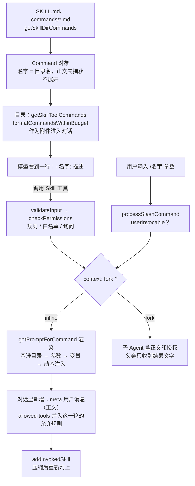

团队写发布说明有固定的套路，放在项目的 `.claude/skills/release-notes/` 里：一份 `SKILL.md`，一个模板文件，frontmatter 里还有一行 `allowed-tools: Bash(cat *)`。你对 Claude Code 说“写 v2.0 的发布说明”，它第一个请求里这份 Skill 只占一行：名字加描述。正文要等模型决定用它、调用了 Skill 工具之后才会进来。

Learn Pi Agent 第 11 章讲过这个“渐进式披露”：目录常驻，正文按需，附带文件用到才读。Pi 几乎没有为它增加机制，目录写进系统提示，模型用 `read` 去读 `SKILL.md`。Claude Code 在同一个思路上加了好几层，每一层对应一个具体的问题：

- 用户也想直接调用，输入 `/release-notes v2.0`。于是 Skill 和斜杠命令成了同一种东西，有两扇门；
- 正文要带上实时信息：参数、Skill 所在的目录，甚至“先在本地跑一条命令，把输出填进来”。于是正文在到达模型之前要先**渲染**；
- Skill 能替用户预先批准工具。于是调用一个 Skill 可能就是在**授权**，调用本身要经过批准；
- 有些活不该污染主对话。于是 `context: fork` 把正文交给子 Agent。

这一章顺着一份 SKILL.md 的一生往下读：怎样被发现，怎样出现在目录里，怎样被调用、渲染、授权，怎样 fork，压缩之后怎样回来。每一站都有一次真实运行的输出和对应的源码摘录，最后和 Pi、mox 对照，再看 coda 里的实现。


@figure assets/course/ch09-skills.png 平时只露一行书脊；调用时才翻开，正文展开进对话，夹着的许可卡就是 allowed-tools

## 先看现象：同一份 SKILL.md，五种进入对话的方式

实验项目里有一个 `release-notes` Skill。描述、正文、模板里各放了一个标记字符串，这样能在抓到的请求里搜到它们出现在哪条消息里；正文用到了 `${CLAUDE_SKILL_DIR}`、`$ARGUMENTS` 和两处 `` !`命令` ``；另有一个标了 `disable-model-invocation` 的 Skill，和一个旧式的 `.claude/commands/greet.md`。

@code labs/ch09/record.ts#region:files title=实验项目

录制用的是 Claude Code 2.1.296，由一个开放模型驱动（第 0 章）；源码摘录来自 2.1.88，两者不同的地方会指出。五次运行：模型自己决定调用（三种设置）、用户输入斜杠命令、旧式命令。

@lab node labs/ch09/skills.ts invoke

读这张表，盯住三件事：

- **第 1 行和第 2 行只差一行 `allowed-tools`。** 带它的 Skill，调用被要求批准（`-p` 模式没人可问，于是失败）；去掉它，直接通过；加一条 `Skill(release-notes)` 规则（第 3 行）也能通过。
- **第 1 行失败以后，模型没有放弃**：它找到 `SKILL.md`，用 Read 读了原文，照着做。但它读到的是**没渲染过的原文**，占位符原样躺在那里（“渲染”一节有对照）。
- **第 4 行**用户输入斜杠命令，没有调用任何工具。**第 5 行**旧式命令 `/greet` 的正文已经在第一条消息里，模型还是又调了一次 Skill 工具。

这些行为分别由三个机制决定：命令怎样被发现，调用怎样展开，授权怎样裁决。先看全程地图，后面每一节讲其中一站。



## 一个目录怎样变成一条命令

Claude Code 里 Skill 和斜杠命令不是两套东西。启动时 `getSkillDirCommands` 扫描几个目录，每个 `SKILL.md`（以及旧式的 `commands/*.md`）都变成一个 `Command` 对象，类型是 `prompt`。先看一个目录是怎么变的：

@cc skills/loadSkillsDir.ts#L421-L471 hl=425,452,462-467

- 第 425 行：`skills/` 目录里只认“一个子目录一个 Skill”。直接放一个 `.md` 文件不算（旧式的 `commands/` 才允许单文件）。
- 第 431–445 行读 `SKILL.md`。文件不存在就悄悄跳过；只有权限、IO 这类读失败才记一条调试日志。整个处理包在 `try` 里，一个坏文件只会让自己消失，不影响别的 Skill。
- 第 447–457 行解析 frontmatter，取出各个字段。**名字是 `entry.name`，也就是目录名**（第 452 行）。frontmatter 里的 `name` 只是 `displayName`。YAML 写坏了也不会抛错：解析失败后重试一次，仍然失败就当 frontmatter 是空的，Skill 照样加载，描述退回正文第一行，`allowed-tools` 之类的字段也随之悄悄丢掉。
- 第 462–467 行装配成 `Command`。此刻正文 `markdownContent` 已经读进内存、捕获进了闭包，`baseDir` 记下目录。发现阶段读了全文，但没有一个字放进上下文。

查找用同一个函数，Skill 工具和 `/名字` 都走它：

@cc commands.ts#findCommand hl=694-696

`name`、显示名、别名，任何一个对上就算，数组里排在前面的赢。所以目录叫 `rn`、frontmatter 写 `name: 发布说明` 的 Skill，输入 `/rn` 和 `/发布说明` 都能调到。

数组怎么排，就是优先级。`getSkillDirCommands` 按固定顺序拼：托管（企业策略）、用户目录、项目目录（从当前目录一路向上到 git 根，近的在前）、`--add-dir`，最后才是旧式的 `commands/`（第 716–723 行）。去重只看文件的真实路径（`realpath`，免得符号链接让同一个文件加载两次），**不看名字**：两个同名的 Skill 都在列表里，查找时排在前面的赢。

下面的实验在一个临时项目里放了各种形态的文件，让 coda 的 `Skills` 和原版的 `findCommand` 回答同样的问题。

@lab node --disable-warning=ExperimentalWarning labs/chapters/09-skills.mjs discovery

对照上面的摘录读这张表：

- `rn` 一行：命令名是目录名，显示名 `发布说明` 来自 frontmatter。查找表里 `rn` 和 `发布说明` 都指向它，和原版的 `findCommand` 逐行一致（这个函数是从固定提交里装载运行的，不是我们重写的）。
- `secret-helper` 标了 `disable-model-invocation`：模型的目录里没有它，用户仍能输入 `/secret-helper`。
- `deploy-check` 和 `ops:deploy` 没写 description，描述取正文的第一行；旧式命令的子目录是命名空间，`ops/deploy.md` 的名字是 `ops:deploy`。
- 目录形式的 `greet` 盖掉了旧式命令 `greet`，因为 `skills/` 排在 `commands/` 前面。coda 直接丢掉后来者；原版两个都留着，只是查找时轮不到后面那个。
- `broken` 键重复，读不出来，其余 Skill 照常加载。

frontmatter 里的字段，各自被谁消费，在 `parseSkillFrontmatterFields` 里能一次看全：

| 字段 | 缺省 | 谁用它 |
| --- | --- | --- |
| `name` | 目录名 | 只是显示名 |
| `description` | 正文第一行（去掉 `#`，最长 100 字符） | 目录里的那一行 |
| `when_to_use` | 无 | 目录里接在描述后面 |
| `allowed-tools` | 无 | 调用时并入允许规则（“授权”一节） |
| `disable-model-invocation` | 否（只有字面的 `true` 才算） | 目录和 Skill 工具的校验 |
| `user-invocable` | 是 | `/名字` 那扇门；`false` 时只有模型能调用 |
| `arguments`、`argument-hint` | 无 | 具名参数、输入框里的提示 |
| `context: fork`、`agent` | inline、general-purpose | 交给哪个子 Agent（“fork”一节） |
| `model`、`effort` | 继承 | 调用期间覆盖主循环的模型和努力程度 |
| `hooks` | 无 | 调用时注册会话级 Hook（第 7 章） |
| `paths` | 无 | 条件激活：操作到匹配的文件才出现 |
| `shell` | bash | `` !`命令` `` 用哪个 shell |

`paths` 和子目录里的 `.claude/skills` 都是按需发现的：Read、Edit、Write 触碰到某个文件时，沿路向上找新的 skills 目录（`discoverSkillDirsForPaths`），带 `paths` 的 Skill 在匹配到文件时才激活（`activateConditionalSkillsForPaths`）。思路和第 4 章子目录里的 CLAUDE.md 一样，大仓库里的 Skill 不必一开始全部露面。启动之后改了 Skill 文件也不用重启：`skillChangeDetector` 监听这些目录，变动后清缓存，并让目录重新发送。

## 模型平时只看到一行：目录和它的预算

`Command` 都有了，哪些要告诉模型？

@cc commands.ts#getSkillToolCommands hl=569,574-578

必须是 `prompt` 类型，且没有 `disableModelInvocation`。来自 `skills/` 目录、内置的和旧式命令的无条件列入（它们没写描述也有正文第一行顶着）；插件和 MCP 来的必须有显式的描述才列入。这就是 `secret-helper` 不在目录里、`/secret-helper` 仍然能用的原因：用户那扇门不看这个字段。

目录里的一行是 `- 名字: 描述`，`when_to_use` 接在描述后面，每条最长 250 个字符。条数多了怎么办？

@cc tools/SkillTool/prompt.ts#L74-L121 hl=76,88-90,110,117-121

预算（`getCharBudget`）默认是上下文窗口的 1%，按每个 token 4 个字符换算，200K 的窗口是 8000 字符。`formatCommandsWithinBudget` 逐档降级：

1. 第 88 行：全部用完整描述，装得下就结束；
2. 装不下，先让内置 Skill 保留完整描述（第 92–110 行），再把剩下的预算扣掉每条的固定开销（`- 名字: `，第 117–119 行），**平均**分给其余各条（第 121 行），每条描述各自截短；
3. 平均每条分不到 20 列（第 123–142 行，摘录之外），非内置的 Skill 只剩名字。

宽度按终端显示的列数算，一个汉字占两列，截断也按列。下面的实验把原版 `formatCommandsWithinBudget`（连同它依赖的算预算、拼一行、取描述、截断，都从固定提交里装载）和 coda 的 `formatListing` 放在同一组 14 个 Skill 上，只改上下文窗口的大小。

@lab node --disable-warning=ExperimentalWarning labs/chapters/09-skills.mjs listing

窗口大到 200K 时 14 条都带着完整描述；缩到 20K，每条描述被截短，以省略号结尾；再缩到 8K，连平均 20 列都分不到，只剩名字。三种预算下 coda 的输出和原版逐字一致。读目录的人（模型）看到“只剩名字”的那一档，就只能靠名字猜用途了，所以描述要把关键词放在最前面。

目录放在哪里，是另一个设计选择：

@cc utils/attachments.ts#L2699-L2750 hl=2718,2725,2741

目录是对话里的一条**附件**（`skill_listing`），不在系统提示里，也不在 Skill 工具的描述里。每个 Agent 记着自己已经发过哪些名字（第 2699–2704 行），只发没发过的（第 2718 行）：第一次发全部，之后新装了 Skill 才发一条增量，恢复旧会话时抑制重发（第 2709 行）。进入模型的形式是一条包着 `<system-reminder>` 的用户消息，开头先说明“下面这些 Skill 可以用 Skill 工具调用”（`messages.ts` 里 `skill_listing` 那一支）。Skill 工具自己的描述是一段固定的文字，只告诉模型“可用的 Skill 列在 system-reminder 消息里”。

录制能印证这个位置：

@lab node labs/ch09/skills.ts listing

标记字符串出现在请求的第二条消息里，而系统提示里没有。2.1.296 把它放进了一条中途插入的 system 消息，2.1.88 的源码是包着 system-reminder 的用户消息，位置不同，思路一样：目录在对话里。`secret-helper` 的描述不在请求里，旧式命令 `greet` 的描述在；正文一个字都没有。

为什么这样放，源码没有写明，这里是推测：工具定义排在请求最前面，是提示缓存前缀的一部分。如果目录写在系统提示或工具描述里，装一个插件、改一个 Skill 文件，整个前缀都变了，缓存全部作废；放在对话里，只是尾部多一条增量消息。压缩的处理印证了这个重视缓存的取向：压缩之后**不重发**目录（重发约 4K token，只是白白重建缓存，收益很小），模型的工具列表里仍有 Skill 工具，调用过的 Skill 另有保留（`compact.ts` 第 524–529 行的注释，最后一节讲）。

## 调用：两扇门，一个展开函数

先看模型这一扇。Skill 工具的提示词是这样教模型的：

@cc tools/SkillTool/prompt.ts#L173-L196 hl=178,189-192,194

用户说的 “/commit” 就是 Skill，要用这个工具调用（第 178 行）；可用的 Skill 列在 system-reminder 消息里（第 189 行，上一节的目录）；一旦匹配就是 BLOCKING REQUIREMENT，先调工具再回答（第 190 行）；没调用就不许提 Skill（第 191 行）；已经在运行的不要重复（第 192 行）；对话里有 `<command-name>` 标签，说明已经加载过，直接照做（第 194 行）。这些全靠模型自觉，所以工具本身还要把关。

`validateInput` 依次检查：名字非空；去掉开头的斜杠（兼容 `/commit` 写法）；`findCommand` 找不到是 “Unknown skill”；`disableModelInvocation` 为真则拒绝；不是 `prompt` 类型也拒绝。它排在权限之前，校验失败的调用走不到询问，和第 3 章讲的流水线一致。Skill 工具没有声明并发安全，按默认值是独占的：注释说得明白，它会把命令展开成一整段提示，模型要先处理完才能继续。

再看用户这一扇。`processSlashCommand` 先判断输入是不是已知命令。不是的话，名字只含字母数字和 `:-_`、而且磁盘上没有同名路径，回一句 “Unknown skill”；否则当普通输入（`/var/log` 这样的路径不会被误认）。找到了，`getMessagesForSlashCommand` 检查 `userInvocable`，为 `false` 就回一句“这个 Skill 只能由 Claude 调用”。然后 `prompt` 类型的命令分两路：`context` 是 `fork` 走 `executeForkedSlashCommand`，否则走 `getMessagesForPromptSlashCommand`。

Skill 工具的 `call` 也分两路，inline 的那一路最后走到**同一个函数**：

@cc tools/SkillTool/SkillTool.ts#L615-L647 hl=622,635-643,645-647

第 622 行 fork 分支另说。其余走 `processPromptSlashCommand`，它就是 `getMessagesForPromptSlashCommand` 的外壳。参数是 `args || ''`（第 640 行）：模型没传参数，展开时用的也是空字符串而不是 `undefined`，这一点在“渲染”一节有后果。展开得到的消息里，带 `<command-message>` 的那条被滤掉，因为 Skill 工具自己会显示；剩下的挂上这次 tool_use 的 id，在工具结束前保持“暂存”。

共用的展开函数做了什么：

@cc utils/processUserInput/processSlashCommand.tsx#L869-L920 hl=869,875-877,885,902-912

1. 第 869 行：`getPromptForCommand` 渲染正文（下一节）；
2. 第 875–877 行：frontmatter 里有 `hooks`，注册进当前会话；
3. 第 885 行：`addInvokedSkill` 记下“这个 Skill 调用过、正文是什么”，压缩之后靠它找回（最后一节）；
4. 第 902–912 行：产出三样东西——一条带 `<command-message>`、`<command-name>`、`<command-args>` 标签的用户消息（界面上看得见的“你输入了什么”），一条 `isMeta` 的用户消息（**正文**，发给模型，界面上隐藏），和一条 `command_permissions` 附件（带着 `allowedTools` 和 `model`）；
5. 返回值里再带一份 `allowedTools`，调用方据此调整这一轮的权限。

录制的会话文件把这几条记录原样留了下来：

@lab node labs/ch09/skills.ts shapes

模型这一扇：`tool_use` → 一句 `Launching skill: release-notes` 的 `tool_result` → `isMeta` 的正文 → `command_permissions`。用户这一扇：标签消息 → `isMeta` 的正文 → `command_permissions`，没有任何工具调用，也不需要批准——用户亲手输入的命令，本身就是授权。两扇门的正文消息和附件是同一个东西。

最后一组是旧式命令 `/greet 小明`：正文已经在第一条消息里，模型还是调了一次 Skill 工具（第 5 行）。2.1.296 的工具认出了重复，回一句“已经在上面加载过，说明没有变化”，没有再放一遍正文。这句话在 2.1.88 的源码里搜不到，那时只有提示词里那条 `<command-name>` 的规则在劝模型别重复。

## 渲染：正文在到达模型之前被改写

两扇门共用的 `getPromptForCommand` 是 `createSkillCommand` 里的一个闭包，捕获了发现阶段读进来的正文：

@cc skills/loadSkillsDir.ts#L344-L399 hl=346,349-354,362,374,385-388

按顺序四步：

1. **基准目录**（第 346 行）。目录形式的 Skill 在正文前面加一行 “Base directory for this skill: …”，模型才知道正文里的相对路径从哪里算起。旧式的 `commands/*.md` 没有这一行。
2. **参数替换**（第 349–354 行），`substituteArguments`，下面细看。
3. **目录变量**（第 362 行）：`${CLAUDE_SKILL_DIR}` 换成绝对路径，这样动态注入的命令能引用 Skill 自带的脚本（紧接着还有会话 id）。
4. **动态注入**（第 374 行起）：正文里的 `` !`命令` `` 在本地执行，输出替换命令本身。MCP 来的 Skill 是远程不可信的，第 374 行直接跳过这一步。执行时传入的权限上下文里，`alwaysAllowRules.command` 被设成**这个 Skill 自己的 `allowed-tools`**（第 385–388 行）：Skill 声明的工具，同时授权了它自己正文里的命令。

正文被改写的四步，用 `/release-notes v2.0` 走一遍：

::: steps getPromptForCommand：正文被改写的四步
--- 两扇门共用的 `getPromptForCommand` 是 `createSkillCommand` 里的闭包，捕获了发现阶段读进内存的正文（`loadSkillsDir.ts` 第 344–399 行）。以 `/release-notes v2.0` 为例，正文里有 `${CLAUDE_SKILL_DIR}`、`$ARGUMENTS` 和两处 `` !`命令` ``。
flowchart TD
  O["正文原文<br/>发现阶段读进来，捕获在闭包里"]:::on
  B1["① 基准目录<br/>加一行 Base directory for this skill"]:::dim
  B2["② 参数替换<br/>$ARGUMENTS 换成 v2.0"]:::dim
  B3["③ 目录变量<br/>CLAUDE_SKILL_DIR 换成绝对路径"]:::dim
  B4["④ 动态注入<br/>命令先过权限，再执行，输出替换命令"]:::dim
  OUT["渲染好的正文<br/>isMeta 用户消息，发给模型"]:::dim
  O --> B1 --> B2 --> B3 --> B4 --> OUT
--- **① 基准目录**（第 346 行）：目录形式的 Skill 在正文前加一行 “Base directory for this skill: …”，模型才知道相对路径从哪里算起。旧式的 `commands/*.md` 没有这一行。
flowchart TD
  O["正文原文<br/>发现阶段读进来，捕获在闭包里"]:::done
  B1["① 基准目录<br/>加一行 Base directory for this skill"]:::on
  B2["② 参数替换<br/>$ARGUMENTS 换成 v2.0"]:::dim
  B3["③ 目录变量<br/>CLAUDE_SKILL_DIR 换成绝对路径"]:::dim
  B4["④ 动态注入<br/>命令先过权限，再执行，输出替换命令"]:::dim
  OUT["渲染好的正文<br/>isMeta 用户消息，发给模型"]:::dim
  O --> B1 --> B2 --> B3 --> B4 --> OUT
--- **② 参数替换**（第 349–354 行，`substituteArguments`）：依次做具名参数、`$ARGUMENTS[n]`、`$n`（从 0 开始）、整串 `$ARGUMENTS`。正文里一个占位符也没有而参数不为空，就把 `ARGUMENTS: …` 附在最后。
flowchart TD
  O["正文原文<br/>发现阶段读进来，捕获在闭包里"]:::done
  B1["① 基准目录<br/>加一行 Base directory for this skill"]:::done
  B2["② 参数替换<br/>$ARGUMENTS 换成 v2.0"]:::on
  B3["③ 目录变量<br/>CLAUDE_SKILL_DIR 换成绝对路径"]:::dim
  B4["④ 动态注入<br/>命令先过权限，再执行，输出替换命令"]:::dim
  OUT["渲染好的正文<br/>isMeta 用户消息，发给模型"]:::dim
  O --> B1 --> B2 --> B3 --> B4 --> OUT
--- **③ 目录变量**（第 362 行）：`${CLAUDE_SKILL_DIR}` 换成绝对路径，这样下一步的命令可以引用 Skill 自带的脚本。
flowchart TD
  O["正文原文<br/>发现阶段读进来，捕获在闭包里"]:::done
  B1["① 基准目录<br/>加一行 Base directory for this skill"]:::done
  B2["② 参数替换<br/>$ARGUMENTS 换成 v2.0"]:::done
  B3["③ 目录变量<br/>CLAUDE_SKILL_DIR 换成绝对路径"]:::on
  B4["④ 动态注入<br/>命令先过权限，再执行，输出替换命令"]:::dim
  OUT["渲染好的正文<br/>isMeta 用户消息，发给模型"]:::dim
  O --> B1 --> B2 --> B3 --> B4 --> OUT
--- **④ 动态注入**（第 374 行起）：行首或空白之后的 `` !`命令` `` 在本地执行（`promptShellExecution.ts` 第 90 行的正则；全角冒号后面的不会执行）。每条命令先过 Bash 工具同一个权限函数（第 98–104 行），不是 allow 就抛错，整个调用失败。权限上下文里 `alwaysAllowRules.command` 是 Skill 自己的 `allowed-tools`（第 385–388 行）。MCP 来的 Skill 跳过这一步。
flowchart TD
  O["正文原文<br/>发现阶段读进来，捕获在闭包里"]:::done
  B1["① 基准目录<br/>加一行 Base directory for this skill"]:::done
  B2["② 参数替换<br/>$ARGUMENTS 换成 v2.0"]:::done
  B3["③ 目录变量<br/>CLAUDE_SKILL_DIR 换成绝对路径"]:::done
  B4["④ 动态注入<br/>命令先过权限，再执行，输出替换命令"]:::on
  OUT["渲染好的正文<br/>isMeta 用户消息，发给模型"]:::dim
  O --> B1 --> B2 --> B3 --> B4 --> OUT
--- 渲染完成。`processPromptSlashCommand` 产出三样东西（`processSlashCommand.tsx` 第 902–912 行）：带标签的用户消息、隐藏的 `isMeta` 正文消息，和一条 `command_permissions` 附件；`addInvokedSkill`（第 885 行）另存一份，压缩之后靠它找回。
flowchart TD
  O["正文原文<br/>发现阶段读进来，捕获在闭包里"]:::done
  B1["① 基准目录<br/>加一行 Base directory for this skill"]:::done
  B2["② 参数替换<br/>$ARGUMENTS 换成 v2.0"]:::done
  B3["③ 目录变量<br/>CLAUDE_SKILL_DIR 换成绝对路径"]:::done
  B4["④ 动态注入<br/>命令先过权限，再执行，输出替换命令"]:::done
  OUT["渲染好的正文<br/>isMeta 用户消息，发给模型"]:::on
  O --> B1 --> B2 --> B3 --> B4 --> OUT
:::

参数替换：

@cc utils/argumentSubstitution.ts#L100-L145 hl=111-121,130-133,136,140-142

分四遍依次做：具名参数 `$名字`（frontmatter 的 `arguments` 声明）、`$ARGUMENTS[n]`、简写的 `$n`、整串的 `$ARGUMENTS`。`$n` 从 **0** 开始，和 Pi 的 `$1` 相反，在两个工具之间搬模板时最容易错。正文里一个占位符也没有、而参数不为空，就把 `ARGUMENTS: …` 附在最后（第 140–142 行）。

下面的实验把原版 `substituteArguments`（装载运行）和 coda 的 `substitute` 放在一起，后面再用 coda 的 `Skills` 渲染一份完整的 Skill。

@lab node --disable-warning=ExperimentalWarning labs/chapters/09-skills.mjs render

参数替换表里有三处会让人意外：

- **`价格 $5 起` 被吃成 `价格  起`。** 参数为空串时，`$n` 照样替换：找不到第 6 个参数，就换成空串。模型那一扇门的参数永远是 `args || ''`（上一节），所以正文里碰巧写的 `$5` 总会消失。写美元金额要小心。
- **参数里的 `$$` 变成了 `$`。** 第 136 行用字符串形式的 `replaceAll`，`$$`、`$&` 这些替换语法对参数也生效。coda 用函数形式，保留原样。同一个仓库里，下面的 shell 输出替换就用了函数形式，还专门写了注释。
- **参数里的 `$1` 被再替换了一次。** 四遍是依次做的，前一遍插进去的内容会被后一遍再扫。Pi 的模板展开只做一遍，源码注释特别写明参数里的 `$1` 不会被递归替换。

动态注入的几种情形见第二张表，规则来自这一段：

@cc utils/promptShellExecution.ts#L89-L131 hl=89-90,98-113,115,131

行内的 `` !`命令` `` 用一个“前面必须是行首或空白”的正则（第 90 行先做一次便宜的预检：正文里有没有 `` !` ``）。录制里的 `date` 那一行，感叹号前面是全角冒号，没有执行；`echo` 那一行前面是空格，执行了。中文写作者很容易踩到这个坑，因为用“：”引出命令太自然了。围栏写法 `` ```! `` 总是会扫。

每条命令执行之前，要过**和 Bash 工具调用同一个权限函数**（`hasPermissionsToUseTool`，第 98–104 行）；不是 `allow` 就抛错，整个 Skill 调用失败（第 106–113 行）。命令退出码非零、被中断，同样让整个调用失败，不会带着半截结果继续。检查的对象是**参数替换之后**的整串命令，因为替换发生在上一步：表里 `hi; touch pwned` 这个参数被拒绝了，副作用没有发生。coda 里“含 `;` `&` `|` 的命令不按规则放行”是因为它没有原版那套把复合命令拆开逐条检查的能力。

录制里也有对应的证据，三种进入方式下占位符的状态：

@lab node labs/ch09/skills.ts render

模型调用和用户调用的结果相同：路径和参数已替换，空格后的命令执行了，全角冒号后的没有。最后一列是 `denied` 那次：模型被拒绝以后自己读了原文，**什么都没有渲染**。它把两行 `` !`…` `` 当成要自己执行的步骤，合并成一条 Bash 命令跑了一次。结果碰巧一样，但走的是另一条路：命令经过了 Bash 工具自己的权限检查，输出作为普通工具结果进入对话，而不是被烘焙进 Skill 正文。Pi 就是这样工作的，模型读原文件；Claude Code 要多做一套渲染，换来的是模型看到正文时，实时信息已经就位，参数和路径也不必靠模型自己代入。

## allowed-tools：授权，不是限制

`allowed-tools` 这个名字容易让人以为是白名单限制，“这个 Skill 只能用这些工具”。源码里它的作用正相反。inline 的 Skill 调用结束时，`call` 返回一个 `contextModifier`：

@cc tools/SkillTool/SkillTool.ts#L775-L821 hl=779,792-799,810-820

第 792–799 行把 `allowedTools` 并进 `alwaysAllowRules.command`，一个和 settings、命令行参数、会话并列的**规则来源**（`getAllowRules` 遍历的来源里有 `'command'`）。工具池一个不少，别的工具照常可用，只是列出的这些在这一轮里不再询问。后面的 `model` 和 `effort` 也是同样的写法：覆盖主循环的模型和努力程度。

这个修改作用到什么时候？`runTools` 把它应用到后续的工具调用，`query.ts` 把更新后的上下文带进下一轮请求（第 1402–1405 行、1674 行），所以一直到模型这次回答结束。用户那一扇门，REPL 在每个用户回合开始时写入一次，下一个没有 Skill 的回合传入空数组，自动清掉（`REPL.tsx` 第 2701–2720 行）。授权的寿命是**一个回合**。

授权是敏感操作，所以**调用这个 Skill 本身要先过一关**。`checkPermissions` 的顺序：

@cc tools/SkillTool/SkillTool.ts#L506-L538 hl=512,529-538

deny 规则优先（摘录之前的第 469–486 行）；然后是 allow 规则（`Skill(名字)` 精确匹配，`Skill(前缀:*)` 前缀匹配）；然后是第 529 行起的一条捷径——“只有安全字段的 Skill”直接放行；都不满足，才问用户，并给出两条建议规则：名字本身和 `名字:*`（第 540–567 行）。录制的 PermissionRequest 钩子数据里，`permission_suggestions` 正是这两条。“安全字段”的判定：

@cc tools/SkillTool/SkillTool.ts#L910-L933 hl=912,917-929,930

这是一份**白名单**，不是黑名单。Command 上的每个属性，在名单里就放过；不在名单里，只要有“有意义的值”（不是 `undefined`、空数组、空对象）就要问。源码注释写明了动机：以后给 `PromptCommand` 加了新属性，默认就是要批准的，审查过再放进名单。和第 3 章 `isConcurrencySafe` 缺省 `false` 是同一种 fail-closed 的写法。

把“授权”这一站放进时间线，看批准、展开、授权依次发生在哪里：

::: steps 模型调用带 allowed-tools 的 Skill
--- 模型调用 Skill 工具。`validateInput` 先把关：名字非空，去掉开头斜杠，`findCommand` 找不到是 “Unknown skill”，`disableModelInvocation` 为真或不是 `prompt` 类型都拒绝。它排在权限之前。
sequenceDiagram
  participant M as 模型
  participant T as Skill 工具
  participant U as 用户 / 权限
  participant R as 展开函数
  participant Q as 查询循环
  M->>T: tool_use：Skill(release-notes)
  Note over T: validateInput：findCommand、disableModelInvocation、prompt 类型
--- `checkPermissions` 依次是：deny 规则；allow 规则（`Skill(名字)` 精确、`Skill(前缀:*)` 前缀）；只有安全字段的 Skill 直接放行（`SkillTool.ts` 第 506–538 行）。带 `allowed-tools` 的 Skill 不在白名单里，只能询问，并给出两条建议规则。
sequenceDiagram
  participant M as 模型
  participant T as Skill 工具
  participant U as 用户 / 权限
  participant R as 展开函数
  participant Q as 查询循环
  M->>T: tool_use：Skill(release-notes)
  Note over T: validateInput：findCommand、disableModelInvocation、prompt 类型
  T->>U: checkPermissions：deny 规则、allow 规则、安全字段捷径都不满足
  U-->>T: 询问，建议 Skill(release-notes) 和 Skill(release-notes:*)
--- 用户批准（或已有 `Skill(release-notes)` 规则）。`call` 走到 inline 分支，交给 `processPromptSlashCommand`，它的外壳就是用户那一扇门共用的展开函数（第 635–647 行）。参数是 `args || ''`。
sequenceDiagram
  participant M as 模型
  participant T as Skill 工具
  participant U as 用户 / 权限
  participant R as 展开函数
  participant Q as 查询循环
  M->>T: tool_use：Skill(release-notes)
  Note over T: validateInput：findCommand、disableModelInvocation、prompt 类型
  T->>U: checkPermissions：deny 规则、allow 规则、安全字段捷径都不满足
  U-->>T: 询问，建议 Skill(release-notes) 和 Skill(release-notes:*)
  U-->>T: 用户批准（-p 模式没人可问，调用失败）
  T->>R: processPromptSlashCommand → getPromptForCommand
--- 展开函数渲染正文，产出三样东西并记下 `addInvokedSkill`（`processSlashCommand.tsx` 第 869–912 行）。模型收到的 `tool_result` 只是一句 `Launching skill: release-notes`，正文走的是另一条隐藏的 meta 用户消息。
sequenceDiagram
  participant M as 模型
  participant T as Skill 工具
  participant U as 用户 / 权限
  participant R as 展开函数
  participant Q as 查询循环
  M->>T: tool_use：Skill(release-notes)
  Note over T: validateInput：findCommand、disableModelInvocation、prompt 类型
  T->>U: checkPermissions：deny 规则、allow 规则、安全字段捷径都不满足
  U-->>T: 询问，建议 Skill(release-notes) 和 Skill(release-notes:*)
  U-->>T: 用户批准（-p 模式没人可问，调用失败）
  T->>R: processPromptSlashCommand → getPromptForCommand
  R-->>T: 标签用户消息 + isMeta 正文 + command_permissions
  T-->>M: tool_result：Launching skill: release-notes
--- 最后 `call` 返回 `contextModifier`：`allowedTools` 并进 `alwaysAllowRules.command`，这个规则来源和 settings、命令行并列（`SkillTool.ts` 第 775–821 行）。工具池没变，只是列出的这些在这一轮里不再询问。**先由用户批准 Skill，Skill 再替用户批准一小组工具。**
sequenceDiagram
  participant M as 模型
  participant T as Skill 工具
  participant U as 用户 / 权限
  participant R as 展开函数
  participant Q as 查询循环
  M->>T: tool_use：Skill(release-notes)
  Note over T: validateInput：findCommand、disableModelInvocation、prompt 类型
  T->>U: checkPermissions：deny 规则、allow 规则、安全字段捷径都不满足
  U-->>T: 询问，建议 Skill(release-notes) 和 Skill(release-notes:*)
  U-->>T: 用户批准（-p 模式没人可问，调用失败）
  T->>R: processPromptSlashCommand → getPromptForCommand
  R-->>T: 标签用户消息 + isMeta 正文 + command_permissions
  T-->>M: tool_result：Launching skill: release-notes
  T->>Q: contextModifier：allowedTools 并进 alwaysAllowRules.command
  Note over Q: 这一轮里 Bash(cat *) 不再询问，回答结束后授权失效
:::

下面的实验先拿原版的 `skillHasOnlySafeProperties`（连同运行时读出来的 `SAFE_SKILL_PROPERTIES` 名单，命令对象由原版的 `createSkillCommand` 创建）逐个字段问，再把录制的三种设置和 coda 对照，最后看批准之后授权的范围和寿命。

@lab node --disable-warning=ExperimentalWarning labs/chapters/09-skills.mjs permission

- **第一张表**：只有 `allowed-tools`（非空）和 `hooks` 要问，`context: fork`、`model`、`paths` 都不问，名单外多出来的字段（最后一行）也要问。注意 `fork` 不问。源码没有说明理由，合理的推断是：fork 出来的子 Agent 每个工具调用仍然各自过权限，fork 本身不放大权限。coda 的 `needsApproval` 与原版逐行一致。
- **第二张表**：Claude Code 录制的三种设置——带 `allowed-tools` 且没有规则：弹询问，`-p` 模式没人批准，失败；加 `Skill(release-notes)` 规则：通过；去掉 `allowed-tools`：直接通过。coda 同样。
- **第三张表**：授权的范围。批准 Skill 之后，`Bash(cat *)` 不再询问（③），但同一个 Skill 授予的范围之外，`rm` 照样要问（④）。一轮结束 `resetGrants()`，授权随之消失（⑤）。调用前后工具池没变。

把这三张表合起来看，Skill 的授权是**先由用户批准 Skill，Skill 再替用户批准一小组工具**，范围窄、寿命短。第 6 章讲过权限的来源和优先级，这里多出来的一个来源 `command`，能放宽权限，是因为用户先批准了它。

## context: fork：正文留在子 Agent 里

有些 Skill 要读很多文件、跑很多命令，只想要一个结论。`context: fork` 让它像子 Agent 那样运行。Skill 工具的 `call` 在第 622 行判断 `command.context === 'fork'`，转到 `executeForkedSkill`；用户那一扇转到 `executeForkedSlashCommand`。两者共用同一个准备函数：

@cc utils/forkedAgent.ts#prepareForkedCommandContext hl=197,203-209,212-217,224

- 第 197 行：正文照样渲染（参数、变量、动态注入都在这里发生）；
- 第 203–209 行：`allowed-tools` 不是并进父亲的上下文，而是包成一个**新的** `getAppState`，只交给子 Agent；
- 第 212–217 行：用哪个子 Agent 由 `agent:` 字段决定，缺省是 `general-purpose`；
- 第 224 行：渲染好的正文是子 Agent 的**第一条用户消息**。

随后 `runAgent` 用父亲的整个工具池（`availableTools: context.options.tools`，再按所选 Agent 的定义过滤）同步运行，结束时 `extractResultText` 取最后一条助手消息的文字，包成 `Skill "名字" completed (forked execution).` 加 `Result:` 返回。fork 的路径没有 `newMessages`，也没有 `contextModifier`：父亲既收不到正文，也不会多出授权，只收到结论。这部分没有录制（实验用的模型和设置没有触发 fork），下面是 coda 的版本，行为依据上面的源码。

@lab node --disable-warning=ExperimentalWarning labs/chapters/09-skills.mjs fork

正文和子 Agent 读到的 `notes.txt` 都只在子 Agent 的对话里，父亲只看到结论；`Bash(cat *)` 授权给了子 Agent（它的 `cat` 没有询问），父亲没有。主对话因此不会被几十轮探索撑大。代价是子 Agent 看不到父亲的对话，Skill 的正文必须自给自足。子 Agent 的工具池、独立记账和取消怎么传递，是下一章的内容。

## 压缩之后，用过的 Skill 还在吗

调用过的 Skill 正文在对话里，压缩（第 5 章）会把它总结掉。所以展开时的 `addInvokedSkill` 另存了一份，压缩之后重新附上：

@cc services/compact/compact.ts#createSkillAttachmentIfNeeded hl=1508,1512-1515,1519-1521

最近调用的排在前面（第 1508 行）；每个 Skill 最多保留开头 5000 个 token，超出的截断并附一句“需要全文请用 Read 读 Skill 路径”（常量在第 129–130 行）；总共不超过 25000，放不下的丢弃，先丢最早的（第 1519–1521 行）。保留开头是因为安装步骤和使用说明通常在文件前部。记录按 `agentId` 隔离，子 Agent 的 Skill 不会漏到主会话里。

取舍和 Pi 不同：Pi 的 Skill 在压缩时被总结，依靠模型需要时重新读文件；Claude Code 另存的是**渲染后**的正文（包含当时的参数和命令输出），重读文件得不到同样的东西。

@lab node --disable-warning=ExperimentalWarning labs/chapters/09-skills.mjs compaction

实验把预算缩小了，才看得见取舍：最近调用的 `late` 完整保留；很长的 `middle` 只留开头并带着重新调用的提示；最早的 `early` 放不下，丢掉。真实的上限是 5000 和 25000 个 token。

## 和 Pi、mox 对照

| | Claude Code 2.1.88 | Pi / mox |
| --- | --- | --- |
| 目录在哪 | 对话里的附件；Skill 工具的描述是固定文字 | 系统提示里的列表（Pi 是 `<available_skills>`） |
| 目录预算 | 窗口的 1%，每条最长 250 字符，三档降级 | 没有总预算，只限制单条描述长度 |
| 模型怎样加载 | Skill 工具；正文是一条 meta 用户消息 | 用 `read` 读 `SKILL.md`；正文是工具结果 |
| 用户怎样调用 | `/名字 参数`，和 Skill 是同一个 `Command` | `/skill:名字 参数`，包进 `<skill>` 标签；提示模板是另一套 |
| 渲染 | 基准目录、参数、目录变量、动态注入 | 参数附在正文后面；没有动态注入 |
| 参数写法 | `$ARGUMENTS`、`$0`（从 0 开始）、具名；分几遍替换 | 模板的 `$1`（从 1 开始）、`$@`、`${1:-默认}`；一遍替换 |
| 授权 | `allowed-tools` 并入允许规则；带它的调用要批准 | 没有 |
| 隔离 | `context: fork` | 没有（子 Agent 是另一个机制） |
| 压缩 | 另存渲染后的正文，压缩后重新附上 | 随对话被总结，模型需要时重读 |
| 谁来保证安全 | 白名单字段、规则、MCP Skill 不执行 shell | 项目 Skill 要先信任项目 |

两处值得对着代码看。参数替换，Pi 用一个正则、一次 `replace` 吃掉所有写法，注释写明参数里的占位符不会递归替换：

::: tabs
@@ Claude Code
@cc utils/argumentSubstitution.ts#L100-L145 hl=111-121,130-133,136,140-142
分四遍依次替换，`$n` 从 0 开始；前一遍插进去的内容会被后一遍再扫。
@@ Pi
@pi packages/coding-agent/src/core/prompt-templates.ts#L63-L81 hl=73-74,79
一遍替换，`$1` 从 1 开始，参数里的占位符不会递归替换。
@@ coda
@code coda/src/skills.mjs#substitute hl=208-213,216
顺序和 Claude Code 相同，只有 `$ARGUMENTS` 用函数形式，保留参数里的 `$$`。
:::

目录，mox 的是系统提示里的一段文字，一条带一个文件位置，因为模型要用 `read` 去读它；没有预算，不分档，也不是增量：

::: tabs
@@ Claude Code
@cc tools/SkillTool/prompt.ts#L74-L121 hl=76,88-90,110,117-121
对话里的附件，有预算，三档降级。
@@ mox
@mox mox/src/skills.ts#formatSkillsIndex
系统提示里的一段文字，每条带文件位置，模型用 `read` 去读。
@@ coda
@code coda/src/skills.mjs#formatListing hl=184,186-189
三档降级的紧凑版，输出与原版逐字一致。
:::

两种设计的分歧在于 Skill 是不是“只是一个文件”。Pi 的答案是：是，模型用读文件的工具去读，不需要任何新机制，行为一目了然。Claude Code 的答案是：不是，它是一个会被渲染、会带权限、会改变这一轮运行条件的**命令**。每多一项机制都解决一个真问题，代价是 Skill 不再等于文件：本章录制里，模型读原文件得到的东西和 Skill 工具给它的不一样。

换一种做法，会坏在哪里：

- **目录写进工具描述**：Skill 一增减，工具定义变了，提示缓存的前缀全部作废（推测）。
- **不渲染，让模型自己读文件**：动态注入的命令变成模型自己要执行的步骤，走工具权限，输出也不是正文的一部分；参数要靠模型自己代入。
- **`allowed-tools` 不经批准**：项目里的任何一份 `SKILL.md`，包括别人仓库里的，都能让模型免询问地使用工具。
- **白名单改成黑名单**：以后每加一个能放大权限的字段，都得有人记得把它写进黑名单，漏一个就是漏洞。
- **fork 时把授权并进父亲**：子 Agent 读完代码就走了，授权却留在父亲的这一轮里（见“你来改”）。

::: insight Skill 也是注入面
Pi 那一章说过：装一个第三方 Skill，等于让陌生人给你的 Agent 写说明书。Claude Code 在几处设了防线：带 `allowed-tools` 的 Skill 调用要批准；动态注入的命令过 Bash 的权限检查；MCP 来的 Skill 不执行动态注入；企业策略可以把 Skill 限制为只从插件加载。防线都建立在“用户先批准了这个 Skill”之上，批准之前读一读 `SKILL.md`，包括它引用的脚本，是用户自己的责任。
:::

## coda 里的实现

`coda/src/skills.mjs` 的每个函数对应上面的一处源码，简化也都写在文件头部的注释里。

**frontmatter。** `parseSkill` 只认单行的 `key: value`，不是完整的 YAML；重复的键、不是 `key: value` 的行直接报错。原版是真的 YAML 解析，写坏了就静默当成空；coda 选择报错，由 `Skills` 把出错的文件记进 `problems`，不拖垮其他 Skill。`allowed-tools` 用括号感知的 `splitToolList` 切分，`Bash(git commit -m "x, y")` 是一个工具。

@code coda/src/skills.mjs#parseSkill hl=65-68,77-81

**目录。** `formatListing` 是三档降级的紧凑版：

@code coda/src/skills.mjs#formatListing hl=184,186-189

**参数替换。** `substitute` 用一张“替换遍数”的表，顺序和原版相同；与原版唯一的差别是 `$ARGUMENTS` 用函数形式，参数里的 `$$` 保留原样：

@code coda/src/skills.mjs#substitute hl=208-213,216

**两扇门共用的展开。** `expand` 对应 `getMessagesForPromptSlashCommand` 和 `executeForkedSkill` 的合体：渲染、记录“调用过”、授权或者 fork。模型那一扇（`tool().execute`）和用户那一扇（`slash()`）都调它。授权只在非 fork 的分支里记进自己：

@code coda/src/skills.mjs#expand hl=370-371,372-377,378

**谁需要批准。** `needsApproval` 的白名单写法，新增字段默认要问：

@code coda/src/skills.mjs#L258-L262 hl=258,261

简化的几处：工具结果只有一个 `text` 通道，所以 coda 把渲染后的正文直接作为工具结果，原版是 `tool_result` 里一句话加另一条 meta 消息；授权记在 `Skills` 实例上，由宿主调 `resetGrants()` 结束寿命；没有 hooks、`model`、`effort`、`paths` 的处理，也没有用户目录和插件来源。

## 自己跑一遍

本章所有实验在同一个脚本里，可以整体运行，也可以只运行一节：

```bash
node --disable-warning=ExperimentalWarning labs/chapters/09-skills.mjs              # 全部，41 项检查
node --disable-warning=ExperimentalWarning labs/chapters/09-skills.mjs permission   # discovery / listing / render / permission / fork / compaction
node labs/ch09/skills.ts shapes                                                      # 录制的分析：listing / invoke / shapes / render
```

## 你来改

先写下预测，再动手验证。

::: predict 先注入命令，再替换参数
让 `renderSkill` 先执行 `injectShell`，再做参数替换（`${CLAUDE_SKILL_DIR}` 那一步留在中间）。正文是 `` 你输入的是： !`echo $ARGUMENTS` ``，参数是 `hi`，渲染结果是什么？这个顺序对权限检查有什么影响？
???
结果是 `你输入的是： ` 后面什么也没有，末尾多了 `ARGUMENTS: hi`。命令先执行了，`$ARGUMENTS` 在 shell 里是一个没定义的变量，输出空行；之后正文里已经没有占位符，参数只好附在最后。原来的顺序下，参数先换进命令，`echo hi` 才是被检查和执行的那一串。对调以后权限检查看到的是字面的 `echo $ARGUMENTS`，参数再也进不了命令，看起来参数进不了命令更安全，代价是这个 Skill 想用参数就用不成了；真正的安全来自“检查最终要执行的那一串”，不是靠顺序躲开。
:::

::: predict 把白名单改成黑名单
把 `needsApproval` 改成 `return skill.allowedTools.length > 0`，也就是只有 `allowed-tools` 要问。给一个 Skill 加上一个以后才有的 `hooks` 字段，它还要问吗？
???
不再问了。黑名单只认识写进去的那一个字段，`hooks` 能注册会话级的 Hook、在后面的工具调用上执行任意命令，却因为没人想到它而放行。原版的 `SAFE_SKILL_PROPERTIES` 是白名单，新增属性默认要批准。“权限”实验第一张表的最后一行（代码里新增了一个字段 `webhook`）就是这个区别：白名单问了，黑名单不会。
:::

::: predict fork 时把授权记进自己
把 `expand` 里的 `for (const rule of skill.allowedTools) this.grants.add(rule)` 挪到 `if (skill.fork)` 之前。fork 实验里，Skill 结束以后父 Agent 的 `cat notes.txt` 还会询问吗？
???
不会了，`grantedRules()` 返回 `["Bash(cat *)"]`，父亲的 `cat` 直接放行，授权泄漏到了不该有的地方。fork 的意义是子 Agent 做完就消失，它拿到的授权也该跟着消失。原版为此把授权包进只传给子 Agent 的 `getAppState`，fork 的路径也没有 `contextModifier`。
:::

## 面试题

::: interview Skill 和工具、CLAUDE.md、斜杠命令有什么区别？
1. **CLAUDE.md** 每次请求都完整进入上下文，适合每个任务都要遵守的约定；**Skill** 只有“名字: 描述”常驻，正文按需，适合做某一类任务的方法。
2. **工具**是可以执行的能力，定义始终在场；Skill 是给模型读的说明，执行仍然依靠已有的工具。
3. **斜杠命令**在 Claude Code 里和 Skill 是同一个 `Command` 对象：`skills/` 目录和旧式 `commands/` 目录都产出它，用户输入 `/名字` 和模型调用 Skill 工具是进入同一个展开函数的两扇门。
4. 加分：区分 `disable-model-invocation`（模型看不到，用户能调）和 `user-invocable: false`（用户不能调，模型能调）。
:::

::: interview 为什么调用一个带 allowed-tools 的 Skill 要用户批准？
1. `allowed-tools` 是**授权**：调用后，列出的工具规则并入 `alwaysAllowRules.command`，这一回合里不再询问。名字像限制，作用是放宽，工具池并没有缩小。
2. 如果模型能自己调用，任何一份 `SKILL.md`（仓库里的、插件里的、甚至被注入的）都能让它绕过权限确认。所以 Skill 工具的 `checkPermissions` 要求：deny 规则 → allow 规则（`Skill(名字)` 或 `Skill(前缀:*)`）→ 只有安全字段的 Skill 放行 → 否则询问。
3. 用的是**白名单**：名单外的字段有值就要问，以后新增的字段默认要批准。
4. 加分：用户亲自输入的 `/名字` 不经这一关，因为输入本身就是授权；授权的寿命是一个回合，范围是列出的那几条规则。
:::

::: interview 模型调用 Skill 和用户输入 /名字，进入对话的过程有什么不同？
1. 共用 `getMessagesForPromptSlashCommand`：渲染正文，注册 hooks，`addInvokedSkill`，产出一条标签消息、一条 `isMeta` 的正文消息、一条 `command_permissions` 附件。
2. 模型那一扇多一次 `tool_use` / `tool_result`（结果只有一句 `Launching skill`），前面要过 `validateInput` 和权限；正文消息挂在这次 tool_use 的 id 上。
3. 用户那一扇没有工具调用，不过权限，但 `user-invocable: false` 的会被拒绝。
4. 加分：模型那一扇传给展开的参数是 `args || ''`，所以 `$5` 这类占位符即使没传参数也会被替换成空串。
:::

::: interview 为什么 Skill 目录放在对话里的附件，而不是系统提示？预算是怎么定的？
1. 事实：目录是 `skill_listing` 附件，包着 `<system-reminder>` 作为用户消息发送；每个 Agent 记着发过的名字，只发增量；Skill 工具的描述是固定文字。
2. 动机（推测）：工具定义和系统提示在请求最前面，是缓存前缀；Skill 增减不应使它们失效。压缩之后也不重发目录（约 4K token 的缓存重建，收益小）。
3. 预算：窗口的 1%（按 4 字符/token，200K 是 8000 字符），每条最长 250 字符；装不下先按比例截短描述，再不行只留名字，内置 Skill 例外。
4. 加分：宽度按终端列数算，汉字占两列；描述要把关键词放前面，因为最差情况下模型只看得到名字。
:::

::: interview Skill 正文里的动态注入有什么好处和风险？怎样防护？
1. 好处：把实时的上下文（git 状态、分支、日期）在模型看到正文之前就填好，不必多花一轮工具调用，输出也由 Skill 作者控制。
2. 风险：命令在本地执行，Skill 作者等于能运行命令；参数会先替换进命令；输出若不小心被当成替换语法会损坏正文。
3. 防护：每条命令走与 Bash 工具相同的权限检查，检查的是替换之后的整串；任何一条被拒绝或失败都让整个调用失败；MCP 来的 Skill 不执行；输出替换用函数形式。
4. 加分：语法上的坑——行内形式只在行首或空白之后才识别，中文冒号后面的不执行。
:::

::: interview context: fork 做了什么？和 allowed-tools 怎样配合？
1. 正文渲染后作为子 Agent 的第一条用户消息，子 Agent 用父亲的工具池（再按所选 Agent 过滤），同步运行；父亲只收到最后一条助手消息的文字，包在 `Skill "x" completed (forked execution)` 里。
2. `allowed-tools` 只加给子 Agent 的权限上下文，不进父亲；fork 路径没有 `newMessages` 和 `contextModifier`。
3. 好处：探索性的几十轮不占主对话；代价：子 Agent 看不到父亲的对话，Skill 正文要自给自足。
4. 加分：`context: fork` 在安全白名单里（不需要为它额外批准）。理由是推断：子 Agent 的每次工具调用仍各自过权限，fork 本身不放大权限。
:::
