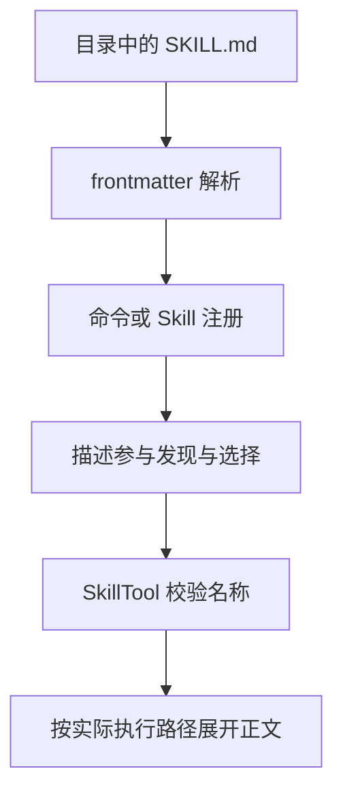

## Skill 是被读取、解析并参与运行的能力

@ccsrc skill-fields

`parseSkillFrontmatterFields` 不只提取名称和简介，还解析 allowed tools、用户/模型可调用性、模型、参数提示、Hook、effort、shell 与 fork context。每个字段都可能改变运行方式，所以 Skill 不只是一个长 prompt 文件。

字段存在也不保证所有分支启用；应继续看 createSkillCommand、加载来源和实际调用者。尤其要检查缺省值与非法值的处理，避免把字符串形式的 false 当成真。

## 模型调用 Skill 仍经过工具入口

@ccsrc skill-tool

`SkillTool` 校验名称、处理兼容的前导斜杠并在 command registry 中查找。特定远程发现分支受 feature 条件约束。只有找到可用命令后，才能谈正文怎样展开、参数怎样替换或是否在 fork 中执行。

运行入口和命令定义分开，让用户调用、模型调用与其他分发方式共享能力描述，但它们的授权条件仍要具体检查。不能因为名称相同就假定所有入口都跳过审批。

## 安装代码解读 Skill，也是一次能力接入

本工作区已配备 Understand Anything、JSON Canvas 与 Mermaid 图示指南。它们分别帮助组织调用邻域、编辑思维导图和选择图类型。安装文件只意味着方法可用，不能代替读源码和验证图里的每条边。

本课程工程地图采用“主题 → 实现入口”的边，不把概念分类冒充函数 calls。真正的调用关系必须在调用者中找到对应语句；功能开关和未验证分支要单独标识。

## 需要验证的边界

可用的 Skill 实验应分别观察 metadata 发现、正文读取、参数展开、权限变化和最终执行上下文。动态命令或 shell 内容还涉及当前目录与真实进程环境，不能用静态渲染替代执行证据。

## 一份 SKILL.md 是延迟加载的能力描述

把所有工作方法塞进 system prompt，会不断增加请求体。Skill 把“什么时候适用”的短描述与“如何完成”的长正文拆开：发现阶段维护元数据，真正调用时才展开具体方法。这里要读两条线，元数据解析是一条，SkillTool 查找与执行是一条。

## 逐个理解元数据，而不是只看 description

`user-invocable` 没写时默认 true；`disable-model-invocation` 控制另一条可调用性；model=inherit 被解析成 undefined，表达继承而非模型字面量；context 只有等于 fork 才成为 fork 执行上下文。allowed-tools、hooks、agent 和 argumentNames 又分别影响工具许可、生命周期、委派和参数。

这些字段并不都在解析函数里完成效果。解析函数只产生结构，必须继续找消费者。例如 parsed.allowedTools 怎样进入调用上下文？fork 由哪条路径启动？没有读消费者便说“写上这个字段就完成隔离”，会把配置语义与执行保证混在一起。

## 一个具体反例：看到了 Skill 名称，却调用失败

SkillTool 会 trim 名称，兼容前导斜杠，再到实际命令集合里查找。空白名称和未注册名称是不同错误。远程实验功能还有单独的 feature gate 与发现条件，不能用该分支解释普通本地 Skill。

假设你把目录名改了，描述仍留在旧缓存中。模型可能选择旧名字，工具层却查不到。这时应记录发现集合、注册集合和调用输入，找到两份视图分叉的位置。重写描述未必能解决身份不一致。

## 动手：做一个只分析、不修改的 Skill

以 normalizeSlug 的代码审阅为例：description 写清触发任务，正文要求先读实现和测试，再列出反例与修改建议。先不授予写入能力。分别从手动命令和模型选择两条入口观察是否可达，检查是否按需载入正文。

后半部分实验对照保留了自动选择、手动调用、权限拒绝等录制。你的验收不应是模型“说自己用了 Skill”，而应包含调用事件、实际展开的指令和后续工具行为。若要 fork，还要检查子任务身份与结果回传。

::: interview Skill 和普通提示模板的关键区别是什么？
具体实现可能让 Skill 参与发现、调用权限、工具授权、Hook 和子上下文执行，而模板主要提供文本组合。应依据该版本 loader 与执行入口解释能力，不能仅根据文件后缀或产品名称分类。
:::

@observation 09-skills
