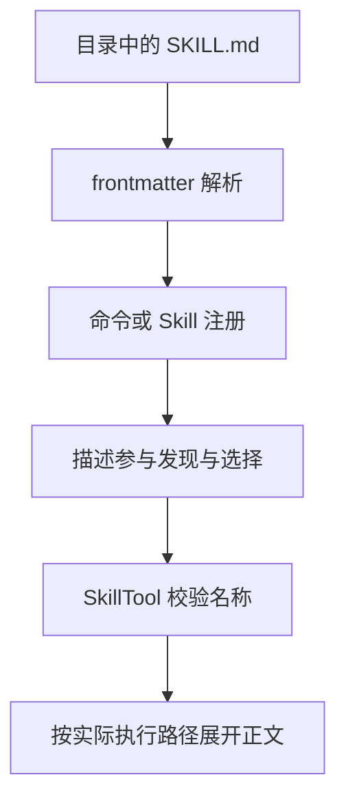

## 本章的问题

把全部团队方法放进系统提示，会让每个请求都携带大量无关内容。Skill 把选择所需的短描述和执行所需的长正文分开。本章先只暴露 name、description；调用 Skill 后再展开正文。

有一个重要区别：发现时可以读取文件以校验元数据，但不等于把正文都放进模型上下文。coda 的 descriptions 明确只返回两项；load 在调用时重新读取具体内容。

## 沿固定源码逐段拆解

@ccsrc skill-fields

### parseSkillFrontmatterFields 产生的是配置语义

description 可以来自显式字段或 Markdown 回退；user-invocable 缺省为 true；model=inherit 表示继承；context 仅在 fork 时进入对应枚举。allowed-tools、hooks、argumentNames、agent 和 effort 都由不同解析器处理。

解析函数并没有亲自运行子 Agent，也没有完成工具授权。解释一个字段，必须继续找消费者：谁使用 allowedTools，谁创建 fork，谁决定模型。把配置字段直接描述成隔离保证会跳过最关键的执行证据。

@ccsrc skill-tool

### SkillTool 从输入名称走到真实命令

先 trim，处理兼容前导斜杠，再查可用 commands。空名称和未注册名称会得到不同错误；远程 canonical 分支还需要内部 feature 和发现条件。存在一个目录，不表示当前命令集合已经发布它。

coda 的 frontmatter 是刻意有限的标量方言，支持逗号工具列表、fork 和可调用性字段，拒绝重复键。它不实现完整 YAML。allowedTools 在工具结果里提供语义信息，不偷偷扩大 gate 权限；真正只读的子任务在下一章收缩工具池。

## 机制总览



## 接入贯穿项目

@implementation 09-skills

### 逐步跟踪本章实现

Skills 构造时读取 frontmatter，只在 entries 保存 path、name、description。descriptions 可以把简短目录放进上下文，而正文留到 load 时再读；这把“知道有哪些能力”和“为本次任务加载说明”拆成了两个可观察动作。

parseSkill 明确限定为标量字段与逗号分隔的 allowed-tools。重复字段、重复名字和缺少必填元数据直接报错，不猜测 YAML 的隐式类型。load 允许去掉一个开头的斜杠，但未知名字仍失败，不让错误悄悄变成空技能。

allowedTools 与 fork 在返回值中是元数据。createCoda 的 Skill 工具只返回正文和这些信息，并没有据此自动提高权限或创建子任务；真正缩减工具目录在下一章实现。读者应能指出声明在哪一行被解析、又在哪个执行边界才可能生效。

## 运行本章实验

```bash
node --disable-warning=ExperimentalWarning labs/chapters/09-skills.mjs
```

@experiment 09-skills

## 逐项解释实验结果

实验比较 descriptions 与 load 的返回结构，检查前导斜杠、未知名称、允许工具和重复键。最终总装会让模型显式调用 verify Skill，并真实执行它要求的回归测试。

读到 Skill 正文不等于任务遵守了它。验收要同时看调用事件、展开内容和后续工具效果。

## 继续动手与验收

增加一个与目录名不同的 name，检查调用使用哪个身份。再在读取后修改正文，说明下一次 load 与已经捕获的描述视图可能怎样分叉，设计版本一致性的修复方案。

::: interview Skill 元数据解析为何不等于执行保证？
技能目录只提供 name 与 description，调用时才读取正文。allowed-tools 与 context: fork 是需要执行层消费的声明，解析到字段不代表权限已改变或子任务已创建；本课把这条边界明确展示出来。
:::

@observation 09-skills
