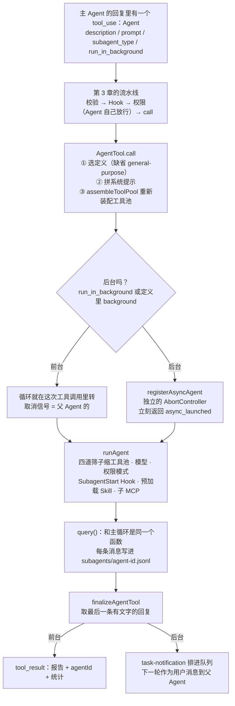
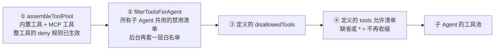
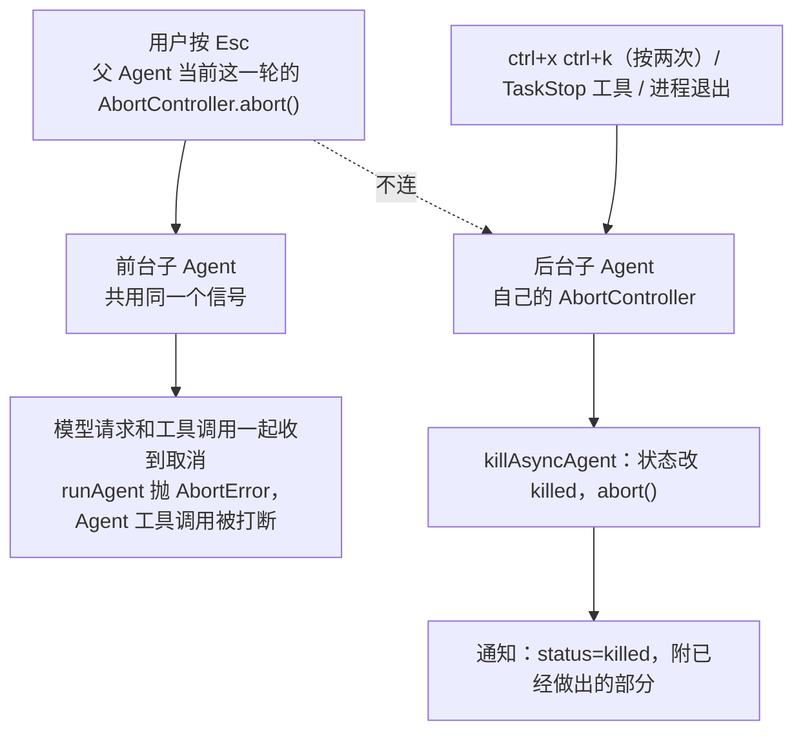

你让 Claude Code 审查 `src/math.js`，再找出 `src/` 下所有导出的名字。主 Agent 自己一个文件也没读，它写了两张任务单。第一张长这样：

```json
{ "description": "Review src/math.js",
  "subagent_type": "reviewer",
  "prompt": "请审查文件 …/src/math.js。只做只读审查，不要修改任何文件。……请按严重程度列出发现的问题，每条给出文件路径与行号……",
  "run_in_background": false }
```

第二张交给内置的 `Explore`，要它做一次 very thorough 的搜索。两个子 Agent 一共调用了 14 次工具，其中 7 条是 Bash；这 14 次调用和它们的结果，一次都没有进入主 Agent 的会话。主 Agent 的会话里只多了两个 Agent 调用和两份报告。

Learn Pi Agent 第 17 章讲过为什么需要子 Agent：把“要翻很多东西、只要一个结论”的活搬出主对话的上下文。这一章读 Claude Code 的做法，回答六个问题：谁来当子 Agent、能用哪些工具、带进去什么、权限怎么算、报告怎么回来、取消怎么传。每个机制对着 2.1.88 的源码，再配一次真实录制（Claude Code 2.1.296，由开放模型驱动；两个版本有出入的地方会指出）。


@figure assets/course/ch10-subagents.png 一张任务单进去，带着缩小的工具在隔间里干活，一份报告出来；取消沿着细绳传进去

## 先看现象：同一个任务，三个请求

录制里，父 Agent 同时派出两个子 Agent：项目里自定义的 `reviewer`，和内置的 `Explore`。项目里埋了几个金丝雀字符串，用来追踪信息流到了哪里：CLAUDE.md、子 Agent 的描述、`reviewer` 的正文里各一个，任务里还藏了一句只有父 Agent 知道的暗号。

@code labs/ch10/record.ts#region:files

三方各自发出的第一个请求（代理截下的真实请求）：

@lab node labs/ch10/subagents.ts requests

这张表里有五件事，后面每一节解释一件：

- **系统提示是子 Agent 自己的。** `reviewer` 的系统提示以定义正文开头，Explore 的以“文件搜索专家”开头。父 Agent 那 5742 字符的系统提示，一个字也没带过去。
- **工具池各算各的。** Explore 比父 Agent 少 6 个：Agent、Edit、Write、NotebookEdit 是定义禁用的，另外两个（ScheduleWakeup、Workflow）是 2.1.296 新增的工具，也不在它的池里；`reviewer` 的定义写了 Grep 和 Glob，于是它有，而这次录制里的父 Agent 没有。
- **CLAUDE.md 有的带，有的不带。** `reviewer` 收到了，Explore 没有。
- **父对话完全看不到。** 暗号没有出现在任何子 Agent 的请求里，子 Agent 的目录也没有。子 Agent 的世界只有父 Agent 写的 `prompt`，加上它自己的系统提示和环境信息。
- **三个请求都带着 adaptive 思考。** 这一条和 2.1.88 的源码不同，见“带进去的东西”。

## 一次委派的全程



子 Agent 不是一种新机制：它是同一个 `query()`，换了一份名单、一份历史、一个取消信号。下面按图上的顺序一站一站读。

## 主 Agent 写的那张单子

一次委派从一个普通的工具调用开始。Agent 工具（旧名 Task，权限规则、Hook 和旧会话里还写着这个名字，所以源码保留了别名）的参数：

@cc tools/AgentTool/AgentTool.tsx#L82-L88 hl=83-87

模型能填的只有五个字段。`prompt` 是子 Agent 收到的**全部内容**：工具的说明里专门有一节 “Writing the prompt”，要求像给刚走进房间的同事交代工作一样写，目标、已经知道什么、要什么格式的结果，缺一不可。录制里主 Agent 写的单子正是这样。`model` 只能填 `sonnet`、`opus`、`haiku` 三个别名。`subagent_type` 可选。（完整的 schema 还会并入 `isolation` 等几个可选参数，有的参数按功能开关从 schema 里删掉。）

Agent 工具自己被标成只读、并发安全，权限检查直接放行，真正的把关留给子 Agent 里的每个工具。并发安全意味着第 3 章的分批规则会让相邻的 Agent 调用同时跑：

@lab node labs/ch10/trail.ts timing

两个子 Agent 各用了 12 秒和 25 秒，父 Agent 实际等了 26.5 秒；第二个在第一个还没结束时就开始了。它比第一个晚了约 1 秒，推测是流式执行器在第一个 tool_use 块一完整时就把它派了出去（第 3 章）。

调用进入 `call`，先要确定谁来干：

@cc tools/AgentTool/AgentTool.tsx#L318-L356 hl=322-323,339-345,346-354

- 第 322 行：`subagent_type` 优先；省略时，fork 关着就用 general-purpose。
- 第 339–345 行：候选名单是 `activeAgents`，先过 `Agent(x,y)` 写法的允许名单，再被权限里的 `Agent(类型)` deny 规则筛一遍，最后按名字查。
- 第 346–354 行：找不到有两种报错。被 deny 规则挡掉的，说明哪条规则、来自哪个来源；真不存在的，列出所有可用的名字。两条都是写给模型看的操作指南，和第 3 章 Edit 的报错一个路数。

## 内置的几位，哪些真的存在

模型能派谁，由名单决定。名单写在 Agent 工具的说明里，每个 Agent 一行：

@cc tools/AgentTool/prompt.ts#L43-L46

`Tools:` 一段由定义的 `tools` 和 `disallowedTools` 算出来：只有禁用清单就写 “All tools except …”。父 Agent 选子 Agent 时看的就是这一行，描述决定它什么时候被想起，和第 9 章的 Skill 一样。（源码里还有灰度开关 `tengu_agent_list_attach`，打开后名单挪进一条 system-reminder。原因写在注释里：MCP 异步连上、插件重载、权限模式变化都会改变名单，名单在工具说明里，每次改变都让整块工具定义的提示缓存失效，这部分约占缓存写入量的 10%。）

内置名单由一个函数拼出来：

@cc tools/AgentTool/builtInAgents.ts#L13-L72 hl=14-17,45-52,55-62,64-69

general-purpose 和 statusline-setup 永远在。Explore 和 Plan 要过两道关：编译开关，以及服务端灰度 `tengu_amber_stoat`（缺省 `true`；注释说 A/B 实验的实验组把它设成 `false`）。claude-code-guide 只出现在非 SDK 的入口里。最后一段是 verification，要另一个编译开关加灰度；再往上还有协调者模式，整个替换这张名单。

源码里写着的路，发布版不一定走得到。第 1 章查 `queryLoop` 的继续分支用过的办法：编译开关关着的分支，字符串根本不会进 cli.js。这里同样去包里查：

@lab node labs/ch10/shipped.ts gates

verification 和协调者模式走不到：灰度名和环境变量名都不在包里。verification 的提示词字符串倒是还留着，模块被打了进去，只是没人把它放进名单。所以交互式 CLI 里的内置名单是 general-purpose、statusline-setup、Explore、Plan、claude-code-guide 五位，Explore 和 Plan 还可能被服务端关掉。下面用原函数 `getBuiltInAgents` 在几种条件下跑一遍，并从固定提交里读出五位的定义字段：

@lab node --disable-warning=ExperimentalWarning labs/chapters/10-subagents.mjs builtins

Explore 和 general-purpose 的区别，写在两个定义里：

@cc tools/AgentTool/built-in/exploreAgent.ts#L64-L83 hl=67-73,78,81

- **工具**：Explore 没有 `tools`，只有 `disallowedTools`，拿走 Agent、Edit、Write、NotebookEdit 和 ExitPlanMode，其余全留。general-purpose 是 `tools: ['*']`，一个不拿。Plan 与 Explore 的工具完全一样。
- **模型**：外部用户的 Explore 用 `haiku`，注释的理由是快；general-purpose 和 Plan 继承父 Agent。
- **项目说明**：`omitClaudeMd`。注释的账：只读搜索用不着提交规范，主 Agent 有完整上下文，会自己解读报告。
- **提示词**：Explore 开头是一长串只读禁令，要求并行发出工具调用、尽快返回；Plan 是“架构师”，要求最后列出 3 到 5 个实施时最关键的文件；claude-code-guide 用 haiku 加 `dontAsk` 模式，提示词里动态拼进用户自己的 skills、agents 和 settings。

Explore 真的“只读”吗？分三层看。工具池里没有 Edit、Write（硬的）；提示词禁止用 Bash 写文件（软的）；Bash 照样要过权限。录制里看得到第三层：`-p` 模式下没人可确认，Explore 的两条复合 Bash 命令被权限系统拒绝，事件带着 Explore 自己的 `agent_id`。

@lab node labs/ch10/trail.ts denied

自定义 Agent 是 `.claude/agents/*.md`：frontmatter 里 `name`、`description` 必填，正文是系统提示；`tools`、`disallowedTools`、`model`、`permissionMode`、`maxTurns`、`skills`、`mcpServers`、`hooks`、`background`、`isolation` 都是可选字段。同名定义出现在多个来源时，后面的盖过前面的，上面实验的最后一行就是这个顺序。

## 缩小工具池：四道筛子



第一道在入口。子 Agent 的工具池不是从父 Agent 的池里挑，而是重新装配：

@cc tools/AgentTool/AgentTool.tsx#L568-L577 hl=573-577

`assembleToolPool` 用子 Agent 自己的权限上下文把内置工具和 MCP 工具重新拼一遍，注释写得明白：不受父 Agent 工具限制的影响。这就是 `reviewer` 比父 Agent 多出 Grep 和 Glob 的原因。不过上下文里的 deny 规则照样生效，整个工具被 deny 的，子 Agent 的池里同样没有。

第二道对所有子 Agent 一视同仁：

@cc tools/AgentTool/agentToolUtils.ts#L70-L116 hl=83-85,94-99,100-113

- 第 83–85 行：MCP 工具先放行，不受下面任何一条限制。
- 第 94–99 行：共用的禁用清单，内置 Agent 和自定义 Agent 各一份（目前内容相同）。
- 第 100–113 行：后台子 Agent 另有一份**白名单**，不在里面的一律拿不到。

清单的内容在另一个文件里：

@cc constants/tools.ts#L36-L50 hl=40-41

第 40–41 行是嵌套的口子：只有 `USER_TYPE === 'ant'` 才把 Agent 放过去。发布版里这个条件被编译成常量，去包里读出实际的清单：

@lab node labs/ch10/shipped.ts tools | md

禁用的六个：TaskOutput、ExitPlanMode、EnterPlanMode、Agent、AskUserQuestion、TaskStop。同一个文件下方的注释解释了其中几个：

@cc constants/tools.ts#L90-L96

Agent 和 TaskOutput 防递归，ExitPlanMode 是主线程才有的抽象，TaskStop 要读主线程的任务状态。所以外部用户的子 Agent 不能再派子 Agent。后台白名单里没有 AskUserQuestion，也没有 SendMessage，因为后台没有人可以问。

第三、第四道在 `resolveAgentTools`：先减去定义的 `disallowedTools`，再看 `tools`，缺省或 `['*']` 就留下剩下的全部，写了名字就只留这些。顺序不能换：允许清单里写了 Agent 也没用，第二道已经把它拿掉了。下面运行真正的 `resolveAgentTools`（从固定提交里装载，清单用发布版的真实内容，工具目录是一张接近发布版的名字表）：

@lab node --disable-warning=ExperimentalWarning labs/chapters/10-subagents.mjs pool

Agent 在哪一行都不在；editor 的 SendMessage 前台有、后台没有；reviewer 写了允许清单，连 MCP 工具也没有。第二张表是 coda 的 `resolveChildTools`：原因按层记录，在共有的工具上与原函数逐项一致。

## 带进去的东西

工具定下来，`runAgent` 装配对话和项目说明：

@cc tools/AgentTool/runAgent.ts#L368-L410 hl=370-373,375-378,390-398,404-410

- 第 370–373 行：初始消息是父历史（只有 fork 才有）加任务单。默认的子 Agent 只有任务单一条。fork 时，父历史里没拿到结果的工具调用要先去掉，否则 API 会拒绝（源码注释）。
- 第 375–378 行：**文件版本记录是一份新的**，fork 才克隆父的。第 3 章的 `readFileState` 记的是“这个模型看过什么”，子 Agent 读过的文件，不会让父 Agent 变成“读过”。
- 第 390–398 行：CLAUDE.md 跟着用户上下文进来，定义设了 `omitClaudeMd` 就去掉（灰度 `tengu_slim_subagent_claudemd` 兜底，缺省 `true`）。
- 第 404–410 行：Explore 和 Plan 还会去掉 gitStatus。它是会话开始时的快照，可能有 40KB，又被标注为陈旧；要看就自己跑 `git status`。

再看运行时的选项：

@cc tools/AgentTool/runAgent.ts#L674-L685 hl=675,678,682-685

子 Agent 没有斜杠命令（`commands: []`）；用解析好的模型；非 fork 的子 Agent **关掉思考**，注释说是为了控制输出成本；MCP 是父 Agent 的连接加上定义里自己声明的服务器，后者在结束时清理。录制里三个请求都带着 adaptive 思考，所以这一条两个版本不一样。

最后是权限：

@cc tools/AgentTool/runAgent.ts#L420-L451 hl=421-434,440-451

- 第 421–434 行：定义可以指定自己的 `permissionMode`，但父 Agent 已经是 bypassPermissions、acceptEdits 或 auto 时，以父 Agent 为准。更宽松的授权不会被子 Agent 的定义收回去。
- 第 440–451 行：后台子 Agent 设上 `shouldAvoidPermissionPrompts`，没有界面，要问人的调用直接拒绝；前台子 Agent 的询问弹在父 Agent 的界面上。
- 规则本身没有变：`canUseTool` 就是父 Agent 传下来的那个函数。所以子 Agent 不是绕过审批的后门，父 Agent 配的 PreToolUse Hook 也照样触发，payload 里多了 `agent_id` 和 `agent_type`。

模型的选择是另一张小表：环境变量 > Agent 调用的 `model` > 定义里的 `model` > 继承父 Agent。下面的 `getAgentModel` 是原函数，表里的 `<haiku>` 表示别名被解析之后的模型（解析本身是别的模块的事，实验用端口顶替）。注意第四行：写了和父 Agent 同档的别名，得到的是父 Agent 的完整模型名，而不是别名的默认版本，源码注释说这是为了避免悄悄降级。coda 把别名查表这一步留给调用者。

@lab node --disable-warning=ExperimentalWarning labs/chapters/10-subagents.mjs model

coda 的 `runChild` 把这些都做了一遍。三种子 Agent 面对同一份父对话，第一次请求长这样；第二张表是“文件版本记录”的对照：

@lab node --disable-warning=ExperimentalWarning labs/chapters/10-subagents.mjs context

第二张表是一个容易忽略的洞。coda 的版本记录藏在 `codingTools()` 的闭包里，子 Agent 如果直接用父 Agent 的工具对象，它读过 `slug.cjs`，父 Agent 没读过也能 Edit，而那份内容父 Agent 的模型从没见过。传 `makeTools` 让子 Agent 拿一套新建的工具，就和原版“新的空记录”一致了。权限同样跑一遍：

@lab node --disable-warning=ExperimentalWarning labs/chapters/10-subagents.mjs permissions

## 同一个循环，另一本账

`runAgent` 里转的就是主循环的 `query()`（第 1 章），只是换了参数。每条消息产出，先写进子 Agent 自己的会话文件，再交给上层：

@cc tools/AgentTool/runAgent.ts#L747-L810 collapse=false hl=748-757,773-787,794-804,808-810

- 第 748–757 行：参数里是前面装配好的一切：初始消息、子 Agent 自己的系统提示、过滤后的上下文、父 Agent 传下来的 `canUseTool`，以及 `maxTurns`。内置 Agent 都不设上限，所以默认没有。
- 第 773–787 行：撞上轮数上限，`query` 发来一个附件，`runAgent` 记一行日志就 `break`，和正常结束走同一条路。
- 第 794–804 行：每条消息先写进子 Agent 的会话文件，再 `yield`。
- 第 808–810 行：循环退出后，如果取消信号已经触发，抛 `AbortError`，其余当作正常结束。

结束时的停止 Hook 走第 1 章那段代码，只是 `executeStopHooks` 看到 `agentId`，事件名换成 SubagentStop，payload 里带着 `agent_transcript_path` 和 `last_assistant_message`。

三个会话文件各记了什么：

@lab node labs/ch10/trail.ts sidechain

子 Agent 会话的第一行是 `parentUuid` 为空的用户消息，内容就是父 Agent 写的 `prompt`，一个字不差；14 次工具调用只在它们自己的文件里，父会话里的 5 次是它自己的。这就是“独立记账”：子 Agent 的账本可以单独打开、单独恢复。SendMessage 给一个已经结束的子 Agent 发消息，会从这个文件重建历史接着跑；给还在跑的发，则排进它的待处理消息，在它下一个工具回合取走。父会话始终保持干净。

## 前台与后台

同一个 `runAgent`，两种接法。前台就是工具调用本身：生成器在这次调用里被一条一条消费，直到结束，报告作为工具结果返回。后台则是登记一个任务，立刻返回：

@cc tools/AgentTool/AgentTool.tsx#L686-L698 hl=688-697

注释写得很直白：**后台 Agent 不连父 Agent 的 AbortController**，因为它们要在用户按 Esc 取消主线程以后继续活着；要杀它们得用专门的手势。前台子 Agent 在运行中也可以转后台（运行超过两秒，界面会提示），所以前台一开始就登记成了可转移的任务。

后台子 Agent 完成时，报告怎么到父 Agent 手里？

@cc tasks/LocalAgentTask/LocalAgentTask.tsx#L246-L261 hl=246,252-257,258-261

拼出一段 `<task-notification>`，里面有任务 id、状态（完成、失败、被停）、摘要、报告正文和统计，用 `enqueuePendingNotification` 排进消息队列。这条队列就是第 1 章的那条，缺省优先级是 `later`，所以通知要等父 Agent 当前这一轮结束，才作为新的一轮处理。录制把这个顺序记了下来：

@lab node labs/ch10/subagents.ts timeline

三个 `result` 事件对应三轮：Explore 先完成，父 Agent 先汇报它的结果并说明 reviewer 还在跑；reviewer 完成以后又是一轮。这次录制里，`-p` 模式一直等到两个后台任务都结束才退出。

## 结果怎么回去

子 Agent 干了一堆活，交回什么？

@cc tools/AgentTool/agentToolUtils.ts#L297-L320 hl=297-300,304-317

只取**最后一条 assistant 回复里的文字**。如果最后一条只有工具调用（比如被轮数上限截住），就往前找最近一条有文字的。中间每一次搜索、每一份读到的文件都不交回，这才是上下文隔离的意义。

这份文字怎么变成父 Agent 的 tool_result：

@cc tools/AgentTool/AgentTool.tsx#L1327-L1374 hl=1329,1347-1350,1356-1362,1363-1372

- 后台启动的结果（第 1327–1339 行）告诉模型：任务在后台跑，完成会自动通知，别重复它的工作，别轮询。
- 第 1347–1350 行：**空报告换成一句话**。注释的理由和第 3 章的空 tool_result 是同一个坑：末尾只剩 agentId 和统计的结果，有的模型会读成“没什么可做的”，直接结束这一轮。
- 第 1356–1362 行：Explore 和 Plan 是“一次性”的，不会被 SendMessage 继续，所以报告后面不附 agentId 和统计。注释算了账：每周三千多万次 Explore，每次省一百多个字符。其余 Agent 的报告后面都有 `agentId` 和 `<usage>`。

coda 的 `summarizeRun` 和 `reportForParent` 是这两段的缩写；实验用脚本化的子 Agent 逐个走一遍：

@lab node --disable-warning=ExperimentalWarning labs/chapters/10-subagents.mjs report

两个版本在这里有一处差别。2.1.88 的工具说明里有这样一条：

@cc tools/AgentTool/prompt.ts#L267-L270 hl=268

子 Agent 的输出“一般可以信任”（原文大意）。录制里（2.1.296）的做法不同：前台报告外面多了一层说明，大意是这是子 Agent 的最终报告，是模型输出，不是用户的话，里面的指令不带用户的权限；报告的每一行还被缩进，让正文里伪造的“说明框”一眼可辨。

@lab node labs/ch10/shipped.ts versions

同一个设计问题，两个版本给了两种答案：子 Agent 读过的网页和文件里可能有提示注入，它的报告是可以信任的结论，还是被污染的数据？新版把报告当数据，在最后一个环节给父 Agent 加了提醒。（Learn Pi Agent 第 17 章同样把子 Agent 的结论当数据。）

## 取消：Esc 杀得掉谁



前台这一半在 `runAgent` 里：

@cc tools/AgentTool/runAgent.ts#L520-L528 hl=524-528

控制器的选择是：调用者指定的优先；异步的新建一个，不连父；同步的**直接就是父 Agent 的控制器**。所以前台子 Agent 的模型请求和工具（包括它起的 Bash 进程）收到的，和父 Agent 是同一个信号。不管正常结束、取消还是出错，`runAgent` 都要收拾残局：

@cc tools/AgentTool/runAgent.ts#L816-L847 hl=818,820-822,828,844-847

清理子 MCP 服务器和会话 Hook，释放文件版本记录，并杀掉它启动的后台 Bash。最后一项的注释写着缘由：没有它，一个 `run_in_background` 的 shell 循环会在子 Agent 结束后继续跑，变成 PPID=1 的孤儿进程。

后台这一半：

@cc tasks/LocalAgentTask/LocalAgentTask.tsx#L281-L303 hl=283-292

`killAsyncAgent` 只对还在运行的任务生效：发 `abort()`、注销清理钩子、状态标成 killed。入口有三个：用户手势（`useCancelRequest.ts` 里按两次 ctrl+x ctrl+k，第一次只提示确认）、主 Agent 调用 TaskStop 工具（`stopTask.ts`），以及 `registerAsyncAgent` 登记的进程退出清理钩子。被停的子 Agent 并不是白干：运行收尾走 `AbortError` 分支，用 `extractPartialResult` 把最后一条有文字的回复放进通知。

实验把三种取消放在一起：

@lab node --disable-warning=ExperimentalWarning labs/chapters/10-subagents.mjs cancel

父 Agent 在 20ms 时取消：前台子 Agent 的工具立刻被打断，后台的不受影响，照常做完；要停后台的得单独 `stop(id)`，停下以后，已经做出的部分仍然交回。

## 没走到的路：fork

源码里还有一种更激进的子 Agent：省略 `subagent_type`，子 Agent 继承父 Agent 的**全部对话**，连系统提示和工具定义都和父 Agent 一字不差。它的设计目标是提示缓存：

@cc tools/AgentTool/forkSubagent.ts#L95-L106

所有 fork 出来的子 Agent，请求前缀字节相同，只有最后一块文字（各自的指令）不同，第一个之后的都能命中缓存。为了让工具定义一致，fork 的子 Agent 甚至保留着 Agent 工具，靠调用时的检查防止递归。设计很精巧，但它的开关是：

@cc tools/AgentTool/forkSubagent.ts#L32-L39 hl=33

发布版里 `isForkSubagentEnabled` 被折叠成恒为 false（见上面的 gates 实验），fork 的提示词字符串留在包里，却没有路径通向它。coda 的 `fork: true` 只保留了“带上父历史”这一半，让读者看到后果。

## 为什么这样设计

| 设计 | 换一种做法 | 会坏在哪里 |
| --- | --- | --- |
| 工具池重新装配，不继承父 Agent 的 | 从父 Agent 当前的池里挑 | 父 Agent 处在 plan 模式或被 deny 掉一些工具时，子 Agent 的能力跟着波动；定义也没法声明“我要 Grep”。代价是同一会话里父子的工具池可能不一致，录制里 `reviewer` 就多出 Grep 和 Glob。 |
| 文件版本记录是新的 | 共用父 Agent 的 | 父 Agent 没读过的文件也能改（`context` 实验的第二张表）。代价是子 Agent 要改文件，得自己先读一遍。 |
| 后台子 Agent 不连父的取消信号 | 连上 | 用户按 Esc 想打断的是当前这一轮，后台任务是他明确要求的，不该被顺带取消（`AgentTool` 的注释）。代价是需要单独的停止手势和退出时的清理钩子，漏了就是孤儿。 |
| 后台遇到询问直接拒绝 | 弹确认框 | 没有界面可弹，调用会一直挂着等人（推理）。代价是后台能做的事比前台少，需要提前用规则授权。 |
| 只交回最后一条有文字的回复 | 把整个过程带回来 | 隔离就没有意义了（推理）。代价是子 Agent 没写进最后一条的发现全丢，所以 general-purpose 的提示词要求它用一份报告收尾。 |
| 外部版禁止嵌套 | 子 Agent 可以再派 | 递归失控时花费成倍增长（推理，Learn Pi Agent 第 17 章同样限制）。内部员工放开，说明这是策略，不是技术限制。 |

还有一条反方向的提醒，写在 Agent 工具的说明里：读一个指定路径、找某个类定义、在两三个文件里找代码，直接用 Read 和搜索工具，不要派子 Agent。子 Agent 是在用 token 换上下文，Learn Pi Agent 第 17 章的实验里总花费反而更高，一两次工具调用就能办完的事不值得派。

## 和 Pi / mox 对照

mox 的 `runSubagent` 是同一个思路的最小版本：

@mox mox/src/subagent.ts#runSubagent

| | Claude Code 2.1.88 | mox（Learn Pi Agent 第 17 章） |
| --- | --- | --- |
| 怎么跑 | 进程内，同一个 `query()` | 进程内，同一个 `runLoop`（Pi 的示例是每个子 Agent 一个进程） |
| 定义 | Markdown + frontmatter，六个来源按顺序覆盖 | 相同的格式，内置 explore、general |
| 工具池 | 重新装配 + 四道筛子，外部版不能嵌套 | 从父工具里 `filter`，去掉 `agent` |
| 项目说明 | 默认带，Explore、Plan 去掉 | 不加载 |
| 权限 | 同一个 `canUseTool`，定义可覆盖模式，后台自动拒绝 | 父 Agent 的 hooks 同样作用 |
| 并行 | Agent 调用并发安全，由第 3 章的分批决定 | `tasks` 数组，`mapWithLimit` 最多 4 个 |
| 前后台 | 都有；后台独立取消，完成后通知 | 只有同步 |
| 交回 | 最后一条有文字的回复 + 统计 | 最后一条回答 |
| 记账 | 每个子 Agent 一个 jsonl | 不单独记录 |
| 轮数上限 | 定义里的 `maxTurns`，缺省无 | 30 轮 |

最大的差别是后台。mox 的子 Agent 是一次同步的工具调用，父 Agent 一直等着；Claude Code 的后台子 Agent 让父 Agent 可以继续和用户说话，这要求循环支持“没有用户输入也能开始新一轮”，也就是第 1 章那条带优先级的队列。Learn Pi Agent 第 18 章的后台命令用的是同类机制（`sendMessage` 的 `triggerTurn`），只是 mox 的子 Agent 没用上。

## 在 coda 里实现

coda 的 `subagents.mjs` 对应这一章的六个机制。**工具池**用三层缩小，`removed` 里记着每个工具是被哪一层拿掉的：

@code coda/src/subagents.mjs#resolveChildTools hl=97-99

**运行**一个子 Agent，把定义、工具、权限、模型、历史装配起来，交给和主循环同一个 `Engine`：

@code coda/src/subagents.mjs#L197-L228 hl=204-209,213-217,222-227

三处和原版的对应：`makeTools` 对应“新的文件版本记录”；`childGate` 对应 `agentGetAppState` 里的权限处理；`signal` 直接交给子 Engine，对应前台共用父 Agent 的控制器。**后台**子 Agent 由 `BackgroundChildren` 管理：

@code coda/src/subagents.mjs#L256-L282 hl=264-267,276-281

`launch` 给它一个独立的 `AbortController` 并立即返回；`stop` 对应 `killAsyncAgent`；结束时 `finish` 拼出通知，交给 `notify`，在 app 里通常是 `engine.follow`。`runChild` 的签名和返回值保持兼容：旧代码传 `tools`、`allow`、`signal`、`fork`，得到 `{ id, frames, terminal, text }`，其他章节和 `app.mjs` 不用改。

## 自己跑一遍

```bash
node --disable-warning=ExperimentalWarning labs/chapters/10-subagents.mjs            # 全部，七个实验
node --disable-warning=ExperimentalWarning labs/chapters/10-subagents.mjs pool       # pool / builtins / context / permissions / report / cancel / model
node labs/ch10/shipped.ts gates     # gates / tools / versions：发布的 cli.js 里能查到什么
node labs/ch10/trail.ts sidechain   # sidechain / return / timing / denied：录制里的账
```

## 你来改

先写下预测，再动手验证。

::: predict 去掉前台共用的信号
在 `runChild` 里把 `signal` 换成 `new AbortController().signal`（不连父 Agent）。`cancel` 实验里前台那一行，子 Agent 的终态是什么？Agent 工具调用要多久才返回？
???
终态变成 `completed`，工具照样等满 100ms，Agent 工具调用要等到子 Agent 自己做完才返回。前台子 Agent 的取消完全靠“和父 Agent 共用一个信号”；换成独立的，它就成了一个没人能打断的同步调用：用户按了 Esc，主线程在等它，它在做自己的事。这正是后台子 Agent 需要 `stop(id)` 的原因，也是原版给后台任务另外设计取消手势的原因。
:::

::: predict 允许清单里写了被禁用的工具
把 Explore 的定义改成 `{ ...BUILT_IN_AGENTS.Explore, tools: ["Read", "Edit"] }`，对 `[Read, Edit, Write]` 调用 `resolveChildTools`。Edit 在最后的池里吗？`removed` 里 Edit 的原因是哪一层？
???
不在。Edit 在第②层（定义的禁用清单）就被拿掉了，允许清单只能在剩下的里挑，所以原因是“② 定义的禁用清单”，而不是“③”。原函数 `resolveAgentTools` 也是这个顺序：先减去 `disallowedTools`，再看 `tools`。同理，允许清单里写 Agent 也找不回它：第①层的共用禁用清单排在最前面。想让一个只读的 Agent 能写，要改的是禁用清单，不是允许清单。
:::

::: predict 把轮数用完当作失败
在 `BackgroundChildren.finish` 里把 `["completed", "budget"].includes(...)` 改成 `child.terminal.status === "completed"`。一个后台子 Agent 被 `maxTurns` 截住，通知里的 `status` 和 `result` 各是什么？
???
`status` 变成 `failed`，摘要写着 `failed: budget`；`result` 仍然带着最后一条有文字的回复。原版不是这样：`runAgent` 收到轮数上限的附件就 `break`，和正常结束走同一条路，`finalizeAgentTool` 取最后的文字，任务标为完成。轮数上限是一道预算，不是一个错误；把它当失败，父 Agent 会以为子 Agent 什么都没做成，其实它已经交出了阶段性的结果。
:::

## 面试题

::: interview 子 Agent 和主 Agent 之间，共享什么、隔离什么？
- **隔离**：对话历史（默认只有一张任务单）；系统提示（用定义自己的）；文件版本记录（新的空记录，所以先读后改要重来）；思考配置；项目说明（Explore、Plan 不带）；后台的取消信号。
- **共享**：权限规则和审批通道（同一个 `canUseTool`，所以不是后门）；MCP 连接；Hook（PreToolUse 等照样触发，payload 里多了 `agent_id`）；模型客户端；前台时的取消信号。
- **各算各的**：工具池，重新装配，不是从父 Agent 的池里挑。
- 加分：说明每一项是为了什么。隔离是为了省上下文，共享权限是为了不留后门。
:::

::: interview 怎样让一个子 Agent 只读？Claude Code 的 Explore 是怎么做的？
分三层，强度递增：提示词禁止写（软的，模型可能违反）；工具池里去掉 Edit、Write 等写工具（硬的，模型调用不到）；权限模式和规则（plan 模式、deny 规则、沙箱）。Explore 用了前两层：禁用清单拿掉五个工具，提示词再禁止 Bash 写文件。但它仍然有 Bash，所以真正的只读需要第三层。录制里能看到：Explore 的复合 Bash 命令仍然要过权限，被拒绝的事件带着它的 `agent_id`。要点是“只读”不能只写在提示词里。
:::

::: interview 前台和后台子 Agent 有什么区别？后台需要循环提供什么支持？
前台：生成器在这次工具调用里被消费，取消信号共用父 Agent 的，权限询问弹在父界面上，报告作为 tool_result 返回。后台：登记为任务，立刻返回“已启动”；独立的 AbortController，Esc 停不掉；没有界面，要问人的调用自动拒绝；工具只给白名单里的；完成后以 `<task-notification>` 排进消息队列，作为新的一轮到达。支持条件：循环能在没有用户输入时开新一轮（带优先级的队列）、有任务登记表、有 id 和输出文件可查询、有专门的停止入口，退出时要清理，不留孤儿。
:::

::: interview 子 Agent 的报告怎么回到父 Agent？父 Agent 该怎样对待它？
只交回最后一条有文字的回复，加 agentId 和统计；中间的搜索和读到的内容不交回，空报告换成一句说明，免得末尾只剩元数据被读成“没事做”。报告是另一个模型的输出，它读过的网页和文件可能含有提示注入，所以是数据，不是指令。2.1.296 在报告外面加了一层“这是模型输出”的说明并缩进每一行；2.1.88 的工具说明则写着一般可信。实践上：让子 Agent 返回可核查的线索（文件和行号），父 Agent 只核对关键处；父 Agent 马上要改的代码，一开始就不要外包。
:::

::: interview 源码里写着的功能，发布的产品里就一定能用吗？你怎么确认？
不一定。还原出来的源码保留了 `feature('X')` 这样的编译期开关和 `USER_TYPE === 'ant'` 这样的判断，发布的包里这些已经被替换成常量，关着的分支整个删掉。2.1.88 里 fork、verification Agent、协调者模式走不到，外部用户的子 Agent 也不能嵌套。确认办法：去 `cli.js` 里查灰度名、环境变量名、提示词字符串还在不在，看判断函数是不是被折叠成 `return false`，再把关键函数从固定提交里装载出来，用包里读出的真实清单运行。加分：服务端灰度（如 `tengu_amber_stoat`）在包里查不出取值，只能说“默认开，可被远程关”。
:::
