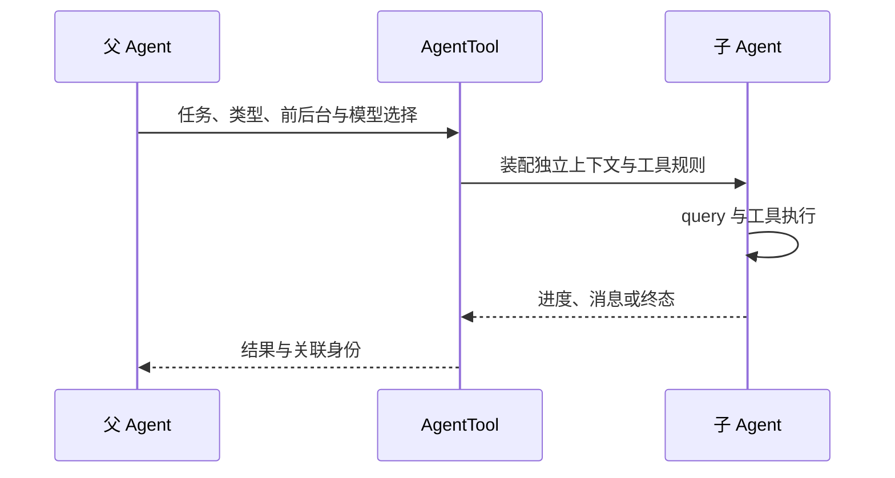

## 子 Agent 有自己的执行配置

@ccsrc agent-schema

AgentTool 的输入契约包括任务、Agent 类型、模型和前后台设置；隔离、工作目录与某些多 Agent 参数又受 schema 分支和 feature 条件限制。不要从一份包含所有字段的类型定义推断外部产品一定暴露全部参数。

## 委派的核心是重新装配执行上下文

@ccsrc agent-run

`runAgent` 接收 Agent definition、prompt messages、权限函数、工具池、query source、模型与取消覆盖等。它随后进入共享查询机制。这说明子 Agent 可以复用内核，同时拥有独立上下文和宿主约束。

工具池、允许规则与父任务可见工具并不天然相同；源码注释明确区分 worker 自己的工具池与父任务限制。研究权限继承时，应检查这些参数最终如何组合，而不是只看父任务曾经获得什么授权。

## 前台、后台与通知的生命周期

前台调用需要在当前工具调用中等待报告；后台任务需要持有状态、输出和完成通知。用户看到报告之前，还可能经历任务结算与结果交付。取消父任务是否取消子任务，也应沿 AbortController 和任务服务检查。

`forkContextMessages`、exact tools、模型和 system prompt 选择影响子请求的缓存前缀。复制整段历史简单但成本高，重建任务摘要成本小却可能遗漏约束；具体选择要以实际分支为准。

## 委派不应扩大结论

看到一个 AgentTool schema，不足以证明完整 swarm、远程执行或所有隔离方式已发布。需要入口可达性、功能条件和运行证据。下方后续版本实验只证明录制时前后台请求的形状，不替代本基准的生命周期分析。

## 为什么需要新的上下文，而不只是新的提示词

主 Agent 调研整个代码库时，搜索结果会挤占主任务上下文。子 Agent 把局部探索放进另一条消息历史，最后交回精炼结果。代价是需要重新装配工具、模型、权限、取消和转录，调度器也要负责结果交接。

`runAgent` 的参数表已经给出重要职责边界：promptMessages 是任务材料，availableTools 是工作者自己的工具池，allowedTools 是允许规则，override 可以提供 agentId、systemPrompt 和 abortController。工具“存在”和工具“获准执行”是两层检查，不能只看工具池长度。

## 前台、后台与工作区隔离是不同维度

前后台决定父调用是否等待以及如何通知；forkContext 决定带入哪些历史；worktree 决定文件修改发生在哪个工作区。子 Agent 即使拥有独立消息历史，也可能仍在同一个目录改文件。反过来，新 worktree 隔离了文件修改，却没有自动解决凭据、网络和权限问题。

源码 schema 把模型覆盖、后台标记、Agent 类型与隔离参数分别表达，还会按功能开关调整模型可见字段。只看完整类型定义，会误以为所有发行环境都向模型提供同样参数。

## 一个容易漏掉的状态 owner

`runAgent` 特别区分 rootSetAppState 与当前 context 的 setter：嵌套异步 Agent 的局部 setter 可能不承担全局任务更新，session 级 Hook 或 Bash 任务要走真正的共享 owner。它说明“把 context 传下去”不是充分设计；要知道其中每个函数修改的是哪份状态。

排查后台任务已结束但父界面没有通知时，沿 agentId、任务注册、终态发布和通知消费追踪；不要只增加一个 `console.log('done')`。取消也应检查信号传给了谁，以及进度停止之后工具资源是否仍然存活。

## 练习：为只读探索定义验收条件

让子任务只负责找 normalizeSlug 的实现与测试，不做修改。预期结果应包含文件位置、反例和可信度；父 Agent 再决定编辑。验收检查：工具许可真的只读，父任务不被大段搜索结果淹没，取消时子任务能结束，后台完成只通知一次。

本章后半部分用独立版本前后台录制比较实际现象。把你的推导与录制对照，并明确哪些关于源码版本的机制仍需集成运行验证。

::: interview 子 Agent 复用同一个 query，为什么仍需要单独的 runAgent 层？
共享 query 处理模型工具循环；runAgent 负责子任务的模型、上下文、工具池、权限、身份、取消与报告生命周期。两者职责不同。验证委派时既要检查子任务内部执行，也要检查父任务怎样接收结果和失败。
:::

@observation 10-subagents
