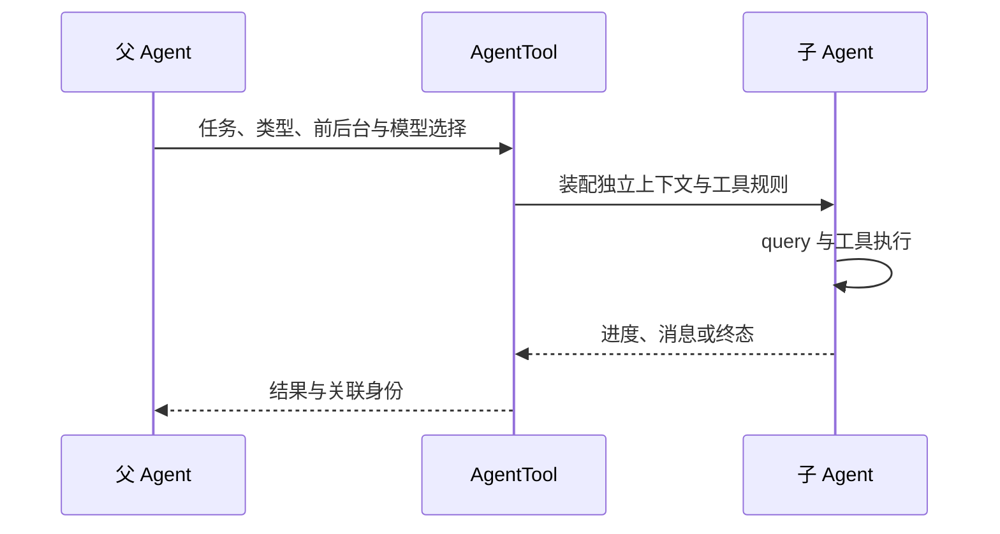

## 本章的问题

主 Agent 需要先找出 slug 的实现与测试。若把全部搜索结果留在主历史里，成本和干扰都会上升。一个只读探索子任务应该得到足够的工具，返回简明发现，并保有自己的历史身份。

“请只读”写在提示里不够。本章先收缩实际工具目录，再构造子 Agent 的请求；Edit 根本没有进入其可用工具池。子任务默认不复制父历史，fork 则是显式选择。

## 沿固定源码逐段拆解

@ccsrc agent-schema

### schema 将模型、前后台和隔离分开表达

AgentTool 的基础输入包含 prompt、类型、模型覆盖和后台标志；完整 schema 再合并多 Agent 与 isolation 字段，部分字段会随 feature 被移除。完整 TypeScript 类型不等于每个发行环境都暴露全部选项。

@ccsrc agent-run

### runAgent 的参数说明了哪些状态需要重新装配

promptMessages、forkContextMessages、availableTools、allowedTools、model 和 override 分别承载材料、工具池、规则与身份。源码注释特别说明允许规则的替换，避免父任务已经允许的效果泄漏给工作者。

rootSetAppState 处理嵌套异步任务的全局更新，局部 context setter 未必能写共享任务状态。这提醒我们：context 是一组不同 owner 的接口，不是一份随便复制的字典。

### 三种隔离不能混成一种

消息上下文隔离控制模型看到什么；工具收缩控制能够请求什么；工作区与系统沙箱控制效果发生在哪里。coda 子任务仍共享物理工作区，但只读目录真实收缩。它没有伪称创建了 worktree。

子 AbortController 连接父信号，finally 移除监听，确保运行结束后没有悬挂的取消订阅。

## 机制总览



## 接入贯穿项目

@implementation 10-subagents

### 逐步跟踪本章实现

子任务入口先创建自己的 controller 与 id，再把父 signal 的 abort 转发过去；任务结束后在 finally 移除父监听。新 Engine 有独立的 running、队列和消息数组。fork=true 选择复制父历史，false 从空历史开始，两种路径都不直接共享父消息数组。

selected 在构造 Toolset 和 buildRequest 之前过滤工具。父任务即使拥有 Edit，默认子任务目录仍只有 Read；模型生成 Edit 意图时会得到 unknown tool，不能靠改写提示取回被删的工具。这个边界比“请你只读”的一段自然语言更容易验证。

返回报告包含 child id、frames、terminal 与文本。调用者必须检查 terminal，不能因为收到了几段文字就报告成功。这里共享同一物理工作区和进程，工具缩减与历史隔离并不等于文件系统快照；需要隔离工作副本时还要引入 worktree 或沙箱。

## 运行本章实验

```bash
node --disable-warning=ExperimentalWarning labs/chapters/10-subagents.mjs
```

@experiment 10-subagents

## 逐项解释实验结果

子任务真实读取文件，尝试 Edit 时得到 unknown tool；父消息没有进入其默认历史，原文件没有改变。随后用已取消父信号启动子任务，确认它不会正常完成。

最终总装会把这个子任务作为 Agent 工具交给主循环；它仍然要经过父任务的工具授权。

## 继续动手与验收

增加 fork=true，比较首个 request 的历史；随后设计一个临时 worktree 端口，说明消息隔离与文件隔离的差别。验收要检查实际目录与可用工具，不只看 Agent 名称。

::: interview 上下文隔离、工具收缩和工作区隔离有何不同？
新 Engine 隔离循环状态与消息数组，实际过滤工具目录限制可执行能力；父 signal 负责取消传播。它仍共享物理工作区，不自动拥有进程或文件系统隔离。实验要让子任务真的提出禁用工具，才能验证目录缩减。
:::

@observation 10-subagents
