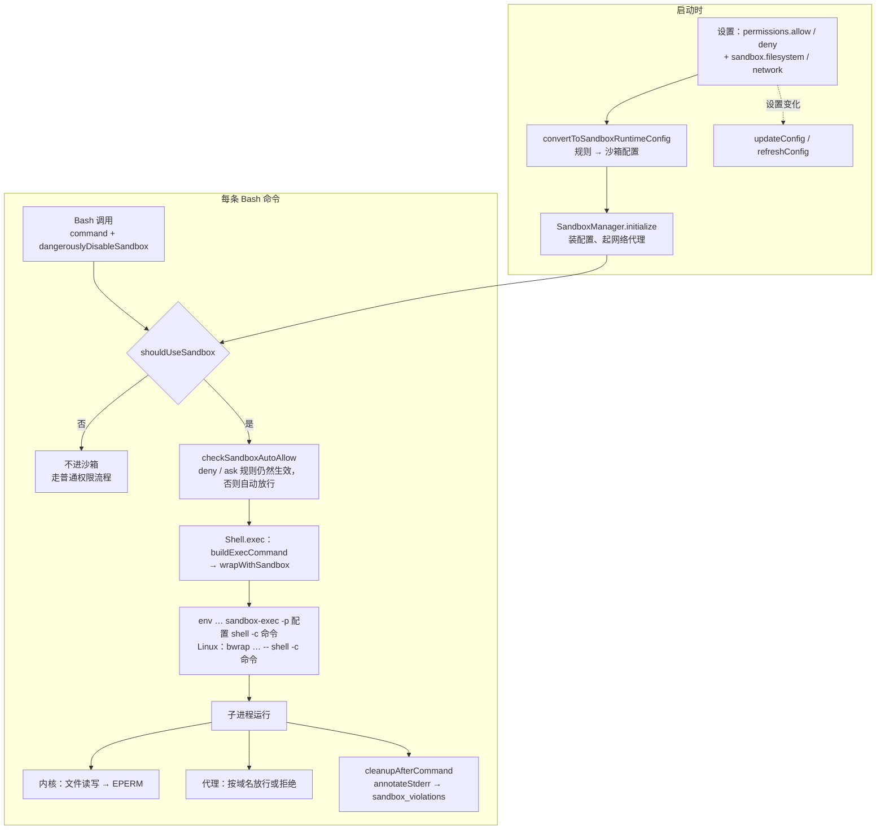
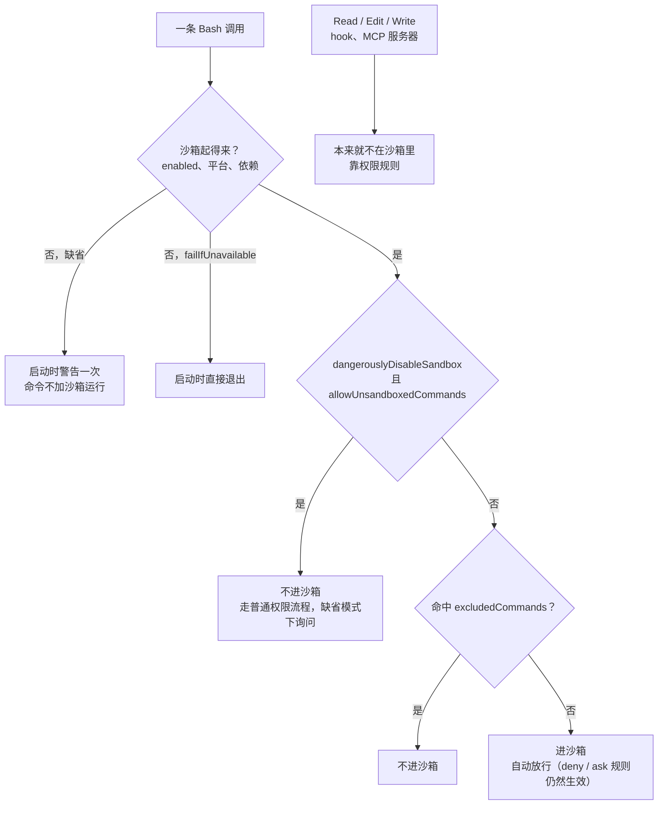

第 7 章末尾留下一个洞。项目里写了 `deny: ["Read(./.env)"]`，Read 工具和 `cat .env` 都被拦下，`python3 -c "print(open('.env').read())"` 却读到了 `DB_PASSWORD=hunter2`：

@lab node labs/ch07/scenario.ts envrule

规则看的是命令的文本。那行 Python 里没有 `cat`，也没有 `Read`，规则认不出它。要挡住它，限制必须加在更低的一层：不管进程是谁、命令怎么写，只要它去打开 `.env`，操作系统就拒绝。这就是 Claude Code 的沙箱。同样那行 Python，在沙箱里得到的是 `PermissionError: [Errno 1] Operation not permitted`，拦下它的是 macOS 内核，不是 Claude Code 的任何一行代码。

这一章追着这件事走完全程：规则怎样被翻译成沙箱配置；Bash 命令怎样被包进 seatbelt 或 bubblewrap；网络怎样用本地代理按域名放行；沙箱里的命令为什么不再逐条询问；什么时候这堵墙会被绕过。最后是 coda 的 `runtime/sandbox.mjs`，以及一组“同一个动作，不进沙箱和进沙箱各做一遍”的对照实验。

录制用的是 Claude Code 2.1.296，由一个开放模型驱动；源码摘录来自 2.1.88；沙箱本体 sandbox-runtime 的摘录来自 v0.0.79（Apache-2.0）。2.1.88 捆绑的 sandbox-runtime 具体是哪一版，从外部看不出来；适配层调用的 `wrapWithSandbox`、`getFsWriteConfig` 等接口在 v0.0.79 里都还在，下面讲的是这一层结构。


@figure assets/course/ch11-sandbox.png 规则被翻译成配置，命令在玻璃箱里运行：工作区能写，网络只开一扇门

## 先看现象：打开沙箱后的八条命令

设置只有三项：打开沙箱；禁止读两个文件（项目外的一个“机密”和项目里的 `.env`）；网络只放行 `example.com`。

@code labs/ch11/record.ts#region:settings

让模型按顺序运行八条命令，权限模式是手动（`default`）：

@code labs/ch11/record.ts#region:steps

@lab node labs/ch11/sandbox.ts steps

几件事值得先抓住：

- **第 1、2 行**：写项目里的文件可以，写项目外的不行。报错里的 `(eval):1:` 是 shell 的 `eval` 在报告写文件失败——后面会看到，命令是被 `eval` 包着运行的。
- **第 3 行**：项目目录明明可写，`.git/hooks/pre-commit` 却写不进去。设置里没写这一条，是谁决定的？
- **第 4、5 行**：Python 读不了被禁止的文件，第 7 章的洞堵上了。但这两个文件是设置里点名的：读是“默认整台机器可读，列出来的才禁止”。
- **第 6—8 行**：网络经过本机上的一个代理，`example.com` 返回 200，`example.org` 被拒绝，错误信息里多了一段 `<sandbox_violations>`。
- **八条命令一条都没有问用户。** 第 6 章里同样的手动模式，`mkdir` 这样的命令都要问（只有 acceptEdits 才放行）。

先看全程地图，后面每一节讲其中一站：



## 权限规则怎样变成沙箱配置

`utils/sandbox/sandbox-adapter.ts` 是 Claude Code 和 sandbox-runtime 之间的一层薄翻译：它自己不隔离任何东西，只回答一个问题——用户的设置和权限规则，对应沙箱该限制什么。入口是 `convertToSandboxRuntimeConfig`，产出的配置有两块：`network`（允许和拒绝的域名）和 `filesystem`（`allowWrite`、`denyWrite`、`denyRead`、`allowRead`）。它很长，分三段读。

### 域名来自 WebFetch 规则

@cc utils/sandbox/sandbox-adapter.ts#L177-L228 hl=182,191-195,201-209,212-220,225

- 允许的域名有两个来源：`sandbox.network.allowedDomains`，以及 `WebFetch(domain:github.com)` 这样的 allow 规则（第 191–195、201–209 行）。拒绝的域名只看 WebFetch 的 deny 规则（212–220 行）。**一条规则，两处执行**：同一条 `WebFetch(domain:github.com)`，既决定 WebFetch 工具能不能访问它，也决定沙箱里的 `curl` 能不能访问它。
- 第 182 行：管理员写在托管策略里的 `allowManagedDomainsOnly` 打开后，只认托管配置里的域名，用户和项目自己写的全部忽略。拒绝名单不受这个开关影响，仍从所有来源合并。
- 第 225 行：`allowWrite` 的起点永远是 `.`（启动目录）加上 Claude 自己的临时目录。注释说临时目录是给 shell 记录工作目录用的。

### 适配层自己加的禁写路径

@cc utils/sandbox/sandbox-adapter.ts#L230-L288 hl=235-236,242-245,252,257-266,268-279

这一段不看任何规则，无条件往 `denyWrite` 里加东西：

- **所有来源的 `settings.json` 和托管配置目录**（235–236 行）。沙箱里的命令如果能改设置，下一次读配置时就能把牢笼打开，所以牢笼自己的配置必须在牢笼之外。启动之后用户 `cd` 到别处，那里的 `.claude/settings*.json` 也一并加入（242–245 行）。
- **`.claude/skills`**（252 行）。注释说 sandbox-runtime 自己保护了 `.claude/commands` 和 `.claude/agents`，没有保护 skills；而 skill 会被自动发现、以完整权限加载（第 9 章），保护级别应该一样，于是适配层补上。
- **裸仓库文件**（257–280 行），最值得细读。git 会把含有 `HEAD`、`objects/`、`refs/` 的目录当成裸仓库。攻击者在项目根目录造出这几样，再放一个 `core.fsmonitor` 指向任意程序的 config，**Claude Code 自己在沙箱外运行的 git** 一碰到它就执行了。沙箱挡得住命令写 `.git/hooks`，挡不住命令“造一个假仓库”。对策分两种：文件已经存在，就放进 `denyWrite`，原地只读；还不存在，直接 deny 会让沙箱在宿主上留下 0 字节的占位文件，还会让 bwrap 里的 `git log HEAD` 失败，所以改为记进 `bareGitRepoScrubPaths`，每条命令结束后由 `scrubBareGitRepoFiles` 删掉。

最后一点是沙箱边界在时间上的延伸：沙箱里的命令写下的东西，之后会被沙箱外的程序读到、执行、信任。受保护路径的清单、裸仓库的清理，都是同一个问题在不同位置的答案。

### Edit 和 Read 规则变成路径

@cc utils/sandbox/sandbox-adapter.ts#L295-L349 hl=299,304,311-314,320-325,332-347

- 第 295–299 行：`--add-dir` 和 `/add-dir` 加进来的目录进入 `allowWrite`。注释的理由是：文件工具在应用层检查权限，不受沙箱影响；Bash 命令跑在沙箱里，目录不在 `allowWrite` 里就进不去。
- 第 304 行：**按来源逐个遍历**配置，因为同一种路径写法在不同来源里指向不同的地方（见下）。Edit 的 allow 规则 → `allowWrite`（311–314），Edit 的 deny 规则 → `denyWrite`（320–322），Read 的 deny 规则 → `denyRead`（323–325）。Bash 规则一条也不翻译：它们管“这条命令能不能跑”，沙箱管“进程能碰什么”，本来就不是一件事。
- 第 332–347 行：`sandbox.filesystem` 里的 `allowWrite`、`denyWrite`、`denyRead`、`allowRead` 与规则**合并**，不是替换。

路径有两套写法。权限规则里（`resolvePathPatternForSandbox`）：`//path` 是从文件系统根开始的绝对路径，`/path` 相对于**配置文件所在的目录**。`sandbox.filesystem` 里（`resolveSandboxFilesystemPath`）：`/path` 就是绝对路径。源码注释记着缘由：有用户把 `/Users/foo/.cargo` 写进 `allowWrite`，被当成相对路径，配置悄悄不生效，于是 `sandbox.filesystem` 单独走了一套。

下面的实验把真正的 `convertToSandboxRuntimeConfig` 从固定提交里取出来运行（设置的读取、临时目录这些外围换成夹具），一条规则一条规则地加，看配置里多了什么；右边是 coda 的 `sandboxPolicy` 对同一条规则的翻译：

@lab node --disable-warning=ExperimentalWarning labs/chapters/11-sandbox.mjs config

- 第一张表是**没有任何规则**时的配置：适配层仍然禁写所有 `settings.json`、托管目录和 `.claude/skills`，网络域名是空的，整个网络都不通。
- `Read(./.env)` → `denyRead`。这就是第 7 章那个洞的答案：同一条规则，在 Read 工具里是文本匹配，翻译之后，每个 Bash 子进程都被内核挡在门外，不管它用什么语言去读。
- `Bash(rm *)` 没有任何变化。沙箱配置里不存在“命令文本”，所以换写法没有用。
- 第 2、3 行：`/docs/**` 被解析成项目目录下的 `docs`，`//etc/hosts` 才是绝对路径。第 9、10 行：同一个 `/Users/me/.cargo`，写进权限规则变成了 `<项目>/Users/me/.cargo`，写进 `sandbox.filesystem` 才是它本人。

规则和设置变了怎么办？适配层在 `initialize` 里订阅设置变化，每次重新翻译再 `updateConfig`；用户在权限弹窗里选了“总是允许”、或者执行 `/add-dir` 之后，还会同步调用一次 `refreshConfig`（REPL 和 `add-dir` 的调用点），免得下一条命令抢在配置更新之前运行。

## 一条 Bash 命令怎样进沙箱

### 第一关：这条命令要不要进

@cc tools/BashTool/shouldUseSandbox.ts#shouldUseSandbox hl=131-133,136-141,143-145,148-150

四个出口，按顺序检查，任何一个出口都意味着“不进沙箱”：

1. `SandboxManager.isSandboxingEnabled()` 为假。这个函数不只看 `sandbox.enabled`，还看平台支持、依赖是否装全、是否在 `enabledPlatforms` 里（适配层第 532–547 行）。
2. 模型带了 `dangerouslyDisableSandbox`，**并且**策略允许（`allowUnsandboxedCommands`，缺省 `true`）。策略禁止时这个参数被完全忽略。
3. 没有命令。
4. 命令命中了 `sandbox.excludedCommands`。

第 4 条的匹配（`containsExcludedCommand`）：先用 `splitCommand_DEPRECATED` 拆开复合命令（这是 shell-quote 的旧路径，和第 6 章说的 Bash 权限判断走的是同一条，tree-sitter 在 2.1.88 的发布版里只在影子模式运行），再对每个子命令逐层剥掉开头的环境变量和 `timeout` 这类包装，比较前缀、精确或通配符。`LD_*`、`DYLD_*`、`PATH` 开头的变量不剥，因为它们会让命令换一个程序运行。源码注释把定位说得很清楚：`excludedCommands` 是给用户的便利功能，不是安全边界。

下面把同一批命令交给真正的 `shouldUseSandbox`（命令拆分器换成只按 `&& || ; |` 切开的简化版）和 coda 的 `sandboxDecision`：

@lab node --disable-warning=ExperimentalWarning labs/chapters/11-sandbox.mjs decision

注意第 3 行：`docker ps && curl evil.com` 里 `docker ps` 命中了排除名单，**整条命令都不进沙箱**，包括后面的 `curl`。函数只要在任何一个子命令上命中就返回 `true`。第 5 行：`PATH=/evil` 前缀不会被剥掉，它不会被当成 `bazel run`，仍然进沙箱。

### 被包装的是整串 shell 命令

BashTool 把 `shouldUseSandbox(input)` 的结果作为选项传给 `Shell.exec`。在 `exec` 里，命令先被 shell provider 组装成一整串：

@cc utils/shell/bashProvider.ts#L156-L187 hl=166,184,186

先 `source` shell 快照（用户的别名、函数），再 `eval` 模型写的命令（第二遍解析，别名才会展开），最后 `pwd -P` 把命令结束时的工作目录写进一个文件，下一条命令从那里接着走。沙箱要包的是**这一整串**，不是原始命令，所以有两个后果：错误来自 `eval`，于是录制里出现了 `(eval):1:`；那个记录工作目录的文件必须放在沙箱可写的地方，沙箱模式下它在 `sandboxTmpDir` 里（同一文件第 116–121 行）。

然后包装：

@cc utils/Shell.ts#L256-L273 hl=259-265,267-269

`SandboxManager.wrapWithSandbox(commandString, binShell, …)` 收进去的是字符串，出来的**还是字符串**，随后 `spawn` 把它交给 shell 的 `-c`（PowerShell 是特例，内壳改用 `/bin/sh`，第 247–257 行）。第 267–269 行为沙箱创建一个权限 `0o700` 的专用临时目录。命令结束后 `exec` 还会调用 `cleanupAfterCommand`（第 391–393 行）：Linux 上 bwrap 会在宿主上留下 0 字节的挂载点文件，这里清掉，macOS 上这一步什么也不做；上一节的 `scrubBareGitRepoFiles` 也在这里。

适配层的 `wrapWithSandbox` 本身只多做一件事：

@cc utils/sandbox/sandbox-adapter.ts#wrapWithSandbox hl=711-716

沙箱已启用，就必须等 `initializationPromise`；连这个 promise 都不存在，直接抛错。**初始化没完成，绝不放行一条命令。** 真正的包装交给 `BaseSandboxManager`，也就是 sandbox-runtime。

### 拼出来的命令长什么样

到了 sandbox-runtime 的 macOS 一侧，最后一步只是拼字符串：

@oss sandbox-runtime src/sandbox/macos-sandbox-utils.ts#L1523-L1537 hl=1525-1536

`env 变量… /usr/bin/sandbox-exec -p <配置文本> <shell> -c <命令>`，用 `quote` 转义成**一个字符串**。`env` 这一层负责设置代理等环境变量，`sandbox-exec -p` 读配置并给之后的进程加上限制，再往里才是用户的 shell 和那一整串命令。配置的内容是什么，下一节看。

## macOS：默认拒绝的 seatbelt 配置

配置由 `generateSandboxProfile` 生成。它的开头：

@oss sandbox-runtime src/sandbox/macos-sandbox-utils.ts#L1015-L1048 hl=1017,1023-1027,1033-1048

`(deny default …)`：**默认拒绝一切**。接着只放行进程运行必需的东西：创建进程、给同一个沙箱里的进程发信号、少数几个系统服务（`mach-lookup` 里逐个列出，注释说参照了 Chrome 的沙箱策略）。`with message` 里的 logTag 编码了这条命令，macOS 的内核日志在记录拒绝时会带上它，sandbox-runtime 靠它把一次拒绝归到触发它的命令上。

在这个起点之上，读、写、网络各自一段，规则的**顺序**是理解它的钥匙——seatbelt 里后写的规则优先：

- **读**：先 `(allow file-read*)` 放开一切，再逐项 `deny`，最后才把 `allowRead` 里的路径重新放开。所以默认是整台机器可读，`denyRead` 点名的才读不了。
- **写**：默认拒绝，`(allow file-write* …)` 只放开 `allowWrite` 里的目录，再在这些目录里 `deny` 掉 `denyWrite` 和强制禁写的路径。
- **移动**：每条禁写的路径，连同它的所有上级目录，还要禁止被删除、改名或在原位重新创建（`file-write-unlink` 和 `file-write-create`，`generateMoveBlockingRules`）。否则命令可以先把 `.git` 搬走，在别处写好钩子，再搬回来。

强制禁写的清单在这里：

@oss sandbox-runtime src/sandbox/macos-sandbox-utils.ts#macGetMandatoryDenyEntries hl=108-111,114-117,120-121,124-127

每个名字写两条：工作目录里的那一个，以及任意深度子目录里的同名路径（`**/名字`），所以 `sub/.git/hooks` 也算。名字来自 `DANGEROUS_FILES`（`.gitconfig`、`.gitmodules`、shell 的启动文件、`.ripgreprc`、`.mcp.json`）、`.vscode`、`.idea`、`.claude/commands`、`.claude/agents`，外加 `.git/hooks` 和 `.git/config`。录制第 3 行写 `.git/hooks/pre-commit` 被拒，出处就是这里。它们的共同点：**写进去的东西，会在沙箱之外被执行或信任**。

网络那一段只留一扇门：

@oss sandbox-runtime src/sandbox/macos-sandbox-utils.ts#L1251-L1262 hl=1252-1261

只有对本机代理端口的操作被放行（bind、inbound、outbound 各一条）。其余的外连，包括“绕过代理直连”，由内核拒绝；上面 `(deny default)` 之后，没有任何一条规则放开网络，Unix socket 也同样默认被拒绝。coda 的 `seatbeltProfile` 保留了同样的结构，下面这份是它为一个小策略生成的配置（原版逐个列出的系统服务，coda 只留下 node、git、shell 跑起来必需的部分），后面的探针用的就是这样生成的配置：

@lab node --disable-warning=ExperimentalWarning labs/chapters/11-sandbox.mjs wrap

受保护路径只用了一条正则（`(.+/)?` 让它在任意深度生效）；`file-write-unlink` 那一行是前面说的“上级目录不能被搬走”，连工作目录本身都在里面。

## Linux：用 bubblewrap 重新拼一个文件系统

Linux 没有 seatbelt，用的是 bubblewrap（`bwrap`）。它不写规则，而是为命令**重新拼一个世界**：`wrapCommandWithSandboxLinux` 的参数以 `--new-session --die-with-parent` 开头，文件系统部分先 `--ro-bind / /` 把整个根目录只读挂载，`allowWrite` 里的目录再以读写方式挂一遍，`denyRead` 的目录用空的 tmpfs 盖住、文件用 `/dev/null` 盖住。网络部分的设计，源码里有一段说明：

@oss sandbox-runtime src/sandbox/linux-sandbox-utils.ts#L1339-L1364 hl=1343-1344,1346-1352,1358-1361

`--unshare-net` 给命令一个**没有任何网卡**的网络命名空间；要上网，只能经由 `socat` 把沙箱里的 3128、1080 端口接到一个 unix socket，再桥到沙箱外的代理。注释里的 LIMITATION 值得记住：Linux 的 `--unshare-net` 在内核层只有“全通”和“全断”，按域名过滤发生在沙箱外的代理里。macOS 一侧的配置（上一节）同样只放行了连代理端口，域名判断也在代理里。

两个平台的差别，从源码里能读到这些：

| | macOS（seatbelt） | Linux（bubblewrap） |
| --- | --- | --- |
| 机制 | `sandbox-exec -p` 加一份规则文本 | `bwrap` 参数：重新挂载文件系统和命名空间 |
| 读 | `(allow file-read*)` 再逐项 `deny` | `--ro-bind / /`；禁读的路径用 tmpfs 或 `/dev/null` 盖住 |
| 路径里的通配符 | 转成正则，直接支持 | 不支持。适配层有 `getLinuxGlobPatternWarnings`，在含通配符的规则上给出警告 |
| 不存在的禁写路径 | 规则对不存在的路径照样生效 | 要挂一个 `/dev/null` 占位，会在宿主上留下 0 字节文件，命令结束后清理（`Shell.ts` 的注释） |
| 网络 | 只放开连代理端口 | `--unshare-net` + `socat` 桥 |
| unix socket | 配置里默认拒绝；`allowUnixSockets` 才放行 | 用 seccomp 过滤 `socket(AF_UNIX)`，所以按路径放行无从谈起（`sandboxTypes.ts` 里 `allowUnixSockets` 的说明：只在 macOS 有效） |

## 网络：沙箱里只有一扇门

回到录制的第 6—8 行。命令里没有任何一个程序被告知“请走代理”，它们是被环境变量带过去的：

@lab node labs/ch11/sandbox.ts source

①：录制里看到的 12 个代理变量，全部来自 `generateProxyEnvVars`，源码一共会生成 23 种：`HTTP_PROXY` 这一族给多数程序，`GRPC_PROXY` 给 gRPC（它只认 HTTP CONNECT 代理），`CLOUDSDK_PROXY_*` 给 gcloud，`GIT_SSH_COMMAND` 让 git 走 SSH 时借 `nc` 穿过代理。**让“只能经过代理上网”在真实世界里可用，大部分工作是这些兼容性细节。**不认代理变量的程序直接连不上，这是对的：失败时关闭。

②：代理地址里的用户名是 `srt.` 加一段 base64，解码出来是那次 Bash 调用的 id。这对应 sandbox-runtime 的 `commandId` 选项：它的注释建议传工具调用 id 而不是命令文本，因为命令文本只比较前 100 个字符，开头相同的两条长命令会串号。代理因此能把一次被拒绝的连接归到触发它的那条命令上。③ 是上一节的强制禁写清单，④ 是 `<sandbox_violations>` 的出处，本节末尾再看。

代理拿到一个连接请求，交给 `filterNetworkRequest` 决定：

@oss sandbox-runtime src/sandbox/sandbox-manager.ts#filterNetworkRequest hl=377-382,387,390-402,404-409,413-416,420-431

顺序和第 6 章的权限规则一样：**先拒绝名单，再白名单，最后问人**，都不命中就拒绝。三个细节：

- 377 行：主机名先过 `isValidHost`。注释举的例子是 `evil.com\x00.allowed.com`：用 `endsWith` 判断它“属于 allowed.com”，可 DNS 解析在空字符处截断，实际连的是 `evil.com`。
- 387 行：先用 URL 解析器**规范化**主机名。`2852039166` 和 `169.254.169.254`（云服务器的元数据地址）是同一个地址，不规范化，拒绝名单就形同虚设。
- 413–431 行：名单之外，才调用宿主程序传进来的询问回调。回调返回 `false` 得到 `user denied`，抛异常得到 `permission prompt failed`，没有回调（或严格白名单）得到 `host is not on the allow list`。录制第 8 行的 `(user denied)` 就是回调返回了 `false`：那次运行是非交互的，没有人可问。交互界面里这个回调会弹出一个对话框（`REPL.tsx` 的 `sandboxAskCallback`）；`-p` 和 SDK 模式里则转成一个 `can_use_tool` 控制请求，工具名叫 `SandboxNetworkAccess`（`structuredIO.ts` 的 `createSandboxAskCallback`），第 12 章会看到它。

coda 的 `networkDecision` 是同一个流程的简化版。下面这张表用它跑几个典型的主机名，包括上面两个攻击例子：

@lab node --disable-warning=ExperimentalWarning labs/chapters/11-sandbox.mjs network

被拒绝的连接记下来之后，命令结束时追加到输出后面：

@oss sandbox-runtime src/sandbox/sandbox-manager.ts#annotateStderrWithSandboxFailures

`BashTool.tsx` 在第 709–710 行调用它（stderr 已经并进了 stdout），这就是模型在录制里看到的 `<sandbox_violations>`。沙箱不只是拦下，还用模型读得懂的方式说明了**为什么**失败，模型才知道是换个做法，还是请用户放行。

## 沙箱里的命令为什么不再询问

录制里八条命令的权限决定都是 `accept`，原因类型 `other`。这条路径在 Bash 的权限检查里：

@cc tools/BashTool/bashPermissions.ts#checkSandboxAutoAllow hl=1277-1293,1303-1325,1339-1347,1351-1358

进入这个函数要先满足三个条件（`bashPermissions.ts` 第 1829–1843 行）：沙箱已启用；`autoAllowBashIfSandboxed` 为真（适配层里缺省 `true`）；`shouldUseSandbox(input)` 为真，也就是这条命令确实会进沙箱。满足之后，**deny 和 ask 规则仍然先于自动放行**：

- 整条命令命中 deny → 拒绝（1277–1293）。
- 复合命令逐个子命令查 deny（1303–1325）。注释强调顺序：子命令的 deny 检查必须在整条命令的 ask 之前，否则一条宽泛的 ask 规则（比如 `Bash(*echo*)`）会抢先返回，把子命令里的 deny 降级成 ask。
- 命中 ask → 询问（1339–1347）。
- 都没有，才返回 `allow`，理由是 “Auto-allowed with sandbox”（1351–1358）。

道理是：边界已经由沙箱保证，再逐条问用户，只增加审批疲劳。第 6 章里整个 Bash 工具的 ask 规则有一个例外（`canSandboxAutoAllow`），也是同一条逻辑：会进沙箱的命令跳过工具级的 ask，交给这里做命令级判断。

配合是双向的。上面是规则决定了沙箱的形状；反方向，沙箱的形状也会影响权限判断：`pathValidation.ts` 把沙箱的写白名单当成“额外允许写入的目录”（第 92–123、233–245 行），所以 `echo foo > /tmp/claude-…/x.txt` 这样的重定向不会弹窗；白名单里的禁写路径（比如 `.claude/settings.json`）则照样挡着。

## 什么时候沙箱会被绕过

先看全貌，每个叶子都是命令不受沙箱约束的一种情形：



**一、沙箱根本没起来。** 平台不支持、依赖没装（Linux 上的 bwrap、socat、ripgrep）、不在 `enabledPlatforms` 里，`isSandboxingEnabled()` 都会返回 `false`，于是上一节第 1 个出口生效。看一下启动时怎么处理：

@cc cli/print.ts#L598-L614 hl=601-603,608,611-614

设置里写了 `sandbox.enabled: true` 却起不来时，缺省行为是向 stderr 打一行警告（“Commands will run WITHOUT sandboxing”），然后继续运行；只有设置了 `failIfUnavailable`（`sandboxTypes.ts` 里的说明：给把沙箱当硬性门槛的托管部署用），才会拒绝启动并以状态码 1 退出（`REPL.tsx` 也有同样一段）。**缺省是失败时放行，加警告。**

**二、模型自己选择不进。** `dangerouslyDisableSandbox` 是 Bash 工具的一个参数。模型什么时候该用它，写在 Bash 工具的提示词里：

@cc tools/BashTool/prompt.ts#L228-L257 hl=231-235,243-247,249,252-255

缺省情况下（252 行以前）提示词告诉模型：先默认进沙箱；只有用户明确要求绕过，或者某条命令刚失败、并且有沙箱造成失败的证据（`Operation not permitted`、访问了允许目录之外的路径、连接了不在白名单的主机、unix socket 错误）时才重试；**重试时“别问，直接做”**（245 行），并说明是哪条限制造成的。“这会向用户请求权限”（247 行）指的是普通的 Bash 权限流程：不进沙箱的命令没有自动放行，缺省模式下照常询问。策略把 `allowUnsandboxedCommands` 设为 `false`（252–255 行）时，这个参数被完全忽略，提示词也换成“所有命令必须在沙箱里运行”。

2.1.296 的录制里，这段说明挪到了请求里一条以 `## Bash command sandbox` 开头的 system 消息中，Bash 工具还多了一个 `allowed_domains` 参数（2.1.88 的源码里没有），让模型把“这条命令要联网”说出来：

@lab node labs/ch11/sandbox.ts request

**三、`excludedCommands`。** 用户配置的便利功能，不是边界：任何一个子命令命中，整条命令都不进沙箱（上一节的表）。

**四、有些东西根本不在沙箱里。** 在 2.1.88 的还原源码里，`wrapWithSandbox` 只在 `Shell.exec` 里被调用，那是 Bash 和 PowerShell 共用的执行入口；Read、Edit、Write 这些文件工具运行在 Claude Code 进程里，`services/mcp` 和 `utils/hooks.ts` 里没有一处引用 `SandboxManager`，命令式的 Hook 和 MCP 服务器同样不在沙箱里。它们的守卫是权限规则（第 6 章）。所以 `Read(./.env)` 有两个执行点：Read 工具在进程内匹配规则，Bash 子进程由内核按翻译后的 `denyRead` 拦截。HTTP 类型的 Hook 是个有趣的例外：沙箱启用时，它的请求被路由到沙箱的网络代理（`execHttpHook.ts` 的 `getSandboxProxyConfig`），域名白名单对它也生效。

**五、墙里面的空隙。** 默认整台机器可读，凭据要自己点名禁读（录制的设置就是这样做的）；放行的域名可以被用来带出数据；沙箱里写下的东西之后在沙箱外被使用，上一节的受保护路径和裸仓库清理是针对它的。这最后一点在权限一侧也有对应：`readOnlyValidation.ts` 第 1946–1966 行，沙箱启用时，当前目录已经不是启动目录的话，git 命令不再被当作只读而自动放行，因为沙箱里的命令可能刚在那里造了一个假仓库。

## 和 Learn Pi Agent 的沙箱扩展对照

Learn Pi Agent 第 15 章为 Pi 和 mox 写了一个沙箱扩展。两边的整体设计几乎一样：macOS 用 seatbelt，Linux 用 bubblewrap；用本地代理按域名放行；项目里“会在沙箱外被执行”的文件单独保护；只包 bash。差别在起点和接线方式。Pi 的 seatbelt 配置是这样开头的：

@mox extensions/sandbox/policy.ts#seatbeltProfile hl=52,53,57

它**默认允许**，再收紧写入、读取和网络；Claude Code 是**默认拒绝**，再逐项放行。

| | Claude Code | Learn Pi Agent 的扩展 | coda |
| --- | --- | --- | --- |
| seatbelt 起点 | `(deny default)`，放行清单很长 | `(allow default)`，再收紧 | 默认拒绝，放行清单缩到必需的几项 |
| 配置从哪来 | 权限规则 + `sandbox.*` 设置翻译而成 | 扩展里手写的 `SandboxPolicy` | `sandboxPolicy(root, rules, options)` 翻译 |
| 默认能读什么 | 整台机器，点名的除外 | 默认禁读 `~/.ssh`、`~/.aws` 等凭据位置 | 整台机器，点名的除外 |
| 受保护路径 | 清单 + 适配层补充 + 裸仓库清理 | `defaultDenyWrite` 八项 | `PROTECTED_PATHS`，任意深度 |
| 命令何时不进沙箱 | `dangerouslyDisableSandbox`、`excludedCommands` | 没有逃生口 | `sandboxDecision`，同样四个出口 |
| 和权限的关系 | 沙箱内自动放行，deny / ask 规则仍然先行 | 权限扩展必须先加载，沙箱后改写命令 | 不涉及，权限层在 `coda/src/permissions.mjs` |
| 沙箱起不来 | 缺省警告后继续；`failIfUnavailable` 才退出 | 通知“bash 命令将不受限制地运行”，继续 | `runSandboxed` 抛错；`createCoda` 缺省警告后不加沙箱运行，`sandboxRequired` 才抛错 |

最重要的差别是第二行：Pi 里权限规则和沙箱策略是两份东西，各写各的；Claude Code 里是**同一份规则被翻译成两个执行点**，写一条 `Read(./.env)`，工具层和内核层同时生效。代价是适配层要维护翻译（路径的两套写法、通配符在 Linux 上不支持），而翻译里的任何一个疏漏，都是规则和沙箱对不上的缝。

## coda 里的实现

`runtime/sandbox.mjs` 把上面几处压成一个模块，每个函数对应源码里的一处：

| coda | 对应 | 简化 |
| --- | --- | --- |
| `sandboxPolicy` | `convertToSandboxRuntimeConfig` | 规则只有一个来源；Edit 和 Write 规则都算写规则；没有托管策略、worktree，也没有裸仓库文件的清理 |
| `seatbeltProfile` | `generateSandboxProfile` | 系统服务清单缩到几项；路径只用 `subpath` 和一条正则 |
| `bwrapArgs` | `wrapCommandWithSandboxLinux` | 只做 `--unshare-net`，没有 socat 桥和 seccomp；不存在的禁写路径直接跳过 |
| `sandboxDecision` | `shouldUseSandbox` | 命令拆分器是自己写的简化版 |
| `networkDecision` | `filterNetworkRequest` | 只有决策，代理本身见 Learn Pi Agent 第 15 章的 `startProxy` |
| `runSandboxed` | `Shell.exec` + `wrapWithSandbox` | 命令是 argv，不经过 shell，没有快照和 `eval` |

先看策略怎么从规则里长出来：

@code runtime/sandbox.mjs#sandboxPolicy hl=134,141-150,153-155

规则按工具名分成 Edit/Write、Read、WebFetch 三类（143–149 行），`Bash(…)` 的工具名不在任何一个分支里，被直接忽略；没有括号的整工具规则被第 142 行跳过。`allowWrite` 的起点是工作目录、`--add-dir` 的目录和专用临时目录（134 行）；`PROTECTED_PATHS` 不放进策略，而是在生成配置时无条件加上，没有任何规则能把它们放开；`sandbox.filesystem` 的三项最后合并进来（153–155 行）。

再看配置怎么生成，规则的顺序就是代码的顺序：

@code runtime/sandbox.mjs#seatbeltProfile hl=216-219,222,230,232-236

读写各是“先放开，再收紧”（216–219、232–234 行）。第 230 行的 `immovable` 和第 235 行的 `file-write-unlink` 就是前面说的“上级目录不能被搬走”。`subpath()` 和 `literal()` 都先调用 `real()`：内核比较的是解析之后的真实路径，这一点会在“你来改”里再遇到。

最后是运行。没有后端的时候，它不会悄悄退回普通执行：

@code runtime/sandbox.mjs#runSandboxed hl=328-331,333-337

`sandboxCommand` 返回 `undefined` 就抛错，错误信息里带着原因：`runSandboxed` 本身只做一件事，要么在沙箱里跑，要么不跑。“起不来时怎么办”是上一层的决定：第 13 章的 `createCoda` 和 Claude Code 一样缺省警告后不加沙箱运行，传 `sandboxRequired` 才对应 `failIfUnavailable`。`codingTools(root, { sandbox: true })` 会让 Test 工具通过它运行。

## 实验：每个动作做两遍

实验里最重要的是下面这张表。每个动作都先**不进沙箱**做一遍，再进沙箱做一遍：第一遍证明探针本身没毛病（失败不是因为脚本写错了），第二遍才是沙箱的结果。写入类的动作之后还会去磁盘上看文件到底有没有出现，不只看返回码。

@lab node --disable-warning=ExperimentalWarning labs/chapters/11-sandbox.mjs probes

- 前三行：写项目里的文件成功，写项目外的失败，用 `sh -c 'echo x > …'` 和用 node 写是同样的结果。沙箱不关心命令是什么语言，它看的是 `open` 系统调用。
- `.git/HEAD` 可以写，`.git/hooks/pre-commit` 不行：禁写是精确到路径的，git 自己要用的文件不受影响。
- “把 `.git` 改名再改回来”被拒绝，这是上级目录不能被搬走的那条规则。
- 读 `.env` 和项目外的 `secret.txt` 被拒绝，规则分别来自 `Read(./.env)` 和 `Read(//…/secret.txt)`；`README.md` 照常读。
- 最后两行：连“代理端口”成功，直连本机上的另一个端口得到 `EPERM`。沙箱里的命令只有这一扇门。

没有后端的情况单独走一遍。`runSandboxed` 在任何平台上都可以用 `platform` 参数假装自己在别处运行；最后一段是沙箱接进贯穿项目的 `Test` 工具之后的结果：

@lab node --disable-warning=ExperimentalWarning labs/chapters/11-sandbox.mjs fallback

整个实验可以直接运行，也可以只运行一节：

```bash
node --disable-warning=ExperimentalWarning labs/chapters/11-sandbox.mjs           # 全部，34 项检查
node --disable-warning=ExperimentalWarning labs/chapters/11-sandbox.mjs probes    # config / decision / wrap / probes / network / fallback
```

## 你来改

先写下预测，再动手验证。

::: predict 把禁写那一行挪到允许写那一行前面
在 `seatbeltProfile` 里，把 `writeRules` 数组的第一项（`allow file-write*`）和第二项（`deny file-write*`）调换顺序。再用生成的配置运行 `echo x > .git/hooks/pre-commit`，结果是什么？
???
写入**成功**了。seatbelt 里后写的规则优先：`deny` 在前、`allow` 在后，后面那条 `(allow file-write* (subpath "<项目>"))` 把前面的禁止全部盖掉了。规则内容一个字没变，只是顺序变了，保护就消失了。sandbox-runtime 的 `generateReadRules` 注释里专门写了一条审查约束：读规则在最后一个 allow 之后只许追加 deny，不许再加 allow，否则上面每一条 deny 都要重新审计。顺序是这类策略语言里最容易出错的地方。
:::

::: predict 把配置里的真实路径改回符号链接写法
macOS 上 `/tmp` 是 `/private/tmp` 的符号链接。拿 `seatbeltProfile(sandboxPolicy("/tmp/demo"))` 的输出，把里面所有 `/private/tmp/demo` 手工改成 `/tmp/demo`，交给 `sandbox-exec -p`，工作目录是 `/tmp/demo`，运行 `echo x > a.txt`。会怎样？
???
**被拒绝**：`Operation not permitted`，连项目目录里的写入都失败。内核比较的是解析之后的真实路径 `/private/tmp/demo/a.txt`，配置里写的 `/tmp/demo` 匹配不上，写根形同虚设，于是落入“默认拒绝”。所以 `subpath()` 和 `literal()` 都先调用 `real()`。sandbox-runtime 的 `normalizePathForSandbox` 在生成配置之前也做了同一件事（读源码可以看到它对路径调用 `realpathSync`）；Learn Pi Agent 第 14 章的权限规则则栽在这个跟头上。
:::

::: predict 删掉主机名的合法性检查
在 `networkDecision` 里删掉 `if (!isValidHost(host)) return deny("malformed host")` 这一行。允许名单是 `*.github.com`，判断 `evil.com\0.github.com`，结果是什么？
???
**放行**，理由 `host is on the allow list`。URL 解析器拒绝带空字符的主机名，`canonicalHost` 返回 `undefined`，代码退回用原字符串比较；原字符串以 `.github.com` 结尾，通配符匹配成功。而 DNS 解析在 `\0` 处截断，真正去连的是 `evil.com`。合法性检查必须**先于**名单比较，这和 sandbox-runtime 的 `filterNetworkRequest` 把 `isValidHost` 放在第一位是同一个道理：用字符串判断“属于谁”，前提是这个字符串和最终被连接的对象是同一个东西。
:::

## 面试题

::: interview 已经有权限规则和 Hook 了，为什么还需要沙箱？
规则和 Hook 判断的是命令的**文本**，沙箱限制的是进程的**行为**。

1. 文本可以换写法：`/bin/rm`、`sh -c '...'`、`python -c "open(...)"`。第 7 章的实验里，`Read(./.env)` 拦住了 Read 工具和 `cat .env`，Python 却读到了 `.env`。
2. 沙箱在操作系统层面限制进程能访问的文件和网络：不管命令怎么写、用什么语言，越界的系统调用都由内核拒绝。
3. Claude Code 把两者连成一条线：权限规则被翻译成沙箱配置（`Read(./.env)` 的 deny 变成 `denyRead`），同一条规则在工具层按文本匹配，在内核层按路径执行。
4. 加分：边界有了保证，沙箱里的命令就不必再逐条确认（`autoAllowBashIfSandboxed`）。安全边界放在沙箱上，规则和 Hook 提供可控性：哪些事要问、哪些要记录、哪些要改写。
:::

::: interview Claude Code 的权限规则怎样变成沙箱配置？哪些限制是适配层不经规则就加上的？
1. `convertToSandboxRuntimeConfig` 按来源逐个读设置：Edit 的 allow → `allowWrite`，Edit 的 deny → `denyWrite`，Read 的 deny → `denyRead`，`WebFetch(domain:x)` 的 allow / deny → 允许 / 拒绝的域名；`sandbox.filesystem.*`、`sandbox.network.*` 与之**合并**。Bash 规则不翻译。
2. 无条件加的：工作目录和临时目录可写；所有 `settings.json` 和托管配置目录禁写（命令不能改自己的牢笼）；`.claude/skills` 禁写；项目根目录下的裸仓库文件（`HEAD`、`objects`、`refs`、`hooks`、`config`）已存在就禁写，不存在就在命令结束后清理。
3. 为什么：Claude Code 自己在沙箱外运行 git，沙箱里的命令如果造出一个假仓库，其中的配置会在沙箱外被执行。沙箱的边界在时间上也要考虑：写下的东西之后会被谁用。
4. 加分：权限规则里的 `/path` 相对于配置文件目录，`sandbox.filesystem` 里的 `/path` 是绝对路径，源码注释记着这是一个线上问题（#30067）。
:::

::: interview 一条 Bash 命令怎样被包进沙箱？包的是哪一层？
1. `shouldUseSandbox` 先判断：沙箱可用、没有被 `dangerouslyDisableSandbox`（且策略允许）绕开、不在 `excludedCommands` 里。
2. `Shell.exec` 让 shell provider 把命令组装成 `source 快照 && eval '命令' && pwd -P >| 文件`，再调用 `wrapWithSandbox`，得到 `env … sandbox-exec -p <配置> shell -c <整串>`（Linux 是 `bwrap … -- shell -c <整串>`），最后交给 `spawn`。
3. 包的是**组装之后的整串**，不是模型写的原始命令。后果：报错来自 `eval`（`(eval):1:`）；记录工作目录的文件必须放在沙箱可写的临时目录。
4. 加分：沙箱已启用却没有初始化完成时，`wrapWithSandbox` 会等待或抛错，不会放行；命令结束后 `cleanupAfterCommand` 清理 bwrap 留下的占位文件和被写进来的裸仓库文件；违规记录经 `annotateStderrWithSandboxFailures` 追加成 `<sandbox_violations>` 交还模型。
:::

::: interview 怎样按域名限制一个进程的网络访问？有哪些局限？
1. 内核层面按域名过滤几乎做不到（域名和 IP 不是一一对应）。做法是两层：沙箱只允许进程连本机的一个代理端口（macOS：seatbelt 只放行连该端口；Linux：`--unshare-net` 让进程没有网卡，再经 `socat` 把 unix socket 桥到沙箱外的代理）；代理在沙箱外，从 HTTP 请求或 HTTPS 的 CONNECT 里拿到主机名，按“拒绝名单 → 白名单 → 询问回调”的顺序决定。
2. 进程通过 `HTTP_PROXY`、`ALL_PROXY`、`GRPC_PROXY` 等一长串环境变量找到代理，不认代理的程序直接连不上（失败时关闭）。
3. 细节：比较之前先校验主机名（拒绝控制字符）并用 URL 解析器规范化（`2852039166` 就是 `169.254.169.254`）；代理用户名里编码命令 id，把拒绝归到具体的命令。
4. 局限：代理只看域名，不看加密的内容；白名单里的域名可以被用来带出数据（放行 `github.com` 就能推送到任意仓库），放行的范围要尽量小、尽量只读。
:::

::: interview Claude Code 的沙箱在哪些情况下不起作用？缺省是失败时放行还是失败时关闭？
1. 沙箱没起来：平台不支持、依赖缺失、没有开启。缺省是**失败时放行并警告**：`sandbox.enabled` 为真却起不来，只向 stderr 打一行 “Commands will run WITHOUT sandboxing”；设置 `failIfUnavailable` 才会拒绝启动。
2. 模型带 `dangerouslyDisableSandbox`，且策略 `allowUnsandboxedCommands` 允许（缺省允许）。
3. 命令命中 `excludedCommands`：任何一个子命令命中，整条命令都不进沙箱；源码注释明说它不是安全边界。
4. 根本不经过沙箱的东西：Read / Edit / Write、命令式 Hook、MCP 服务器，它们靠权限规则守卫。
5. 沙箱之内的空隙：默认整台机器可读、放行的域名可带出数据、沙箱里写下的东西之后在沙箱外被使用。
6. 加分：需要硬性保证的部署应该同时设置 `failIfUnavailable: true` 和 `allowUnsandboxedCommands: false`；`dangerouslyDisableSandbox` 的重试并不绕过权限，不进沙箱的命令没有自动放行，缺省模式下照常询问。
:::

::: interview “沙箱里的命令自动放行”会不会让 deny 规则失效？
不会。

1. `checkSandboxAutoAllow` 在自动放行之前先查：整条命令命中 deny 就拒绝；复合命令逐个子命令查 deny；然后是 ask；都没有才返回 `allow`。
2. 顺序有讲究：子命令的 deny 检查要放在整条命令的 ask 之前，否则一条宽泛的 ask 规则会把子命令里的 deny 降级成 ask。
3. 自动放行有三个前提：沙箱已启用、`autoAllowBashIfSandboxed` 为真（缺省真）、这条命令确实会进沙箱。任何一个不成立，命令回到普通的权限流程。
4. 加分：边界由沙箱保证，规则负责“这类命令不该跑”的策略，两层各管各的；反方向，沙箱的写白名单也会让权限判断少问（`pathValidation.ts`）。
:::
