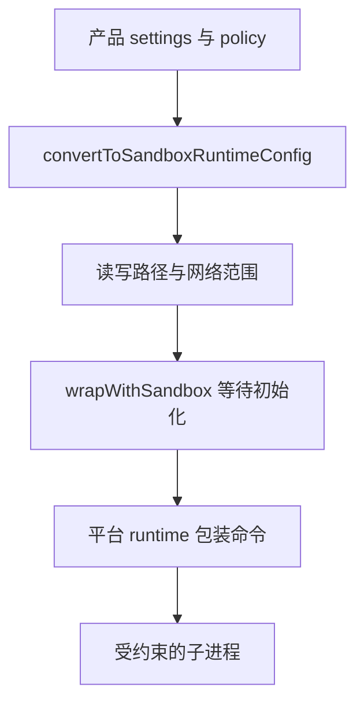

## 产品规则先被翻译成运行时配置

@ccsrc sandbox-config

`convertToSandboxRuntimeConfig` 从产品 settings 和权限规则构造 allowed/denied domains 与文件访问集合。managed policy 会改变哪些来源可参与配置；某些设置路径还被专门加入禁止写入范围。

这层翻译值得独立测试：产品设置正确，不保证最终系统策略正确；一条网络许可或文件规则在转换时丢失，会让实际执行与 UI 不一致。

## 找到实际命令包装处

@ccsrc sandbox-wrap

`wrapWithSandbox` 在启用状态下等待初始化，并把 command、shell、自定义配置与 abort signal 委托给 BaseSandboxManager。初始化失败不应被假装成“已隔离但继续执行”。

它连接了产品配置和外部沙箱运行时，却没有在本文件实现所有操作系统策略。继续往下读 sandbox-runtime，才会看到平台相关约束。课程保留固定的开源组件对照，但不能据此断言产品捆绑的组件字节版本与对照仓库相同。

## 三层边界应分别取证

| 层 | 研究问题 |
| --- | --- |
| 规则与模式 | 用户和组织允许做什么 |
| 配置适配 | 允许/拒绝如何变成运行时参数 |
| 平台执行 | 进程实际能读写和连接什么 |

单元测试可以证明配置转换；临时文件和网络目标实验可以证明特定平台的实际限制。另一个操作系统、本机未启用的路径或远程执行，需要自己的验证。

## 与原实验的关系

下方 2.1.296 的 Seatbelt 和代理观察仍可阅读。它们属于独立版本与环境；源码主线的结论以 2.1.88 的配置和调用位置为依据。把观察和实现放在一起，应该增加解释力，而不是抹掉版本差异。

## 为什么权限通过后还要有操作系统约束

授权器接受了 `npm test`，不代表测试进程内部只能执行这个字面意思。脚本还能启动其他程序、读写文件、访问网络。沙箱把允许的资源范围交给系统执行层约束，补上命令字符串与真实效果之间的距离。

这里有三层代码：产品 settings 描述用户想要的规则；adapter 将这些规则翻译为 runtime config；runtime 再按平台构造隔离执行。只测试 adapter 输出，不能证明系统实际拦住了访问。只看一次命令被拒，也不能确定配置翻译正确覆盖所有规则。

## 精读配置翻译中的默认值

源码默认把当前目录和 Claude 临时目录加入可写范围，再加入 settings 文件等敏感位置的禁止写入。为什么允许写项目，却限制它自己的配置？因为 Agent 若能修改随后会被高权限读取的配置，当前一次受约束执行就可能改变未来的边界。

工作目录发生变化时，原始 cwd 和当前 cwd 都要考虑。网络规则也有 managed-only 分支，不能简单把用户 allow 与组织规则拼成并集。读这一层时，列表初值、覆盖顺序和相对路径基准，比字段名称更值得关注。

## 初始化失败应怎样处理

`wrapWithSandbox` 在启用沙箱时等待 initializationPromise；缺少该初始化状态会抛错。不能因为初始化失败就默默退回普通 shell，那会让“我以为在沙箱里”的授权前提失效。是否存在显式绕过流程，需要继续读调用方，并记录它要求什么决策。

测试也要分层：配置测试使用合成 settings；包装测试检查传给 runtime 的参数；系统测试则在临时目录中实际尝试允许和禁止的操作。失败信息应指出是哪一层失败，而不是统一叫 permission denied。

## 本章实验怎样读

后半部分同时保留了产品的独立版本观察和开源 sandbox-runtime 的源码/实验。它们有各自固定版本，不能从 runtime 的公开能力推断这个 Claude Code 构建启用了全部能力。做跨平台判断时，先列平台与依赖，再分别验证。

练习为一份配置列出 allowWrite、denyWrite、allowRead、denyRead 和网络域名；加入“cwd 改变”和“组织只允许 managed 域名”两个反例。然后选一条非破坏性访问，在临时目录里做系统验证，保留实际退出与输出。

::: interview 为什么沙箱配置适配器也需要回归测试？
它把产品规则映射为系统运行时的策略。来源优先级、路径转换或 domain 规则一旦映射错，执行边界就会偏离用户设置。应分别测试转换结果和真实平台行为，不能只检查配置文件或系统调用中的一层。
:::

@observation 11-sandbox
