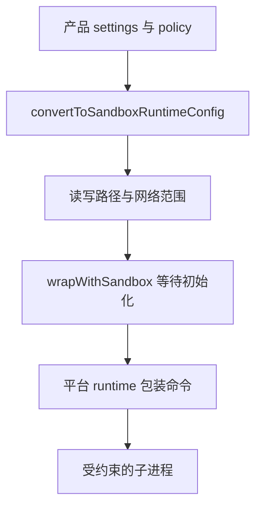

## 本章的问题

允许执行测试，不等于测试程序只会做用户期望的事。它还可以写文件、启动子进程和访问网络。仅检查命令字符串不能约束程序内部的效果。

本章把配置翻译和实际执行拆开。macOS 采用 Seatbelt，Linux 有 bubblewrap 时采用对应包装；没有可用后端就明确失败，不默默退回普通执行。先做允许写入的正对照，再尝试工作区外写入。否则连进程都没启动，也可能被误判成“沙箱成功阻止”。

## 沿固定源码逐段拆解

@ccsrc sandbox-config

### convertToSandboxRuntimeConfig 翻译产品语义

网络域名可能来自组织策略或用户规则；managed-only 分支不能简单取并集。文件写入的初值包含当前目录与临时目录，同时明确禁止设置文件等位置。cwd 改变以后，原始目录与新目录都需要考虑。

源码还保护会被未来高权限流程读取的配置与 Skill 目录。这类保护关注跨命令的影响：一次受限执行不应该改写未来的信任边界。

@ccsrc sandbox-wrap

### wrapWithSandbox 先等待初始化

启用沙箱时如果存在 initializationPromise，就等待；如果缺失就抛错。初始化失败不能悄悄变为无隔离 shell，否则授权时的前提已经改变。真正包装仍委托 BaseSandboxManager，由底层平台实现。

coda 的探针策略只展示工作区写入和网络范围，不覆盖产品所有敏感读取保护或命令例外。配置测试、包装测试、OS 效果测试应分别记录。

## 机制总览



## 接入贯穿项目

@implementation 11-sandbox

### 逐步跟踪本章实现

`sandboxCommand` 把根目录和 argv 变成平台执行器的输入。macOS 使用 Seatbelt 拒绝网络与工作区外写入，Linux 在可用时使用 bubblewrap 的只读根目录和单独可写工作区。它们约束子进程可以产生的效果，而不是只匹配某种命令拼写。

`runSandboxed` 找不到后端会直接抛错，不悄悄改成普通 runProcess。平台有命令但内核不允许创建隔离环境时，也必须从实际运行结果识别，不能只凭 which 成功就标记隔离通过。实验报告保留 enforced/unavailable 的区别。

正向探针先证明沙箱内写入能成功，反向探针再尝试工作区外写入并检查外部文件未出现。两者缺一不可，否则“所有命令都失败”也会伪装成安全。课程配置允许广泛读取而限制写入，不能把本次探针扩大解释成完整产品的网络代理和机密读取防护。

## 运行本章实验

```bash
node --disable-warning=ExperimentalWarning labs/chapters/11-sandbox.mjs
```

@experiment 11-sandbox

## 逐项解释实验结果

有可用系统后端时，先观察 inside 文件被真实写入，再确认 outside 写入失败且文件不存在。若平台或容器不允许运行后端，输出 unavailable，并保留错误；这种结果不标记成隔离已生效。

全课其余实验仍可离线运行。系统能力的限制应该改变证据范围，不能改变安全默认值。

## 继续动手与验收

给策略增加只读配置目录，做一个允许读取与禁止写入的成对探针。再检查路径含空格和符号链接的情况，确认传给后端的是实际物理目录。

::: interview 怎样证明沙箱真实阻止了效果？
命令策略判断是否批准一次动作，OS 沙箱限制已启动进程能产生哪些效果。实验必须同时证明内部允许写、外部拒绝写；缺后端应报告不可用而非放行。某一次负向探针通过不等于完整产品安全性证明。
:::

@observation 11-sandbox
