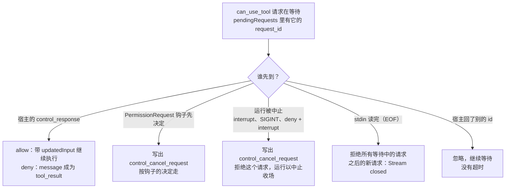

在 CI 里跑 `claude -p "把失败的测试修好"`，模型决定写一个文件。交互界面里，这时会弹出一个“允许吗？”的确认框；CI 里没有终端，也没有人。

出路有三条：用规则提前放行；干脆当作拒绝，让模型换一种做法；或者把问题交给启动 Claude Code 的那个程序来回答。第三条是 Agent SDK 的基础。SDK 没有另写一个 Agent，它启动的就是同一个 `claude` 进程，只是在 stdin 和 stdout 上多了一条双向的协议。

这一章顺着一次无界面运行往下走：输入怎样进来，两条循环怎样分工，一次权限请求怎样发出去又等回来，没人回答的时候怎样收场；最后看 SDK 的传输层，以及它和 Pi 的 RPC 模式差在哪里。claude 的录制来自 Claude Code 2.1.296，连接的是本机一个按剧本回答的假模型服务（`labs/ch12/record-headless.mjs`，不需要密钥，每次输出一样）；源码摘录和“原函数”实验来自 2.1.88，两者不一致的地方会指出。

@figure assets/course/ch12-headless.png 没有屏幕时，一行一条 JSON 进出；问和答靠同一个编号配对，直到 EOF

## 先看现象：三种输出格式，和一次没人可问的写文件

先不管协议。同一次运行（模型只说一句话），换三种输出格式：

@lab node labs/ch12/headless.mjs formats

默认的 `text` 只把最后一句话写到 stdout；`json` 写一个 JSON，就是最后那条 `result`；`stream-json` 一行一个事件，第 1 章看过。最后一行是个小陷阱：`stream-json` 不配 `--verbose`，进程直接退出，退出码 1，一个字都没有。三种格式出自同一个生成器，区别只在 `runHeadless` 最后怎么消费它：

@cc cli/print.ts#L917-L957 hl=918-927,928-930,932-934

- 第 928–930 行：`stream-json` 什么也不做，因为每条消息已经在上面的 `for await` 里一条条写出去了（只在 `stream-json` 并且 `--verbose` 时才写，所以缺 `--verbose` 的检查放在更前面，第 787–793 行）。
- 第 918–927 行：`json` 只取 `lastMessage`，也就是最后一条不属于控制消息和状态事件的消息，通常就是 `result`；加了 `--verbose` 输出整个数组。
- 第 931–956 行：默认的文本格式按 `result.subtype` 选择打印什么，成功打印 `result` 字段，其余是一句简短的错误。
- 退出码不在这里，在函数最后：最后一条是 `result` 且 `is_error` 为真就退出 1，否则 0（第 971–973 行）。

所以在 CI 里判断成败，看退出码和最后那条 `result`，别去解析文本。

再看需要确认的调用。同一个脚本，模型要写 `notes.txt`，只有 `-p`，没有任何宿主：

@lab node labs/ch12/headless.mjs timeline print-only

没有人可问时，第 6 章读过的那几行把 ask 变成了拒绝：理由是“你还没有授权”这一句话，作为 `is_error` 的 `tool_result` 交给模型。拒绝没有让运行失败，`result` 仍是 `success`。要知道有没有调用被拦住，看 `permission_denials`。它由 `QueryEngine` 给 `canUseTool` 套的一层记录：

@cc QueryEngine.ts#L243-L271 hl=261-268

凡是决定不是 `allow`（`deny` 和没人回答的 `ask`），都记下工具名、调用 id 和参数，最后随 `result` 带出去。所以 `-p` 下想知道“模型想做什么、被拦在哪”，答案在这个数组里。

## 输入怎样进来：prompt、管道，和 3 秒的等待

`-p` 的提示可以写在命令行上，也可以从管道进来，两种形状在 `main.tsx` 里就分开了：

@cc main.tsx#L857-L883 hl=858-863,875-880

- 第 858 行：stdin 是终端（`isTTY`）就什么也不读，提示只有命令行上那一句。
- 第 861–863 行：`--input-format stream-json` 时，把 `process.stdin` 本身交出去。它是一个异步可迭代对象，后面的所有消息都从它读，直到它结束。
- 第 864–880 行：文本格式要把 stdin 读完，和命令行上的提示用换行拼起来（`cat error.log | claude -p "解释这个"`）。读多久？`peekForStdinData` 的规则是：如果 3 秒里一个字节也没来，就放弃等待、打印警告；一旦来了第一块数据，就一直等到它结束。

最后一条规则在子进程里很容易踩到：父进程给了一根管道，既不写也不关，`claude -p` 就白等 3 秒。下面是录制：

@lab node labs/ch12/headless.mjs stdin

关闭 stdin（相当于 `< /dev/null`），不到一秒就开始了；留着它不管，3 秒以后才出现第一行输出，stderr 里是那句警告。

不管提示最初是什么形状，`runHeadless` 里的 `getStructuredIO` 都把它统一成一个消息流：非空字符串变成一条 `user` 消息，空白字符串变成空流，已经是流的原样放行（第 5199–5233 行）。coda 的 `normalizeInput` 做的就是这件事。

## 一个进程，两条循环：读 stdin 的和跑任务的

`--input-format stream-json` 下，`claude` 回答完一个问题并不退出：stdin 还开着，下一行随时可能来。所以进程里有两条并行的循环，源码里有一段注释把它说得很清楚：一条读 stdin、把消息放进队列，另一条从队列取出消息处理、产出结果；输入结束并且最后一次生成也做完，进程才算完成。两条循环加上 SDK 一侧，画成时序是这样（一次完整的审批往返在中间）：

::: steps 一次无界面运行：握手、提问、审批往返、EOF
--- **握手。** 宿主先发 `initialize`，读 stdin 的循环回答可用的命令、模型和账号信息；SDK 在这里登记钩子的回调 id 和进程内 MCP 服务器的名字。
sequenceDiagram
  participant H as 宿主（SDK 或脚本）
  participant R as stdin 读取循环
  participant Q as run 循环（ask → query）
  participant P as canUseTool（StructuredIO）
  participant O as 出站队列 → stdout
  H->>R: control_request initialize
  R->>O: control_response（命令、模型、账号……）
--- **提问进来。** 读 stdin 的 `for await` 把用户消息变成 `prompt` 命令入队，`void run()` 不等它（`print.ts` 第 4102–4122 行）；`run()` 开头的 `if (running) return` 是个互斥锁。模型回复 `tool_use Write`，先排进出站队列。
sequenceDiagram
  participant H as 宿主（SDK 或脚本）
  participant R as stdin 读取循环
  participant Q as run 循环（ask → query）
  participant P as canUseTool（StructuredIO）
  participant O as 出站队列 → stdout
  H->>R: control_request initialize
  R->>O: control_response（命令、模型、账号……）
  H->>R: user 消息
  R->>Q: enqueue，void run()
  Q->>O: assistant（tool_use Write）
--- **走到权限。** `run` 循环里 `canUseTool` 被调用。规则和模式已经说了 `allow` 或 `deny` 就直接返回，只有 `ask` 才往下走（`structuredIO.ts` 第 554–559 行）。
sequenceDiagram
  participant H as 宿主（SDK 或脚本）
  participant R as stdin 读取循环
  participant Q as run 循环（ask → query）
  participant P as canUseTool（StructuredIO）
  participant O as 出站队列 → stdout
  H->>R: control_request initialize
  R->>O: control_response（命令、模型、账号……）
  H->>R: user 消息
  R->>Q: enqueue，void run()
  Q->>O: assistant（tool_use Write）
  Q->>P: canUseTool(Write, input)
  Note over P: 规则和模式的结论是 ask（第 6 章）
--- **发出去。** 同时启动 PermissionRequest 钩子，不等它，立刻把 `can_use_tool` 请求放进出站队列（第 577–606 行）。写出不是直接 `write`，而是 `outbound.enqueue`，所以 `control_request` 不会插到还在排队的事件前面；等待者以 `request_id` 为键放进 `pendingRequests`（第 475–531 行）。
sequenceDiagram
  participant H as 宿主（SDK 或脚本）
  participant R as stdin 读取循环
  participant Q as run 循环（ask → query）
  participant P as canUseTool（StructuredIO）
  participant O as 出站队列 → stdout
  H->>R: control_request initialize
  R->>O: control_response（命令、模型、账号……）
  H->>R: user 消息
  R->>Q: enqueue，void run()
  Q->>O: assistant（tool_use Write）
  Q->>P: canUseTool(Write, input)
  Note over P: 规则和模式的结论是 ask（第 6 章）
  P->>O: control_request can_use_tool（request_id）
  O->>H: 一行 JSON，按入队顺序
--- **等回来。** 宿主用同一个 `request_id` 回一行 `control_response`。`processLine` 按它找到等待者，完成一次后删掉（第 374–424 行）；schema 校验通过，转成 allow 或 deny，`message` 原样成了 `tool_result` 的内容，运行接着往下走。
sequenceDiagram
  participant H as 宿主（SDK 或脚本）
  participant R as stdin 读取循环
  participant Q as run 循环（ask → query）
  participant P as canUseTool（StructuredIO）
  participant O as 出站队列 → stdout
  H->>R: control_request initialize
  R->>O: control_response（命令、模型、账号……）
  H->>R: user 消息
  R->>Q: enqueue，void run()
  Q->>O: assistant（tool_use Write）
  Q->>P: canUseTool(Write, input)
  Note over P: 规则和模式的结论是 ask（第 6 章）
  P->>O: control_request can_use_tool（request_id）
  O->>H: 一行 JSON，按入队顺序
  H->>R: control_response（同一个 request_id）
  R->>P: 按 request_id 找到等待者，完成它
  P-->>Q: allow（可带 updatedInput）或 deny（带 message）
  Q->>O: user（tool_result）、assistant、result
--- **收尾。** 宿主关闭 stdin：读循环只做 `inputClosed = true`，不 `abort`（第 4124 行）。此刻没有 `run()` 在跑才立刻 `output.done()`，在跑就交给 `run()` 自己收尾（第 4126–4138 行）。EOF 不是中断。
sequenceDiagram
  participant H as 宿主（SDK 或脚本）
  participant R as stdin 读取循环
  participant Q as run 循环（ask → query）
  participant P as canUseTool（StructuredIO）
  participant O as 出站队列 → stdout
  H->>R: control_request initialize
  R->>O: control_response（命令、模型、账号……）
  H->>R: user 消息
  R->>Q: enqueue，void run()
  Q->>O: assistant（tool_use Write）
  Q->>P: canUseTool(Write, input)
  Note over P: 规则和模式的结论是 ask（第 6 章）
  P->>O: control_request can_use_tool（request_id）
  O->>H: 一行 JSON，按入队顺序
  H->>R: control_response（同一个 request_id）
  R->>P: 按 request_id 找到等待者，完成它
  P-->>Q: allow（可带 updatedInput）或 deny（带 message）
  Q->>O: user（tool_result）、assistant、result
  H->>R: 关闭 stdin（EOF）
  R->>R: inputClosed = true
  Q->>O: 当前运行结束，output.done()
:::

先看读 stdin 的一侧。它的主体是一个 `for await`，每读到一条用户消息就入队、启动 `run()`；循环结束，说明 stdin 读完了：

@cc cli/print.ts#L4102-L4142 hl=4102-4109,4122,4124-4126,4138

- 第 4102–4109 行：用户消息变成一条 `prompt` 命令放进队列。
- 第 4122 行：`void run()`，不等它。`run()` 开头是 `if (running) return`（第 1866–1868 行），一个用标志位实现的互斥锁：已经有一次 `run()` 在跑，这次调用什么也不做，新入队的命令由正在跑的那次取走。
- 第 4124 行：读完以后只做一件事，`inputClosed = true`。没有 `abort`。
- 第 4126–4138 行：如果此刻没有 `run()` 在跑，立刻 `output.done()`，关闭出站队列，主流程的 `for await` 随之结束，进程收尾。如果正在跑，这里什么也不做，收尾交给 `run()` 自己。

再看 `run()` 的尾部。它每次结束都要做两件事：

@cc cli/print.ts#L2470-L2495 hl=2470,2492-2495

- 第 2470 行放下互斥锁。
- 第 2492–2495 行的注释记录了一次竞争：命令可能恰好在 `dequeue()` 返回空、`running = false` 之前到达，那时它调用 `run()` 看到 `running === true` 就返回了，消息没人管。所以放下锁以后要再看一眼队列，有就再跑一次。
- 队列空了，再往下（第 2637–2680 行）检查 `inputClosed`：为真，而且没有还在工作的团队成员，就清理订阅、调用 `output.done()`。进程的退出条件因此是“输入结束，并且最后一次运行结束”两个都成立。

## EOF 不是中断，interrupt 才是

读完上面的代码，一个推论是：宿主关闭 stdin，只是告诉 claude“不会再有新消息了”，不会打断正在做的事。下面的录制验证了这一点。宿主发完提问立刻关闭 stdin，模型随后读了一个文件、说了一句话：

@lab node labs/ch12/headless.mjs timeline eof-early

关闭 stdin 发生在第 0 毫秒，之后两轮模型请求照常完成，`result` 是 `success`，进程自己退出。中断另有专门的请求。两条路都在读 stdin 的循环里：

@cc cli/print.ts#L2842-L2862 hl=2842-2844,2849,2862

- `interrupt`（第 2831–2849 行）：`abortController.abort()` 中止当前这一次生成，回一个成功的 `control_response`，然后继续等下一条消息。进程活着。
- `end_session`：同样先中止，然后 `break` 跳出 `for await`。从这里往下和 EOF 一样，`inputClosed = true`，等收尾。
- Ctrl+C（SIGINT）另有处理函数（第 1027–1034 行）：中止当前请求，然后 `gracefulShutdown(0)` 直接收尾退出。

停下来的方式一共四种，列在一起：

| 宿主做了什么 | 当前这次运行 | 进程 |
| --- | --- | --- |
| 关闭 stdin（EOF） | 照常做完，等待中的审批请求被拒绝 | 运行结束后退出 |
| `interrupt` 请求 | 中止；`result` 为 `error_during_execution` | 继续等下一条消息 |
| `end_session` 请求 | 中止 | 和 EOF 一样，收尾后退出 |
| SIGINT | 中止 | `gracefulShutdown(0)`，直接收尾退出 |

## 一次审批的往返：从 tool_use 到 tool_result

先看真实的一次。下面是 Agent SDK 驱动 Claude Code 的会话：SDK 的 `pathToClaudeCodeExecutable` 指向一个窃听器（`labs/ch12/cli-tap.mjs`），它启动真正的 `claude`，转发 stdin 和 stdout，同时把每一行记下来。SDK 里注册了三样东西：审批回调 `canUseTool`，一个 PreToolUse 钩子（就是一个 JS 函数），和一个在 SDK 进程里运行的 MCP 工具 `lookup_ticket`。

@lab node labs/ch12/wire.mjs session

- 第 0、2 行是握手。`initialize` 带着钩子的回调 id（只有 `hook_0`，函数本身留在 SDK 里）和进程内 MCP 服务器的名字；claude 回答可用的命令、模型、账号信息。提问（第 1 行）在握手之后，格式和输出里的 `user` 消息一样。
- 第 14–16 行：模型调用 `lookup_ticket`，claude 先通过 `hook_callback` 问 SDK 的 PreToolUse 钩子，SDK 回 `{}`，表示没有意见。
- 第 17–20 行：状态变成 `requires_action`，宿主靠它知道“现在卡在等我”；claude 写出 `can_use_tool`；SDK 回答 allow；状态回到 `running`。
- 第 21–22 行：被批准的 MCP 工具在 SDK 进程里执行。claude 把 JSON-RPC 的 `tools/call` 装进 `mcp_message` 请求交给 SDK，SDK 把结果装进回答送回来。

回调没有任何魔法：每一个都是 claude 写给宿主的一行 `control_request`，宿主用同一个 `request_id` 回一行 `control_response`。再看一次被拒绝的往返，完整的 JSON：

@lab node labs/ch12/wire.mjs trip

- `request_id` 属于这次提问，`tool_use_id` 属于模型的这次调用。回答靠前者配对；回答里的 `toolUseID` 是后者，claude 用它认出迟到或重复的回答（下面读 `processLine` 时看到）。
- `permission_suggestions` 是三条“以后不用再问”的建议，宿主可以把其中一条放进回答的 `updatedPermissions`，claude 会应用并写入配置。`blocked_path`、`description`、`display_name` 给界面用。
- 回答里的 `message` 原样成了 `tool_result` 的内容，`is_error` 为真。模型读到“请改用 rm -r 并逐个确认”，接下来先 `rm` 再 `rmdir`，都被放行了（录制的最后几步）。

发出这个请求的是 `canUseTool`。进程启动时先决定用哪一种：

@cc cli/print.ts#L4267-L4293 hl=4273-4275,4276-4278

`--permission-prompt-tool stdio`（SDK 注册了审批回调时自动加上）用 `StructuredIO` 自己的实现；什么都没配，就是第 6 章的 `hasPermissionsToUseTool`，ask 在 `toolExecution` 里变成拒绝；其余的是指向某个 MCP 工具的名字，把问题交给它。下面读第一种，先是请求怎么发出去：

@cc cli/structuredIO.ts#L553-L611 hl=554-559,577-583,586-606,611

- 第 554–559 行：规则和模式（第 6 章）已经说了 `allow` 或 `deny`，直接返回，不打扰宿主。只有 `ask` 才往下走。
- 第 577–583 行：同时启动 PermissionRequest 钩子（第 7 章），在后台运行。
- 第 586–606 行：不等钩子，立刻把 `can_use_tool` 请求发给宿主。请求里就是录制里看到的那些字段，`request_id` 是新生成的 UUID。
- 第 611 行：`Promise.race`，钩子和宿主谁先给出结论听谁的。源码注释的理由是：终端里钩子也和弹窗赛跑，SDK 宿主应该一样，宿主的对话框立刻弹出，不被一个慢钩子拖住。

`sendRequest` 把请求放进队列并等待：

@cc cli/structuredIO.ts#L475-L531 hl=480-486,490-503,512-523,529

- 第 480–485 行：输入已经关闭或信号已经中止，抛错，一行都不写。这是下一节“Stream closed”的来源。
- 第 486 行：写出不是直接 `write`，而是 `outbound.enqueue`。所有要写给宿主的东西（事件、控制请求）都排进同一条队，只有一个读者负责写，所以 `control_request` 不会插到还在排队的事件前面。录制里 `assistant`（tool_use）总在 `can_use_tool` 之前，就是这个原因。
- 第 490–503 行：信号中止时，先写一条 `control_cancel_request`，再立刻 `reject` 本地的等待，不等宿主确认。
- 第 512–523 行：等待者以 `request_id` 为键放进 `pendingRequests`，连同回答要通过的校验。同一时刻可以有多个，因为并发安全的工具会并行执行（第 3 章）。
- 第 529 行：无论怎么结束，`finally` 里都把它删掉。

回答回来时，由 `processLine` 按 `request_id` 找到这个等待者：

@cc cli/structuredIO.ts#L374-L424 hl=374-375,381-398,400-401,411-414,416-424

- 第 374 行：找得到就往下，第 400–401 行把 `tool_use_id` 记进 `resolvedToolUseIds`，从表里删除，保证只完成一次。
- 第 375–398 行：找不到的分两种。`toolUseID` 在 `resolvedToolUseIds` 里，是重复或迟到的回答，静默忽略；否则交给 `unexpectedResponseCallback`。这个回调是为“进程重启后回答才到”准备的：它去会话记录里找有没有一个没有结果的 `tool_use`，有就重新执行它。找不到就什么也不会发生。两种情形都不会抛错，也不会误解开别的等待者。
- 第 411–414 行：宿主回的是 `error` 子类型，等待者收到 `reject`。
- 第 416–424 行：成功的回答要先过 schema 校验（下一节），再 `resolve`。

`can_use_tool` 这条通道还被借去传别的问题。沙箱（第 11 章）启用时，`runHeadless` 用 `structuredIO.createSandboxAskCallback()` 初始化它（`print.ts` 第 620 行）：沙箱里的命令要访问一个没有被允许的主机，这个回调就发一条 `can_use_tool`，工具名是合成的 `SandboxNetworkAccess`，参数是 `{ host }`，`description` 是“Allow network connection to …?”。宿主把它当成普通的工具审批来回答，不需要新的协议子类型；请求失败（EOF、中止）一律按拒绝处理（`structuredIO.ts` 第 731–753 行）。

用原函数验证一下，上面的说法不是我们的推测。下面把这个类从固定提交里取出来原样运行（权限判断、钩子和 zod 校验换成脚本），在 EOF 之前和之后各问一次：

@lab node labs/ch12/real.mjs closing

## 回答里的 updatedInput 和 message 去了哪里

宿主的回答要先通过一个 schema：

@cc utils/permissions/PermissionPromptToolResultSchema.ts#L44-L79 hl=47,50-59,67-69

`allow` 必须带 `updatedInput`（一个对象），`deny` 必须带 `message`。注意 `updatedPermissions` 的写法：解析失败不拒绝整个回答，退回 `undefined`（第 50–59 行）。一个宿主把“以后都允许”的建议写坏了，用户这次的“允许”仍然有效。校验过了，转成权限决定：

@cc utils/permissions/PermissionPromptToolResultSchema.ts#L95-L127 hl=95-106,110-111,117-122

- 第 96–106 行：`updatedPermissions` 被应用并持久化。录制里那三条建议，宿主只要原样放回去，这条规则就写进了 `localSettings`。
- 第 110–111 行：`updatedInput` 是个空对象，当作“用原来的参数”。注释说这是为了手机上点推送通知回答的客户端，它们没有原始参数，只能发 `{}`。非空就整个替换。
- 第 117–122 行：`deny` 带 `interrupt: true`，除了拒绝，还中止整个运行。

两个字段的效果，用录制验证。宿主批准了写文件，但把 `content` 改成了别的内容；另一次，宿主拒绝并写了理由：

@lab node labs/ch12/headless.mjs timeline stdio-deny

第 6 行的 `tool_result` 就是宿主写的那句话，`is_error` 为真，文件没有创建。批准的那次（`stdio-allow`）写出的文件内容是“宿主改写过的内容”，不是模型原本写的，见下一节的表。`updatedInput` 是宿主改写参数的唯一机会：模型看到的 `tool_use` 没变，被执行的参数已经变了。这和第 7 章 Hook 改写参数是同一种能力，只是换成了应用程序的代码。

## 没人回答的时候：五种结局

一个 `can_use_tool` 请求在 `pendingRequests` 里等着，它怎样结束：

同一个请求在等待时可能有不同的结局，按时间看钩子、宿主和 EOF 谁先到：

::: steps 等待中的审批请求：谁先到听谁的
--- 一个 `can_use_tool` 请求发出之前，规则和模式的结论是 `ask`，才会走到这里。
sequenceDiagram
  participant Q as run 循环
  participant P as createCanUseTool
  participant K as PermissionRequest 钩子
  participant H as 宿主
  Q->>P: canUseTool(Write, input)
  Note over P: 规则和模式的结论是 ask
--- `createCanUseTool` 同时做两件事：后台启动 PermissionRequest 钩子，立刻把请求发给宿主，不等钩子。最后 `Promise.race`（`structuredIO.ts` 第 577–611 行）。
sequenceDiagram
  participant Q as run 循环
  participant P as createCanUseTool
  participant K as PermissionRequest 钩子
  participant H as 宿主
  Q->>P: canUseTool(Write, input)
  Note over P: 规则和模式的结论是 ask
  P-)K: 后台启动钩子，不等它
  P->>H: control_request can_use_tool（request_id）
  Note over P,H: Promise.race，谁先给出结论听谁的
--- **结局一：钩子抢先。** 先 `sdkPromise.catch(() => {})` 吞掉预期的取消异常，再 `abort()`，由 `sendRequest` 写出 `control_cancel_request`，宿主的对话框不必再等（第 613–620 行）。
sequenceDiagram
  participant Q as run 循环
  participant P as createCanUseTool
  participant K as PermissionRequest 钩子
  participant H as 宿主
  Q->>P: canUseTool(Write, input)
  Note over P: 规则和模式的结论是 ask
  P-)K: 后台启动钩子，不等它
  P->>H: control_request can_use_tool（request_id）
  Note over P,H: Promise.race，谁先给出结论听谁的
  alt 钩子先决定
    K-->>P: allow 或 deny
    P->>H: control_cancel_request（撤销提问）
    P-->>Q: 按钩子的决定走
  end
--- **结局二：宿主先回答。** 钩子的结果被丢弃（第 631–638 行）。回答里的 `updatedInput` 和 `message` 经 schema 校验后变成权限决定。
sequenceDiagram
  participant Q as run 循环
  participant P as createCanUseTool
  participant K as PermissionRequest 钩子
  participant H as 宿主
  Q->>P: canUseTool(Write, input)
  Note over P: 规则和模式的结论是 ask
  P-)K: 后台启动钩子，不等它
  P->>H: control_request can_use_tool（request_id）
  Note over P,H: Promise.race，谁先给出结论听谁的
  alt 宿主先回答
    H-->>P: control_response（同一个 request_id）
    Note over K: 钩子的结论被丢弃
    P-->>Q: allow 或 deny
  end
--- **结局三：EOF。** 读 stdin 的生成器读完后 `inputClosed = true`，等待中的请求全部 `reject`（第 254–260 行）；`createCanUseTool` 的 `catch` 把任何异常变成 `behavior: 'deny'`（第 639–649 行）。模型看到的是一次技术失败，不是用户的拒绝。中止信号同理，另外先写一条 `control_cancel_request`。
sequenceDiagram
  participant Q as run 循环
  participant P as createCanUseTool
  participant K as PermissionRequest 钩子
  participant H as 宿主
  Q->>P: canUseTool(Write, input)
  Note over P: 规则和模式的结论是 ask
  P-)K: 后台启动钩子，不等它
  P->>H: control_request can_use_tool（request_id）
  Note over P,H: Promise.race，谁先给出结论听谁的
  alt 输入读完（EOF）
    H--xP: 关闭 stdin
    Note over P: pendingRequests 里的请求全部 reject
    P-->>Q: deny，message = Tool permission request failed: …
  end
:::

EOF 的那一支在读 stdin 的生成器里，数据读完以后：

@cc cli/structuredIO.ts#L215-L261 hl=228-232,244-247,254-260

第 228–232 行是切行：攒着数据，只按 `\n` 切；第 244–247 行读更多的数据块；第 248–253 行处理没有换行的最后一行；第 254–260 行是 EOF 之后的收场，`inputClosed = true`，等待中的请求全部 `reject`。`reject` 的异常在 `createCanUseTool` 的 `catch` 里变成一个拒绝：

@cc cli/structuredIO.ts#L613-L657 hl=613-620,622-628,639-649

- 第 613–620 行：钩子先决定。先 `sdkPromise.catch(() => {})` 吞掉预期的取消异常，再 `abort()`，由 `sendRequest` 写出 `control_cancel_request`，宿主的对话框不必再等。
- 第 622–628 行：钩子没有意见，继续等宿主。
- 第 631–638 行：宿主先回答，钩子的结果被丢弃。
- 第 639–649 行：任何异常（EOF、中止、校验失败）都变成 `behavior: 'deny'`，`message` 是 ``Tool permission request failed: ${error}``。这条文字会成为 `tool_result`，模型看到的是一次因技术原因失败的审批，不是用户的拒绝。

再看钩子和宿主的赛跑，同样用原函数跑三种情形：

@lab node labs/ch12/real.mjs race

钩子立刻决定的那次，宿主多收到一条 `control_cancel_request`，决定来自钩子；钩子没意见，宿主的回答生效；钩子 100 毫秒后才决定，宿主早到了，钩子的结论被丢弃。

再看真实的 claude 面对宿主的各种做法。每一行是一个场景，都是同一个剧本（模型要写 `notes.txt`），宿主做法不同：

@lab node labs/ch12/headless.mjs outcomes

- 批准并改写，文件内容是改写后的。拒绝，理由原样到了模型手里。
- `wrong-id`：宿主先回了一个不认识的 id，300 毫秒后才发正确的回答，又补发了一次 deny。第一个被忽略，请求一直等着；正确的回答生效；第三个被吃掉，文件写成了模型原本的内容。
- `eof-pending`、`eof-then-ask`：不管 EOF 发生在请求之前还是之后，调用都被拒绝，`tool_result` 里写着原因（录制里的文字以 `AbortError:` 开头，2.1.88 里是普通 `Error:`），运行照常做完，退出码 0。

最后看 `interrupt`。宿主在请求还没回答时发了一个 `interrupt`：

@lab node labs/ch12/headless.mjs timeline interrupt

第 6 行，claude 先写 `control_cancel_request` 撤销这个提问；第 7 行才回 `interrupt` 的成功响应（录制的 2.1.296 里带着 `still_queued: []`）。工具结果是固定的“用户不想继续”那句话，不是 EOF 那一支的 `Tool permission request failed`；`result` 是 `error_during_execution`，退出码 1。两种收场的差别在后面：EOF 之后模型还会再说话，`interrupt` 之后这次运行就结束了。

注意表里没有“超时”。宿主不回答，请求就一直等下去：claude 一侧没有计时器，要不要给人留时间、留多久，是宿主的事。

## stdout 只放协议

“一行一条 JSON”有两个容易出事的地方，Claude Code 各用了一道保险。

第一，写出去的时候。`JSON.stringify` 会把 U+2028、U+2029 原样写出来，这在 JSON 里合法；但按 JavaScript 的行结束符规则切行的接收方，会在这里把一条消息切成两半：

@cc cli/ndjsonSafeStringify.ts#L16-L32 hl=19-21,30-32

转义成六个字符的 `\u2028`、`\u2029` 是等价的 JSON，解析出来还是同一个字符串，任何接收方都不会把它当成换行。这是写出端的办法；Pi 的做法是读取端只按 `\n` 切（第 19 章）。两边都做，最稳。

第二，stdout 上只能有协议。依赖库里一句 `console.log`，就会让宿主的逐行解析出错，而且宿主没有办法恢复。所以进程在发出第一条消息之前先装一个守卫：

@cc utils/streamJsonStdoutGuard.ts#L59-L91 hl=70-81

守卫把 `process.stdout.write` 换成一个按行检查的版本：攒到换行，整行 `JSON.parse`，能解析的放行，不能的改道到 stderr，前面加 `[stdout-guard]` 标记。正规的 `structuredIO.write` 本来写出的就是 JSON 加换行，一路畅通；调用者的意图（输出文字）也算达成了，只是换了个去处。

读的一侧，同一个类也要面对数据块的任意断点。取出原函数运行：

@lab node labs/ch12/real.mjs framing

数据块在中间断开、中间有空行、最后一行没有换行，都能读出来。最后一行是坏行：Claude Code 直接退出，退出码 1。Pi 的 RPC 模式则回一个错误响应继续运行，coda 把坏行变成一个 `protocol_error` 帧，交给调用者决定。

## Agent SDK：同一个进程，外加一层回调

读到这里，SDK 的样子已经清楚了。还有一个绕不开的问题：SDK 的实现在哪里？还原源码里的 `query()` 只是一个类型声明：

@cc entrypoints/agentSdkTypes.ts#L112-L122 hl=120-122

函数体只有一行抛错，这个文件是 SDK 对外的类型。TypeScript 版 SDK 没有开源许可，真正的传输层要看 Anthropic 开源的 Python 版（MIT）。它启动的命令行就是我们在录制里看到的那些：

@lab node labs/ch12/sdk.ts argv

三处值得看。没有 `-p`：stdout 不是终端，就已经是非交互模式（`main.tsx` 里 `isNonInteractive` 的条件包括 `!process.stdout.isTTY`）。多了 `--input-format stream-json` 和 `--permission-prompt-tool=stdio`。提问不在命令行上，而是 `initialize` 之后从 stdin 送进去。整个会话里两个方向的消息统计：

@lab node labs/ch12/sdk.ts protocol

Python SDK 读 claude 的 stdout，把每一行按类型分流：

@oss agent-sdk-python src/claude_agent_sdk/_internal/query.py#L397-L426 hl=398-410,412-418,420-426

`control_response` 唤醒发出请求的等待者；`control_request`（claude 的提问）交给处理函数，在新任务里并发执行；`control_cancel_request` 取消对应的任务。其余是普通事件，交给使用者。这三路和 `StructuredIO` 的三个出口一一对应。处理函数里，审批请求这一支：

@oss agent-sdk-python src/claude_agent_sdk/_internal/query.py#L586-L638 hl=590-591,610-614,617-638

没有注册回调就报错（第 590–591 行），回答 claude 一个 `error`，而不是让它一直等。有回调就执行它，把 `PermissionResultAllow` 或 `PermissionResultDeny` 转成 `behavior`、`updatedInput`、`message`、`interrupt` 这几个字段（第 617–638 行）。字段名和我们读的 schema 一一对上。下面把录制的字段和这份源码并排：

@lab node labs/ch12/sdk.ts source

SDK 最微妙的是什么时候关 stdin。回想上面：EOF 会让等待中的审批请求被拒绝，之后的请求连问都不问（`Stream closed`）。SDK 如果在写完提问之后立刻关闭 stdin，所有回调就全部失效了。所以：

@oss agent-sdk-python src/claude_agent_sdk/_internal/query.py#wait_for_result_and_end_input hl=1080-1091

有回调（`can_use_tool`、钩子、进程内 MCP 服务器）就等 `_run_ended_event`：它在 claude 报告 `session_state_changed: idle` 之后触发（不报告状态的旧版本，则是第一条 `result`），然后才 `end_input()`。docstring 解释了代价：背景任务可能在 `result` 之后继续运行，需要 stdin 的请求不能被切断。我们的录制 `eof-then-ask` 证明了不这样做会怎样：

@lab node labs/ch12/headless.mjs timeline eof-then-ask

提问和 EOF 同时发出（第 0 毫秒），写文件的审批请求连发都没发，直接是 `Stream closed`，模型收到的 `tool_result` 是一次技术失败。

另一个值得知道的默认值：SDK 不设置 `systemPrompt` 时，会传 `--system-prompt ""`，所以系统提示不再是那五千多字符的 Claude Code 预设：

@lab node labs/ch12/sdk.ts prompt

[文档](https://code.claude.com/docs/en/agent-sdk/modifying-system-prompts)写明，不设置 `systemPrompt` 时 SDK 只带一个最小提示，Claude Code 预设里的安全指引不在其中；要和命令行一致，设置 `systemPrompt: { type: "preset", preset: "claude_code" }`。SDK 面向各种各样的 Agent，不一定是编程助手，也不一定有人在旁边看着，所以默认给一张白纸，由开发者写自己的提示（也要自己补上安全方面的内容）。工具定义、环境信息照旧。表里多出来的三个工具（`AskUserQuestion`、`EnterPlanMode`、`ExitPlanMode`）都需要有人回答，大概正因如此只在有审批通道时才提供；这是推测，录制只显示了工具列表的差别。

## 和 Pi、mox 的 RPC 对照

Learn Pi Agent 第 19 章给 mox 写了 `--mode json` 和 `--mode rpc`。两边的区别用一个问题总结：谁可以先开口。

| | Claude Code + Agent SDK | Pi `--mode rpc` | mox `--mode rpc` |
| --- | --- | --- | --- |
| 传输 | stdin / stdout，一行一条 JSON | 相同 | 相同 |
| 分帧 | 写出端转义 U+2028 / U+2029，读取端按 `\n` 切 | 不转义，要求双方都只按 `\n` 切 | 同 Pi |
| 宿主发什么 | `user` 消息；`control_request`（initialize、interrupt、set_model……） | 命令：prompt、abort、get_state…… | 命令：prompt、abort、get_state、get_messages |
| 配对 | `request_id`，双向 | 命令用 `id`；扩展请求用另一套 `id` | 命令用 `id` |
| 运行中向宿主提问 | `can_use_tool`、`hook_callback`、`mcp_message`、`elicitation` | `extension_ui_request`（confirm、select、input、editor） | 没有 |
| 宿主不回答 | 一直等；EOF、中止、钩子抢先、答错 id 各有收场 | 超时或中止时给默认值（confirm 是 false） | — |
| 输入结束（EOF） | 当前运行做完再退出；等待中的请求被拒绝 | 立刻中止并退出 | 等当前运行结束再退出 |
| 一次运行结束 | `result` 帧 | `agent_settled` 事件 | `agent_settled` 事件 |

Pi 一侧其实也有“向宿主提问”的通道，不过它是为扩展的界面（对话框、通知）准备的：

::: tabs
@@ Pi
@pi packages/coding-agent/src/modes/rpc/rpc-mode.ts#L90-L131 hl=97,109-120
中止或超时时用调用方给的默认值 `resolve`，`confirm` 的默认值是 `false`。
@@ Claude Code
@cc cli/structuredIO.ts#L475-L531 hl=480-486,490-503,512-523,529
没有超时；输入关了或信号中止就抛错，中止时先写 `control_cancel_request` 再 `reject`。
@@ coda
@code coda/src/io.mjs#L51-L81 hl=53-54,61-65
照 Claude Code 写：`id` 配对，关了或取消就不问，取消时通知宿主再 `reject`。
:::

每个对话框一个 `id`，放进 `pendingExtensionRequests`，写一条 `extension_ui_request`。区别在于收场：信号中止（第 109–112 行）或者超时（第 115–120 行），不是抛错，而是用调用方给的默认值 `resolve`。`confirm` 的默认值是 `false`，所以对话框得不到回答等于拒绝。Claude Code 的审批请求没有超时，没人回答就一直等，它靠中止信号和 EOF 收场，收场的方式是 `reject` 加一句给模型看的话。这是两种取舍：Pi 把“等多久”放进协议，Claude Code 把它留给宿主。

输入结束的处理也不一样。Pi 收到 stdin 的 `end` 就调用 `shutdown()`，最后走到 `session.dispose()`：

::: tabs
@@ Pi
@pi packages/coding-agent/src/core/agent-session.ts#L1428-L1437 hl=1429-1435
`dispose()` 先 `abort` 掉重试、压缩、Bash 和正在运行的 Agent，然后进程退出。
@@ Claude Code
@cc cli/structuredIO.ts#L215-L261 hl=228-232,244-247,254-260
读完以后 `inputClosed = true`，等待中的请求全部 `reject`；正在运行的任务不受影响。
@@ coda
@code coda/src/io.mjs#L105-L111
`close()` 拒绝所有等待者；`cli.mjs` 随后 `await job`，等运行做完。
:::

`dispose()` 先 `abort` 掉重试、压缩、Bash 和正在运行的 Agent，然后进程退出。mox 在 `end` 时等当前运行结束（第 19 章）。Claude Code 的做法最接近 mox，但多了一步：等待中的审批请求被拒绝，免得运行永远挂起。三种做法对应三个宿主：把 stdin 关闭当作“请退出”的信号，当作“不会再有新消息”，当作“这个会话作废”。你的宿主关闭 stdin 的时候想表达的是哪一种，决定了该怎么选。

## 动手：coda 的 ControlIO 和行协议

coda 的 `io.mjs` 把本章的机制缩成四个函数，加上 `cli.mjs` 里的读取循环。核心是 `ControlIO`，对应 `StructuredIO` 里的 `pendingRequests`、`sendRequest`、`processLine` 里处理回答的一段，以及 EOF 时拒绝等待者的收场：

@code coda/src/io.mjs#ControlIO hl=53-54,61-65,89-99,105-111

- `ask`（第 51–81 行）≈ `createCanUseTool` + `sendRequest`。第 53–54 行是 `sendRequest` 开头的两个检查，管道关了或已经取消，就不问。每个请求有自己的 id（`permission-1`……），和模型的工具调用 id 是两回事。
- 第 61–65 行是 `aborted()`：撤销等待、写 `control_cancel_request`、`reject`。第 70 行保证每条结束路径都摘掉取消监听。
- `reply`（第 89–99 行）≈ `processLine` 里的 `control_response` 分支。找得到就取出、只完成一次；找不到的记进 `ignored`，原因是 `unknown`（没发过）、`duplicate`（已回答）、`late`（已撤销），对应源码里 `resolvedToolUseIds` 区分出来的几种情形。
- `close`（第 105–111 行）≈ `read()` 的 EOF 收场。
- 带理由的拒绝（第 74 行）是一处适配。coda 的权限闸门（第 6 章）只返回真假，没有地方放理由；`Toolset` 会把抛出的错误原文变成 `tool_result`，所以带 `message` 的拒绝借这条路把话递给模型。Claude Code 里是决定自带 `message`，直接成为 `tool_result` 的内容。`updatedInput` 没有对应：coda 的闸门不能改写参数。

宿主那一侧的循环在 `cli.mjs` 里：

@code coda/src/cli.mjs#L27-L88 hl=30,39-46,47-50,51-54,62-63,81

第 30 行先装上 `guardStdout`，之后任何不是协议的输出都改道 stderr。读循环用 `readFrames`：坏行变成 `protocol_error`，写回去、中止、停止读（第 40–46 行），和 Claude Code 在 stdin 上遇到坏行的做法一致。其余按类型分发：`permission_response` 交给 `io.reply`（第 47–50 行）；`cancel` 中止（第 51–54 行）；`user` 开始一次运行，`ask` 回调接到 `io.ask`，事件直接写进 stdout。一个进程只接一次提问，这是教学版的简化，Claude Code 有队列，可以连续接。stdin 读完以后，`io.close()` 拒绝所有等待，`await job` 等运行做完（第 62–63 行）——EOF 不是中断。退出码按最后的结局定（第 81 行）：正常答完是 0，被取消、轮数用完、模型失败是 1，对应 Claude Code 看最后一条 `result` 的 `is_error`。

`io.mjs` 提供这一章的行协议，`cli.mjs` 就是用它们搭起来的：`encodeFrame`（写出端转义）、`readFrames`（只按 `\n` 切，处理多字节字符被拆开、空行、没有换行的最后一行、坏行）、`guardStdout`（非 JSON 的行改道 stderr）。三个函数的行为和前面读过的原函数对应。

### 同一组输入，原函数和 coda 并排

下面的实验把前面讲的情形各跑一遍，左边是从 2.1.88 取出来原样执行的 `StructuredIO`，右边是 coda 的 `ControlIO` 接在真正的 `Toolset` 和权限闸门上：

@lab node --disable-warning=ExperimentalWarning labs/chapters/12-headless-sdk.mjs pairing

六种情形两边的结论一致：不认识的 id 被忽略，重复和迟到的回答被忽略，取消会通知宿主，拒绝的理由到达模型，EOF 拒绝而不是放行，管道关了以后新请求不再发出。文字不同，是两边的错误信息各写各的。

### 真实子进程：一个宿主脚本驱动 coda

实验里的宿主用 `child_process.spawn` 启动 `coda/src/cli.mjs`，用 `readFrames` 读它的 stdout，按帧的内容决定怎么回答。先看批准的完整时间线，再看宿主的另外五种做法：

@lab node --disable-warning=ExperimentalWarning labs/chapters/12-headless-sdk.mjs session

和真实 claude 的 `outcomes` 对照：拒绝带理由、不认识的 id 被忽略、`eof-pending` 拒绝后运行照常做完、`eof-early` 不被打断，几乎一一对应。差别有两处。`cancel` 在 coda 里是一个 `cancel` 帧，Claude Code 里是 `control_request: interrupt`，而且后者会得到一个成功响应。两边的退出码规则一致：取消的那次退出码是 1，Claude Code 同样看最后一条 `result` 的 `is_error`。

### 一行一条 JSON

最后是行协议。`encodeFrame` 和 Claude Code 的 `ndjsonSafeStringify`（原函数）对五种内容输出一致；读的一侧，一个字符的三个字节被拆在两个数据块里，也能还原：

@lab node --disable-warning=ExperimentalWarning labs/chapters/12-headless-sdk.mjs framing

第一张表是为什么要转义：含 U+2028 的内容，`JSON.stringify` 的结果按 ECMAScript 的行规则会被切成两段，转义之后永远是一段。

## 你来改

先写下预测，再动手验证。

::: predict 关掉 close() 里的拒绝
把 `ControlIO.close()` 改成只剩 `this.closed = true`，去掉遍历 `pending` 的循环和 `pending.clear()`。宿主在审批请求还没回答时关闭 stdin（实验里的 `eof-pending` 场景），`cli.mjs` 子进程会怎样？
???
进程以退出码 13 结束，stderr 是 `Warning: Detected unsettled top-level await`，一帧 `terminal` 也没有写出去（我们实测过）。原因：等待中的 Promise 永远不会结算，`cli.mjs` 末尾的 `await job` 卡在那里；stdin 关了、没有别的句柄，Node 的事件循环空了，进程就带着“未结算的顶层 await”退出。对宿主来说，这是读到了 EOF，却没有收到任何结论。Claude Code 在 `read()` 读完输入后逐个 `reject`，就是为了不留下这种悬而不决的进程。
:::

::: predict 带理由的拒绝改成普通的 false
把 `ask` 里 `else if (frame.message) reject(Error(frame.message));` 一行删掉。宿主回答 `{allow: false, message: "这个目录只读"}`，模型收到的 `tool_result` 是什么？
???
变成 `permission denied`，理由丢了。模型不知道为什么被拒绝，很可能原样再试一次，或者换一个同样会被拒绝的做法。Claude Code 里这句话是决定自带的 `message`，直接成为 `tool_result`；录制里的 `stdio-deny` 场景可以看到模型原样收到了宿主写的那句话。拒绝理由是一条反馈通道，不只是一个开关。
:::

::: predict 取消时不通知宿主
删掉 `onAbort` 里的 `this.write({ type: "control_cancel_request", id })`。用户中止了运行，宿主随后（它的确认框还亮着）点了“允许”，回答发了过来。运行的结局、`io.ignored` 里会有什么？
???
运行照样以 `cancelled` 结束，工具不会执行：`settle` 已经把这个 id 记为 `cancelled`。回答到达时落进 `ignored`，原因是 `late`。区别在宿主：没有撤销通知，它的对话框一直挂着，用户以为批准了，实际什么也没发生。Claude Code 的 `aborted()` 同时做两件事，写 `control_cancel_request` 和 `reject`，缺一都不行。
:::

## 面试题

::: interview Agent SDK 和 CLI 是什么关系？宿主程序的回调是怎么被调用的？
1. SDK 启动的就是 `claude` 命令行进程，用 stdin / stdout 上逐行的 JSON 通信：用户消息和事件流在两个方向上流动。命令行里没有 `-p`（stdout 不是终端就已经是非交互模式），多了 `--input-format stream-json` 和 `--permission-prompt-tool stdio`。
2. 此外两边都可以发 `control_request`，用 `request_id` 配对 `control_response`。SDK 在 `initialize` 里登记钩子的回调 id 和进程内 MCP 服务器；运行中 claude 遇到需要批准的调用、触发了 SDK 的钩子、模型调用了进程内 MCP 工具，就发 `can_use_tool`、`hook_callback`、`mcp_message`。
3. 所以回调是跨进程的 RPC，不是函数调用。加分：这套协议里没有魔法，Python SDK 里把读到的每一行分流给三个出口的代码只有三十行。
:::

::: interview 无界面运行时，需要用户确认的工具调用怎么处理？
- 没有配置：ask 在 `toolExecution` 里变成拒绝，理由（“还没有授权”）作为 `is_error` 的 `tool_result` 给模型，运行不失败，`result.permission_denials` 记一笔。
- 预先放行：`--allowedTools`、`--permission-mode`、设置里的规则（第 6 章）。
- 交给宿主：`--permission-prompt-tool stdio`，也就是 SDK 的 `canUseTool`。宿主收到 `can_use_tool`，回答 `allow`（可带 `updatedInput`、`updatedPermissions`）或 `deny`（带 `message`、可带 `interrupt`）。PermissionRequest 钩子和宿主赛跑，先到先得。
- 加分：宿主不回答，请求一直等；EOF、中止各有收场（拒绝，原因写进 `tool_result`）。
:::

::: interview 设计 stdio 上的请求/响应协议，要考虑哪些问题？
1. 配对：请求带唯一 id，回答带同一个 id；等待者放进表里，完成一次就删。
2. 异常回答：id 不认识、重复、迟到（请求已经被撤销）都要忽略，不能报错，也不能误解开别的等待者。
3. 撤销：请求等待期间被中止，要通知对方“不用回答了”（`control_cancel_request`），同时本地立即拒绝。
4. 输入结束：EOF 时所有等待中的请求一起拒绝，之后的新请求立刻拒绝；EOF 表示不再有新输入，不等于中断。
5. 写入：所有输出排进同一条队，一个写手，避免请求插到事件前面；stdout 只放协议，转义 U+2028 / U+2029，装守卫把杂音改道 stderr。
6. 加分：要不要有超时（Pi 有、Claude Code 没有）；SDK 一侧什么时候关 stdin（有回调就等 `idle`）。
:::

::: interview stdin 关闭应该意味着什么？三个实现有什么不同？
这是个协议语义问题，要在文档里说清楚。Claude Code：不会再有新消息，当前运行做完再退出，等待中的审批请求被拒绝；中止要另发 `interrupt` 或 `end_session`。mox：等当前运行结束再退出。Pi：立刻 `dispose`，中止所有进行中的工作后退出。选哪个取决于宿主：脚本喜欢前两种（发完就关，等结果），IDE 喜欢第三种（窗口关了就别再花钱）。加分：SDK 在有回调时必须等 `idle` 才关 stdin，否则每个回调都会得到 `Stream closed`。
:::

::: interview 在 CI 里用 claude -p，怎样可靠地判断成败？
1. 退出码：最后一条 `result` 的 `is_error` 为真就是 1；`stream-json` 没配 `--verbose` 也是 1。
2. `--output-format json` 拿最后那条 `result`，看 `subtype`（`success`、`error_during_execution`、`error_max_turns`……）和 `is_error`；文本格式只有一行话，不适合判断。
3. `permission_denials` 告诉你有哪些调用被拦住，运行本身可能仍是 `success`。
4. 子进程的 stdin 要么写完关掉，要么重定向到 `/dev/null`，否则 `-p` 会白等 3 秒。
5. 加分：用 `--allowedTools` 之类的规则提前放行需要的工具，否则模型要写文件时会被拒绝。
:::
