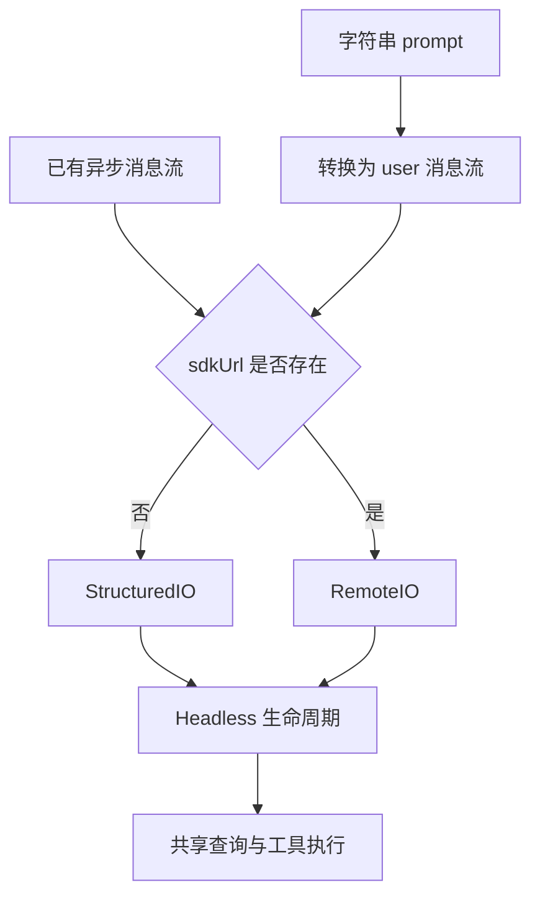

## 无界面运行仍有完整生命周期

@ccsrc headless

`runHeadless` 协调输入、选项、输出与执行。没有 TUI 并不意味着只是发送一次模型请求：权限回应、工具、会话恢复和控制请求仍可能在运行中发生。调用者还依赖明确的结束状态与错误传播。

@ccsrc structured-io

`getStructuredIO` 把普通字符串输入规范化为带 user message 形状的流；已有异步输入则保留流形式。随后依据 sdkUrl 选择本地 StructuredIO 或 RemoteIO。相同的业务输入经过不同传输，需要保持协议语义一致。

## 还原文件里也存在 SDK 占位实现

@ccsrc sdk-stub

这是一个必须按源码说话的例子：`entrypoints/agentSdkTypes.ts` 中的 query 有类型重载，但函数体是未实现占位。不能因为函数名叫 query，就把它解释为实际启动进程或发送请求的 SDK 实现。

需要沿真实打包入口、已发布 SDK 或其他授权开源实现查执行逻辑。课程保留 Python Agent SDK 的开源源码对照；它解释跨进程控制的一种实际实现，但版本对应关系必须单独标明。

## 数据流与控制流要分开理解

流出的 assistant 或 tool event 是结果数据；权限回应、取消和 Hook 回调是控制交互。只有 stdout 上出现 JSON，不能证明双向控制已经正确工作。需要检查请求身份、回应匹配、进程退出和超时之后的资源清理。

一个端到端回归可以使用 fake CLI 或本地合成协议流，不必每次调用收费模型；但这种测试只证明协议与生命周期，不证明供应商兼容或模型质量。

## 无界面模式仍然需要一个控制面

交互界面可以展示权限问题、接收取消、渲染进度。去掉 TUI 后，这些职责没有消失，只是需要通过结构化 IO 或 SDK 回调表达。把 stdout 拼成最终文本，只解决了内容输出，不能正确控制整个任务。

`runHeadless` 接收恢复选项、输出格式、工具和 Agent 定义、权限相关参数以及预算。它是应用生命周期入口；`getStructuredIO` 则把不同输入统一成消息流。两者不该被读成“直接调用一次模型”。

@lab node --disable-warning=ExperimentalWarning labs/engineering/run.mjs io

这个实验执行原始归一化函数，用测试构造器接住参数。普通字符串成为带 session_id、message 和 parent_tool_use_id 的 user 消息；空白字符串成为空流；sdkUrl 切换构造器。测试不发网络，也不启动子进程，输出中的 remote 只证明分支选择。

## 类型入口为什么会骗过读者

@lab node --disable-warning=ExperimentalWarning labs/engineering/run.mjs sdk

函数确实抛出 not implemented。看到它不应该得出“SDK 无法使用”，而应该改进阅读路径：这个文件服务于什么构建？真实 npm 包怎样导出执行器？哪个公开 SDK 实现启动并管理 CLI？产品功能、类型声明入口和实际执行入口是三件事。

后半部分保留的公开 Python SDK 源码为这个问题提供另一条可读路径，那里可以继续研究进程传输和控制协议。它也有自己的固定版本，不能替代 2.1.88 内部所有实现的证据。

## 把工具确认做成协议，需要哪些约束

SDK 客户端收到确认请求后，需要关联 request id，返回相应答复；服务端等待期间仍要能处理取消、输入结束和子进程退出。若调用方不消费事件，输出缓冲可能填满，甚至让工作阻塞。因此“收到最后一条 result”与“子进程已经退出”也要分别处理。

练习定义一个最小客户端的状态：starting、running、waiting_permission、cancelling、closed。为输出 EOF、无回应确认、取消后迟到答复各写一个期望行为。不要先追求完整 UI；先用合成协议输入验证不会悬挂，再用真实 CLI 验证集成。

::: interview 阅读 SDK 源码时，怎样避免把声明文件误当实现？
检查函数体、实际包 exports、构建入口和调用路径。类型签名说明契约，实际实现可能位于其他文件或发布工序中；若当前函数只抛未实现错误，就应明确说明材料的边界，再用真实实现或运行证据补足。
:::

@observation 12-headless-sdk
