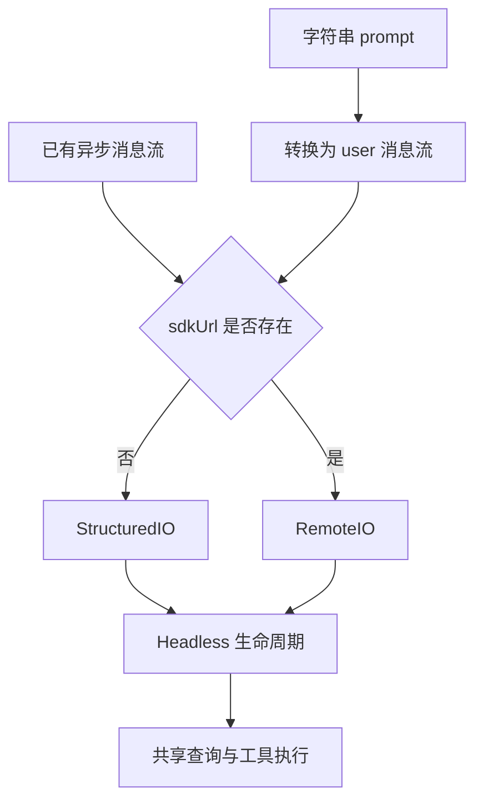

## 本章的问题

把 stdout 拼成最终文本，只解决内容输出。一个无界面 Agent 还需要接受取消、关联权限答复、处理 EOF、报告终态并退出进程。任何一个 pending Promise 没结算，都可能让客户端一直等着。

coda 的 ControlIO 以 request id 管确认。不存在的答复不能解开等待；输入关闭时明确拒绝未回答请求。CLI 的 stdout 只放 JSON 帧，调试信息不能随意混入协议。

## 沿固定源码逐段拆解

@ccsrc headless

### runHeadless 是生命周期入口

参数不止 prompt：恢复选项、输出格式、权限、工具、Agent 定义、预算和模型都参与装配。无界面运行仍然消费共享查询逻辑，不能把它理解成绕过工具与权限的一次 API 调用。

@ccsrc structured-io

### getStructuredIO 把多种输入归一化

非空字符串变成 SDKUserMessage 流，空白字符串变空流，已有异步输入则继续使用。sdkUrl 决定本地 StructuredIO 或 RemoteIO 构造器。归一化以后，后面的消费路径不需要不断判断最初来自哪种输入。

@ccsrc sdk-stub

### 再回看类型占位入口

第 0 章的反例现在有了具体替代路径：真实执行位于入口、IO、查询与进程管理之间，而不是那个直接抛错的导出。公开 SDK 组件可用于进一步研究传输，但版本和实现证据仍要独立标注。

coda CLI 提供有限的单任务 JSONL 教学协议，不声称兼容产品 SDK 的全部消息格式。

## 机制总览



## 接入贯穿项目

@implementation 12-headless-sdk

### 逐步跟踪本章实现

ControlIO 把每次确认分配为新的 permission id，并把等待者放进 pending。reply 只能按同一个 id 取出并完成一次等待；未知或过期回答返回 false。业务工具 id 与控制请求 id 分开，客户端才不会把一条确认错配到另一个调用。

输入 EOF 的意义是再也收不到确认答案，因此 close 要拒绝所有 pending 并清理监听，不能让 agent 永久等待。取消同样移除该请求的等待者。normalizeInput 只处理输入形状，CLI 则负责逐行解析、路由 user 与 permission_response，以及把输出继续写成 JSONL。

本章既直接测试控制对象，也真实 spawn CLI，通过管道写入、结束 stdin 并等待退出码。前者定位协议状态，后者验证装配和进程收尾。Python SDK 的固定源码仍是独立对照；教学 Node 协议不是对官方 SDK 全部方法的兼容实现。

## 运行本章实验

```bash
node --disable-warning=ExperimentalWarning labs/chapters/12-headless-sdk.mjs
```

@experiment 12-headless-sdk

## 逐项解释实验结果

实验先在进程内核对确认 id、输入关闭与归一化，再启动真实 coda CLI 子进程。它必须输出可解析 JSON、完成终态、写入 Session，并以 0 退出。检查了进程退出，才能发现仅看最后一句文字时遗漏的悬挂。

客户端若要保持双向确认，应保持 stdin 打开；EOF 会触发明确的未答复错误，不会自动同意。

## 继续动手与验收

写一个客户端，发送 user 后等待 permission_request，再回相同 id。分别测试错误 id、取消后迟到答复和 EOF；确保没有任何路径会擅自允许写入。

::: interview 无界面权限等待怎样避免悬挂？
控制请求 id 唯一标识一份等待中的确认；回答只消费对应 pending 一次。EOF 和取消都必须使等待结束，避免 CLI 永不退出。本章同时测试对象状态和真实子进程管道，覆盖协议与装配两层。
:::

@observation 12-headless-sdk
