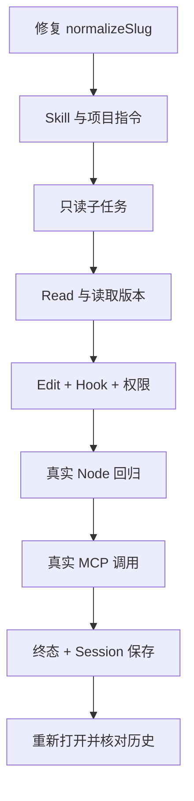

## 本章的问题

现在从一个真实失败开始：slug.cjs 只把单个空格替换成连字符，连续空格会产生双连字符；test.cjs 用 Node assert 描述正确结果。本章不以模型说“完成”作为验收，而以实际文件、实际测试输出和持久会话为准。

主任务依次加载 verify Skill，调用只读子 Agent 定位实现，Read 文件，Edit 唯一片段，Test 回归，调用本地 MCP echo，最后给出结论。模型回复由脚本固定，除采样外的每条工程边都真实执行。

同一个 coda 没有为毕业实验再写一套快捷逻辑。createCoda 只是把前面模块装在一起；哪个权限、Hook 或文件契约拦住了任务，实验会直接暴露出来。

## 沿固定源码逐段拆解

@ccsrc query

### 从任务身份到查询状态

外层业务完成与内部循环继续是不同边界。总装时保留第 1 章的退出语义，不能为了让演示“绿”就把失败改成 completed。

@ccsrc compact-rebuild

### 从持久事实到下一次请求

会话保存了什么、压缩视图保留了什么、请求又增加了什么，是三份可追的材料。最终重开 Session 检查末尾回答，不以进程内缓存冒充恢复。

@ccsrc headless

### 从部件到完整应用

产品 Headless 装配大量依赖；coda 同样需要把工具、记忆、策略、Skill、子任务和连接清理接到正确 owner。总装的价值是找到单模块测试没暴露的冲突：比如 Agent 容器工具没有授权、MCP 进程没关闭、测试成功没有回到历史。



这里的模型端口可替换为显式配置的 Anthropic adapter。课程验收采用确定性模型，以免把模型偶然选择正确当成工程链路正确。

## 接入贯穿项目

@implementation 13-synthesis

### 逐步跟踪本章实现

总装从真实临时项目开始：slug.cjs 的连续空格处理有错，test.cjs 是独立回归。createCoda 把文件工具、记忆、gate、hooks、可选 Skill、只读子任务与 MCP 工具组装到同一个 Engine，后续每条调用都必须穿过前面章节建立的执行边界。

脚本模型依次提出 Skill、Agent、Read、Edit、Test、MCP 意图。Edit 使用 Read 留下的版本凭据；Test 运行实际 Node 子进程；after hook 只在真实测试成功时计数；MCP 回应也必须作为对应 id 的工具结果回到主历史。脚本只固定意图，没有直接替这些工具写出成功结果。

终态消息追加到 Session 后，再创建新的 Session 实例读同一日志，检查最后答案与工具结果。应用只在终态保存本次消息，尚不具备每个事件的崩溃恢复；这个限制与已验证的正常重开应分别说明。最后由 finally 关闭 MCP，确保正文回放的完成有真实资源收尾作依据。

## 运行本章实验

```bash
node --disable-warning=ExperimentalWarning labs/chapters/13-synthesis.mjs
```

@experiment 13-synthesis

@journey 13-synthesis

## 逐项解释实验结果

七项检查分别验证终态、测试实际运行、修复字节、项目指令注入、MCP 结果、重新打开的会话和工具配对数量。展开输出看 journey，可以把每个 tool id 追到对应结果。

不要只看总体 PASS。故意漏掉 Test 许可、把 old 字符串改成不唯一、或者让 MCP 服务不回应，分别观察失败出现在哪层。正确的课程项目应能解释这些失败，而非只保留一次顺利演示。

## 继续动手与验收

增加一个错误测试，让主 Agent 在 Test 失败后再次修复并重跑；保存两轮 diff 与工具结果。然后把 scripted provider 换成可选 live adapter，保持工作区、规则和验收不变，单独记录模型选择的不确定性。

::: interview 怎样证明完整任务完成而不只看最后一句话？
按请求、工具意图、实际效果、工具结果、终态、持久重开追踪一次修复。脚本模型只能安排意图，真实 Test、MCP 和 Session 必须提供独立结果。最后检查进程收尾和未覆盖的崩溃窗口，才能说明完成的具体范围。
:::

@observation 13-synthesis
