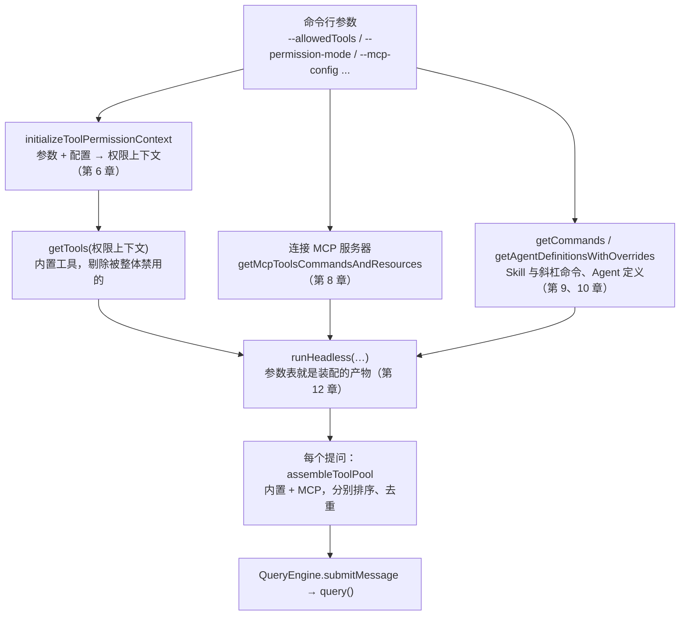
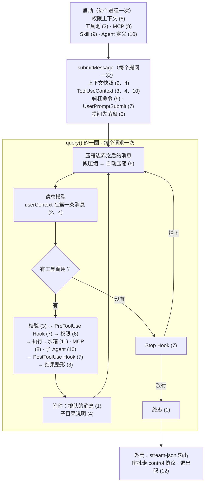

前面十二章每章拆开一个机制：循环、请求、工具、项目指令、会话与压缩、权限、Hook、MCP、Skill、子 Agent、沙箱、无界面。单独看，每一个都能讲通，也都有一个能跑的 coda 模块。

合在一起会出什么问题？举三个例子。Hook 说“允许”，规则说“拒绝”，听谁的？压缩把对话换成了摘要，这个结果只存在于请求里，还是也写进会话文件？子 Agent 刚读过 `src/slug.cjs`，父 Agent 没读过就改它，算不算“读过”？这些问题单看任何一章都答不完整，因为它们不属于哪一个机制，而在机制之间的缝上。

这一章做三件事：先看 Claude Code 在哪里把机制装在一起（`main.tsx`、`QueryEngine`、`query()`）；再把 coda 的 `createCoda` 重写成同样的装配，在一个临时项目里修一个真正失败的测试；最后把 Claude Code、Pi、mox、coda 并排放在一张表里，收束全课。源码摘录来自 Claude Code 2.1.88，数字和录制来自 2.1.296。

@figure assets/course/ch13-assembly.png 前十二章的部件一件件扣回主循环，最后用一次真实的测试通过来验收

## 先看现象：十一次请求，修好一个真正失败的测试

临时项目里有一个函数 `slug()`，只把单个空格换成连字符，连续空格会得到 `a--b`；`test/slug.test.cjs` 是真正会失败的测试。项目里还有 `CLAUDE.md`、`src/CLAUDE.md`（子目录说明）、一个 `verify` Skill、两个 Hook 脚本（一个拦下对 `test/` 的修改，一个在改完后补一句提醒）。

模型是脚本，它只决定“要求什么”。其余——文件版本检查、权限、Hook 子进程、测试进程、MCP 服务器进程、会话文件——全是 coda 的真实代码在运行。下面是第一次运行的全部十一个请求，一行一个：

@lab node --disable-warning=ExperimentalWarning labs/chapters/13-synthesis.mjs steps

把它读成一个故事：

- 第 1 步，模型调用 Skill。`verify` 带着 `allowed-tools`，所以**调用本身要用户批准**（权限一列是 `ask/skill`）；批准之后，`Test` 在这一次运行里被授权，第 3 步的 Test 不再询问（`allow/rule`）。
- 第 2 步，子 Agent 去定位文件，只交回最后一段话。
- 第 4 步，模型没读过文件就改。子 Agent 读过的不算：校验这一关就拦下了，权限和 Hook 两列都是空的。
- 第 6 步，模型想改测试来“通过”。校验过了，PreToolUse Hook（一个真实的子进程）以退出码 2 拦下，理由是写给模型看的。
- 第 7 步，改实现：默认模式下 Edit 要问用户；改完 PostToolUse Hook 把一句提醒补在结果后面。
- 第 8 步，模型没跑测试就说“已经修好了”。Stop Hook 发现“改过之后没有通过的测试”，把运行推回循环，这是第 1 章的 `stop_hook_blocking`。
- 第 9 步，测试真的通过。第 10 步调用本地 MCP，第 11 步收尾。

下面是同一段旅程的逐步回放。每个请求显示模型这一次真正收到的全部消息：前两条 meta 消息是 CLAUDE.md 和 Skill 目录，读到 `src/slug.cjs` 之后 `src/CLAUDE.md` 排在那批工具结果的后面。点“下一步”可以一路看到结束，再看到“关闭、重新打开”之后的第二次运行。

@trace node --disable-warning=ExperimentalWarning labs/ch13/trace.mjs

把这十一步压成七帧，看每道关在哪一步出场：

::: steps 修复一个失败的测试：每道关在哪一步出场
--- **批准 Skill。** 模型先调用 `verify` Skill。它带着 `allowed-tools`，所以调用本身要用户批准（权限一列是 `ask/skill`）；批准之后，`Test` 在这一次运行里被授权（第 9 章）。
flowchart TD
  N1["① Skill(verify)：调用要批准"]:::on
  N2["② Agent 定位文件 · ③ Test 失败"]:::dim
  N3["④ Edit 实现：没读过，校验拦下"]:::dim
  N4["⑤ Read × 2 · ⑥ Edit 测试：PreToolUse Hook 拦下"]:::dim
  N5["⑦ Edit 实现：问用户，PostToolUse 补提醒"]:::dim
  N6["⑧ 说“已经修好了”：Stop Hook 推回"]:::dim
  N7["⑨ Test 通过 · ⑩ MCP · ⑪ 收尾"]:::dim
  N1 --> N2 --> N3 --> N4 --> N5 --> N6 --> N7
--- **定位，再跑测试。** 子 Agent 去找实现文件，只交回最后一段话（第 10 章）；第 3 步的 `Test` 不再询问（`allow/rule`），测试失败：`'a--b' !== 'a-b'`，触发 PostToolUseFailure。
flowchart TD
  N1["① Skill(verify)：调用要批准"]:::done
  N2["② Agent 定位文件 · ③ Test 失败"]:::on
  N3["④ Edit 实现：没读过，校验拦下"]:::dim
  N4["⑤ Read × 2 · ⑥ Edit 测试：PreToolUse Hook 拦下"]:::dim
  N5["⑦ Edit 实现：问用户，PostToolUse 补提醒"]:::dim
  N6["⑧ 说“已经修好了”：Stop Hook 推回"]:::dim
  N7["⑨ Test 通过 · ⑩ MCP · ⑪ 收尾"]:::dim
  N1 --> N2 --> N3 --> N4 --> N5 --> N6 --> N7
--- **没读过就改。** 模型想直接 Edit `src/slug.cjs`。子 Agent 读过的不算，校验这一关就拦下：“file has not been read yet”，权限和 Hook 两列都是空的（第 3、10 章）。
flowchart TD
  N1["① Skill(verify)：调用要批准"]:::done
  N2["② Agent 定位文件 · ③ Test 失败"]:::done
  N3["④ Edit 实现：没读过，校验拦下"]:::on
  N4["⑤ Read × 2 · ⑥ Edit 测试：PreToolUse Hook 拦下"]:::dim
  N5["⑦ Edit 实现：问用户，PostToolUse 补提醒"]:::dim
  N6["⑧ 说“已经修好了”：Stop Hook 推回"]:::dim
  N7["⑨ Test 通过 · ⑩ MCP · ⑪ 收尾"]:::dim
  N1 --> N2 --> N3 --> N4 --> N5 --> N6 --> N7
--- **读完，又想改测试。** 两个 Read 之后，模型想改测试来“通过”。校验过了，PreToolUse Hook（一个真实的子进程）以退出码 2 拦下，理由是写给模型看的（第 7 章）。
flowchart TD
  N1["① Skill(verify)：调用要批准"]:::done
  N2["② Agent 定位文件 · ③ Test 失败"]:::done
  N3["④ Edit 实现：没读过，校验拦下"]:::done
  N4["⑤ Read × 2 · ⑥ Edit 测试：PreToolUse Hook 拦下"]:::on
  N5["⑦ Edit 实现：问用户，PostToolUse 补提醒"]:::dim
  N6["⑧ 说“已经修好了”：Stop Hook 推回"]:::dim
  N7["⑨ Test 通过 · ⑩ MCP · ⑪ 收尾"]:::dim
  N1 --> N2 --> N3 --> N4 --> N5 --> N6 --> N7
--- **改实现。** 默认模式下 Edit 要问用户（`ask/default`）；改完 PostToolUse Hook 把一句提醒补在结果后面（第 6、7 章）。
flowchart TD
  N1["① Skill(verify)：调用要批准"]:::done
  N2["② Agent 定位文件 · ③ Test 失败"]:::done
  N3["④ Edit 实现：没读过，校验拦下"]:::done
  N4["⑤ Read × 2 · ⑥ Edit 测试：PreToolUse Hook 拦下"]:::done
  N5["⑦ Edit 实现：问用户，PostToolUse 补提醒"]:::on
  N6["⑧ 说“已经修好了”：Stop Hook 推回"]:::dim
  N7["⑨ Test 通过 · ⑩ MCP · ⑪ 收尾"]:::dim
  N1 --> N2 --> N3 --> N4 --> N5 --> N6 --> N7
--- **没跑测试就想收工。** 模型回复“已经修好了”，Stop Hook 发现“改过之后没有通过的测试”，把运行推回循环，这是第 1 章的 `stop_hook_blocking`。
flowchart TD
  N1["① Skill(verify)：调用要批准"]:::done
  N2["② Agent 定位文件 · ③ Test 失败"]:::done
  N3["④ Edit 实现：没读过，校验拦下"]:::done
  N4["⑤ Read × 2 · ⑥ Edit 测试：PreToolUse Hook 拦下"]:::done
  N5["⑦ Edit 实现：问用户，PostToolUse 补提醒"]:::done
  N6["⑧ 说“已经修好了”：Stop Hook 推回"]:::on
  N7["⑨ Test 通过 · ⑩ MCP · ⑪ 收尾"]:::dim
  N1 --> N2 --> N3 --> N4 --> N5 --> N6 --> N7
--- **验收，收尾。** 模型再跑 `Test`，通过；第 10 步调用本地 MCP，第 11 步收尾。一个脚本化的模型加上全部真实的机制，修好了一个真正失败的测试。
flowchart TD
  N1["① Skill(verify)：调用要批准"]:::done
  N2["② Agent 定位文件 · ③ Test 失败"]:::done
  N3["④ Edit 实现：没读过，校验拦下"]:::done
  N4["⑤ Read × 2 · ⑥ Edit 测试：PreToolUse Hook 拦下"]:::done
  N5["⑦ Edit 实现：问用户，PostToolUse 补提醒"]:::done
  N6["⑧ 说“已经修好了”：Stop Hook 推回"]:::done
  N7["⑨ Test 通过 · ⑩ MCP · ⑪ 收尾"]:::on
  N1 --> N2 --> N3 --> N4 --> N5 --> N6 --> N7
:::

## 沿着 main.tsx 读装配：参数怎样变成工具、权限和连接

交互界面和 `claude -p` 共用同一套启动代码，这里沿无界面（headless）这条路读，它最短，也最容易看清“有哪些东西被装在一起”。

### 第一站：参数先变成一份权限上下文

@cc main.tsx#L1747-L1754 hl=1748-1749,1751-1753

用户在命令行写的 `--allowedTools`、`--disallowedTools`、`--tools`（基础工具集）、`--permission-mode`、`--add-dir`，都在这里一次性变成 `toolPermissionContext`。函数内部还会把配置文件里的规则合并进来（第 6 章：来源取并集）。注意这里**还没有创建任何工具**，权限上下文是后面所有装配的输入：工具清单要它做过滤，每一次工具调用要它做判断，子 Agent 继承的也是它。第 1868 行 `let tools = getTools(toolPermissionContext)` 是它的第一个消费者。

### 第二站：工具清单，在模型看到之前就被规则改过一遍

@cc tools.ts#assembleToolPool hl=352,362-366

`getTools` 返回内置工具，并先用 `filterToolsByDenyRules` 把**整个被禁用**的工具拿掉。注释写得很清楚：它和运行时权限检查是同一个匹配器，所以一条 `mcp__server` 的 deny 规则，会让这个服务器的全部工具在模型看到之前就消失，而不是等到调用时才拒绝（第 6、8 章）。

`assembleToolPool` 在此基础上做三件事。MCP 工具同样先过一遍 deny 规则（第 352 行）。内置工具和 MCP 工具**各自**按名字排序，内置的排在前面，成为连续的前缀（第 362–366 行）。注释解释了原因：服务端的缓存策略把全局断点放在最后一个内置工具之后，如果两类工具混在一起排序，一个名字落在内置工具中间的 MCP 工具，会让它后面所有内置工具的缓存全部失效（第 2 章）。最后 `uniqBy` 保证重名时内置的赢。

这个函数在无界面路径里每处理一个提问都会重新调用一次（`print.ts` 第 2004 行的 `buildAllTools`），所以权限模式变了、MCP 服务器晚到了，下一个提问的工具清单自然更新；同一个提问的各圈之间则不变，这是缓存前缀稳定的另一半。

### 第三站：MCP 在第一轮之前连好

@cc main.tsx#L2704-L2729 hl=2704,2714,2718,2720-2723,2729

每个服务器连上（或失败）都通过回调更新一个状态仓库：客户端列表按名字更新，工具列表 `uniqBy` 合并（第 2714 行）。整批连接失败也只是 `catch` 之后写一条调试日志（第 2718 行），不会让启动中止，这和第 8 章里“连不上只是一条 failed 记录”一致。关键在第 2720–2723 行的注释：`-p` 往往只有一轮，“晚到的服务器下一轮可见”对它没有意义，所以**第一轮之前必须等所有 MCP 配置连完**（第 2729 行）。交互界面则是边连边用。

### 第四站：装配的产物就是 runHeadless 的参数表

@cc main.tsx#L2829-L2859 hl=2829,2835-2836,2843-2844,2858

读这个调用，不用管每个选项的含义，只看**传了什么**：命令（Skill 和斜杠命令）、工具、SDK 的 MCP 配置、Agent 定义（第 2829 行），然后是 `permissionPromptToolName`、`allowedTools`（第 2835–2836 行）、`systemPrompt` 和 `appendSystemPrompt`（第 2843–2844 行），以及 `sessionStartHooksPromise`（第 2858 行）。最后一个值得停一下：SessionStart Hook 在启动早期就开始跑，结果是一个 Promise，直到 `runHeadless` 组装初始消息时才 await（`print.ts` 第 5092 行），所以 Hook 的耗时和别的启动工作重叠了。

到这里，`main.tsx` 的工作结束：它没有创建 Agent 循环，只是把权限、工具、命令、Agent 定义和 MCP 连接**准备好**，交给下一层。

## QueryEngine：一次 submitMessage 的装配顺序

`runHeadless` 里每收到一个提问，就创建（或复用）一个 `QueryEngine`，调用 `submitMessage`。这个函数的前半段不调用模型，只做装配。顺序本身就是设计。

### ToolUseContext：工具手里拿着什么

@cc QueryEngine.ts#L349-L372 hl=352,356,362,366-367,368-371

所有工具、Hook、子 Agent 拿到的“环境”是一个 `ToolUseContext`。把它的字段对回前面的章节：

- `options.tools`、`mcpClients`、`agentDefinitions`（第 352、356、362 行）：当前的工具池、MCP 连接、Agent 定义。Agent 工具调用子 Agent 时，要从这里取定义。
- `getAppState`（第 366 行）：权限上下文住在应用状态里，而不是被拷贝进每个工具。用户切换权限模式，下一次调用就读到新值。
- `abortController`（第 368 行）：取消信号。第 10 章的前台子 Agent 直接共用它。
- `readFileState`（第 369 行）：第 3 章的“模型看到的文件版本”，Read、Edit、Write 共用一份。
- `nestedMemoryAttachmentTriggers`、`loadedNestedMemoryPaths`（第 370–371 行）：第 4 章的子目录说明——记下“读过哪些文件”和“已经附上过哪些说明”。`Tool.ts` 的注释说明了为什么要单独记已附上的路径：`readFileState` 是 LRU，忙的时候会淘汰条目，只看它会把同一份 CLAUDE.md 重复注入几十次。

这个对象不是单例。第 10 章的 `createSubagentContext` 会为子 Agent 造一份新的：非 fork 的子 Agent 拿到一份全新的空 `readFileState`，`abortController` 视前后台而定，`setAppState` 在后台是空操作。coda 里对应的是 `makeTools()`：每次调用都新建一套文件工具，各自带一份版本记录。

### 提问先落盘，然后才请求模型

@cc QueryEngine.ts#L436-L455 hl=436-444,450-451,455

注释讲了一个线上事故：如果等模型回复了才写会话文件，用户在回复到达之前按了 Stop，会话文件里就只有队列操作的记录，`--resume` 会报“找不到这次对话”。所以进入 `query()` 之前，用户的消息（连同斜杠命令、UserPromptSubmit Hook 处理之后的结果）就写进了会话文件（第 451 行），而且**要 await**（第 455 行；`--bare` 模式才改成不等）。

这是第 5 章“文件里只追加事实”在装配层的落点：写文件不是循环结束后的收尾，而是每次发请求之前的前置条件。coda 的 `Conversation.flush` 做同样的事，只是粒度更细——每次请求前，把还没写过的消息都追加进去，不止是提问。

### query() 的一圈：十二个机制排成一行

装配完成之后进入 `query()`。一圈里的调用顺序（读 `query.ts` 就能确认）：取压缩边界之后的消息 → `applyToolResultBudget`（第 3 章）→ 微压缩 → 自动压缩（第 5 章）→ 请求模型。回复里有工具调用，就是工具执行 → 附件（排队的消息、子目录说明）→ 下一圈；没有，就问 Stop Hook。其中请求模型这一步：

@cc query.ts#L659-L664 hl=660-661,663-664

`messages` 是 `prependUserContext(messagesForQuery, userContext)`：CLAUDE.md 和日期作为第一条 meta 用户消息出现在这里，而不是 system（第 2、4 章）；`systemPrompt` 是 `appendSystemContext` 的结果，git 状态在 system 末尾；`tools` 是 `toolUseContext.options.tools`；`signal` 是 `abortController` 的信号。

## 十二个机制挂在主循环哪里

把前面读到的位置和各章合起来，得到一张总图。实线是一圈里的顺序，括号里是章节号：

这张图有三个读法：

- **竖着读是时间**：启动一次，每个提问装配一次，每一圈循环一次。越靠上的机制越“重”但越少执行；越靠下越“轻”但每圈都跑。这解释了为什么 MCP 连接放在启动，而权限检查放在每个调用。
- **横着读是责任**：圈里只有两个机制会改写“下一圈看到什么”——压缩（改写消息）和附件（追加消息）。其余机制要么决定一个调用的命运（校验、Hook、权限、沙箱），要么决定循环停不停（Stop Hook、轮数）。
- **缝在箭头上**：压缩 → 请求模型，中间的箭头是“压缩结果写回哪里”；Hook → 权限，中间的箭头是“Hook 的意见算不算数”；子 Agent 的 query → 父的结果，中间的箭头是“版本记录共不共用”。下一节看 coda 怎样处理这些箭头。

## createCoda：把箭头接上

coda 的 `createCoda` 对应上面三层：构造期做 `main.tsx` 的事（规则、工具池、MCP、Skill、Agent），`run()` 做 `submitMessage` 的事（SessionStart、斜杠命令、UserPromptSubmit、Skill 目录、先落盘），然后交给第 1 章的 `Engine`。下面的时序图是一次 `run()`：

::: steps createCoda.run：一次提问的装配顺序
--- **入口（对应 `submitMessage` 的前半段）。** `run()` 先 `start()`：连接 MCP、重新装配工具池；然后依次触发 SessionStart 和 UserPromptSubmit，后者可以拦下提示，被拦下的提示既不发给模型，也不写进会话文件。
sequenceDiagram
  participant H as 调用者（cli.mjs）
  participant A as createCoda.run
  participant K as Hooks
  participant C as Conversation
  participant S as 会话文件
  participant E as Engine
  participant T as Toolset
  H->>A: run(text, signal)
  A->>A: start()：连接 MCP，重新装配工具池
  A->>K: SessionStart（startup 或 resume）
  A->>K: UserPromptSubmit（可拦下）
--- **交给 Engine。** 历史装进 `Conversation`，Skill 目录作为 meta 消息；然后把提问和历史交给第 1 章的 `Engine`。
sequenceDiagram
  participant H as 调用者（cli.mjs）
  participant A as createCoda.run
  participant K as Hooks
  participant C as Conversation
  participant S as 会话文件
  participant E as Engine
  participant T as Toolset
  H->>A: run(text, signal)
  A->>A: start()：连接 MCP，重新装配工具池
  A->>K: SessionStart（startup 或 resume）
  A->>K: UserPromptSubmit（可拦下）
  A->>C: reset(history)，Skill 目录作为 meta 消息
  A->>E: engine.run(question, history)
--- **每一圈的请求前。** `request()` 里先 `flush`：把 Engine 消息列表里还没写过的部分追加进会话文件（对应 `QueryEngine` 的先落盘）；再 `compactIfDue`，到线才摘要，压缩结果作为新的根写回；最后组装请求，CLAUDE.md 在第一条消息里。
sequenceDiagram
  participant H as 调用者（cli.mjs）
  participant A as createCoda.run
  participant K as Hooks
  participant C as Conversation
  participant S as 会话文件
  participant E as Engine
  participant T as Toolset
  H->>A: run(text, signal)
  A->>A: start()：连接 MCP，重新装配工具池
  A->>K: SessionStart（startup 或 resume）
  A->>K: UserPromptSubmit（可拦下）
  A->>C: reset(history)，Skill 目录作为 meta 消息
  A->>E: engine.run(question, history)
  loop 每一圈
    E->>A: request(messages)
    A->>C: flush：没写过的消息追加进文件
    C->>S: append
    A->>A: compactIfDue：到线就摘要，写回新的根
    A->>E: wire（userContext 在第一条消息）
  end
--- **有工具调用。** `Toolset` 并行或分批执行：PreToolUse Hook 的意见按 `call.id` 留给闸门，然后依次校验、闸门、执行、PostToolUse。每道关失败都变成一条带原 id 的结果，没有一道关让循环抛异常。
sequenceDiagram
  participant H as 调用者（cli.mjs）
  participant A as createCoda.run
  participant K as Hooks
  participant C as Conversation
  participant S as 会话文件
  participant E as Engine
  participant T as Toolset
  H->>A: run(text, signal)
  A->>A: start()：连接 MCP，重新装配工具池
  A->>K: SessionStart（startup 或 resume）
  A->>K: UserPromptSubmit（可拦下）
  A->>C: reset(history)，Skill 目录作为 meta 消息
  A->>E: engine.run(question, history)
  loop 每一圈
    E->>A: request(messages)
    A->>C: flush：没写过的消息追加进文件
    C->>S: append
    A->>A: compactIfDue：到线就摘要，写回新的根
    A->>E: wire（userContext 在第一条消息）
    E->>T: runCalls
    T->>K: PreToolUse（意见按 call.id 留给闸门）
    T->>T: 校验 → 闸门 → execute → PostToolUse
  end
--- **没有工具调用。** 模型说完了，Engine 去问 Stop Hook（`onStop`）：被拦下就带着理由再来一圈，放行才结束。
sequenceDiagram
  participant H as 调用者（cli.mjs）
  participant A as createCoda.run
  participant K as Hooks
  participant C as Conversation
  participant S as 会话文件
  participant E as Engine
  participant T as Toolset
  H->>A: run(text, signal)
  A->>A: start()：连接 MCP，重新装配工具池
  A->>K: SessionStart（startup 或 resume）
  A->>K: UserPromptSubmit（可拦下）
  A->>C: reset(history)，Skill 目录作为 meta 消息
  A->>E: engine.run(question, history)
  loop 每一圈
    E->>A: request(messages)
    A->>C: flush：没写过的消息追加进文件
    C->>S: append
    A->>A: compactIfDue：到线就摘要，写回新的根
    A->>E: wire（userContext 在第一条消息）
    E->>T: runCalls
    T->>K: PreToolUse（意见按 call.id 留给闸门）
    T->>T: 校验 → 闸门 → execute → PostToolUse
    E->>K: 没有工具调用时 Stop Hook
  end
--- **收尾。** Engine 返回终态，`finish` 做最后一次 `flush`，调用者拿到 frames 和 terminal，`cli.mjs` 据此给退出码。
sequenceDiagram
  participant H as 调用者（cli.mjs）
  participant A as createCoda.run
  participant K as Hooks
  participant C as Conversation
  participant S as 会话文件
  participant E as Engine
  participant T as Toolset
  H->>A: run(text, signal)
  A->>A: start()：连接 MCP，重新装配工具池
  A->>K: SessionStart（startup 或 resume）
  A->>K: UserPromptSubmit（可拦下）
  A->>C: reset(history)，Skill 目录作为 meta 消息
  A->>E: engine.run(question, history)
  loop 每一圈
    E->>A: request(messages)
    A->>C: flush：没写过的消息追加进文件
    C->>S: append
    A->>A: compactIfDue：到线就摘要，写回新的根
    A->>E: wire（userContext 在第一条消息）
    E->>T: runCalls
    T->>K: PreToolUse（意见按 call.id 留给闸门）
    T->>T: 校验 → 闸门 → execute → PostToolUse
    E->>K: 没有工具调用时 Stop Hook
  end
  E-->>A: terminal
  A->>C: finish：最后一次 flush
  A-->>H: frames 与 terminal
:::

### 箭头一：Hook 的意见，不能越过规则

Toolset 的闸门收到的只有 `(call, tool, signal)`，看不到 PreToolUse Hook 的 allow / ask 意见。`createCoda` 的做法是让 Hook 一侧把意见按 `call.id` 记下来，闸门再取：

::: tabs
@@ coda
@code coda/src/app.mjs#L62-L89 hl=69-74,83-84
Hook 一侧把意见按 `call.id` 记下来，闸门再取，并成一条“整个工具”的 allow 或 ask 规则。
@@ Claude Code
@cc services/tools/toolHooks.ts#resolveHookPermissionDecision hl=347,372-378,386-391
Hook 的 allow 只跳过询问：先 `checkRuleBasedPermissions`，没有规则意见才采纳；deny 规则照样拒绝，ask 规则照样弹窗。
:::

Hook 说 allow，就相当于多一条“整个工具 allow”的规则；Hook 说 ask，相当于多一条“整个工具 ask”的规则。借用第 6 章的 `decide` 的顺序，deny 规则、ask 规则和受保护路径本来就排在 allow 前面，所以 Hook 的 allow 自然只能省掉询问，推翻不了它们。这比单独写一套“Hook 意见”的判断要少一个出错的地方。Hook 说 deny 的情况，`Hooks.before` 已经在上游拦下，走不到闸门。

### 箭头二：压缩的结果写回会话文件

第 5 章的 `Compactor` 只产出一个压缩后的视图。如果 `request()` 每圈都把视图交给模型而不记住它，下一圈 Engine 仍然拿着没压缩的完整消息，于是每一圈都重新请求摘要；会话文件里也没有压缩边界，重开之后又是一整段长对话。`Conversation` 管这件事：

@code coda/src/app.mjs#L184-L223 hl=203-206,209-211,213-217

三个方法对应三条规则。`flush` 把 Engine 的完整消息列表里还没写过的部分追加进文件，每次请求前调用，所以进程在任何时刻被杀，文件里都有直到上一次请求为止的全部消息（对应 `QueryEngine` 先落盘）。`view` 是请求用的视图：压缩过就是“压缩结果 + 压缩之后新增的消息”，没压缩就是原消息。`adoptCompaction` 先 flush，再用第 5 章的 `appendCompaction` 把压缩结果作为新的根写进去（旧记录一条不删，`logicalParent` 指回压缩前的叶子），最后记下“在 Engine 的第几条消息处压缩的”。

调用它的地方在 `request()` 里：

@code coda/src/app.mjs#L333-L376 hl=335-336,355-357,359,361-364

到线才摘要（第 355 行用 `estimate` 先判断，免得每一圈都去跑 SessionStart Hook 和召回 Skill）；微压缩只改这一次请求的视图，文件不动（第 359 行）；完整压缩写回之后，还要重新加载 CLAUDE.md 和子目录说明（第 362–364 行），因为摘要已经替换了原来附过它们的那些消息（第 4 章）。`compactionExtras` 把调用过的 Skill（第 9 章）和 SessionStart(compact) Hook 的补充信息作为附件交给 `Compactor`，加上 `Compactor` 自己重新读的最近几个文件，就是第 5 章说的“压缩之后请求里剩下什么”。

### 箭头三：子 Agent 不共用版本记录

`Agent` 工具把 `makeTools` 交给 `runChild`，每次调用得到一套全新的文件工具，各自带一份版本记录；`permissions` 是父 Agent 同一份规则的“活”对象，子 Agent 不会成为绕开审批的后门。实验第 4 步就是这个设计的现象：子 Agent 读过 `src/slug.cjs`，父 Agent 直接改，校验一关拦下。

### 全部的缝

跨章节的缝不止这三处。`createCoda` 一共处理了下面这些，右边是实验里守着它们的检查：

| 缝 | 来自 | `createCoda` 的做法 | 实验里的检查 |
| --- | --- | --- | --- |
| CLAUDE.md 放 system 还是第一条用户消息 | 第 2、4 章 | `snapshotContext` 取一次快照，经 `userContext` 进第一条 meta 消息；system 只有稳定的默认提示（子 Agent 的接口仍是 system，见下） | CLAUDE.md 在消息里不在 system 里 |
| Stop Hook 没接 | 第 7 章 | `onStop: (input) => hooks.stop(input)` | 第 8 步被推回循环 |
| Hook 的 allow / ask 意见 | 第 6、7 章 | 按 call.id 记下，并入闸门的规则 | Hook 权限意见表 |
| 工具抛错不触发 PostToolUseFailure | 第 7 章 | 在工具的 `execute` 外包一层（`instrumented`） | 只有 Test 失败触发，校验失败的 Edit 不触发 |
| 压缩结果不写回 | 第 5 章 | `Conversation.adoptCompaction` | 摘要请求只有 1 次，重开后从摘要开始 |
| 压缩后重新附上的内容 | 第 4、5、9 章 | `compactionExtras`、`memory.clear()`、`nested.reset()` | 重新读了最近读过的文件 |
| Skill 工具 | 第 9 章 | `skills.tool({ rules })`，规则是活对象；目录用 `announce()`；每次运行 `resetGrants()` | Test 靠 Skill 授权放行，重开后要重新问 |
| Agent 工具 | 第 10 章 | 传 `makeTools` 和 `permissions`；默认 Explore；`parallel: true` | 没读过就改被拦下 |
| MCP | 第 8 章 | `connectMcpServers` 带服务器名；规则写 `mcp__fixture`；`isError` 抛错走失败 Hook；`close()` 关进程 | MCP 进程真的退出 |
| 大结果落盘 | 第 3 章 | `resultDir` 缺省在会话文件旁边 | 40000 字符的结果只剩路径和预览 |
| 子目录说明 | 第 4 章 | Read 之后 `noteRead` + `collect`，经 `engine.steer` 排在工具结果后面 | `src/CLAUDE.md` 排在 Read 结果后面 |
| 沙箱起不来 | 第 11 章 | 缺省发一条 warning 事件后不加沙箱运行，`sandboxRequired` 才抛错 | （平台相关，未纳入检查） |
| 退出码、stdout 纯净 | 第 12 章 | `exitCodeFor`、`guardStdout`、`readFrames` | 退出码表 |
| 工具清单的排序和 deny 过滤 | `tools.ts` | `assembleToolPool`、`visibleTools` | 内置在前、MCP 在后 |

还有两处没有对齐：子 Agent 的项目说明仍放进 system（`runChild` 的接口是 `memories`，没有 `userContext`），主 Agent 则按 Claude Code 放在第一条消息里；`Engine.steer` 排进去的子目录说明在 coda 里是普通用户消息，丢掉了 `meta` 标记。两者都不影响请求的正确性。

## 实验：一段旅程，换几个角度读

实验把整段旅程只跑一遍，每一节再从结果里取一个角度。直接运行 `node labs/chapters/13-synthesis.mjs` 看全部，或者加上节名看一节。第一次运行读过了，现在看请求的构成：

@lab node --disable-warning=ExperimentalWarning labs/chapters/13-synthesis.mjs request

重点是最后四项检查。CLAUDE.md 在消息里、不在 system 里；`prefixHash`（system 加工具）在十一个请求里一个字节都没变；Skill 目录只发一次；读到 `src/slug.cjs` 之后 `src/CLAUDE.md` 排在那批工具结果的后面，不改开头，缓存不受影响。

再看几道关各自拦下了什么，以及 MCP 进程：

@lab node --disable-warning=ExperimentalWarning labs/chapters/13-synthesis.mjs gates

四道关的“模型收到”一列是模型唯一能看到的东西：校验失败是一句“先 Read”；Hook 拦下是 Hook 的 stderr 原文；权限询问通过之后和别的成功结果没有区别；Stop Hook 是一条下一圈的用户消息。**每道关失败都变成一条带原 id 的结果，没有一道关让循环抛异常。** 这也是为什么 `PostToolUseFailure` 只在 Test 失败时触发——前两道关根本没走到工具。

保存，关闭，重新打开：

@lab node --disable-warning=ExperimentalWarning labs/chapters/13-synthesis.mjs resume

重开后第一个请求带着第一次运行里的全部工具结果（包括 MCP 和子 Agent 的）。Skill 授予的权限只管上一次运行，所以第二次运行里的 Test 又被问了一次。Skill 目录也没有再发一遍，因为历史里已经有了。

然后是压缩。窗口被刻意设得很小，历史超过触发线：

@lab node --disable-warning=ExperimentalWarning labs/chapters/13-synthesis.mjs compact

“摘要请求的次数”是 1，尽管第三次运行有两个模型请求：第一个请求触发了压缩并写回，第二个请求用的是写回之后的视图。会话文件的记录数从 29 变成 38，旧记录一条没少；重开后的历史只剩 8 条，第一条是摘要，后面是当前这一轮、重新读过的文件、以及压缩之后新增的消息。

Hook 与提示：

@lab node --disable-warning=ExperimentalWarning labs/chapters/13-synthesis.mjs hooks

六行表格是第 6、7 章那条结论的总装版：Hook 的 allow 只能省掉询问，ask 规则和 deny 规则仍然优先；Hook 的 ask 能让本来放行的模式也去问。被 UserPromptSubmit 拦下的提示既不发给模型，也不写进会话文件。

大结果和命令行：

@lab node --disable-warning=ExperimentalWarning labs/chapters/13-synthesis.mjs big

@lab node --disable-warning=ExperimentalWarning labs/chapters/13-synthesis.mjs exit

退出码是第 12 章留下的缝：答完是 0，轮数用完、模型请求失败、输入里有坏行都是 1，stderr 始终是空的。判断标准和 Claude Code 一致：看最后一次运行是不是一次成功的回答，而不是进程有没有崩。

## 按数字看一遍

前面的实验用的是脚本模型。下面这张表从各章用真实 Claude Code（2.1.296）录制的运行里现算，它们是这门课最硬的证据：

@lab node labs/ch13/numbers.ts

几个数字值得记住。工具定义是系统提示的 8 倍，固定开销主要在工具，这就是总装时给工具排序、不让它们的前缀变化的理由。正常对话里缓存命中接近 100%，压缩请求也有 93%，而压缩之后的第一个请求只有 1%：压缩真正的代价是换掉了前缀。安全分类器的系统提示有十四万个字符，比主对话大二十多倍。工具搜索让第一个请求少了三分之一的输入。并行读四个文件，三次里有两次结果乱序。

## 四方对照：每个机制，四种答案

把全课的对照收进一张表。Claude Code 是 2.1.88 的源码；Pi 是 v1.5.0；mox 是 Learn Pi Agent 的实现（扩展机制与 Pi 兼容）；coda 是本课的教学实现。

| 方面 | Claude Code | Pi | mox | coda |
| --- | --- | --- | --- | --- |
| 循环 | `query()` 异步生成器，显式 State，七个继续、十个出口；输出被截断且有工具调用时照常执行 | `runLoop`，截断就不执行工具 | 同 Pi | `Engine`，同 Claude Code |
| 工具并发 | 相邻分批，写操作是栅栏；流式执行器边收边跑 | 整条回复要么并行要么串行，写冲突靠文件锁 | 同 Pi | 相邻分批 |
| 先读后改 | 2.1.88 硬规则（新版本按模型放宽） | 没有，精确匹配 + 唯一性 | 同 Pi | 内容哈希的硬规则 |
| 请求与上下文 | 稳定的前缀；CLAUDE.md 在第一条用户消息；变化追加在末尾 | system 分节，中途变化以补丁追加；项目说明在 system 里 | 同 Pi | 同 Claude Code（总装对齐） |
| 项目指令 | 逐层发现、`@引用`、子目录按需 | 每层一个文件，无引用 | 同 Pi | 同 Claude Code |
| 会话 | JSONL，uuid + parentUuid；提问先落盘 | JSONL 树，一条消息一条记录 | 同 Pi | 同 Claude Code 的思路；每次请求前先写 |
| 压缩 | 借缓存的摘要请求，重读最近文件，熔断 | 序列化旧消息单独摘要，保留最近约 2 万 token | 同 Pi，没有熔断 | 摘要写回新的根 |
| 权限 | 核心里三值闸门 + 规则 + 模式 + 分类器 | 核心只认 block，规则在扩展里 | 同 Pi | 三段 `decide`，Hook 意见并入规则 |
| Hook | 27 个事件，command / prompt / agent / http | 扩展实现，6 个事件 | 同 Pi | 5 个事件，command + 回调 |
| MCP | 官方 SDK，`mcp__服务器__工具`，结构化结果优先，工具搜索 | 自己写协议层；direct / deferred / codemode / hidden | 直接加载 | `runtime/rpc.mjs` |
| Skill | 命令：渲染、授权、fork，目录在对话里 | 读 `SKILL.md`，目录在 system 里 | 同 Pi | 同 Claude Code |
| 子 Agent | 同一个 `query()`，工具池四道筛子，前后台，每个一个会话文件 | 示例扩展，独立进程 | 同进程里的新循环，只有同步 | 同 Claude Code 前台 |
| 沙箱 | seatbelt / bubblewrap，权限规则翻译成沙箱配置，默认拒绝 | 扩展，默认允许再收紧 | 同 Pi | 默认拒绝；起不来时警告后继续 |
| 无界面 | `-p` + stream-json + control 协议，SDK 建在它上面 | `--mode rpc`，命令加事件 | `--mode json`、`--mode rpc` | `cli.mjs`，同 Claude Code 的协议子集 |

读这张表，最大的分歧只有一条：**机制放在核心里，还是放在扩展里。** Claude Code 把权限、Hook、Skill、压缩、沙箱的翻译都做成核心的一部分，它们之间可以有精确的约定：同一份规则同时翻译成工具层的判断和内核层的沙箱配置，Hook 的 allow 知道自己排在 deny 规则后面。代价是核心大，行为被产品的开关牵着走（第 1 章里好几个分支在发布版里走不到）。Pi 把核心压得很小，只留一个二值的 `beforeToolCall` 闸门和事件，其余全部由扩展实现，换来的是每个机制都可以换掉，代价是机制之间的约定要由扩展作者自己协调：权限扩展和沙箱扩展各写各的规则，谁先加载谁生效。

这也是总装一章有意义的原因。在 Pi 里，总装是用户的事（挑哪些扩展、什么顺序）；在 Claude Code 里，总装是产品的事（`main.tsx` 和 `QueryEngine`）；在 coda 里，总装是 `createCoda` 的事，它选的是 Claude Code 的路。

### 装配本身的样子：三层，还是一个函数

mox 的装配全在 `main()` 里，顺着读下来就是一份清单：

@mox mox/src/cli.ts#L75-L90 hl=78,79-80,84,89,90

工具是 `createCodingTools(cwd)`；扩展宿主 `ExtensionHost` 先加载全局扩展，`--trust` 之后才加载项目里的（项目里的扩展是可执行代码）；`--ext` 直接加载一个扩展文件，比如权限扩展（第 84 行）；MCP 服务器被包成一个内置扩展加载（第 89 行）；最后给扩展发一个 `session_start`（第 90 行）。权限、Hook、沙箱不在这里出现，它们是扩展，由 `--ext` 和目录决定。Pi 的 `createAgentSession` 是同一个思路的产品版：

@pi packages/coding-agent/src/core/sdk.ts#L455-L472 hl=456-457,461,470

`AgentSession` 拿到 Agent、会话管理器、设置、`resourceLoader`（技能、扩展、提示模板都从这里加载），以及一个 `extensionRunnerRef`（第 470 行）：运行时所有扩展事件都经过它。再往上一层，`Agent` 创建时的 `transformContext` 把“发给模型的消息”交给扩展改写。这里没有“权限上下文”，也没有“工具池”这样的核心概念：工具是会话的一个状态，权限是某个扩展挂在 `tool_call` 上的回调。

对照 Claude Code 的三层：`main.tsx` 准备权限上下文、工具、MCP、命令和 Agent 定义；`QueryEngine` 每个提问组装一次 `ToolUseContext` 并先落盘；`query()` 每圈执行机制。每一层的产物都是下一层的输入，每个机制在哪一层出现是固定的。这就是 Claude Code 能写出 `assembleToolPool` 里那种“排序是为了缓存”的约定的前提：它知道工具池在哪里被消费。

四种装配的入口，并排看它们把什么交给了谁：

::: tabs
@@ Claude Code
@cc main.tsx#L2829-L2859 hl=2829,2835-2836,2843-2844,2858
`main.tsx` 把权限、工具、命令、Agent 定义和 MCP 连接准备好，作为参数表交给 `runHeadless`。
@@ Pi
@pi packages/coding-agent/src/core/sdk.ts#L455-L472 hl=456-457,461,470
`AgentSession` 拿到会话管理器、`resourceLoader` 和 `extensionRunnerRef`，机制由扩展事件接上。
@@ mox
@mox mox/src/cli.ts#L75-L90 hl=78,79-80,84,89,90
`main()` 里顺着一份清单：工具、扩展宿主、`--ext`、MCP 内置扩展、`session_start`。
@@ coda
@code coda/src/app.mjs#L276-L331 hl=280,290,321,326,330
`createCoda` 一个函数里接好闸门、工具池、Toolset 和 Conversation。
:::

### mox 可以向 Claude Code 学什么

这门课顺带给 mox 找到一张很小的改进清单，每条都有实验依据：

- **压缩的熔断**：连续几次“刚压缩完又满了”就停下，并告诉用户原因（第 5 章）。
- **子 Agent 报告的标注**：交回时注明“这是模型输出，不是用户或系统的指示”（第 10 章）。
- **Skill 的权限**：将来如果支持 `allowed-tools`，调用前要先经过用户批准（第 9 章）。
- **RPC 模式的反向请求**：让客户端能回答确认请求，而不是一律拒绝（第 6、12 章）。
- **提问先落盘**：进程在模型响应期间被杀，会话文件里也要有这次提问（本章）。

## 值得记住的十条设计原则

把各章的结论抽出来，大概是这十条。每一条后面是它出自哪几章。

1. **开头不动，变化追加。** 系统提示、工具定义、第一条消息都是缓存前缀的一部分；项目说明、日期、Skill 目录、推迟的工具名、Hook 的补充信息、子目录说明、压缩摘要，一律追加在后面。代价最高的操作——压缩、中途改变工具列表——恰好是那些不得不改写开头的操作。（第 2、4、5、8、9 章）
2. **文件里只追加事实，请求里重建视图。** 会话文件记录发生过的一切，压缩是一个新的根，不是删除；每次请求前再按“每个调用恰有一个结果”投影一次。写文件在请求之前，不在循环之后。（第 5 章，本章）
3. **每个调用都有一个结果，每道关的失败都是结果。** 校验、Hook、权限、工具抛错、中止，全部变成带原 id 的 `tool_result`；异常不冲出循环。（第 1、3、12 章）
4. **放宽权限的只有用户和规则。** deny 优先于 ask 优先于 allow；Hook 可以收紧，也可以省掉询问，但推翻不了 deny；授予权限的 Skill，调用本身要批准；SDK 的审批回调替用户回答，仍然排在规则之后。（第 6、7、9、12 章）
5. **边界在进程上，不在文本上。** 规则和 Hook 匹配的是命令的写法，`/bin/rm`、`python -c` 就能绕过；沙箱在内核层面限制进程。（第 6、7、11 章）
6. **想清楚失败时往哪边倒。** Hook 出错时放行（可用性），分类器拿不准时拒绝（安全），自动压缩连续失败时停下（不空转烧钱），沙箱起不来时警告后继续（不让 Agent 动不了），无界面没人回答时拒绝（不让它悬在那里）。同样是“出错”，每处的选择不同，各有道理。（第 5、6、7、11、12 章）
7. **给模型的和给程序的分开。** 工具结果有给模型的文本和给 Hook、界面的结构化数据；大输出存成文件，只给模型路径和预览；MCP 的 `structuredContent`、Skill 渲染后的正文、Hook 的补充信息，各有进入对话的位置。（第 3、7、8、9 章）
8. **隔离靠“新建一份”，不靠约定。** 子 Agent 的文件版本记录是新建的，不是“请别共用”；它的权限走父的同一份规则，不是“请遵守”。coda 里把这个意图写成 `makeTools`，让共用在结构上不可能。（第 3、10 章）
9. **不可信的内容要标出来。** 分类器看不到工具结果，所以文件里的注入说服不了它；子 Agent 的报告当作数据；压缩摘要的末尾告诉接手的模型完整记录在哪个文件里。数据和指令之间要有一条看得见的线。（第 5、6、10 章）
10. **真实的模型会走你没想到的路。** 并行结果乱序时按位置配对（第 3 章），用 Bash 绕过只盯着 Read 的 Hook（第 7 章），Skill 加载被拒后自己去读原文件（第 9 章）。脚本模型只会走你预想的路——驾驭层的设计要用真实的模型去检验。本章的旅程用脚本模型，是为了让每一次拦截都可重复；它回答不了“真实的模型会不会这样走”。

## 你来改

先写下预测，再动手验证。

::: predict 让 Hook 的 allow 直接放行
在 `hookAwareGate` 开头 `opinions.delete(call.id)` 之后加一句：`if (opinion === "allow") return true;`。运行 `node labs/chapters/13-synthesis.mjs hooks`，“Hook 说 allow，规则说 ask”和“Hook 说 allow，规则说 deny”两行会变成什么？
???
两行都是“没问”，而且第二行的文件被写了：deny 规则 `Write(out.txt)` 被 Hook 绕过去了。原版的顺序是 Hook 的意见交给 `resolveHookPermissionDecision`，它在 allow 的情况下仍然检查规则；coda 里把 allow 变成“多一条整个工具的 allow 规则”，让 `decide` 原有的顺序（deny、ask、受保护路径排在 allow 之前）自己处理，正好得到同样的结果。直接 `return true` 等于让任何一个项目里的 Hook 脚本都能推翻用户写下的 deny 规则。
:::

::: predict 压缩只改视图，不写回
删掉 `compactIfDue` 里的 `conversation.adoptCompaction(messages, result.messages)`，其余不动。第三次运行（两个模型请求）里，摘要请求会发几次？会话文件里还有压缩边界吗？第四次运行的第一个请求有多少条消息？
???
摘要请求 2 次，没有压缩边界，第四次运行的第一个请求有 36 条消息（正常是 11 条）。第一个请求到线，压缩，得到压缩视图，但 `Conversation` 不知道这件事：第二个请求时 Engine 仍然拿着没压缩的完整消息，`view()` 原样返回，又一次超过触发线，又付一次摘要的钱。会话文件只多了新追加的几条消息（29 → 34 条），重开之后加载的仍是整段长对话。这就是“压缩的结果只存在于请求里”的后果：每个提问都要为同一段历史重新付一次摘要的钱。
:::

::: predict 内置工具和 MCP 工具放在一起排序
把 `assembleToolPool` 改成 `[...builtIn, ...extra].sort(byName)`。现在连上第二个 MCP 服务器，多出一个工具 `mcp__aaa__lookup`，请求里的工具清单从第几个开始和上一次不同？原来的写法呢？
???
合在一起排序：从第 3 个（下标 2）开始不同，因为 `localeCompare` 不区分大小写，`mcp__aaa__lookup` 排在 `Edit` 和 `Read` 之间，它后面的 `Read`、`Skill`、`Test`、`Write` 全部后移。原来的写法：从第 7 个（下标 6）开始，前面六个内置工具逐字不变。工具在缓存前缀里排在 system 之前，前缀从第一个不同的工具开始失效，所以内置工具连续地排在最前面，MCP 工具的增减只影响尾巴（`tools.ts` 里的注释写的就是这个理由）。
:::

## 面试题

::: interview 从零设计一个 coding agent，你会怎么分层？
按“谁决定什么”分，从里到外大致五层：

1. **循环**：模型说话 → 调用工具 → 结果回到对话 → 再请求，直到没有工具调用。要先定下终态有哪几种、每个调用恰有一个结果、取消怎么传递。
2. **请求布局**：什么放在稳定的前缀（工具、系统提示），什么作为追加的消息（项目说明、环境、提醒）。这决定缓存和成本，也决定压缩和恢复怎么做。
3. **工具流水线与控制**：参数校验 → Hook → 权限 → 执行 → 结果整形；失败往哪边倒；文件版本检查；并发怎么保证顺序。沙箱放在最里面，保护进程而不是文本。
4. **会话与上下文管理**：只追加的文件、请求前的投影、压缩作为新的根、先写后发。
5. **扩展与外壳**：MCP、Skill、子 Agent 都是“往工具池和对话里加东西”；外壳（无界面协议、退出码、审批回调）把前面所有的意见变成一个协议。

加分：说明分层的依据是**变化的频率和失败的代价**——前缀稳定，所以变化追加；写盘在请求之前，所以崩溃可恢复；这五层怎么在 `main.tsx` / `QueryEngine` / `query()` 里对号入座。
:::

::: interview Claude Code 和 Pi 最大的设计差异是什么？
**机制放在核心里，还是放在扩展里。**

- Claude Code：权限（三值闸门、规则、模式、分类器）、Hook、Skill、压缩、沙箱翻译都是核心。好处是机制之间有精确的约定（同一份规则翻译成工具层判断和沙箱配置；Hook 的 allow 排在 deny 规则之后）；代价是核心大，行为被产品开关牵着走。
- Pi：核心只留循环、一个二值的 `beforeToolCall` 闸门和事件，权限、Hook、沙箱、子 Agent 都是扩展。好处是每个机制可替换；代价是扩展之间的约定要由使用者协调（权限扩展和沙箱扩展各有一套规则，加载顺序决定谁生效）。

具体的分歧可以举：并行工具的顺序（相邻分批保证 Read 不越过 Edit，对 Pi 的整批并行加文件锁）、压缩（借缓存的摘要请求，对序列化后单独摘要）、Skill（命令，对读文件）。加分：补一句这些选择没有对错，取决于你在乎“可预测”还是“可替换”。
:::

::: interview 用户按下回车到模型收到第一个请求，中间装配了哪些东西？顺序为什么这样？
启动时（一次）：权限上下文 → 内置工具清单（剔除被整体禁用的）→ MCP 连接（无界面等连完）→ Skill / 命令、Agent 定义。每个提问：取系统提示和上下文快照 → 组 `ToolUseContext`（工具池、MCP 客户端、`readFileState`、取消信号……）→ 处理斜杠命令和 UserPromptSubmit Hook → **提问先写进会话文件** → 进入 `query()`。每一圈：压缩边界之后的消息 → 微压缩 / 自动压缩 → 请求模型。

顺序的依据：权限上下文是后面所有装配的输入，所以最早；MCP 要在第一轮之前连好，因为 `-p` 往往只有一轮；先落盘是为了让进程在模型响应期间被杀时，`--resume` 仍然找得到这次对话；压缩在请求之前，因为请求的大小决定能不能发。
:::

::: interview Hook 说 allow，规则说 deny，听谁的？为什么？
听规则。Hook 是用户（或某个项目）写的脚本，它能做的是**省掉询问**，不能推翻 deny 规则、ask 规则和受保护路径；Hook 说 ask 则可以让本来放行的模式也去问；Hook 说 deny（退出码 2 或 JSON 的 block）直接拦下，并且理由原文交给模型。

依据：一个克隆下来的仓库里可以带 Hook 配置，如果它的 allow 能推翻用户的 deny，deny 规则就形同虚设。实现上最稳的做法是把 Hook 的 allow 当成“多一条 allow 规则”，让原有的决策顺序（deny、ask、安全检查在前）自己裁决，而不是另写一套优先级。加分：Hook 本身不是安全边界（第 7 章：换一种写法就能绕过 Read 上的 Hook），真正的边界在沙箱。
:::

::: interview 进程在模型响应期间被 kill -9，怎么保证会话能恢复？压缩又该怎么写进会话？
- **先写后发**：每次发请求前，把还没写进文件的消息追加进去。Claude Code 在进入 `query()` 之前就写了用户消息；coda 的 `flush` 每个请求前都做。文件只追加、每条一行，崩溃最多损坏最后一行，下次追加前截断。
- **恢复时整理**：丢掉没有结果的工具调用，判断上一轮是不是被打断（最后一条是工具结果就补一句“接着做”），请求前再按“每个调用恰有一个结果”投影。
- **压缩写回**：压缩的结果作为新的根写进文件，旧记录一条不删，`logicalParent` 指回压缩前的叶子；之后的请求用“压缩结果 + 之后新增的消息”作为视图。否则要么每圈重新摘要，要么重开后又是一整段长对话。
- 加分：说清楚摘要会把错误变成事实，所以摘要里要带上完整记录的路径。
:::

::: interview 怎样验收一个 coding agent “真的完成了任务”，而不只是模型说完成了？
把“模型要求什么”和“世界发生了什么”分开。用脚本模型决定工具调用序列，让除模型之外的一切都真实运行：真实的测试进程（先失败后通过）、真实的文件系统（读磁盘看修复）、真实的 Hook 和 MCP 子进程、真实的会话文件（关掉再打开）。验收看独立的证据：测试输出、文件内容、权限与 Hook 的日志、重开后的请求里有没有这次运行的全部结果、进程有没有退出。

加分：脚本模型只能走你想到的路，它能证明机制接对了，证明不了真实模型不会绕过它；所以还要用真实模型做录制，看它在被拦下之后会不会换一种写法（第 7、9 章的现象）。
:::

::: interview 无界面下需要人确认的权限怎么办？退出码和 stdout 有什么要求？
三条出路：规则提前放行；当作拒绝，让模型换做法；把问题发给宿主，用带 `request_id` 的请求/响应配对。要处理没人回答的收场：回答、Hook 抢先、取消（撤销请求）、输入结束（等待中的请求一起拒绝，运行照常做完）、答错 id（忽略）。

stdout 只放协议：一行一条 JSON，写出端转义 U+2028 / U+2029，依赖库误打到 stdout 的非 JSON 行改道 stderr。退出码看**最后一次运行的结局**：不是一次成功的回答就是 1（轮数用完、被取消、模型请求失败、坏输入），不是看进程有没有崩。CI 里判断成败，看退出码和最后一个结果事件，不要解析文本。
:::

::: interview 有人说“这些机制 Pi 的扩展也能做到”，你怎么回应？
大部分能。Pi 的扩展能挂在工具调用前后，能改写上下文，能加工具，能做权限和沙箱。差别不在“能不能”，而在**机制之间的约定谁来保证**：Claude Code 里，同一份规则被翻译成两个执行点，Hook 的意见排在规则之后，压缩的结果写进会话文件，这些都由核心保证；在 Pi 里，是扩展作者各自实现、使用者按顺序加载。前者可预测，后者可替换。

回应时要具体：举“权限规则和沙箱配置两份各写各的，哪天对不上”这类缝，再说可替换性是 Pi 的真实优势（比如换一套权限语义不需要改核心）。不要把它说成谁更好。
:::
