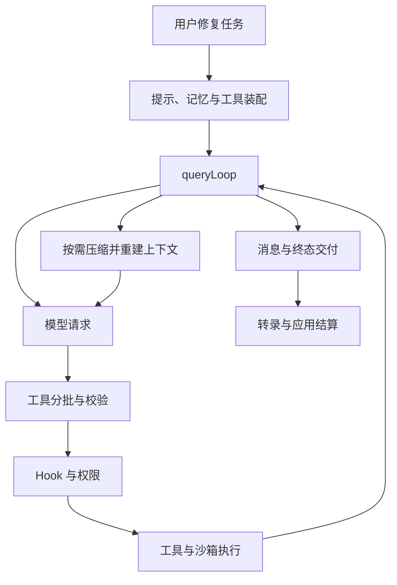

## 用源码主干组织工程理解

从入口快速分支到主循环 State，再到请求构造、工具调度、持久会话与控制扩展，可以把这份还原材料读成一套工程系统。每个模块都围绕状态所有权和边界协作，不需要先记住全部文件。

@ccsrc query-state

@ccsrc tool-partition

主循环负责跨请求推进；工具调度把并发执行与上下文修改次序分开。这个设计连接了效率和一致性：可以尽早反馈并行任务的结果，同时保留可解释的状态变化。

## 三项目的证据基准

| 项目 | 主源码依据 | 如何验证 |
| --- | --- | --- |
| Learn Pi Agent | Pi v1.5.0 固定提交与自己实现的 mox | 从源码摘录到实验运行 |
| Learn Claude Code | 指定 sourcemap 的 2.1.88 固定提交 | sourcesContent 一致性、调用链定位；2.1.296 观察另列 |
| Learn MiniMax Code | 官方公开 0.7.2 固定提交 | 源码阅读、真实函数离线实验与贡献回归 |

Pi 内核、Claude Code 产品实现和 MiniMax 的产品装配不处于同一抽象层。比较时先选一个机制，例如取消、工具配对或压缩，再沿相同问题追入口、状态、失败和恢复。

## 导图怎么帮助继续学习

工程地图提供主题与实现入口，可在网页检索、缩放并打开固定源码链接；`.canvas` 可以放进 Obsidian 编辑，Mermaid 版本可直接在 GitHub 阅读。地图边标注为主题或实现入口，不用概念图伪造函数调用图。

Understand Anything 提供继续细查节点邻域的方法：调用者、被调用者、所属层、输入输出和真实源文件。图只是导航，最终判断必须回到代码；版本改变后，应重核相关节点和边。

## 面试讲述从一个反例开始

可以讲一个具体边界：例如 SDK 类型入口存在 query，却没有实际实现；或者并发输出顺序与上下文应用顺序不同。然后展示固定源码、解释错误直觉、说明怎样验证，以及还有哪些条件没有覆盖。

比起列出“读过 Agent、MCP、Hook”，这样的解释更能展示因果判断与工程能力。若贡献补丁还没合并，也应准确说明准备、提案、PR 与合并的阶段。

## 总装：沿同一次修复串起全部机制

回到 normalizeSlug。用户指令进入入口，项目记忆被发现并筛选，系统提示选出底座，模型请求携带可用工具；模型先读文件，再提出 Edit；执行器校验参数，Hook 和权限处理是否能继续；编辑结果回到模型，测试由 Bash 在相应约束下执行；最终输出交给 UI 或 SDK，会话记录保留可恢复事实。



这是一张机制总览，图里的职责边不代表每个实现都在同一个函数中同步完成。能够回到对应章指出实际 owner，是学完整门课的检验。

## 做一个不依赖模型的工程验收

```bash
npm run lab:source
npm run check
npm run typecheck
npm run build
```

第一条验证还原源码函数的局部契约；check 会核对证据并执行正文声明的离线实验；类型检查约束实验工具；build 生成可阅读页面。它们都通过，能说明课程与这些离线契约一致，不能宣布 Claude Code 在某个真实账号下端到端通过。

## 三个综合故障，练一次因果定位

**故障一：工具已经执行，调用方却没收到完成。** 先分清 tool_result、query terminal 和应用完成；检查生成器是否异常或被提前关闭，再看输出和持久记录。第 1 章实验说明不能把 completed 塞进 finally 解决。

**故障二：任务越跑越贵。** 比较请求前缀、工具列表、累计历史和压缩失败次数。第 2 章的请求结构与第 5 章的断路器，分别覆盖缓存失效和重复恢复两种原因。不要只把 maxTurns 调小来掩盖问题。

**故障三：后台探索改了主任务文件。** 分别检查工具规则、共享目录和隔离方式。独立消息上下文不等于文件系统隔离，worktree 也不等于网络隔离。第 10、11 章讨论的是不同边界。

## 综合作业：写一份能被别人反驳的工程说明

选择上面一个故障，用一页材料完成五件事：写出具体输入与症状；给出固定版本调用链；明确状态 owner 和不变量；构造能暴露错误理解的反例；列出实际验证与未覆盖范围。至少运行一个本课程源码实验，再修改一个测试输入说明为什么结论变化。

完成后试着讲给没有读过这个仓库的人。对方应能根据你的文件和命令重复结果，而不是必须相信你的总结。这份材料既适合作为个人工程笔记，也能成为后续实习面试里有证据的项目讨论。

::: interview 这三门课最大的共同方法是什么？
把模糊问题转成可检查的契约，固定研究版本，沿真实入口追到状态和副作用，用源码、实验和结果互相校验。图表帮助导航，不能替代证据；对未启用、未运行或不同版本的部分，应保留边界。
:::

@observation 13-synthesis
