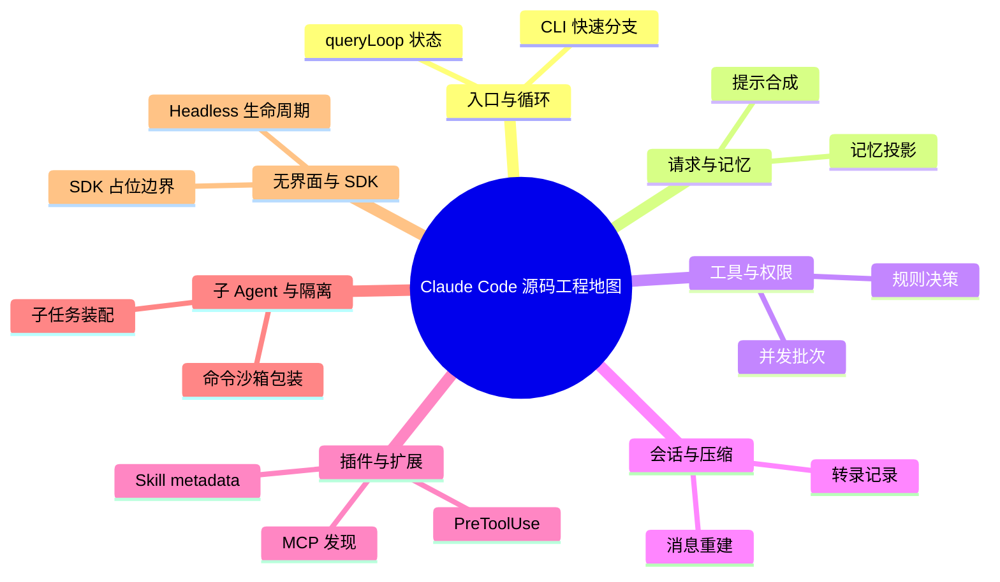

# Claude Code 源码工程地图

版本：2.1.88 · 固定提交：[a8a678c](https://github.com/ChinaSiro/claude-code-sourcemap/tree/a8a678cb6244e6770e1e421767ff0987a1d95549)。

主题分类与实现入口；不是完整调用图。每个实现入口都在构建时核对文件与行号。

## 源码入口

### 入口与循环

- [CLI 快速分支 · restored-src/src/entrypoints/cli.tsx:33–92](https://github.com/ChinaSiro/claude-code-sourcemap/blob/a8a678cb6244e6770e1e421767ff0987a1d95549/restored-src/src/entrypoints/cli.tsx#L33-L92)
- [queryLoop 状态 · restored-src/src/query.ts:241–340](https://github.com/ChinaSiro/claude-code-sourcemap/blob/a8a678cb6244e6770e1e421767ff0987a1d95549/restored-src/src/query.ts#L241-L340)

### 请求与记忆

- [提示合成 · restored-src/src/utils/systemPrompt.ts:41–124](https://github.com/ChinaSiro/claude-code-sourcemap/blob/a8a678cb6244e6770e1e421767ff0987a1d95549/restored-src/src/utils/systemPrompt.ts#L41-L124)
- [记忆投影 · restored-src/src/utils/claudemd.ts:1153–1203](https://github.com/ChinaSiro/claude-code-sourcemap/blob/a8a678cb6244e6770e1e421767ff0987a1d95549/restored-src/src/utils/claudemd.ts#L1153-L1203)

### 工具与权限

- [并发批次 · restored-src/src/services/tools/toolOrchestration.ts:91–127](https://github.com/ChinaSiro/claude-code-sourcemap/blob/a8a678cb6244e6770e1e421767ff0987a1d95549/restored-src/src/services/tools/toolOrchestration.ts#L91-L127)
- [规则决策 · restored-src/src/utils/permissions/permissions.ts:1071–1172](https://github.com/ChinaSiro/claude-code-sourcemap/blob/a8a678cb6244e6770e1e421767ff0987a1d95549/restored-src/src/utils/permissions/permissions.ts#L1071-L1172)

### 会话与压缩

- [转录记录 · restored-src/src/utils/sessionStorage.ts:1408–1450](https://github.com/ChinaSiro/claude-code-sourcemap/blob/a8a678cb6244e6770e1e421767ff0987a1d95549/restored-src/src/utils/sessionStorage.ts#L1408-L1450)
- [消息重建 · restored-src/src/services/compact/compact.ts:330–347](https://github.com/ChinaSiro/claude-code-sourcemap/blob/a8a678cb6244e6770e1e421767ff0987a1d95549/restored-src/src/services/compact/compact.ts#L330-L347)

### 插件与扩展

- [Skill metadata · restored-src/src/skills/loadSkillsDir.ts:185–267](https://github.com/ChinaSiro/claude-code-sourcemap/blob/a8a678cb6244e6770e1e421767ff0987a1d95549/restored-src/src/skills/loadSkillsDir.ts#L185-L267)
- [PreToolUse · restored-src/src/utils/hooks.ts:3394–3445](https://github.com/ChinaSiro/claude-code-sourcemap/blob/a8a678cb6244e6770e1e421767ff0987a1d95549/restored-src/src/utils/hooks.ts#L3394-L3445)
- [MCP 发现 · restored-src/src/services/mcp/client.ts:2226–2283](https://github.com/ChinaSiro/claude-code-sourcemap/blob/a8a678cb6244e6770e1e421767ff0987a1d95549/restored-src/src/services/mcp/client.ts#L2226-L2283)

### 子 Agent 与隔离

- [子任务装配 · restored-src/src/tools/AgentTool/runAgent.ts:248–347](https://github.com/ChinaSiro/claude-code-sourcemap/blob/a8a678cb6244e6770e1e421767ff0987a1d95549/restored-src/src/tools/AgentTool/runAgent.ts#L248-L347)
- [命令沙箱包装 · restored-src/src/utils/sandbox/sandbox-adapter.ts:704–729](https://github.com/ChinaSiro/claude-code-sourcemap/blob/a8a678cb6244e6770e1e421767ff0987a1d95549/restored-src/src/utils/sandbox/sandbox-adapter.ts#L704-L729)

### 无界面与 SDK

- [Headless 生命周期 · restored-src/src/cli/print.ts:455–516](https://github.com/ChinaSiro/claude-code-sourcemap/blob/a8a678cb6244e6770e1e421767ff0987a1d95549/restored-src/src/cli/print.ts#L455-L516)
- [SDK 占位边界 · restored-src/src/entrypoints/agentSdkTypes.ts:120–129](https://github.com/ChinaSiro/claude-code-sourcemap/blob/a8a678cb6244e6770e1e421767ff0987a1d95549/restored-src/src/entrypoints/agentSdkTypes.ts#L120-L129)
